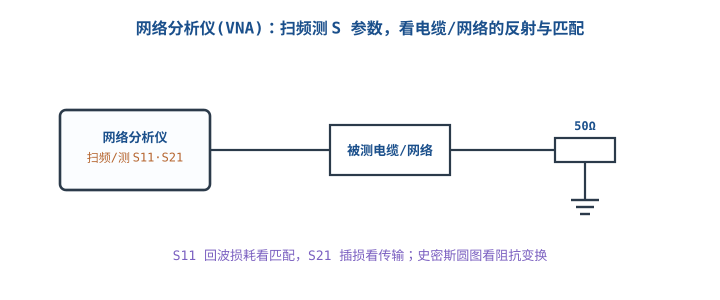

# 逻辑分析仪、频谱仪与网络分析仪

## 1. 三种"分析"仪器各看哪个域

::: motivation 示波器看时间，这三样看得更深
示波器看 2~4 路模拟波形，遇到 I2C/SPI/UART 一堆数字时序，眼睛数不过来；遇到 EMI 谐波、RF 匹配，示波器的时间域也无能为力。**逻辑分析仪（Logic Analyzer, LA）看多通道数字时序并自动解码协议；频谱仪（Spectrum Analyzer）把信号拆到频率域；网络分析仪（VNA）测网络的 S 参数。**三者分别补上"数字多通道""频率""阻抗匹配"三块盲区。
:::

主图概括了三类仪器的位置：LA 飞线夹到数字总线上抓 0/1；频谱仪在频率域看谐波与噪声。

## 2. 工作原理与关键指标

### 逻辑分析仪
- 只判断每个采样点是**高还是低**（阈值比较），不还原模拟幅度；几十上百通道同时抓。
- 关键指标：**采样率**（决定能抓多快的时序）、**存储深度**（一次能抓多久）、**阈值电压**（要匹配被测 IO 电平 3.3V/1.8V）、通道数。
- 配合 sigrok/PulseView 软件自动把 SCL/SDA、CLK/MOSI 解码成地址/数据字节。

### 频谱仪
- 把信号做傅里叶变换，显示**幅度 vs 频率**，看单音、谐波、杂散、EMI 辐射。
- 纵轴单位是 **dBm**（功率对数刻度，$1\text{mW}=0\text{dBm}$），不是电压；$P_{dBm}=10\log_{10}(P/1\text{mW})$。
- 关键指标：频率范围、RBW（分辨率带宽，越小越能分辨近邻谱线）、底噪/灵敏度、DANL。
- 检波器：EMI 认证用**准峰值检波器 QP**（Quasi-Peak，模拟人对干扰的感知加权）；看谐波/杂散用峰值或平均值检波器。

### 网络分析仪 VNA
- 扫频输出已知扫频信号，测入射/反射/传输，得 **S 参数**：S11（输入反射/回波损耗）、S21（正向插损）。
- 关键指标：频率范围、动态范围、端口数；用来调匹配、测电缆损耗与反射点。

## 3. 接线与操作

- **LA**：地夹接被测板 GND，信号夹逐个夹到 SCL/SDA/CLK/MOSI…；阈值设到被测 IO VIH 的中间（如 3.3V 设 1.5V）。
- **频谱仪**：输入口加衰减器/探头，别超输入最大功率；近场探头找 EMI 辐射源。
- **VNA**：先做**校准（calibration）**，把电缆/接头的误差剔除，再测 DUT，否则数值不可信。

## 4. 测量示例（含计算）

::: example 用 LA 抓 I2C 通信失败
现象：MCU 读传感器返回全 0。LA 接 SCL/SDA，阈值 1.5V，采样率 1MHz。
- 解码看到：主机发地址 0x48，SDA 在 ACK 位一直被拉高（从机没拉低应答）。
- 结论：从机没 ACK → 查地址是否对、上拉 4.7kΩ 是否到位、从机供电是否正常。
- 经验：I2C 开漏总线必须有上拉，缺上拉时 SDA 永远高电平，LA 上看不到跳变。
:::

::: example 用 S11 判断电缆反射
VNA 测一段同轴电缆末端开路，S11 在目标频段接近 0dB（几乎全反射）；末端接 50Ω 后 S11 降到 −20dB 以下（回波损耗好，VSWR≈1.22）。
$$\text{回波损耗 } RL=-20\log_{10}|\Gamma|,\quad |\Gamma|=10^{-RL/20}=10^{-20/20}=0.1$$
VSWR=$(1+|\Gamma|)/(1-|\Gamma|)=1.1/0.9\approx1.22$。
:::

## 5. 上手操作清单

- [ ] LA 先设对阈值电压，否则电平判断全错。
- [ ] 采样率至少是被测最快时钟的 5~10 倍，存储深度够覆盖一帧完整通信。
- [ ] VNA 测之前先校准；频谱仪注意输入功率上限。
- [ ] 协议解码先选对协议与通道映射，再看字节。

## 扩展与变种电路

### 扩展1：I2C / SPI 协议解码接线 Protocol Decode Wiring

LA 的真正威力是把时序翻译成协议字节；先接对线、设对阈值，软件自动解码。

::: example 接线与判读
- I2C 只占 2 通道（SCL、SDA）+ 共地；SPI 占 4（CLK、MOSI、MISO、CS）。
- 阈值设到 IO 电平一半；软件里选对应协议、映射通道，自动标出 START/ADDR/ACK/DATA。
- 例：读不到传感器，先看 LA 上有没有 START 条件和 ACK；没有上拉时 SDA 不跳变，是最常见原因。
:::

对比"示波器手数时序"：示波器 4 通道看 I2C 要自己数 bit；LA 几十通道 + 自动解码，直接给字节。

::: pitfall LA 阈值设错导致解码全错
- **现象**：解码出一堆乱码/全 F。
- **原因**：被测是 1.8V IO，LA 阈值却设 1.4V（按 3.3V 经验），高低判错。
- **解决**：阈值设在被测 IO VIH/VIL 中点；1.8V 系统设 ~0.9V。
:::

### 扩展2：网络分析仪测电缆与匹配 VNA S-Parameters

VNA 扫频测 S11/S21，是做 RF 匹配、高速电缆、天线调试的核心工具。

::: example 用 S11 找反射点
- VNA 先校准去除电缆误差，接被测电缆/网络。
- S11(dB) 越负匹配越好；史密斯圆图上看阻抗离 50Ω 多远。
- 例：某连接器在 500MHz 处 S11 突升到 −8dB，说明此处阻抗突变，是反射/不连续点。
:::

对比"万用表通断"：通断只知道连没连；VNA 告诉你在哪个频率、为什么反射。

::: pitfall 不校准就测，数值全错
- **现象**：S11 曲线奇怪，换根线也变。
- **原因**：电缆和接头本身的损耗/反射没被校准剔除。
- **解决**：测前做全端口 SOLT 校准（open/short/load/thru），把参考面移到 DUT 端口。
:::

## 6. 常见坑与故障现象

::: pitfall 常见坑
- **LA 阈值电压不匹配被测 IO**：1.8V/3.3V 混用，高低判错，解码全乱。
- **采样率/存储深度不够**：抓一段通信只看到碎片，定位不到偶发错误。
- **VNA/频谱仪输入超功率**：接大信号直接烧前端，先加衰减器。
- **用示波器硬数 I2C 时序**：慢且易错，该上 LA 自动解码。
:::

## 7. 自测题

逻辑分析仪测 1.8V 的 FPGA IO，阈值应设多少？

设到 1.8V 的一半附近，约 0.9V，让高低电平判在 VIH/VIL 中点。按 3.3V 经验设 1.4V 会把 1.8V 的高电平误判。

I2C 总线 LA 上 SDA 一直是高电平、没有跳变，最可能缺什么？

缺上拉电阻。I2C 是开漏总线，主机/从机只能拉低，靠上拉电阻把电平拉高；没有 4.7kΩ 上拉时 SDA 永远高，看不到通信。

VNA 测得 S11 = −20dB，反射系数 |Γ| 和 VSWR 各是多少？

$|\Gamma|=10^{-20/20}=0.1$；VSWR=$(1+0.1)/(1-0.1)\approx1.22$。−20dB 是较好的匹配（工程常要求 < −15dB）。

## 8. 参考资料

- sigrok/pulseview – [开源信号分析平台](https://sigrok.org/) 与 [GitHub](https://github.com/sigrokproject/pulseview)
- 配合 [I2C](https://learn.sparkfun.com/tutorials/i2c) / SPI 教程理解协议解码对象
