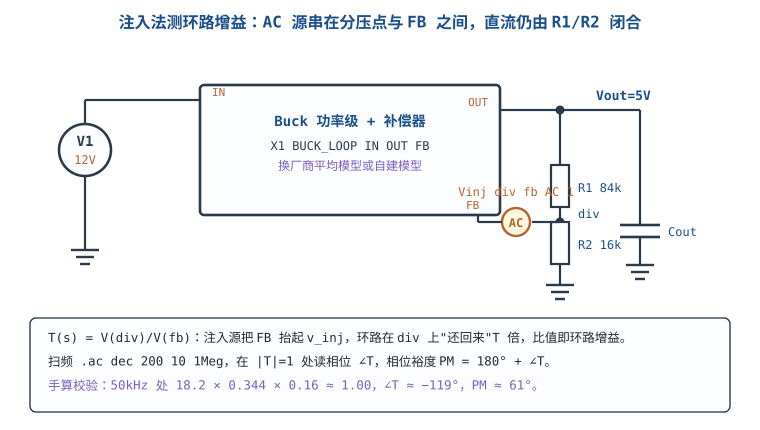

# LTspice 仿真入门

仿真不是"把电路跑一遍看看对不对"。它是一次**用模型做的实验**：你给求解器一个电路方程和一组容差，它给你一组数；这组数对不对，取决于模型有多真、求解器有多准、以及你问的问题是否适合用这种方法回答。这一章把三件事讲透——**模型从哪来、可信到什么程度**；**AC、瞬态、直流三种分析各回答什么问题**；**仿真结果和实测不符时，差异从哪来**。最后用一个 12V 转 5V 的 Buck 环路，把注入源怎么接、`.ac` 怎么设、相位裕度怎么读，从头走一遍。

## 1 设计动机：仿真省的不是时间，是返工

::: motivation 三个"早十分钟就能避免"的事故
**一、分压算错。** 一个 24V 检测分压，纸上算成 1/11，实际焊成 1/12，ADC 读数差 8.3%；仿真里改一个电阻值 10 秒就能看出来，打样回来改板要两周。

**二、环路不稳。** 电流模式 Buck 的补偿电阻按"经验 10k"取，样机在满载时 250kHz 振荡，换补偿网络、改电感、加电容试了三轮，每次打样 3 周。若先用平均模型跑一遍环路，穿越频率和相位裕度在 10 分钟内就有数。

**三、上电即炸。** 上电顺序没核算，3.3V 先于 1.8V 建立，MCU 的 IO 通过内部 ESD 二极管给 1.8V 域反灌，浪涌电流烧了内核 LDO。仿真里加一个上电时序源，能提前看到这条反灌路径。
:::

仿真的成本与收益差着两三个数量级：

| 项目 | 时间 | 直接成本 | 可修改性 |
|---|---|---|---|
| 手算一遍 | 10~60 分钟 | 0 | 随时 |
| 仿真一遍 | 5~30 分钟 | 0（软件免费） | 改参数即重跑 |
| 打样 + 贴片 | 2~4 周 | 数百到数千元 | 改板再来一轮 |
| 批量返修 | 数周 | 每台 200 元起 | 召回、品牌损失 |

**但仿真有一个前提：模型和设置必须配得上你要回答的问题。** 用理想运放仿环路，得到的相位裕度是"理想运放的相位裕度"；用开关模型跑 AC 分析，得到的曲线根本没有物理意义。所以下面先讲模型，再讲分析类型，最后才讲怎么点按钮。

## 2 定义与直观：模型的可信度决定仿真的价值

**仿真（simulation）**是在数值求解器里解电路的基尔霍夫方程：把每个节点的 KCL 和每个回路的 KVL 写成方程组，用 Newton 迭代求解，每一步都带容差。它给出的不是"真值"，而是"**在给定模型下、给定容差内的解**"。

因此仿真的可信度由两个乘数决定：

$$\text{可信度}=\text{模型保真度}\times\text{求解精度}$$

任何一个乘数为零，结果都不可用。模型保真度是你自己的责任（选对模型、填对参数），求解精度是设置的责任（步长、容差、分析类型）。


三类模型的区别，比"用不用厂商模型"这个说法更细：

| 模型类型 | 典型来源 | 包含什么 | 不包含什么 | 可信范围 | 典型偏差 |
|---|---|---|---|---|---|
| **理想模型** | 软件内置（R/L/C、理想开关、理想运放） | 拓扑、量级、一阶时间常数 | 寄生、饱和、损耗、温漂 | 定性判断、量级估算 | 效率、纹波可能差 2 倍以上 |
| **厂商行为模型** | 器件官网的 `.model`（MOSFET、二极管、运放） | 阈值、跨导、结电容、部分封装寄生 | 完整封装 RLC、热耦合、批次分布 | 工作点、损耗量级、开关波形 | 10%~30% |
| **厂商子电路模型** | 官网 `.subckt`（控制器、LDO、基准） | 内部控制环、保护、软启动 | PCB 寄生、外部元件误差 | 环路形状、启动时序 | 5%~20% |
| **自建平均模型** | 自己用受控源搭 | 你写进去的传函 | 开关纹波、死区、采样效应 | 环路设计、稳定性 | 取决于建模水平 |

三条使用纪律：

1. **先问"我要它回答什么"**：要判断"这个补偿网络稳不稳"，平均模型足够；要判断"开关瞬间的振铃有多高"，必须用带封装的开关模型。
2. **模型必须带测试条件**：厂商模型的参数是在特定 $V_{DS}$、$I_D$、温度下拟合的。拿 25 °C 的模型去仿 −40 °C 的启动，误差可能比设计余量还大。
3. **每个仿真都要有"手算基准"**：算不出期望值的仿真，只能证明"软件能跑"，不能证明"电路对"。

## 3 定量关系：求解器、步长与 AC 分析

### 3.1 求解器在解什么

SPICE 用改进节点法（Modified Nodal Analysis，MNA）把电路写成矩阵方程，再用 Newton-Raphson 迭代找解。收敛判据是每个节点的电压和每条支路的电流都满足：

$$\left|\Delta v\right|<\text{RELTOL}\cdot\left|v\right|+\text{VNTOL},\qquad \left|\Delta i\right|<\text{RELTOL}\cdot\left|i\right|+\text{ABSTOL}$$

- $\text{RELTOL}$：相对容差，默认 $10^{-3}$；
- $\text{VNTOL}$：电压绝对容差，默认 $10^{-6}\ \text{V}$；
- $\text{ABSTOL}$：电流绝对容差，默认 $10^{-12}\ \text{A}$；
- $\Delta v$、$\Delta i$：本次迭代与上次迭代的增量。

这个式子解释了两件事。**第一，为什么高阻节点容易报错**：节点电流只有 pA 级时，$\text{ABSTOL}=10^{-12}\ \text{A}$ 已经和信号同量级，迭代判据失去意义。**第二，为什么"收敛失败"不等于"电路错"**：它可能只是容差与电路量级不匹配——一个 1MΩ 的偏置网络，用默认容差就是难收敛的。

### 3.2 步长与精度

瞬态分析的精度由最大步长控制。经验判据是：最大步长不超过开关周期的 1/100。

$$t_{step}\le\frac{T_{sw}}{100}=\frac{1}{100f_{sw}}$$

$f_{sw}=500\ \text{kHz}$ 时 $T_{sw}=2\ \mu\text{s}$，最大步长取 $20\ \text{ns}$。仿真 10ms 的数据量是：

$$N=\frac{10\times10^{-3}}{20\times10^{-9}}=5.0\times10^{5}\ \text{点}$$

50 万点对现在的机器不算多，但如果同时保存 20 个节点、跑 20 组参数，文件会到 GB 级。所以 `.save` 只存关心的节点、`.tran` 的时间只取关心的一段，是常规操作。

### 3.3 AC 分析的本质：在工作点附近线性化

AC 分析先算直流工作点，再在工作点处把非线性器件线性化，然后对每个频点解一次复数方程。所以它**只对"小信号、线性化后仍成立"的电路有效**：开关电源要先把开关行为平均掉（用平均模型），运放要工作在线性区。

扫频的点数用 `.ac dec N f1 f2` 指定，每十倍频 N 点，相邻点的频率比是：

$$\frac{f_{n+1}}{f_n}=10^{1/N}$$

$N=100$ 时比值 $10^{0.01}=1.0233$，即每点跳 2.33%；$N=200$ 时比值 $1.0116$，每点跳 1.16%。这个比值直接决定读相位裕度的精度：若穿越点附近相位斜率是 $-90^{\circ}/$十倍频，$N=100$ 时的频率量化带来的相位误差约为

$$90\times\log_{10}(1.0233)=90\times0.010=0.9^{\circ}$$

$N=200$ 时约 $0.45^{\circ}$。**做环路仿真至少用 `dec 200`**，否则读数的最后一位是猜的。

扫频范围也要算：从 10Hz 到 1MHz、`dec 200`，总点数是

$$N_{total}=200\times\log_{10}\left(\frac{10^{6}}{10}\right)=200\times5=1000\ \text{点}$$

1000 点、几秒钟，这是环路仿真的标准配置。

### 3.4 环路增益与注入法

环路增益 $T(s)$ 是"绕反馈环一圈"的传递函数。仿真的做法是在环路上串一个 AC 源，把环"断开又不断开"：

- 直流上，注入源是 0V 的理想导线，反馈照常闭合，工作点正确；
- 交流上，注入源给一个已知的激励，环路对它的响应就是 $T(s)$。

把注入源接在分压点 `div` 与反馈脚 `fb` 之间，可以严格推出：

$$T(s)=\frac{V(div)}{V(fb)}$$

原因是：注入源把 `fb` 抬起 $v_{inj}$，环路在 `div` 上"还回来" $T$ 倍，串联关系解出 $V(div)/V(fb)=T$。这个式子的好处是**不需要在图上做任何符号修正**：`V(div)/V(fb)` 的相位在直流处是 $0^{\circ}$，随频率下降到 $-180^{\circ}$，与本章采用的相位裕度定义直接对应：

$$PM=180^{\circ}+\angle T(f_c),\qquad GM=-20\lg\left|T(f_{180})\right|$$

其中 $f_c$ 是 $\left|T\right|=1$ 的频率（穿越频率），$f_{180}$ 是 $\angle T=-180^{\circ}$ 的频率，$PM$ 是相位裕度（$^{\circ}$），$GM$ 是增益裕度（dB）。这套定义与[稳定性：伯德图、相位裕度与补偿](../opamp/stability-bode.md)一致，环路补偿的设计方法见[开关电源的控制环路与补偿](../power/smps-control-loop.md)。

注入法有适用条件：前向增益和反馈增益都要远大于 1，注入点两侧的阻抗要匹配。电源环路在穿越频率附近通常满足，但在极低频（增益极高）或极高频（增益极低）时读数会有偏差，**所以只信穿越点附近那一段**。

### 3.5 收敛选项：不是"调参玄学"

`.options` 里的每一项都对应 §3.1 判据里的一个量。改动前先想清楚"我在放宽哪个判据、代价是什么"：

| 选项 | 默认值 | 作用 | 什么时候动 |
|---|---|---|---|
| `reltol` | $10^{-3}$ | 相对容差 | 收敛失败先放宽到 $10^{-2}$，收敛后再收紧到 $10^{-4}$ 复核 |
| `abstol` | $10^{-12}$ A | 电流绝对容差 | 大电流（>10A）可放宽到 $10^{-9}$ |
| `vntol` | $10^{-6}$ V | 电压绝对容差 | 高压（>100V）可放宽到 $10^{-3}$ |
| `gmin` | $10^{-12}$ S | 每个节点对地的并联电导 | 有浮空节点/理想变压器时加到 $10^{-9}\sim10^{-12}$ |
| `itl1` | 100 | 直流工作点迭代上限 | 工作点算不出来时加到 500 |
| `itl4` | 10 | 瞬态每步迭代上限 | 报 "time step too small" 时加到 50 |
| `cshunt` | 0 | 全局并联电容 | 理想开关/浮空节点导致矩阵奇异时加 $10^{-15}\sim10^{-12}$ F |
| `method` | trap | 积分方法 | 开关波形出现非物理振铃时改 `gear` |
| `plotwinsize` | 300 | 波形压缩 | 做 `.meas`/FFT 前设 0，否则读数有压缩误差 |
| `numdgt` | 6 | 输出有效位数 | 需要高精度读数时设 7~10 |

**纪律：每改一次 `.options`，都要记录改了什么、结果变了多少。** 否则"调通了"和"调错了"无法区分——这正是[硬件调试方法论与上电检查](debug-methodology.md)里"一次只改一个变量"的同一原则。

## 4 典型计算：Buck 环路的 AC 仿真全流程

### 4.1 目标与手算基准

沿用[开关电源的控制环路与补偿](../power/smps-control-loop.md)的算例：12V 转 5V/3A、$f_{sw}=500\ \text{kHz}$、$L=6.8\ \mu\text{H}$、$C_{out}=2\times22\ \mu\text{F}$（5V 偏置下有效 30.8µF）、峰值电流模式、$f_c=50\ \text{kHz}$。

先把期望值算出来，作为仿真的对照基准。功率级主极点：

$$f_p=\frac{1}{2\pi RC}=\frac{1}{2\pi\times1.667\times30.8\times10^{-6}}=3.10\ \text{kHz}$$

功率级直流增益 $G_{dc}=R/R_i=1.667/0.3=5.56$（14.9dB），反馈分压比 $H=0.8/5=0.16$。在 $f_c=50\ \text{kHz}$ 处：

$$\left|G_{vd}(f_c)\right|=\frac{5.56}{\sqrt{1+(50/3.10)^{2}}}=\frac{5.56}{16.16}=0.344$$

补偿器在 $f_c$ 处的中频增益是 $18.2$，于是

$$\left|T(f_c)\right|=18.2\times0.344\times0.16=1.002\approx1$$

穿越成立。相位逐项：补偿器积分 $-90^{\circ}$、零点 $+86.5^{\circ}$、高频极点 $-11.0^{\circ}$、功率级极点 $-86.5^{\circ}$、采样双极点 $-18.1^{\circ}$，合计 $-119.1^{\circ}$，所以

$$PM=180^{\circ}-119.1^{\circ}=60.9^{\circ}$$

**仿真的任务就是把这组数复现出来。** 如果仿真给出 $f_c=50\ \text{kHz}$、$PM\approx61^{\circ}$，说明模型和设置有资格回答"这个环路稳不稳"；如果差得远，先查模型和注入点，不要先改补偿。

### 4.2 最小可跑示例：RC 低通的 `.ac` 与 `.meas`

先用一个能手算的电路把语法练熟，再上 Buck。RC 低通（R=1kΩ、C=1µF）：

```
* RC 低通：最小可跑的 AC 示例
V1 in 0 AC 1
R1 in out 1k
C1 out 0 1u
.ac dec 100 1 100k
.meas AC fc WHEN mag(V(out))=0.7071
```

- `V1 in 0 AC 1`：AC 幅度设为 1，这样输出幅值直接等于增益；
- `.ac dec 100 1 100k`：每十倍频 100 点，1Hz 到 100kHz；
- `.meas AC fc WHEN mag(V(out))=0.7071`：找幅值等于 $1/\sqrt{2}$ 的频率，写进 SPICE Error Log。

期望值：$f_c=1/(2\pi RC)=1/(2\pi\times10^{3}\times10^{-6})=159.2\ \text{Hz}$。仿真读数应落在 155~163Hz（`dec 100` 的频率量化）。**这一步验证的是"你的 `.meas` 语法和读数路径没问题"**，不是电路设计。

### 4.3 Buck 环路：注入源与网表

环路仿真的关键是注入源的位置。它必须满足两个条件：直流上短路（工作点正确）、交流上串在环里（能测到 $T$）。



顶层网表结构（功率级与补偿器用子电路表示，可换成厂商模型或自建平均模型）：

```
* Buck 环路增益 AC 分析（注入法）
V1 in 0 12
X1 in out fb 0 BUCK_LOOP
R1 out div 84k
R2 div 0 16k
Vinj div fb AC 1
.ac dec 200 10 1Meg
.meas AC fc WHEN mag(V(div)/V(fb))=1
.options plotwinsize=0 numdgt=7
```

逐行说明：

- `X1 in out fb 0 BUCK_LOOP`：子电路调用，节点顺序为 输入、输出、反馈输入、地。**子电路内部必须包含完整的功率级与补偿器**，否则测到的不是环路增益。
- `R1/R2`：反馈分压，$H=16/(84+16)=0.16$，与手算一致。分压比必须和设计值一致，否则 $f_c$ 会整体平移。
- `Vinj div fb AC 1`：注入源。**`AC 1` 不能漏**——漏了就是一条 0V 导线，`V(div)/V(fb)` 恒等于 1，曲线是一条 0dB 平线。
- `.ac dec 200 10 1Meg`：10Hz 到 1MHz、每十倍频 200 点、共 1000 点。
- `.meas AC fc WHEN mag(V(div)/V(fb))=1`：自动找穿越频率。**不同 LTspice 版本对 `.meas` 表达式的支持略有差异，跑完先看 SPICE Error Log 有没有输出 `fc`；没有输出就用光标读数，两条路的结果应一致。**
- `.options plotwinsize=0`：关掉波形压缩，否则 `.meas` 读数会被压缩算法影响；`numdgt=7` 让 Error Log 输出更多有效位。

### 4.4 读穿越频率与相位裕度

三种读法，从快到准：

1. **光标（最可靠）**：波形窗口里把表达式设为 `V(div)/V(fb)`，纵轴切到 dB，把光标拖到幅值 0dB 处。LTspice 的光标读数会同时给出该点的频率、幅值和相位——**相位加 180° 就是 $PM$**。本例应读到约 $f=50\ \text{kHz}$、相位 $-119^{\circ}$、$PM\approx61^{\circ}$。
2. **`.meas`（可自动化）**：`.meas AC fc WHEN mag(V(div)/V(fb))=1` 给出 $f_c$；增益裕度用 `.meas AC gmax MAX mag(V(div)/V(fb))` 核对低频增益。相位裕度建议仍用光标确认一次，因为不同版本对复数表达式的 `phase` 支持不一致。
3. **导出 CSV 后算（最稳）**：`File → Export` 导出频率、幅值、相位三列，在表格里插值找 0dB 点，再线性插值相位。适合写报告和复核别人的结果。

读的时候注意三件事：

- **在 0dB 处读相位，不是在相位曲线最低点读**；
- **确认相位是从 $0^{\circ}$ 开始下降的**（`V(div)/V(fb)` 在直流处相位应为 $0^{\circ}$）；如果从 $-180^{\circ}$ 开始，说明注入方向接反了；
- **增益裕度在 $\angle T=-180^{\circ}$ 处读幅值**，本例约 155kHz 处 $-9.8\ \text{dB}$，即 $GM=9.8\ \text{dB}$。

### 4.5 手算校验：把仿真的每一段都对上

仿真跑出曲线后，逐项核对，而不是只看最后那个 61°：

| 检查项 | 手算 | 仿真预期 | 偏差超 10% 时先查 |
|---|---|---|---|
| 低频增益 | $18.2\times5.56\times0.16=16.2$（24.2dB） | 约 24dB | 分压比、补偿器 $G_m$、$R_c$ |
| 主极点 | 3.10kHz | 3.0~3.2kHz | 输出电容的有效容值（直流偏置降额） |
| 穿越频率 | 50kHz | 45~55kHz | 补偿器零点/极点位置、采样双极点 |
| 相位裕度 | $60.9^{\circ}$ | $55\sim65^{\circ}$ | 高频极点、采样效应、ESR 零点 |
| 增益裕度 | 9.8dB | $8\sim12$dB | 开关频率附近的极点与延迟 |

**低频增益的算式**：$18.2$（补偿器中频增益）$\times5.56$（功率级 $G_{dc}$）$\times0.16$（分压比）$=16.2$，即 $20\lg16.2=24.2\ \text{dB}$。这个数在 100Hz 附近应该能看到平台；如果仿真只有 14dB，多半是分压比用错了（比如把 $H$ 当成了 $1/H$）。

**为什么要求"偏差 <10%"**：器件容差、模型误差、数值误差叠加起来，10% 是"模型可信"的合理门槛。超过 10% 说明有一项没对上，此时改补偿参数等于在错误的基线上调参。

### 4.6 瞬态：启动、软启动与过冲

AC 分析回答"稳不稳"，瞬态回答"上电那一下会不会出事"。同一块板，`.tran` 的设置：

```
.tran 0 10m 0 20n
.options plotwinsize=0
.meas TRAN vmax MAX V(out)
.meas TRAN t_settle WHEN V(out)=4.95 FALL=1
```

- `0 10m 0 20n`：从 0 仿真到 10ms，最大步长 20ns（500kHz 的 1/100）；
- `vmax`：输出最大电压，用来核对过冲。若软启动是 5ms 线性上升，过冲应小于 5%（5.25V）；
- `t_settle`：输出首次下降到 4.95V 的时刻，用来核对建立时间。

数据量 $10\ \text{ms}/20\ \text{ns}=5\times10^{5}$ 点。启动过程要看的是三个数：**过冲峰值、建立时间、输入浪涌电流峰值**。浪涌电流直接决定输入电容的 ESR 压降（见[故障排查案例库](troubleshooting-cases.md)的低温失效案例），仿真里不测，实测时就要靠猜。

## 5 工程含义：什么时候信仿真、什么时候别信

### 5.1 该仿真与不该仿真的问题

| 问题 | 适合的分析 | 为什么 |
|---|---|---|
| 这个分压/增益对不对 | `.op` + 手算 | 直流，理想模型就够 |
| 环路稳不稳、$PM$ 多少 | `.ac` + 平均模型 | 小信号线性化，正是 AC 的适用域 |
| 上电过冲、软启动 | `.tran` + 平均或开关模型 | 大信号，必须看时域 |
| 开关瞬间的振铃/EMI | `.tran` + 带封装的开关模型 | 需要寄生参数，理想模型无意义 |
| 效率 | `.tran` + 完整损耗模型 | 对模型极敏感，仿真值只能作参考 |
| 热 | 需专门的热仿真工具 | 电路仿真器不建热网络 |

**一句话判据**：AC 回答线性问题，瞬态回答大信号问题，直流回答工作点问题。问错类型，得到的曲线再漂亮也没有意义。

### 5.2 模型来源与可信度：厂商模型不是"真值"

厂商模型是**拟合**出来的，不是器件本身。三个常见陷阱：

1. **拟合条件不对**：MOSFET 的 $R_{DS(on)}$ 模型常在 $V_{GS}=10\ \text{V}$ 下拟合，你的电路用 4.5V 驱动，误差可能 30% 以上。
2. **温度没建模**：多数行为模型是 25 °C 的。低温启动、高温降额必须用带温度参数的模型或自己加温度系数。
3. **封装寄生缺失**：模型可能只到芯片引脚，不含键合线、封装引线、PCB 过孔。100nH 量级的回路电感在 10MHz 以上就是几欧姆。

**因此仿真的正确用法是"比较"而不是"预测"**：比较方案 A 与方案 B 的相对优劣（同一个模型，误差同向抵消），比预测"效率一定是 91.2%"可靠得多。

### 5.3 仿真与实测不符的四个来源

| 来源 | 典型量级 | 表现 | 怎么查 |
|---|---|---|---|
| **寄生参数** | 走线 0.2~0.5nH/mm、过孔 0.5~0.8nH/个 | 高频段幅频/相频偏离、振铃频率对不上 | 把估算的寄生加进网表重跑，看偏差是否缩小 |
| **模型误差** | 10%~30% | 工作点、损耗、开关波形整体偏移 | 换一个厂商模型对比；用实测工作点校准 |
| **PCB 布局** | 耦合电容 pF 级、地弹百 mV 级 | 仿真干净、实测有尖峰 | 用近场探头/电流探头找耦合路径 |
| **探头与测量** | 10pF 探头在 50kHz 是 318kΩ | "一测就变"、相位读数偏移 | 换有源探头/缩短地线，或先算负载效应 |

举一个探头影响环路测量的具体例子：补偿器输出（COMP 脚）是高阻节点，$R_c=90.9\ \text{k}\Omega$。10X 探头 10pF 在 50kHz 的容抗是

$$X_C=\frac{1}{2\pi fC}=\frac{1}{2\pi\times50\times10^{3}\times10\times10^{-12}}=318\ \text{k}\Omega$$

它与 $90.9\ \text{k}\Omega$ 并联后是

$$90.9\ \text{k}\Omega\parallel318\ \text{k}\Omega=\frac{90.9\times318}{90.9+318}=70.7\ \text{k}\Omega$$

等效电阻降到原来的 77.8%，补偿器零点频率因此上移约 28%（$1/0.778=1.29$）。**你在 COMP 脚上量到的零点位置，可能根本不在设计值上。**

另一个例子是输出电容的直流偏置降额：标称 $2\times22\ \mu\text{F}$ 在 5V 偏置下只有 30.8µF。若仿真按 44µF 算，主极点从 3.10kHz 变成

$$f_p'=\frac{1}{2\pi\times1.667\times44\times10^{-6}}=2.17\ \text{kHz}$$

穿越频率与相位裕度都会跟着变。**仿真的第一件事是填"有效值"，不是"标称值"。**

### 5.4 收敛问题：先诊断，再调参

收敛失败的提示通常有三类，对应不同的处理：

| 提示 | 含义 | 先做什么 | 再做什么 |
|---|---|---|---|
| "Singular matrix" | 矩阵奇异，某节点没有直流通路 | 查浮空节点、理想变压器、悬空电容 | 加 `gmin` 或大电阻到地 |
| "Time step too small" | 瞬态步长被压到极限 | 查理想开关、突变源、无穷大斜率 | 加 `cshunt`、放宽 `reltol`、改 `gear` |
| "Iteration limit reached" | 迭代次数不够 | 查工作点是否合理 | 提高 `itl1`/`itl4` |

处理顺序永远是：**先确认电路本身没有病（浮空、短路、无穷大电流），再动数值选项。** 把 `reltol` 放宽到 $10^{-2}$ 能让任何电路"跑通"，但结果可能已经错了 1%。正确的做法是"放宽跑通 → 找到问题 → 收紧复核"。

### 5.5 仿真记录该写什么

一份能被别人复现的仿真记录至少包含：软件版本、模型文件名与版本、关键参数（含有效值而不是标称值）、分析类型与设置（`.ac dec` 点数、`.tran` 步长）、`.options` 改动、以及手算基准值。缺了任何一项，"仿真说可以"就只是一句无法复核的话。

仿真能提前挡掉的是"算错、接错、参数选错"这三类问题；挡不掉的是"布局、寄生、器件批次"这三类。所以仿真之后仍要按[硬件调试方法论与上电检查](debug-methodology.md)做分级上电，按[故障排查案例库](troubleshooting-cases.md)的方法做失效复盘，焊接与装配的问题则回到[焊接：直插、贴片、拆焊与飞线](soldering.md)。

## 6 常见坑

::: pitfall 把理想模型的结果当实测
- **现象**：仿真效率 96%、纹波 5mV，实测效率 88%、纹波 40mV，怀疑"板子做坏了"。
- **原因**：理想模型没有导通损耗、开关损耗、ESR/ESL，也没有封装寄生；效率与纹波恰恰由这些决定。
- **解决**：效率/纹波类问题必须用带损耗与寄生的模型；把仿真当"相对比较"而不是"绝对预测"，并用实测值反标定模型。
:::

::: pitfall 对开关电路直接跑 AC 分析
- **现象**：`.ac` 结果是一条平线或剧烈跳变，怎么看都不像环路。
- **原因**：AC 分析在工作点线性化，开关管在开通/关断两个状态之间切换，没有单一工作点。
- **解决**：先用平均模型（受控源等效功率级）再跑 `.ac`；要看开关细节用 `.tran`。厂商的"平均模型"就是为此准备的。
:::

::: pitfall 注入源忘了 AC 幅度或接错位置
- **现象**：`V(div)/V(fb)` 恒等于 1（0dB 平线），或相位从 $-180^{\circ}$ 开始。
- **原因**：`AC 1` 漏写；或注入源接在环外/方向接反。
- **解决**：确认 `Vinj div fb AC 1` 串在分压点与 FB 之间；确认直流处相位从 $0^{\circ}$ 开始；先用 RC 示例验证读数路径。
:::

::: pitfall 步长太大，把振铃当噪声
- **现象**：开关波形出现台阶、过冲被削平，换一台机器结果又不一样。
- **原因**：最大步长大于边沿时间的 1/10，求解器"跨过"了细节。
- **解决**：最大步长取开关周期的 1/100 或边沿时间的 1/10（取更小者）；用 `.options plotwinsize=0` 关掉波形压缩。
:::

::: pitfall 收敛失败就删元件
- **现象**：删掉一个电容"就能跑了"，但结果和理论对不上。
- **原因**：删掉的多半是导致奇异的元件（浮空节点、理想开关），问题被掩盖而不是被解决。
- **解决**：先查浮空节点/理想元件，用 `gmin`、`cshunt`、大电阻到地提供直流通路；每次改动都记录。
:::

::: pitfall 用标称容值算有效带宽
- **现象**：仿真 $f_c=50\ \text{kHz}$，实测只有 35kHz；主极点位置怎么都对不上。
- **原因**：陶瓷电容在直流偏置下降额，$2\times22\ \mu\text{F}$ 在 5V 下只有 30.8µF；感值也有饱和降额。
- **解决**：网表里填"工作点下的有效值"，并用厂商的容值-偏置曲线核对；关键电容实测后再回填。
:::

## 7 自测题

<details><summary>为什么 AC 分析必须先有直流工作点？开关电源直接跑 .ac 会怎样？</summary>

AC 分析在工作点处把非线性器件线性化，没有工作点就没有线性化基准。开关电源的开关管在两个状态间切换，没有单一工作点，直接跑 `.ac` 得到的曲线没有物理意义。

正确做法：用平均模型（受控源等效功率级）跑 `.ac` 看环路；开关细节用 `.tran` 看。`.op` 先确认工作点合理，是跑 `.ac` 之前的标准动作。

</details>

<details><summary>500kHz 的 Buck 做瞬态仿真，最大步长取多少？仿真 10ms 有多少个数据点？</summary>

最大步长取开关周期的 1/100：

$$t_{step}=\frac{1}{100\times500\times10^{3}}=20\ \text{ns}$$

10ms 的数据量：

$$N=\frac{10\times10^{-3}}{20\times10^{-9}}=5.0\times10^{5}\ \text{点}$$

步长再大就会跨过边沿细节，振铃和过冲会被削平。

</details>

<details><summary>注入法里为什么 T(s)=V(div)/V(fb)，而不是 V(fb)/V(inj)？</summary>

把注入源接在分压点 `div` 与反馈脚 `fb` 之间，`fb` 被抬起 $v_{inj}$，环路把响应"还"到 `div` 上：

$$V(div)=T\cdot V(fb),\qquad V(fb)=V(div)+v_{inj}$$

联立解出 $V(div)/V(fb)=T$。这个形式不需要符号修正：直流处相位为 $0^{\circ}$，随频率下降到 $-180^{\circ}$，与 $PM=180^{\circ}+\angle T(f_c)$ 直接对应。

</details>

<details><summary>`.ac dec 100` 和 `dec 200` 在读相位裕度上差多少？为什么推荐 200？</summary>

每点频率比 $10^{1/N}$：`dec 100` 是 1.0233（跳 2.33%），`dec 200` 是 1.0116（跳 1.16%）。

按穿越点附近 $-90^{\circ}/$十倍频的相位斜率估，频率量化带来的相位误差分别是 $90\times\log_{10}(1.0233)=0.9^{\circ}$ 与 $0.45^{\circ}$。$PM$ 的设计余量常只有几度，0.9° 的读数误差已经不可忽略，所以环路仿真至少 `dec 200`。

</details>

<details><summary>手算 12V→5V/3A/500kHz 的 Buck：$f_p$、$f_c$ 处的 $|T|$ 和 $PM$ 是多少？仿真差多少算不正常？</summary>

$$f_p=\frac{1}{2\pi\times1.667\times30.8\times10^{-6}}=3.10\ \text{kHz}$$

$$\left|G_{vd}(f_c)\right|=\frac{5.56}{\sqrt{1+(50/3.10)^2}}=0.344$$

$$\left|T(f_c)\right|=18.2\times0.344\times0.16=1.002$$

相位合计 $-119.1^{\circ}$，$PM=60.9^{\circ}$，$GM\approx9.8\ \text{dB}$。

仿真偏差超过 10% 就不正常，先查分压比、电容有效值、补偿器零极点，别先改补偿参数。

</details>

<details><summary>仿真相位裕度 61°，实测只有 40°，最可能的原因有哪些？按什么顺序查？</summary>

按"从便宜到贵"的顺序：① 探头负载（10pF 在 50kHz 是 318kΩ，并在 90.9kΩ 的 COMP 节点上把零点推高约 28%）；② 输出电容有效值（直流偏置降额让 $f_p$ 上移）；③ 模型误差（厂商模型在非拟合条件下偏差 10~30%）；④ PCB 寄生与布局耦合（仿真没建）。

先用有源探头/短地线复测一次，再核对电容的有效容值，最后才怀疑模型。

</details>

## 8 参考资料

- **Analog Devices, *LTspice 官方 Help***：*Dot Commands* 一节的 `.ac`、`.tran`、`.meas`、`.options` 语法，*Circuit Elements* 一节的受控源与子电路，*Waveform Viewer* 一节的光标与相位读数；本章 §3.5、§4.3、§4.4 的命令与设置以该文档为准。
- **L. W. Nagel, *SPICE2: A Computer Program to Simulate Semiconductor Circuits*（UC Berkeley ERL Memo M520, 1975）**：Newton 迭代、`RELTOL`/`ABSTOL`/`VNTOL` 容差、`GMIN` 与收敛判据的原始定义；本章 §3.1、§5.4 的判据口径来自该文。
- **R. D. Middlebrook, *Measurement of Loop Gain in Feedback Systems*（Int. J. Electronics, 1975）**：电压注入法测环路增益、注入点选择与误差条件；本章 §3.4 的注入法与适用条件是该方法在 SPICE 里的实现。
- **Robert W. Erickson & Dragan Maksimović, *Fundamentals of Power Electronics*（3rd ed.）**：*Converter Transfer Functions* 与 *Controller Design* 两章给功率级传函、补偿器零极点与穿越频率的设计流程；本章 §4.1 的手算基准与该书口径一致。
- **TI SLVA630A *Loop Response Considerations in Peak Current Mode Buck Converter Design***：峰值电流模式的功率级简化、采样双极点与 Type II 取值；本章 §4.1、§4.5 的 $f_c=50\ \text{kHz}$ 算例与[开关电源的控制环路与补偿](../power/smps-control-loop.md)共用同一组参数。
- **Analog Devices, MT-101 *Decoupling Techniques***：去耦回路、寄生电感与测量带宽；本章 §5.3 的"仿真里没建模的那部分"按该文的回路电感口径估算。
