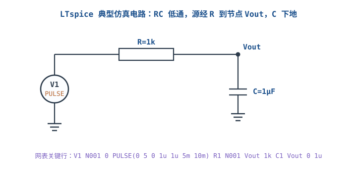
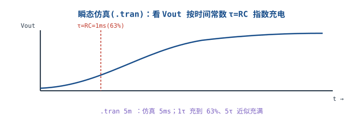
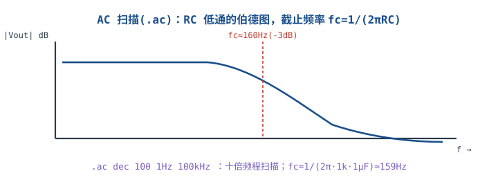

# LTspice 仿真入门

## 1. 为什么先仿真再打板

::: motivation 仿真省掉打样的钱和时间
一个 RC 时间常数、一个运放增益，画板子前先在 LTspice（免费、ADI 出品）里跑一遍，几分钟就能看到波形对不对、幅值多少。**把"纸上算不对"的问题在仿真阶段解决**，比打样回来再改板便宜得多。仿真不能代替实测，但能挡掉大部分低级错误。
:::



## 2. 网表与元件

LTspice 可画图也可写网表（netlist）。上面电路的关键网表行：

```
V1 N001 0 PULSE(0 5 0 1u 1u 5m 10m)
R1 N001 Vout 1k
C1 Vout 0 1u
.tran 5m
```

- `V1`：脉冲源（PULSE），节点 N001 与地之间。
- `R1`/`C1`：节点间元件，后接阻值/容值。
- 节点 `0` 固定代表地。

## 3. 两类最常用仿真

### 瞬态仿真 .tran
看信号随时间怎么变。上面 RC 低通入阶跃，Vout 按时间常数指数充电。



$$\tau=R\times C=1\text{k}\Omega\times1\mu\text{F}=1\text{ ms},\quad f_c=\frac{1}{2\pi RC}\approx159\text{ Hz}$$

1 个 τ 充到约 63%，5 个 τ（5ms）近似充满——这就是 `.tran 5m` 设 5ms 的原因。

### AC 扫描 .ac
看频率响应（伯德图）。`.ac dec 100 1Hz 100kHz` 表示十倍频程、每频段 100 点、从 1Hz 扫到 100kHz。



### 常用指令补充
- **`.step` 扫参**：`.step param R list 1k 10k 100k` 让一个参数取多个值，一次画出多条曲线，看参数影响。
- **`.measure` 读数**：`.tran` 后写 `.measure t_when WHEN Vout=0.63`，自动输出 63% 时刻，直接读时间常数，不用肉眼量。
- **E/F/G/H 受控源**：电压控制电压源(E)、电流控制电流源(F)、电压控制电流源(G)、电流控制电压源(H)，用来建受控模型（如压控电阻、运放开环行为）。

## 4. 仿真示例（含计算）

::: example 验证 RC 低通截止频率
- 设计要求：滤除 1kHz 以上噪声，保留直流到 100Hz。
- 取 R=1k、C=1µF，$f_c=1/(2\pi RC)\approx159\text{Hz}$。
- .ac 扫描读 −3dB 点 ≈159Hz，与计算吻合；1kHz 处衰减约 −16dB。
- 仿真确认后再画板，省掉打样验证周期。
:::

## 5. 上手操作清单

- [ ] 先画/写网表，确认元件节点连对。
- [ ] 选对仿真类型：看时间用 .tran，看频率用 .ac，看直流工作点用 .op。
- [ ] 波形探针点在节点上（如 Vout），别悬空。
- [ ] 仿真结果和手算对照，差太多先查网表连接。

## 扩展与变种电路

### 扩展1：瞬态仿真与时间常数 Transient Analysis

瞬态是最常用的仿真，用来验证充放电、阶跃响应、延时。


::: example 设置与判读
- `.tran <停止时间>`：仿真多长；想看 5τ 充满就设 5ms。
- 探针看 Vout，量 63% 点对应的时间应等于 RC。
- 例：R=1k、C=1µF → τ=1ms；若仿真 63% 点在 1ms 附近，电路连对了。
- 对比手算：仿真值与 $V(t)=V_{in}(1-e^{-t/RC})$ 对照，一致即正确。
:::

对比"只算不仿真"：手算给公式，仿真给完整波形和极端情况（压摆、饱和）。

::: pitfall 仿真时间设太短看不到稳态
- **现象**：波形还在上升就停了，读不到终值。
- **原因**：.tran 时间 < 5τ。
- **解决**：停止时间设到至少 5τ，让波形进入稳态再读。
:::

### 扩展2：AC 扫描与伯德图 AC Analysis

AC 扫描把电路当线性系统，画出增益/相位随频率的曲线，看带宽和稳定性。


::: example 设置与判读
- `.ac dec <每频段点数> <起始频率> <结束频率>`。
- 读幅频曲线 −3dB 点 = 截止频率；看高频滚降斜率（RC 低通 −20dB/十倍频）。
- 例：fc≈159Hz，1kHz（约 6 倍频）处衰减约 −16dB，与一阶低通理论一致。
- 运放电路还能加 .ac 看环路增益，判断稳定性。
:::

对比瞬态：瞬态看一个信号的时间细节；AC 一眼看到整个频率范围的带宽与滚降。

::: pitfall 非线性电路直接 AC 扫描
- **现象**：含开关/饱和的电路，.ac 结果离谱。
- **原因**：AC 是小信号线性分析，在直流工作点附近线性化。
- **解决**：先 .op 确认工作点合理，再 .ac；大信号/开关行为用 .tran 看。
:::

## 6. 常见坑与故障现象

::: pitfall 常见坑
- **节点连错（地/接反）**：仿真出荒谬结果。先查网表节点连接。
- **忘了 .op 直接 .ac**：工作点不对导致 AC 结果错。先看直流工作点。
- **仿真时间/频率范围设错**：看不到关心的区间。按 τ 和 fc 设范围。
- **盲信仿真不实测**：理想模型忽略寄生，实测有差异。仿真挡低级错误，关键参数仍要实测。
:::

## 7. 自测题

<details><summary>R=1kΩ、C=1µF，RC 低通的截止频率 fc 和时间常数 τ 各是多少？</summary>
$\tau=RC=1\text{ms}$；$f_c=1/(2\pi RC)\approx159\text{Hz}$。.tran 看到 1τ=1ms 充到 63%，.ac 看到 159Hz 处 −3dB。
</details>

<details><summary>想看 Vout 充到稳态，.tran 停止时间至少设多少？</summary>
至少设 5τ = 5ms。5 个时间常数后电容近似充满（约 99.3%），短于此时间看不到稳态终值。
</details>

<details><summary>.ac 扫描适合看什么？什么情况下不该用？</summary>
.ac 看线性电路的频率响应（带宽、截止频率、滚降）。含开关/饱和/大信号的非线性行为不该用 .ac，应改用 .tran 看瞬态，且先 .op 确认工作点。
</details>

## 8. 参考资料

- Analog Devices – LTspice 官方（免费下载与文档）
- kitspace/awesome-electronics（仿真工具与教程索引）
