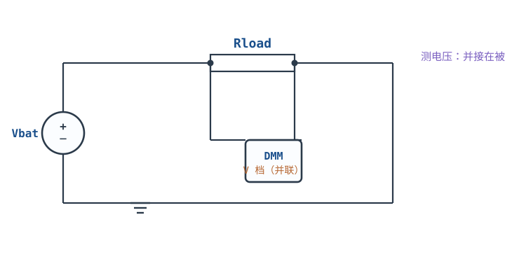
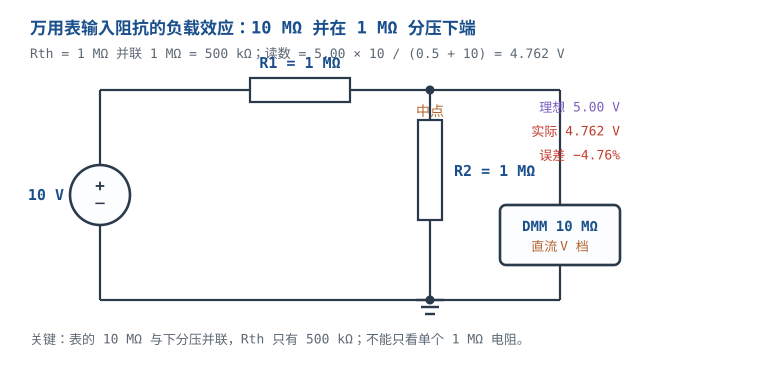
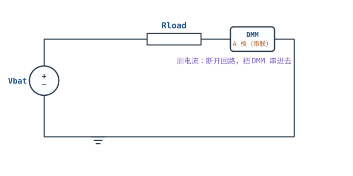
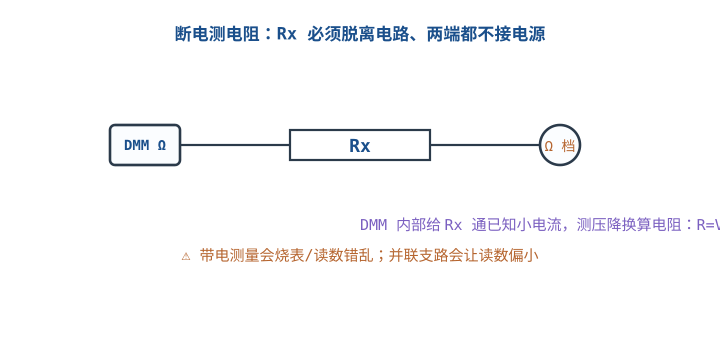

# 万用表使用与测量技巧 Digital Multimeter (DMM)

万用表看起来是"最没有门槛"的仪器：选个档、搭两根表笔、读数。真正让人摔跤的，是把它当成理想表——以为电压档输入阻抗无穷大、电流档不占电压、交流档对任何波形都准、电阻档读到多少就是多少。这四条假设每一条都有明确的失效边界，而且失效时的读数通常"看起来很合理"，不会报警。本章按"输入阻抗 → 真有效值 → 分流电阻 → 四线电阻 → 安全等级"的顺序，把一块手持数字万用表（Digital Multimeter，DMM）的非理想性逐项算清楚，最后用"24 V 回路测 100 mA"把档位、表笔与误差串起来。

本章的符号口径：$V_{\text{read}}$ 是表显示值（V）；$R_{in}$ 是电压档输入电阻（$\Omega$）；$R_{th}$ 是被测节点对地的戴维南等效电阻（$\Omega$）；$R_{sh}$ 是电流档分流电阻（$\Omega$）；$I$ 是回路电流（A）；$V_{burden}$ 是电流档插入压降（V）；$V_{pk}$ 是波形峰值（V）；$D$ 是占空比。文中给出的分流电阻、探头电容、输入阻抗均为典型量级，具体以数据手册为准。

## 1 设计动机

::: motivation 三个现场
**现场一：1 MΩ 分压中点，表读 4.76 V，电路其实是 5.00 V。** 一块 10 MΩ 输入阻抗的表并在 1 MΩ 下分压电阻上，戴维南电阻 $R_{th}=1\ \text{M}\Omega\parallel1\ \text{M}\Omega=500\ \text{k}\Omega$，表的分流让读数变成 $5.00\times10/(10+0.5)=4.762\ \text{V}$，偏低 4.76%。工程师据此把 1% 电阻换成 0.1% 电阻，问题当然不会消失——误差来自表，不来自电阻。

**现场二：mA 档一串，3.3 V 板复位。** 3.3 V、33 Ω 的负载吃 100 mA，mA 档分流电阻约 1 Ω，串进去后电流降到 $3.3/(33+1)=97.06\ \text{mA}$，分流电阻上吃掉 97.1 mV。对 3.3 V 系统这是 2.94% 的电源跌落，足够让 LDO 掉出调整区或 MCU 复位。

**现场三：CAT II 表去量配电箱。** 表上印着"600 V"，但它只属于 CAT II；配电箱属于 CAT III。两者差的不只是数字，而是规定等级的瞬态过电压耐受能力。雷击/感性负载切换在配电回路上产生的瞬态可达数千伏，能量是焦耳量级到数百焦耳；CAT II 表的爬电距离、保险丝分断能力和输入保护都可能不够。**"能显示 600 V"与"能安全承受 600 V 所在环境的瞬态"是两件事。**
:::

| 你想确认 | 先算 | 判据（工程经验值） |
|---|---|---|
| 表会不会把节点拉低 | $R_{th}/(R_{th}+R_{in})$ | 误差 <1% 要求 $R_{th}<R_{in}/100$ |
| 读数是不是"幽灵电压" | 耦合电容的 $X_C$ 与 $R_{in}$ 分压 | 并 10 kΩ 后读数塌掉，多半是 ghost |
| 非正弦波读数准不准 | 波形因数与波峰因数 | 平均值表只对正弦标定 |
| 电流档会不会影响电路 | $V_{burden}=I R_{sh}$ | 插入压降 < 电源的 1% |
| 小电阻测不测得准 | 引线电阻与接触电阻占比 | 引线 >0.1% 的 $R_x$ 就改四线 |
| 这块表能不能上这个现场 | CAT 等级 + 额定工作电压 | 表与表笔的 CAT 都不能低于现场 |

**不算会摔在哪**，四个带数字的代价：

1. **高阻节点测不准。** 10 MΩ 表测 1 MΩ 源，读数只有真实值的 $10/11=90.9\%$，偏低 9.09%；测 10 MΩ 源只剩 50%。这类节点包括 MOS 栅极偏置、高阻分压中点、pH/光电二极管前端。
2. **burden voltage 改变工作点。** 1 Ω 分流电阻在 100 mA 回路里吃掉约 97 mV；3.3 V 系统里相当于 2.94% 的电源跌落，5 V 系统里约 1.9%。低压大电流测量必须把这一项算进预算。
3. **平均值表把 PWM 读小一半以上。** 10% 占空比、10 V 峰值的脉冲，真有效值是 3.162 V，平均值表只显示 1.111 V，偏低 64.9%。
4. **CAT 等级不够是人身风险。** 不是"读数漂一点"，而是瞬态下输入回路击穿、表笔飞弧、保险丝分断失败。安全等级不能靠"我用的时候小心点"弥补。

## 2 定义与直观

### 2.1 一块表，三种理想模型

DMM 内部的核心是一块模数转换器（ADC），它只直接测电压；其它量都先转换成电压：

- **电压档**：被测电压经精密分压电阻衰减到 ADC 量程，表显示的是"分压前的电压"。理想电压表输入阻抗无穷大；真实表在直流电压档通常是 10 MΩ 量级，高阻档可到 GΩ 量级。
- **电流档**：让电流流过表内已知的小电阻 $R_{sh}$，测它两端的压降 $V=I R_{sh}$，再反推电流。理想电流表内阻为零；真实表必然有 $R_{sh}$，所以串入回路一定会产生插入压降，这个压降就叫 **burden voltage**（插入压降/负担电压）。
- **电阻档**：表内输出一个已知的小电流（或小电压），测被测电阻上的压降，按 $R=V/I$ 换算。它测的是"表笔两端看到的电阻"，包含引线、接触电阻和并联支路。
- **通断档**：电阻低于阈值（典型 30~50 Ω）就蜂鸣，只适合判断"通/不通"，不能当精密电阻用。

理想模型与真实模型的差距，就是本章所有算例的来源。

### 2.2 五个必须先定义的非理想量

| 量 | 定义 | 典型量级 | 什么时候会咬人 |
|---|---|---|---|
| 输入电阻 $R_{in}$ | 电压档两表笔之间的直流电阻 | 10 MΩ | 被测节点 $R_{th}$ 接近或超过 100 kΩ |
| 输入电容 $C_{in}$ | 表笔、电缆与输入端的并联电容 | 几十~几百 pF | 高频或快沿节点 |
| 分流电阻 $R_{sh}$ | 电流档内部的采样电阻 | μA 档几百 Ω~kΩ，mA 档约 1 Ω，10 A 档约 0.01 Ω | 低压、大电流、低裕量回路 |
| 带宽 $BW$ | 交流档能准确测量的频率上限 | 入门表约 1 kHz，好的手持表 20~100 kHz | PWM、变频器、开关电源纹波 |
| 测量类别 CAT | 表能安全承受瞬态过电压的安装位置等级 | CAT II / III / IV | 任何接市电或长电缆的测量 |

**"真有效值"不是"什么波形都准"。** 真有效值（True RMS）只解决"转换方法"的问题：它按定义 $V_{rms}=\sqrt{\frac{1}{T}\int_0^T v^2(t)\,dt}$ 计算，而不是假设波形是正弦。它仍然受带宽、波峰因数和量程限制。把"True RMS"当成万能标签，是第二个常见误解。

::: analogy 表笔像一只"带刻度的并联电阻"
把电压档想成一只 10 MΩ 的电阻并在被测两点上，表只是顺便读这只电阻两端的电压。并在 1 kΩ 节点上，10 MΩ 几乎无感；并在 1 MΩ 节点上，它拿走了 1/11 的电流，读数就低了 9%。电流档则相反：它是一只 1 Ω 左右的小电阻串进回路，表读这只电阻上的压降；回路里多了一只 1 Ω，电流当然会变小。

类比的边界：电阻类比只对低频、直流成立。高频时表笔和输入端的电容会并联进来，$C_{in}$ 的阻抗随频率下降，表不再是"10 MΩ"，而是一个复数阻抗；这时要用 $R_{in}\parallel C_{in}$ 的模型，不能只算电阻。
:::

## 3 定量关系

### 3.1 输入阻抗：表并上去，节点就变了

设被测节点对地的戴维南等效为 $V_{th}$ 串 $R_{th}$，表的内阻为 $R_{in}$，则读数：

$$V_{\text{read}}=V_{th}\frac{R_{in}}{R_{th}+R_{in}}$$

相对误差：

$$\varepsilon_R=\frac{V_{\text{read}}-V_{th}}{V_{th}}=-\frac{R_{th}}{R_{th}+R_{in}}$$

符号与单位：$V_{th}$ 是开路电压（V）；$R_{th}$、$R_{in}$ 是电阻（$\Omega$）；$\varepsilon_R$ 是无量纲相对误差。负号表示读数总是偏低。

对 10 MΩ 表，几个典型节点：

| $R_{th}$ | 读数/真实值 | 相对误差 | 结论 |
|---|---|---|---|
| 10 kΩ | 0.9990 | −0.10% | 可以忽略 |
| 100 kΩ | 0.9901 | −0.99% | 刚好 1% |
| 1 MΩ | 0.9091 | −9.09% | 不能忽略 |
| 10 MΩ | 0.5000 | −50.0% | 完全失真 |

**1 MΩ 分压中点算例。** 10 V 电源、上下一律 1 MΩ，理想中点 5.00 V。$R_{th}=1\ \text{M}\Omega\parallel1\ \text{M}\Omega=500\ \text{k}\Omega$，代入：

$$V_{\text{read}}=5.00\times\frac{10}{0.5+10}=4.762\ \text{V}$$

误差：

$$\varepsilon_R=-\frac{0.5}{0.5+10}=-0.04762=-4.76\%$$

如果把表直接并在 1 MΩ 源上（$R_{th}=1\ \text{M}\Omega$），读数 $10\times10/(1+10)=9.091\ \text{V}$，偏低 9.09%。**"10 MΩ 比 1 MΩ 大 10 倍，应该够了吧"——不够，因为分压比看的是 $R_{th}$，不是单个电阻。**

### 3.2 幽灵电压：高阻节点上的电容耦合

一根悬空的导线与市电火线之间有几十 pF 的杂散电容。这个电容和表的 10 MΩ 输入电阻构成一个分压器，表会读到一个"像真的一样"的电压，但一加负载就塌掉，这就是**幽灵电压（ghost voltage）**。

设耦合电容 $C_c$，市电频率 $f$，则容抗：

$$X_C=\frac{1}{2\pi f C_c}$$

表读数：

$$V_{\text{read}}=V_{\text{mains}}\frac{R_{in}}{\sqrt{R_{in}^2+X_C^2}}$$

当 $R_{in}\ll X_C$ 时近似为 $V_{\text{mains}}R_{in}/X_C$。

**算例：230 V、50 Hz、30 pF。** 

$$X_C=\frac{1}{2\pi\times50\times30\times10^{-12}}=1.061\times10^{8}\ \Omega=106.1\ \text{M}\Omega$$

$$V_{\text{read}}=230\times\frac{10}{\sqrt{10^2+106.1^2}}=230\times\frac{10}{106.57}=21.6\ \text{V}$$

相量分压给出的就是 21.6 V；工程上按 $R_{in}/X_C$ 估算为 $230\times10/106.1=21.7\ \text{V}$，两者一致。若耦合电容 100 pF，$X_C=31.8\ \text{M}\Omega$，读数 $230\times10/\sqrt{10^2+31.8^2}=68.9\ \text{V}$——一根悬空线在表上显示 68.9 V，接上 100 kΩ 电阻后只剩 0.217 V。

**怎么判。** 并一只 10 kΩ 电阻：$X_C=106.1\ \text{M}\Omega$，读数变成 $230\times10^4/1.061\times10^8=21.7\ \text{mV}$，ghost 立刻消失；如果是真实低阻电源，并 10 kΩ 只会按分压比略降。**读数对负载敏感，是 ghost 的指纹。**

### 3.3 真有效值 vs 平均值整流：波形因数决定误差

**真有效值**按定义计算：

$$V_{rms}=\sqrt{\frac{1}{T}\int_0^T v^2(t)\,dt}$$

**平均值整流表**先取绝对值再求平均，然后乘一个只对正弦成立的校准系数：

$$V_{\text{display}}=1.1107\times\frac{1}{T}\int_0^T |v(t)|\,dt$$

其中 $1.1107=\dfrac{\pi}{2\sqrt{2}}$ 是正弦的"有效值/整流平均值"之比。对正弦，这个系数刚好把平均值还原成有效值；对其它波形，误差由**波形因数** $FF=V_{rms}/V_{avg}$ 与正弦的差异决定。

设波形峰值 $V_{pk}$，四种常见波形：

| 波形 | 真有效值 | 整流平均值 | 平均值表显示 | 相对误差（表−真） |
|---|---|---|---|---|
| 正弦 | $0.7071V_{pk}$ | $0.6366V_{pk}$ | $0.7071V_{pk}$ | 0 |
| 方波（50% 占空） | $1.000V_{pk}$ | $1.000V_{pk}$ | $1.1107V_{pk}$ | +11.1% |
| 三角波 | $0.5774V_{pk}$ | $0.5000V_{pk}$ | $0.5554V_{pk}$ | −3.81% |
| 脉冲，$D=0.1$ | $0.3162V_{pk}$ | $0.1000V_{pk}$ | $0.1111V_{pk}$ | −64.9% |

**算例：10 V 峰值、10% 占空比的 PWM。** 真有效值：

$$V_{rms}=V_{pk}\sqrt{D}=10\times\sqrt{0.1}=3.162\ \text{V}$$

平均值表显示：

$$V_{\text{display}}=1.1107\times10\times0.1=1.111\ \text{V}$$

误差：

$$\frac{1.111-3.162}{3.162}=-0.649=-64.9\%$$

波峰因数 $CF=V_{pk}/V_{rms}=10/3.162=3.16$。很多手持表规定 CF≤3 时保证精度，超过 3 后误差会进一步变大；测开关电源、SCR 调光、变频器输出时，必须同时看 CF 和带宽。

**带宽是独立指标。** 入门表交流带宽约 1 kHz，好的手持表 20~100 kHz，台式表更高。一个 100 kHz、10% 占空比的 PWM，即使表是真有效值，也可能因为带宽不够而读小。**"真有效值"解决的是波形假设，"带宽"解决的是频率假设，两者不能互相替代。**

### 3.4 电流档：分流电阻与 burden voltage

电流档把回路断开，让电流全部流过 $R_{sh}$，表读 $V_{sh}=I R_{sh}$。对回路的影响可以写成：

$$I_{\text{meas}}=\frac{V_S}{R_L+R_{sh}},\qquad V_{burden}=I_{\text{meas}}R_{sh}$$

其中 $V_S$ 是回路电源电压（V），$R_L$ 是负载电阻（$\Omega$）。相对电流误差：

$$\varepsilon_I=\frac{I_{\text{meas}}-I_0}{I_0}=-\frac{R_{sh}}{R_L+R_{sh}}$$

其中 $I_0=V_S/R_L$ 是不接表时的电流。

| 档位 | $R_{sh}$ 典型量级 | 100 mA 时 burden | 适合 |
|---|---|---|---|
| μA 档 | 几百 Ω~kΩ | 100 mA 时不可用（会烧保险丝） | 微安级漏电，且回路阻抗要匹配 |
| mA 档 | 约 1 Ω | 约 100 mV | 一般低压回路，需核算压降 |
| 10 A 档 | 约 0.01 Ω | 约 1 mV | 大电流、低 burden，但分辨率差 |

**算例一：24 V、240 Ω、100 mA。** 不接表 $I_0=24/240=100\ \text{mA}$。串 mA 档 $R_{sh}=1\ \Omega$：

$$I_{\text{meas}}=\frac{24}{240+1}=99.585\ \text{mA},\qquad V_{burden}=99.585\ \text{mV}$$

电流误差 $-0.415\%$，负载电压从 24.000 V 降到 $99.585\ \text{mA}\times240=23.900\ \text{V}$。对 24 V 继电器、LED 驱动这类负载，0.1 V 通常可接受。

**算例二：3.3 V、33 Ω、100 mA。** 

$$I_{\text{meas}}=\frac{3.3}{33+1}=97.06\ \text{mA},\qquad V_{burden}=97.06\ \text{mV}$$

电流误差 $-2.94\%$，负载电压只剩 3.203 V。若后面是 3.3 V LDO，1.7% 的输入跌落可能让它掉出调整区；若后面是 MCU，复位/掉电不是不可能。**同样的 1 Ω，在 24 V 回路里是 0.4%，在 3.3 V 回路里是 3%——burden 的严重程度要相对电源电压看。**

**算例三：10 A 档。** $R_{sh}=0.01\ \Omega$，100 mA 时 burden 仅 1 mV，电流误差 $-0.0042\%$。但 3½ 位表在 10 A 档的分辨率通常是 10 mA，读 100 mA 只有"0.10 A"两位有效数字，量化误差可达 10%。**低 burden 与高分辨率不可兼得，要按测量目的选。**

### 3.5 四线电阻：把引线和接触电阻赶出测量回路

两线法测电阻，表看到的包括表笔线、接触电阻、被测电阻；四线法则把电流回路和电压测量回路分开：

$$R_{\text{meas}}=R_x+2R_{\text{lead}}+2R_{\text{contact}}$$

四线开尔文（Kelvin）法用一对" force "线灌电流，另一对" sense "线测电压；sense 线几乎不取电流，引线压降不在电压测量回路里，所以：

$$R_{\text{meas}}=R_x$$

**算例：0.1 Ω 分流电阻。** 两线法：每根表笔线 0.2 Ω，每个接触点 0.05 Ω，则 $R_{\text{meas}}=0.1+2\times0.2+2\times0.05=0.6\ \Omega$，误差 $+500\%$。四线法：force 线灌 10 mA，sense 线在电阻两端取压，读数 $10\ \text{mA}\times0.1\ \Omega=1\ \text{mV}$，引线压降不进入读数。

**测试电流与热电势。** 10 mA 下 0.1 Ω 只有 1 mV，而不同金属接点的热电动势可达几 µV~几十 µV；10 µV 就是 1% 误差。把测试电流加到 100 mA，信号变成 10 mV，热电势占比降到 0.1%，但电阻功耗 $I^2R=1\ \text{mW}$，仍可接受。**四线法不是"更高级"，而是"低阻测量的唯一正确接法"；两线法在 10 kΩ 上完全够用，在 0.1 Ω 上不可用。**

### 3.6 CAT II/III/IV：额定的是"环境 + 电压 + 瞬态"

IEC 61010-1 把测量类别按安装位置分三级（另有 CAT I 用于电子设备内部）：

| 类别 | 典型位置 | 例子 | 瞬态严酷度 |
|---|---|---|---|
| CAT II | 插座供电的负载侧 | 墙上插座、家电、便携工具 | 中等 |
| CAT III | 配电盘、固定布线 | 断路器、母线、配电箱 | 高 |
| CAT IV | 建筑进线、电表侧 | 电表、一次过流保护、进线 | 最高 |

**"CAT III 600 V"是一个组合额定**：它表示在 CAT III 环境下、额定工作电压 600 V 时，表能承受标准规定的瞬态过电压。它不表示"这块表在任何 600 V 场合都安全"，更不表示"可以拿 CAT II 表去量 CAT III 600 V"。表的输入端子、表笔、保险丝、爬电距离是一个系统，最弱的一环决定安全等级。

**瞬态能量算例（量级估算）。** 设某类瞬态为 6 kV、1.2/50 μs，组合波发生器的等效源阻抗按 2 Ω 估算，峰值电流：

$$I_{pk}=\frac{6000}{2}=3000\ \text{A}$$

按三角波近似，能量：

$$E\approx\frac{1}{2}V_{pk}I_{pk}t=\frac{1}{2}\times6000\times3000\times50\times10^{-6}=450\ \text{J}$$

按矩形等效则约 900 J。这个量级远超一只 1/4 W 电阻能吸收的能量（焦耳量级以下）。如果表被误放在电流档，$R_{sh}=1\ \Omega$，6 kV 直接加在 1 Ω 上，峰值功率 $V^2/R=36\ \text{MW}$；即使持续时间只有几十微秒，保险丝和分流电阻也来不及"温柔"地失效。**CAT 等级保护的是这种"瞬间"的事，不是稳态读数。**

**一个常见说法要纠正：** "测墙上插座必须 CAT III。" 按 IEC 61010 的安装位置定义，墙上插座回路属于 CAT II；配电箱才是 CAT III，进线是 CAT IV。工程上用 CAT III 表测插座是"留裕量"，不是"标准要求"。真正不能做的是：用 CAT II 300 V 的表去测 400 V 三相配电（CAT III），或者用 CAT II 表笔配 CAT III 表——表笔的额定同样要匹配。

### 3.7 精度：读数百分比 + 字数

DMM 的精度通常写成 $\pm(a\%\ \text{of reading}+b\ \text{counts})$。3½ 位表在 20 V 档的分辨率是 0.01 V，5.00 V 读数、$a=0.5$、$b=1$：

$$\Delta V=5.00\times0.5\%+0.01=0.025+0.01=0.035\ \text{V}$$

即 $5.00\pm0.035\ \text{V}$，相对误差 0.7%。4½ 位表在 20 V 档分辨率 0.001 V，若 $a=0.05$、$b=2$：

$$\Delta V=5.000\times0.05\%+2\times0.001=0.0025+0.002=0.0045\ \text{V}$$

相对误差 0.09%。**位数决定分辨率，不决定精度；"4½ 位"不等于"0.01%"。** 选表时先看精度公式，再看位数。

## 4 典型计算

### 4.1 完整算例：24 V 回路测 100 mA，选档位与表笔

**需求**：24 V 电源给 240 Ω 负载供电，预期电流 100 mA；要测实际电流，并判断 mA 档的 burden 是否可接受，该用哪个档位、哪种表笔。

**第一步：不接表的工作点。**

$$I_0=\frac{24}{240}=0.100\ \text{A}=100\ \text{mA}$$

**第二步：mA 档（$R_{sh}=1\ \Omega$）。**

$$I_{\text{meas}}=\frac{24}{240+1}=0.099585\ \text{A}=99.585\ \text{mA}$$

$$V_{burden}=0.099585\times1=0.099585\ \text{V}\approx99.6\ \text{mV}$$

负载电压：

$$V_L=0.099585\times240=23.900\ \text{V}$$

相对误差：

$$\varepsilon_I=\frac{99.585-100}{100}=-0.415\%$$

**第三步：10 A 档（$R_{sh}=0.01\ \Omega$）。**

$$I_{\text{meas}}=\frac{24}{240+0.01}=0.0999958\ \text{A}=99.996\ \text{mA}$$

$$V_{burden}=99.996\ \text{mA}\times0.01\ \Omega=0.99996\ \text{mV}\approx1.0\ \text{mV}$$

误差 $-0.0042\%$。但 3½ 位表 10 A 档分辨率 10 mA，读 100 mA 时显示"0.10 A"，量化误差约 $\pm10\ \text{mA}$（10%），远大于 burden 带来的误差。

**第四步：判断。**

- 若测量目的是"确认负载电流在 90~110 mA 范围"，mA 档的 99.6 mA 完全够用，0.415% 的误差可接受，分辨率 0.1 mA 也足够。
- 若负载对 100 mV 压降敏感（例如 24 V 转 3.3 V 的 LDO 前级、低压差恒流源），改用 10 A 档，或外接 0.1 Ω 采样电阻 + mV 表；外接 0.1 Ω 在 100 mA 下只有 10 mV，但要注意采样电阻的容差与温漂。
- 若这是永久监测，不要一直占着 mA 档：1 Ω 的长期压降会改变电路工作点，改用电流检测放大器（current sense amplifier）或霍尔传感器。

**第五步：表笔与安全。**

- 24 V 属于安全特低电压（SELV），CAT II 300 V 的表笔在电气间隙上足够；但前提是 24 V 确实与市电隔离。若 24 V 来自非隔离降压/整流，故障时可能带市电电位，必须按更高等级处理。
- 电流测量必须用电流插孔（mA 或 10 A），并且串入回路；**绝不能把电流档并在 24 V 电源两端**。mA 档的 1 Ω 并到 24 V 上，理论电流 24 A，保险丝瞬间熔断，表笔和 PCB 都可能受损。
- 表笔的 CAT 等级不能低于表的 CAT 等级；表笔绝缘破损、插头松动时，任何等级都不作数。

**第六步：功耗检查。**

$$P_{sh}=I^2R_{sh}=0.099585^2\times1=9.92\times10^{-3}\ \text{W}\approx10\ \text{mW}$$

1 Ω 分流电阻的 10 mW 不会明显发热，但 mA 档保险丝、表笔线还有额外电阻，实际 burden 可能比 99.6 mV 略大；精密测量时把表笔线也计入，或改用四线式分流器。

### 4.2 算例：幽灵电压 21.6 V，并 10 kΩ 后剩多少

**场景**：一根与 230 V 火线平行走的悬空导线，杂散电容约 30 pF，用 10 MΩ 表测到约 20 V。

**第一步：容抗。**

$$X_C=\frac{1}{2\pi\times50\times30\times10^{-12}}=106.1\ \text{M}\Omega$$

**第二步：表读数。** 按相量分压精确计算：

$$V_{\text{read}}=230\times\frac{10}{\sqrt{10^2+106.1^2}}=21.6\ \text{V}$$

**第三步：并 10 kΩ。** 

$$V_{\text{read}}=230\times\frac{0.01}{\sqrt{0.01^2+106.1^2}}=21.7\ \text{mV}$$

读数从 21.6 V 塌到 21.7 mV，说明它几乎全部是电容耦合来的"虚电"，不是低阻电源。若并 100 kΩ，读数约 0.217 V，仍然很小；并 1 MΩ 则约 2.17 V——**判断 ghost 时，负载电阻要足够低，才能把高阻源的电压拉塌。**

### 4.3 算例：PWM 真有效值与平均值表的差距

**场景**：10 V 峰值、10% 占空比、频率 1 kHz 的 PWM，分别用真有效值表和平均值表测。

**真有效值：**

$$V_{rms}=10\times\sqrt{0.1}=3.162\ \text{V}$$

**平均值表：**

$$V_{\text{display}}=1.1107\times10\times0.1=1.111\ \text{V}$$

**误差与波峰因数：**

$$\frac{1.111-3.162}{3.162}=-64.9\%,\qquad CF=\frac{10}{3.162}=3.16$$

如果这块表的 CF 保证范围只到 3，3.16 已经越界，实际误差可能比 64.9% 更大。若频率升到 100 kHz，而表只有 1 kHz 带宽，读数还会再被带宽衰减一次。**测 PWM 要同时确认三件事：True RMS、带宽、CF。**

### 4.4 算例：0.1 Ω 分流电阻，两线 vs 四线

**场景**：一个 0.1 Ω、1% 的电流分流电阻，表笔线每根 0.2 Ω，接触电阻每个 0.05 Ω。

**两线：**

$$R_{\text{meas}}=0.1+2\times0.2+2\times0.05=0.6\ \Omega$$

误差：

$$\frac{0.6-0.1}{0.1}=+500\%$$

**四线：** force 线灌 100 mA，sense 线取压：

$$V_{\text{sense}}=0.1\ \text{A}\times0.1\ \Omega=10\ \text{mV}$$

引线压降不在 sense 回路里，读数对应 0.1 Ω。若热电势 10 µV，相对误差 $10\ \mu\text{V}/10\ \text{mV}=0.1\%$。**低阻测量先问"能不能四线"，再问"表够不够准"。**

## 5 工程含义

### 5.1 按任务选档位

| 任务 | 档位/模式 | 关键判据 | 主要风险 |
|---|---|---|---|
| 查电源电压 | DC V，自动量程 | 量程 > 预期 1.5 倍 | 表笔插错孔 |
| 查信号有无 | DC V 或 AC V | 先大量程 | 交流档带宽不够 |
| 测 μA 漏电 | μA 档 | burden 与回路阻抗匹配 | 分流电阻太大，改变偏置 |
| 测 mA 工作电流 | mA 档 | $V_{burden}<1\%V_S$ | 低压回路被拉跌 |
| 测 >1 A 电流 | 10 A 档 | 分辨率与 burden 权衡 | 10 A 档未熔断保护 |
| 测 0.1 Ω~10 Ω | 四线电阻 | 引线 <0.1% $R_x$ | 两线法读大 5 倍 |
| 测 >100 kΩ | 高阻电压/电阻 | $R_{th}<R_{in}/100$ | 表负载效应、漏电 |
| 市电插座 | CAT II 以上 | 表与表笔 CAT 匹配 | 用错类别、表笔破损 |
| 配电箱 | CAT III 以上 | 额定工作电压覆盖 | 瞬态击穿、弧闪 |

### 5.2 高阻节点：先算 $R_{th}$，再决定要不要缓冲

10 MΩ 表要在 1% 误差内工作，要求 $R_{th}<R_{in}/100=100\ \text{k}\Omega$；要 0.1%，要求 $R_{th}<10\ \text{k}\Omega$。超过这个范围，三个办法：

1. **加缓冲**：用低偏置电流的运放跟随器（如 CMOS 输入、$I_B$ 在 pA 级）把高阻节点变成低阻节点，再用普通表测。缓冲器的输入偏置电流和输入电容要计入，见[噪声：电压噪声、电流噪声与计算](../opamp/noise.md)。
2. **用高阻表/静电计**：输入阻抗 GΩ~TΩ 的台式表，适合 pH、光电二极管、MOS 栅极。
3. **改变测量点**：测分压前的低阻节点，或用已知电阻反推，而不是直接测高阻中点。

**不要用"低阻抗模式（Lo-Z）"去测高阻节点。** Lo-Z 通常并一只 3 kΩ 左右的电阻，用来泄放 ghost voltage；它的输入阻抗比普通 10 MΩ 低几千倍，测高阻节点会把读数拉得更低。Lo-Z 是"验 ghost"的工具，不是"提高精度"的工具。

### 5.3 burden 预算：先看电源，再看负载

把允许的 burden 写成电源电压的百分比：

$$V_{burden}<k V_S$$

$k=1\%$ 时，3.3 V 系统允许 33 mV，对应 mA 档 1 Ω 下最多 33 mA；5 V 系统允许 50 mV，对应 50 mA；24 V 系统允许 240 mV，mA 档 100 mA 的 100 mV 仍在预算内。**同样一块表，在 24 V 上能用，在 3.3 V 上可能就不能用。**

若 burden 超预算，优先级是：10 A 档（低 burden、低分辨率）→ 外接采样电阻 + mV 表 → 电流检测放大器 → 霍尔/磁通门传感器。不要用"把表笔线加长、接触电阻变大"来凑，那只会让读数更不可信。

### 5.4 真有效值的三个前提

1. **带宽足够**：PWM 的基频、开关沿的高频分量都要在表带宽内；否则先衰减再计算，读数偏小。
2. **波峰因数在保证范围内**：CF 超过手册规定值，误差不再有保证；脉冲、SCR、变频器输出要查 CF。
3. **AC 还是 AC+DC**：真有效值表有"AC"和"AC+DC"两种模式。AC 模式隔掉直流，只测交流分量；AC+DC 模式把直流也算进去。测 PWM、整流后波形时，选错模式会差一个直流分量。

### 5.5 CAT 与表笔：最弱的一环

- 表的 CAT 等级、额定工作电压、表笔的 CAT 等级、保险丝的分断能力，四者取最低。
- 电流输入的保护通常比电压输入弱；用电流档测市电是高风险操作，非必要不做。
- 表笔绝缘破损、插头松动、表壳裂纹都会让 CAT 等级失效；CAT 是"完好状态"下的额定。
- 高压测量优先用差分探头/隔离通道，不要用普通手持表去碰浮地或热地，见[示波器：探头、触发、带宽与接地](oscilloscope.md)与[电气安全与触电防护](../basics/electrical-safety.md)。

### 5.6 四线、屏蔽与低热电势

低阻测量除了四线，还要注意：

- **热电势**：不同金属接点形成热电偶，µV 级；用同种金属、等温接点，或取正反向平均。
- **测试电流**：太大发热、太小被热电势淹没；0.1 Ω 用 10~100 mA 是常见量级，具体看电阻额定功率。
- **屏蔽/ guarding**：高阻测量时，guard 驱动屏蔽层到等电位，减少漏电流；普通手持表没有 guard，只能靠缩短走线、清洁板面。

## 6 常见坑

::: pitfall 坑一：10 MΩ 表测高阻节点，读数偏低却怪电阻
- **现象**：1 MΩ/1 MΩ 分压中点，理论 5.00 V，表读 4.76 V；换电阻、换电源都不变。
- **原因**：表的 10 MΩ 与下分压并联，$R_{th}=500\ \text{k}\Omega$，负载效应 −4.76%。
- **解决**：先算 $R_{th}/(R_{th}+R_{in})$；高阻节点加缓冲、用高阻表，或改测低阻节点。
:::

::: pitfall 坑二：平均值表测 PWM，读数只有真值的三分之一
- **现象**：10 V、10% 占空比 PWM，真有效值应为 3.162 V，表显示 1.111 V。
- **原因**：平均值表按正弦系数 1.1107 校准，对脉冲不成立；波峰因数 3.16 还可能超限。
- **解决**：换 True RMS 表，确认带宽覆盖基频与开关沿，CF 在保证范围内；需要时用示波器积分/数学功能复核。
:::

::: pitfall 坑三：mA 档串进 3.3 V 回路，板子复位
- **现象**：不接表工作正常，串 mA 档后 MCU 复位或 LDO 掉出调整。
- **原因**：1 Ω 分流电阻在 100 mA 下吃掉约 97 mV，3.3 V 系统跌落 2.94%。
- **解决**：改用 10 A 档或外接 0.1 Ω 采样电阻；先算 $V_{burden}<1\%V_S$，再决定档位。
:::

::: pitfall 坑四：CAT II 表或表笔上配电箱
- **现象**：表显示正常，但一次瞬态后表壳击穿、保险丝炸裂，甚至弧闪伤人。
- **原因**：CAT II 的爬电距离、保险丝分断能力、输入保护不满足 CAT III 的瞬态要求；表笔也可能是 CAT II。
- **解决**：按安装位置选 CAT 等级，表与表笔同时满足；高压场合用带 CAT 额定的一体化探头，不用裸表笔。
:::

::: pitfall 坑五：两线法测 0.1 Ω，读成 0.6 Ω
- **现象**：0.1 Ω 分流电阻用普通电阻档测出 0.6 Ω，以为电阻坏了。
- **原因**：表笔线 0.2 Ω×2 + 接触电阻 0.05 Ω×2 = 0.5 Ω，全部加在读数上。
- **解决**：用四线开尔文法；没有四线表时，先短接表笔读"零位"，再从读数里减掉，但接触电阻不稳定，只能粗测。
:::

::: pitfall 坑六：把 ghost voltage 当漏电
- **现象**：悬空导线对地测到约 20 V，接上负载就消失；反复查绝缘查不出问题。
- **原因**：导线与市电之间的 30 pF 耦合电容与 10 MΩ 表分压，读数 21.6 V。
- **解决**：并 10 kΩ 电阻复测，读数塌到 mV 级即为 ghost；用 Lo-Z 模式或泄放电阻确认，不要误判为绝缘故障。
:::

## 7 自测题

用 10 MΩ 表测一个 1 MΩ 源的开路电压，读数比真实值低多少？如果要误差小于 1%，源电阻上限是多少？

读数 $=V_{th}\times10/(1+10)=0.909V_{th}$，偏低 9.09%。误差 $R_{th}/(R_{th}+10\ \text{M}\Omega)<1\%$，解得 $R_{th}<101\ \text{k}\Omega$。所以 10 MΩ 表只对 100 kΩ 以下的节点"基本无感"。

10 V 电源、上下各 1 MΩ 的分压中点，理想 5.00 V，10 MΩ 表实际读多少？

$R_{th}=1\ \text{M}\Omega\parallel1\ \text{M}\Omega=500\ \text{k}\Omega$；$V=5.00\times10/(0.5+10)=4.762\ \text{V}$，误差 −4.76%。注意不能只用"10 MΩ 比 1 MΩ 大 10 倍"判断，要看戴维南电阻。

10 V 峰值、10% 占空比的脉冲，真有效值和平均值表读数各是多少？

真有效值 $=10\times\sqrt{0.1}=3.162\ \text{V}$；平均值表 $=1.1107\times10\times0.1=1.111\ \text{V}$，偏低 64.9%。波峰因数 $10/3.162=3.16$，要确认表在 CF=3.16 时仍保证精度。

24 V、240 Ω 回路，串 1 Ω mA 档后电流和 burden 各是多少？换成 10 A 档（0.01 Ω）呢？

mA 档：$I=24/(240+1)=99.585\ \text{mA}$，$V_{burden}=99.6\ \text{mV}$，误差 −0.415%。10 A 档：$I=24/240.01=99.996\ \text{mA}$，burden≈1.0 mV，误差 −0.0042%；但 3½ 位表分辨率只有 10 mA，读数的量化误差约 10%。

墙上插座和配电箱分别属于哪个 CAT 等级？"测插座必须 CAT III"这句话对吗？

墙上插座回路属于 CAT II；配电箱/固定布线属于 CAT III；建筑进线属于 CAT IV。按标准定义，"测插座必须 CAT III"不准确——CAT II 表在 300 V 插座上是有额定依据的。工程上可以用 CAT III 留裕量，但不能用 CAT II 表去测 CAT III 配电箱。

0.1 Ω 电阻，两线法读到 0.6 Ω，多出来的 0.5 Ω 是什么？怎么消掉？

多出来的是两根表笔线的电阻（2×0.2 Ω）和两个接触电阻（2×0.05 Ω）。用四线开尔文法：force 线灌电流，sense 线只取电阻两端电压，引线压降不进入测量回路。0.1 Ω 用 100 mA 测试电流时 sense 电压 10 mV，热电势 10 µV 只占 0.1%。

## 8 参考资料

- Fluke, *ABCs of DMMs — Understanding Digital Multimeters*，应用笔记：输入阻抗、量程、真有效值与安全等级的基础口径。
- Keithley, *Low Level Measurements Handbook*, 7th ed., Chapter 2 *Voltage, Current and Resistance Measurements*：高阻测量、分流电阻、burden voltage 与四线电阻。
- IEC 61010-1:2010+AMD1:2016, Clause 6.1.2：测量类别 CAT II/III/IV、额定工作电压与瞬态过电压的定义和试验要求。
- Analog Devices, *AD737 True RMS-to-DC Converter* 数据手册：真有效值转换、波峰因数与带宽限制。
- Fluke, *87V/83V Digital Multimeters Extended Specifications*：10 MΩ 输入阻抗、CAT III 1000 V / CAT IV 600 V 额定与电流档指标。

相关章节：[示波器：探头、触发、带宽与接地](oscilloscope.md)、[信号发生器、电子负载与稳压电源](signal-generator-load.md)、[逻辑分析仪、频谱仪与网络分析仪](logic-analyzer-spectrum.md)、[电气安全与触电防护](../basics/electrical-safety.md)、[接地与地环路](../power/grounding.md)、[ADC 原理、参数与参考电压](../mcu/adc.md)、[噪声：电压噪声、电流噪声与计算](../opamp/noise.md)、[安规认证](safety-certification.md)。
