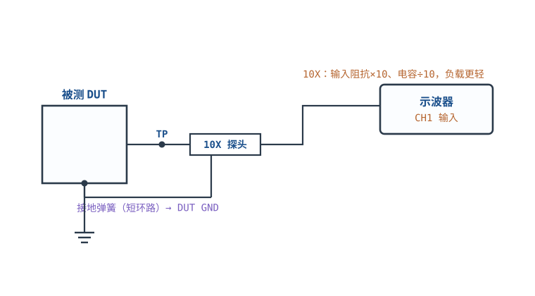
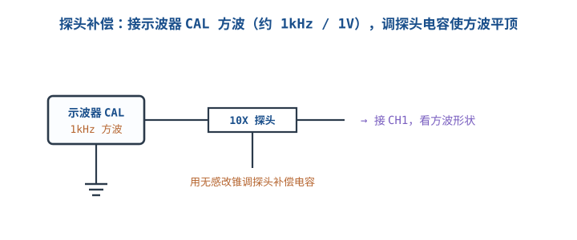
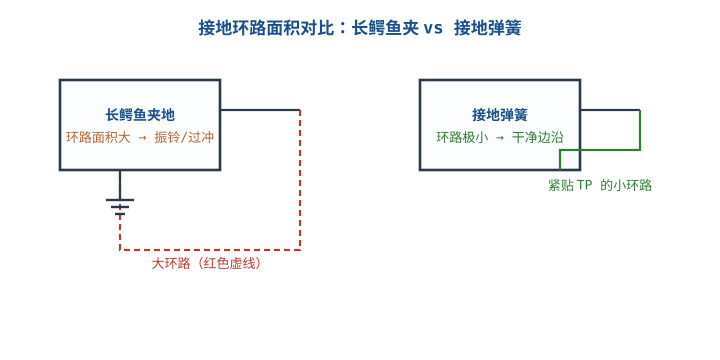

# 示波器：探头、触发、带宽与接地 Oscilloscope

## 1. 为什么示波器和探头要一起看

::: motivation 示波器测到的"干净"可能是假象
万用表只能告诉你"现在是几伏"，示波器（Oscilloscope）告诉你**电压随时间怎么变**：上升沿、纹波、振铃、偶发毛刺。但很多人测出一条"很漂亮"的曲线，其实是被探头带宽和长接地线**滤波/振铃**后的假像——边沿变缓、过冲被吞掉。示波器+探头是一个系统，任何一环不够，测量就失真。
:::

本章把四件事讲透：**探头 1X/10X 与补偿、带宽与上升时间、接地、触发**。这四点决定了你看到的波形是不是真的。

## 2. 系统构成与接线

主图是最标准的接法（前提：DUT 为低压且已与市电隔离，见下文"适用前提"）：探头尖端点在被测测试点（TP），接地弹簧就近接到 DUT 的 GND，探头体上的衰减开关拨到 10X，同轴电缆进示波器通道。



- 探头 Tip 接信号，Ground 弹簧接被测地；**地和信号必须就近**。
- **适用前提（重要）**：普通台式示波器无源探头的地夹（接地弹簧）通过电源线保护地线接到仪器**保护地（protective earth）**，因此只适用于**低压、已与市电隔离**的电路板（如电池供电、隔离变压器、隔离 DC-DC 供电的 DUT）。测量**非隔离电源初级侧的热地（hot ground）**，或任何**相对保护地存在电位**的点时，**禁止**把探头地夹直接夹上去——会形成对保护地的短路，造成打火、跳闸甚至损坏仪器；此时必须使用**差分探头、隔离探头，或带隔离通道的示波器**。
- 探头体上有 1X/10X 衰减开关，示波器通道设置必须与之一致（10X 档机内自动把读数 ×10）。

## 3. 关键指标

| 指标 | 含义 | 经验判据 |
|---|---|---|
| **带宽 Bandwidth (BW)** | 幅度下降到 −3dB 的频率 | 应是被测最高频率成分的 **3~5 倍** |
| **上升时间 Rise Time** | 10%→90% 边沿 | $t_r\approx 0.35/BW$ |
| **采样率 Sample Rate** | 每秒采样点数 | 实时采样 ≥ 最高频率 5~10 倍，看清边沿要更高 |
| **探头输入阻抗** | 低频电阻、高频电容 | 无源 10X：10MΩ ∥ ~9.5pF |
| **通道数 / 存储深度** | 同时看几路、一次抓多长 | 调调试电源+逻辑至少 2 通道 |

**带宽与上升时间的换算**是本章核心公式：

$$t_r \approx \frac{0.35}{BW}$$

例：一台 100MHz 示波器，系统上升时间约 $0.35/100\text{MHz}=3.5\text{ns}$。若被测方波上升沿只有 1ns，这台机器根本看不清——它会把 1ns 的边沿测成 ~3.5ns。

下面这张图说明"带宽不够时，快边沿被系统低通拖慢"：

```echarts
{
  "tooltip": {"trigger": "axis"},
  "legend": {"data": ["真实信号（理想阶跃）", "100MHz 系统测得", "350MHz 系统测得"], "bottom": 0, "textStyle": {"fontSize": 12}},
  "grid": {"left": 56, "right": 24, "top": 26, "bottom": 60},
  "xAxis": {"type": "category", "name": "时间 ns", "data": [0,0.5,1,1.5,2,3,5,8,12], "axisLabel": {"fontSize": 11}},
  "yAxis": {"type": "value", "name": "电压 V", "min": 0, "max": 1.1, "axisLabel": {"fontSize": 11}},
  "series": [
    {"name": "真实信号（理想阶跃）", "type": "line", "step": "end", "showSymbol": false, "lineStyle": {"width": 2.6, "color": "#2b3a4a"},
     "data": [0,0,1,1,1,1,1,1,1]},
    {"name": "100MHz 系统测得", "type": "line", "smooth": true, "showSymbol": false, "lineStyle": {"width": 2.4, "color": "#c0392b"},
     "data": [0,0.05,0.15,0.3,0.45,0.75,0.95,1,1]},
    {"name": "350MHz 系统测得", "type": "line", "smooth": true, "showSymbol": false, "lineStyle": {"width": 2.4, "color": "#2e7d32"},
     "data": [0,0.2,0.5,0.75,0.88,0.98,1,1,1]}
  ]
}
```

::: advanced 进阶：级联带宽
示波器与探头是两级低通级联，系统带宽近似
$BW_{sys}\approx \dfrac{1}{\sqrt{1/BW_{scope}^2+1/BW_{probe}^2}}$。
探头带宽低于示波器时，瓶颈在探头——所以"探头带宽 ≥ 示波器带宽，宁高勿低"。
:::

## 4. 接线与操作：触发与档位

- **耦合方式**：测直流/电源用 DC 耦合；只想看纹波的交流分量（去掉大直流偏置）用 AC 耦合。
- **触发 Trigger**：让波形稳定的关键。边沿触发选信号边沿、触发电平设在波形跳变沿中间；间歇毛刺用"正常/Normal"模式配合触发耦合抑制噪声。**波形乱跑、晃屏，90% 是触发没调好。**
- **档位一致**：探头拨 10X，示波器通道衰减菜单也要设 10X，否则幅度差 10 倍。

## 5. 测量示例（含计算）

::: example 该选多大带宽？
要测一个 20MHz 方波、边沿约 2ns 的数字信号。
- 按上升时间反推所需带宽：$BW\ge0.35/2\text{ns}=175\text{MHz}$。
- 按"3~5 倍最高频率"：最高频率分量约按方波 5 次谐波估 ≈100MHz，×3~5 = 300~500MHz。
- 结论：选 **≥200MHz** 的系统才够看边沿；100MHz 机器只能看个大概。
:::

::: example 探头负载效应
某 MOSFET 栅极节点源阻抗 $R_s=1\text{M}\Omega$。
- **1X 探头**：输入电容 $C_{in}\approx95\text{pF}$（整根电缆电容都并进来），时间常数 $\tau=R_s C_{in}=1\text{M}\Omega\times95\text{pF}=95\mu s$。
- 这会把该节点的高速边沿显著拖慢——甚至改变电路行为。换 **10X 探头**：$C_{in}$ 降到约 $95\text{pF}/10\approx9.5\text{pF}$，$\tau$ 降到 $9.5\mu s$，负载轻得多。
:::

## 6. 上手操作清单

- [ ] 接探头后先做**探头补偿**（见扩展 1）。
- [ ] 测高速信号先换**接地弹簧**，别用长鳄鱼夹（扩展 2）。
- [ ] 波形晃屏先调触发电平与触发源。
- [ ] 怀疑边沿失真时，换更高带宽探头/机器对比，确认不是仪器瓶颈。

## 扩展与变种电路

### 扩展1：探头补偿 1X/10X Probe Compensation

无源探头是一个衰减分压器，内含可调补偿电容；不补偿好，频响不平，方波上斜/下垂/圆角。



::: example 补偿判读
- 把探头接到示波器前面板 CAL 端（约 1kHz/1V 方波）。
- 用无感改锥调探头体上的补偿电容，看 CH1 方波：
  - **平顶直角** = 补偿正确；
  - **上翘/过冲** = 过补偿（电容偏大）；
  - **圆角/下垂** = 欠补偿（电容偏小）。
- 1X 与 10X 档负载不同：10X 输入阻抗 ×10、电容 ÷10，测高阻节点优先 10X，但小信号幅度被 ÷10。
:::

```echarts
{
  "tooltip": {"trigger": "axis"},
  "legend": {"data": ["正确补偿", "欠补偿(圆角)", "过补偿(上翘)"], "bottom": 0, "textStyle": {"fontSize": 12}},
  "grid": {"left": 50, "right": 20, "top": 24, "bottom": 56},
  "xAxis": {"type": "category", "data": [0,1,2,3,4,5,6,7,8,9,10], "axisLabel": {"show": false}},
  "yAxis": {"type": "value", "min": 0, "max": 1.2, "axisLabel": {"show": false}},
  "series": [
    {"name": "正确补偿", "type": "line", "step": "end", "showSymbol": false, "lineStyle": {"width": 2.6, "color": "#2e7d32"},
     "data": [0,1,1,1,1,0,0,0,0,0,0]},
    {"name": "欠补偿(圆角)", "type": "line", "smooth": true, "showSymbol": false, "lineStyle": {"width": 2.2, "color": "#1a4f8b"},
     "data": [0,0.7,0.85,0.9,0.92,0.4,0.1,0.05,0.02,0,0]},
    {"name": "过补偿(上翘)", "type": "line", "smooth": true, "showSymbol": false, "lineStyle": {"width": 2.2, "color": "#c0392b"},
     "data": [0,1.15,1.05,1.02,1.0,0.1,0,0,0,0,0]}
  ]
}
```

对比"不补偿直接测"：欠补偿让高频被压低、方波圆角；过补偿出现上冲。**测精密边沿/纹波前，每个通道都要补偿。**

::: pitfall 1X/10X 档位与菜单不一致
- **现象**：读数比预期大 10 倍或小 10 倍，调试一直对不上。
- **原因**：探头拨了 10X，示波器通道衰减仍设 1X（或反之）。
- **解决**：拨开关后立刻在通道菜单里改衰减比；带自动检测的探头也要确认识别正确。
:::

### 扩展2：接地弹簧 vs 长鳄鱼夹 Ground Spring

长鳄鱼夹接地线像一个大电感线圈，高速测量时振铃和过冲主要来自它，而不是电路本身。



::: example 什么时候必须换弹簧
- 测数字时钟、高速总线、开关节点（SW 节点）等快边沿信号时，把鳄鱼夹换成探头帽上的**接地弹簧针**，地针直接顶在 TP 旁边的 GND 上过孔。
- 环路电感 $L\propto$ 环路面积，面积越小，地弹/振铃越小。
- 对比：同一 SW 节点，长夹看到一堆振铃，换弹簧后振铃消失——说明振铃是测量引入的，不是电路问题。
- 前提：以上结论针对**已接地（相对保护地为零电位）**的 DUT；若测的是非隔离电源初级侧 SW 节点/热地，探头地夹仍须按"适用前提"改用差分/隔离探头，换弹簧不能替代隔离。
:::

对比"方便 vs 正确"：长夹好夹但只适合慢信号；高速测量宁可麻烦也要用弹簧。

注意：换弹簧、缩短地线**只改善测量环路面积**（减小环路天线面积，抑制噪声与振铃），**不能**解决示波器与 DUT 保护地之间存在电位差（地环路）的问题，也**不能**改变探头/仪器的测量类别（CAT 额定）或对地耐压；后两类问题需靠差分/隔离探头、同一供电回路等手段解决。

::: pitfall 把测量引入的振铃当成电路问题
- **现象**：开关电源 SW 节点满屏振铃，反复加 RC 吸收也压不下去。
- **原因**：长鳄鱼夹地环路电感与探头电容谐振，振铃是探头环路产生的。
- **解决**：换接地弹簧、缩短地回路；振铃消失即证明是测量假象。（前提：DUT 已隔离、SW 点参考本地地；非隔离初级侧热地须先按"适用前提"改用差分/隔离探头，不能直接夹地夹。）
:::

## 7. 常见坑与故障现象

::: pitfall 常见坑
- **带宽不够却以为"信号就是这样"**：边沿测出来圆钝、幅度偏小，其实是仪器低通。先按 0.35/tr 核算需要的带宽，再下结论。
- **忘记做探头补偿**：方波圆角或上冲，导致幅度/边沿测量系统偏差，却去查电路。
- **用长鳄鱼夹地测高速信号**：振铃被误判为电路自激或反射。
- **探头 10X/1X 与通道菜单不匹配**：幅度差 10 倍，全链路参数对不上。
:::

## 8. 自测题

<details><summary>要测一个上升沿 0.7ns 的信号，示波器带宽至少要多大？</summary>
按 $BW\ge0.35/t_r=0.35/0.7\text{ns}=500\text{MHz}$。留裕量选 ≥500MHz~1GHz 系统，否则边沿被仪器拖慢。
</details>

<details><summary>探头接好后方波显示圆角，应该调什么？</summary>
做探头补偿：用无感改锥调探头体上的补偿电容，直到方波变成平顶直角。圆角=欠补偿（电容偏小），上翘=过补偿。
</details>

<details><summary>测开关电源 SW 节点满屏振铃，加了 RC 吸收仍无效，先怀疑什么？</summary>
先怀疑测量接地。长鳄鱼夹地环路电感大，与探头电容谐振产生振铃。换接地弹簧就近接地，若振铃消失则是测量假象，不是电路问题。（此前提为 DUT 已隔离、SW 点相对本地地为零电位；非隔离初级侧热地须先用差分/隔离探头，先满足隔离前提再谈环路长短。）
</details>

## 9. 参考资料

- Tektronix – [ABCs of Probes Primer](https://www.tek.com/vn/documents/whitepaper/abcs-probes-primer)（系统带宽 3~5 倍法则、探头电容负载、10X/1X 补偿、接地环路）
- sigrok/pulseview 开源信号分析平台（与示波器配合做协议解码）
