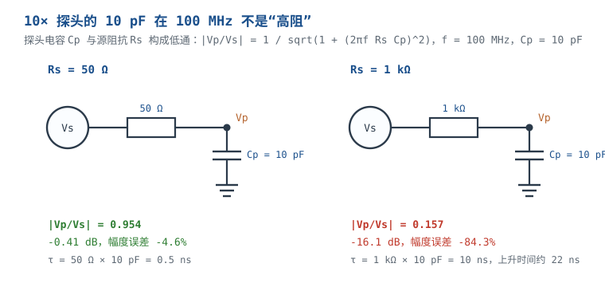

# 示波器：探头、触发、带宽与接地 Oscilloscope

示波器（Oscilloscope）把电压随时间的变化画出来，但它画的不是"电路上真实发生的电压"，而是"经过探头、电缆、前端放大器和 ADC 之后，仪器认为发生的电压"。这条链路上任何一环带宽不够、负载太重、接地太长，波形都会变形；更麻烦的是，变形后的波形通常仍然干净、稳定、可触发，让人以为"电路就是这样"。

本章把测量链拆成五段：**带宽与上升时间、采样与混叠、探头负载、接地引线、触发与耦合**。每一段都给可复算的判据，最后用"10 ns 上升沿、100 MHz 信号"这个需求把选型串起来，并纠正一个常见的参数组合矛盾。文中探头电容、接地电感、示波器噪声均为典型量级，具体以数据手册为准。

本章符号：$BW$ 是 $-3\ \text{dB}$ 带宽（Hz）；$t_r$ 是 10%~90% 上升时间（s）；$f_s$ 是采样率（Sa/s）；$C_p$ 是探头输入电容（F）；$R_s$ 是源阻抗（$\Omega$）；$L_g$ 是接地引线电感（H）；$T_d$ 是电缆单向延迟（s）。

## 1 设计动机

::: motivation 三个现场
**现场一：100 MHz 示波器看 1 ns 边沿，测出 3.6 ns，工程师去加电容。** 示波器本身上升时间约 $0.35/100\ \text{MHz}=3.5\ \text{ns}$；被测边沿 1 ns，两者平方和开根得 $\sqrt{1^2+3.5^2}=3.64\ \text{ns}$。看到的"慢边沿"是仪器响应，不是电路响应。照着 3.6 ns 去调驱动能力或加 RC，只会把真实边沿越调越慢。

**现场二：10 pF 探头点在 100 MHz、1 kΩ 节点上，幅度只剩 15.7%。** 探头的 10 pF 在 100 MHz 的容抗是 $159\ \Omega$，与 1 kΩ 源构成低通，衰减 $-16.1\ \text{dB}$。工程师以为"10 MΩ 探头对电路没影响"，却没注意 10 MΩ 只在直流成立；交流看的是电容。

**现场三：100 MHz 时钟用 90 MS/s 采样，看到 10 MHz 正弦。** $f_s=90\ \text{MS/s}$ 小于 $2f=200\ \text{MS/s}$，100 MHz 被折叠到 $|100-90|=10\ \text{MHz}$。示波器用正弦插值把点连成一条漂亮的 10 MHz 曲线，触发也稳定；只看屏幕，根本想不到是混叠。
:::

| 你想确认 | 先算 | 判据（工程经验值） |
|---|---|---|
| 带宽够不够看清边沿 | $BW\ge0.35/t_r$ | 系统带宽再乘 3~5 倍裕量 |
| 采样率够不够 | $f_s\ge5BW$ | 至少满足奈奎斯特，工程上 5~10 倍 |
| 探头会不会压慢节点 | $R_s C_p$ 与 $1/(2\pi R_s C_p)$ | 探头极点高于信号带宽 5 倍 |
| 接地引线会不会振铃 | $f_0=1/(2\pi\sqrt{L_gC_p})$ | 振铃频率落在信号带宽内就要换弹簧 |
| 纹波测不测得到 | 20 MHz 限带 + AC/DC 耦合 | 先确认纹波频率与探头地环路 |
| 触发稳不稳 | 触发源、电平、模式 | 偶发事件用 Normal + 单次 |
| 能不能浮地测 | 差分/隔离探头 | 普通探头地夹接保护地，不能碰热地 |

**不算会摔在哪**，四个带数字的代价：

1. **带宽不足把边沿算错。** 1 ns 边沿用 100 MHz 系统测成 3.64 ns，误差 264%；若据此算时序裕量，会把合格设计判成不合格，或反过来把不合格判成合格。
2. **采样不足产生假波。** 100 MHz 在 90 MS/s 下变成 10 MHz，频率读错 10 倍；如果把它当成真实频率去调 PLL，方向完全相反。
3. **探头负载改变电路。** 10 pF 在 100 MHz、1 kΩ 节点上衰减 84.3%；在 50 Ω 节点上也有 4.6% 的幅度误差和约 1.1 ns 的上升时间恶化。
4. **长接地引线制造振铃。** 10 cm 夹子约 100 nH，与 10 pF 探头在 159 MHz 谐振；100 MHz 时钟的 3 次谐波正好落在这附近，振铃被误判为电路自激。

## 2 定义与直观

### 2.1 测量链：你看到的不是节点电压

一条完整的测量链是：

**被测节点 → 探头尖端/地 → 探头衰减与补偿 → 同轴电缆 → 示波器前端（衰减器/放大器）→ ADC → 数字滤波/插值 → 屏幕**

每一段都有自己的带宽、阻抗和噪声。系统的 $-3\ \text{dB}$ 带宽由各级级联决定；探头的输入电容和接地电感会直接并到被测节点上；ADC 的采样率和存储深度决定时间分辨率与记录长度。**"示波器带宽"只是其中一段，不是系统带宽。**

### 2.2 五个核心定义

| 量 | 定义 | 典型量级 | 失效边界 |
|---|---|---|---|
| 带宽 $BW$ | 正弦输入幅度下降到 $-3\ \text{dB}$ 的频率 | 100 MHz~2 GHz | 只看正弦，不看方波；探头可能更低 |
| 上升时间 $t_r$ | 阶跃响应 10%~90% 的时间 | 与 $BW$ 近似成反比 | 高斯响应假设；非高斯会偏 |
| 采样率 $f_s$ | ADC 每秒采样点数 | 1~10 GS/s | 多通道时可能减半；插值不增加信息 |
| 存储深度 $M$ | 一次采集的样点数 | 1 M~100 M 点 | 记录长度 $=M/f_s$，深存储可能降采样率 |
| 探头输入阻抗 | 直流电阻并联电容 | 10 MΩ ∥ 10 pF（10X） | 高频时电容主导，10 MΩ 不再是"高阻" |

**带宽与上升时间的关系**来自一阶/Gaussian 近似：

$$t_r\approx\frac{0.35}{BW}$$

这个 0.35 来自单极点系统：$t_r=2.2\tau$，$BW=1/(2\pi\tau)$，两式相除得 $2.2\times2\pi\approx13.8$，即 $BW\times t_r\approx0.35$。对高阶/Gaussian 响应，系数在 0.35 附近；对有明显峰化的响应，系数会变小。**它是工程近似，不是物理定律。**

### 2.3 探头：1X 与 10X 是两种完全不同的负载

无源探头不是一个"透明的针"。10X 探头内部是一个 9 MΩ 电阻并联可调电容，与示波器的 1 MΩ 输入构成 10:1 分压；1X 探头基本就是把电缆直接接上去，电缆电容（约 100 pF）全部并在节点上。

| 项目 | 1X 探头 | 10X 探头 |
|---|---|---|
| 直流输入电阻 | 约 1 MΩ | 约 10 MΩ |
| 输入电容 | 约 100 pF（电缆电容） | 约 10~15 pF |
| 典型带宽（低源阻抗） | 约 6~10 MHz | 100~500 MHz |
| 对节点的负载 | 重，尤其高阻节点 | 轻，但高频仍不可忽略 |
| 幅度 | 1:1 | 1:10（示波器乘 10 显示） |

10X 探头的补偿条件是两个分压器的 RC 乘积相等：

$$R_1C_1=R_2C_2$$

其中 $R_1=9\ \text{M}\Omega$、$R_2=1\ \text{M}\Omega$ 是探头与示波器的输入电阻，$C_1$ 是探头可调补偿电容，$C_2$ 是示波器输入电容与电缆电容之和。若 $C_2=15\ \text{pF}$：

$$C_1=\frac{R_2C_2}{R_1}=\frac{1\ \text{M}\Omega\times15\ \text{pF}}{9\ \text{M}\Omega}=1.67\ \text{pF}$$

补偿电容只有 pF 量级，所以探头上的小螺丝刀一拧，波形就从"圆角"变到"过冲"。补偿不对，幅度和边沿都不对。

::: analogy 探头像一只"带电容的听诊器"
把探头想成听诊器：尖端要贴紧测试点，地线要短，否则听到的是"听诊器本身的共振"。10X 探头像加了阻抗匹配的听诊器，对电路影响小，但信号也被衰减 10 倍；1X 探头像直接把耳朵贴上去，信号大，但把电缆电容全并进了电路。

类比的边界：听诊器不会改变心跳，探头会改变节点电压。探头电容与源阻抗构成低通，探头地线与探头电容构成谐振回路；测量本身就是一个电路事件，不是被动观察。
:::

## 3 定量关系

### 3.1 带宽、上升时间与 5 倍法则

被测信号的边沿越快，频谱越高。工程上把"信号带宽"近似为：

$$BW_{\text{sig}}\approx\frac{0.35}{t_{r,\text{sig}}}$$

要测准这个边沿，测量系统本身的上升时间必须远小于它。设系统上升时间为 $t_{r,\text{sys}}$，测得上升时间为：

$$t_{r,\text{meas}}=\sqrt{t_{r,\text{sig}}^2+t_{r,\text{sys}}^2}$$

若系统带宽是信号带宽的 $k$ 倍，则 $t_{r,\text{sys}}=t_{r,\text{sig}}/k$，代入：

$$t_{r,\text{meas}}=t_{r,\text{sig}}\sqrt{1+\frac{1}{k^2}}$$

| $k=BW_{\text{sys}}/BW_{\text{sig}}$ | 测得上升时间/真实值 | 误差 | 评价 |
|---|---|---|---|
| 1 | 1.414 | +41.4% | 完全不够 |
| 2 | 1.118 | +11.8% | 只能看趋势 |
| 3 | 1.054 | +5.4% | 一般调试可接受 |
| 5 | 1.020 | +2.0% | 工程推荐 |
| 10 | 1.005 | +0.5% | 计量级 |

**这就是"5 倍法则"的来历**：系统带宽取信号带宽的 5 倍，上升时间误差约 2%。注意是**系统**带宽，不是示波器标称带宽；探头、电缆、前端都算在内。

### 3.2 级联带宽：探头会把系统带宽拉低

示波器与探头可以近似为两个一阶低通级联，系统带宽：

$$BW_{\text{sys}}=\frac{1}{\sqrt{\dfrac{1}{BW_{\text{scope}}^2}+\dfrac{1}{BW_{\text{probe}}^2}}}$$

若两者相等，$BW_{\text{sys}}=BW/\sqrt{2}=0.707BW$。例如 500 MHz 示波器配 500 MHz 探头：

$$BW_{\text{sys}}=\frac{1}{\sqrt{1/500^2+1/500^2}}=353.6\ \text{MHz}$$

系统上升时间：

$$t_{r,\text{sys}}=\frac{0.35}{353.6\ \text{MHz}}=0.99\ \text{ns}$$

如果被测边沿是 1 ns，测得：

$$t_{r,\text{meas}}=\sqrt{1^2+0.99^2}=1.41\ \text{ns}$$

误差 41%。**"示波器 500 MHz、探头 500 MHz"不等于"系统 500 MHz"；要把探头算进去。**

### 3.3 采样、混叠与存储深度

奈奎斯特判据要求 $f_s>2f_{\max}$，但只说"大于 2 倍"不够：要看清波形形状、做插值、留抗混叠余量，工程上取 5~10 倍。采样后的频率折叠公式：

$$f_{\text{alias}}=\left|f_{\text{in}}-n f_s\right|,\qquad n=\operatorname{round}\left(\frac{f_{\text{in}}}{f_s}\right)$$

**算例：100 MHz 输入、90 MS/s 采样。** $n=\operatorname{round}(100/90)=1$：

$$f_{\text{alias}}=|100-90|=10\ \text{MHz}$$

屏幕上是一条 10 MHz 正弦，频率只有真实值的 1/10。如果把采样率改成 110 MS/s，$n=1$，alias $=|100-110|=10\ \text{MHz}$，还是 10 MHz，只是相位反转；至少要 200 MS/s 才严格满足 $f_s>2f$，工程上取 250 MS/s 以上。**看到"频率随采样率变化而跳变"的波形，第一反应应该是混叠，而不是信号本身在变。**

存储深度决定一次能看多久：

$$T_{\text{record}}=\frac{M}{f_s}$$

$M=10\ \text{M}$ 点、$f_s=2.5\ \text{GS/s}$ 时，$T_{\text{record}}=4\ \text{ms}$。要抓 1 s 的偶发事件，要么降低采样率（可能混叠），要么用分段存储/触发，要么换更深存储的机器。**采样率、存储深度、通道数是互相牵制的：多通道打开时，单通道采样率常常减半。**

### 3.4 探头负载：10 pF 在 100 MHz 不是"高阻"

探头输入等效为 $R_p\parallel C_p$。对源阻抗 $R_s$，探头的极点：

$$f_p=\frac{1}{2\pi R_s C_p}$$

在频率 $f$ 处的幅度传输：

$$\left|\frac{V_p}{V_s}\right|=\frac{1}{\sqrt{1+(2\pi f R_s C_p)^2}}$$

**算例：$C_p=10\ \text{pF}$、$f=100\ \text{MHz}$。**

- $R_s=50\ \Omega$：$2\pi fR_sC_p=2\pi\times10^8\times50\times10^{-12}=0.314$，传输 $=1/\sqrt{1+0.314^2}=0.954$，即 $-0.41\ \text{dB}$，幅度误差 $-4.6\%$。
- $R_s=100\ \Omega$：系数 $0.628$，传输 $=0.847$，$-1.45\ \text{dB}$，误差 $-15.3\%$。
- $R_s=1\ \text{k}\Omega$：系数 $6.28$，传输 $=0.157$，$-16.1\ \text{dB}$，误差 $-84.3\%$。

**注意：不能简单用 $X_C/(R_s+X_C)$ 算。** 电容是复数阻抗，分压要按相量算；$159/(1000+159)=13.7\%$ 是错误结果，正确值是 $15.7\%$，因为 $R_s$ 与 $C_p$ 的电压不是同相相加。这个差别在高阻节点上更明显。

上升时间也会被探头拖慢。探头的时间常数 $\tau=R_sC_p$，10%~90% 上升时间约 $2.2\tau$：

- $R_s=50\ \Omega$：$\tau=0.5\ \text{ns}$，$t_{r,p}=1.1\ \text{ns}$；与 1 ns 信号合成 $\sqrt{1^2+1.1^2}=1.49\ \text{ns}$，恶化 49%。
- $R_s=1\ \text{k}\Omega$：$\tau=10\ \text{ns}$，$t_{r,p}=22\ \text{ns}$，完全淹没 1 ns 边沿。

### 3.5 接地引线：电感与谐振

探头地线不是理想导线，每毫米约 1 nH。10 cm 鳄鱼夹约 100 nH，1 cm 接地弹簧约 10 nH。它与探头电容 $C_p$ 构成并联谐振：

$$f_0=\frac{1}{2\pi\sqrt{L_gC_p}},\qquad Z_0=\sqrt{\frac{L_g}{C_p}}$$

**算例：$C_p=10\ \text{pF}$。** 10 cm、$L_g=100\ \text{nH}$：

$$f_0=\frac{1}{2\pi\sqrt{100\times10^{-9}\times10\times10^{-12}}}=159.2\ \text{MHz}$$

$$Z_0=\sqrt{\frac{100\ \text{nH}}{10\ \text{pF}}}=100\ \Omega$$

1 cm、$L_g=10\ \text{nH}$：

$$f_0=\frac{1}{2\pi\sqrt{10\times10^{-9}\times10\times10^{-12}}}=503.3\ \text{MHz}$$

在 100 MHz，100 nH 的阻抗是 $2\pi fL=62.8\ \Omega$，10 nH 只有 $6.28\ \Omega$。**长地线在 100 MHz 已经是一个几十欧的"弹簧"，不是导线；它和探头电容谐振，把边沿变成振铃。**

### 3.6 触发与耦合

- **触发源**：选被测通道，不要选一个没接信号的通道。
- **触发电平**：放在边沿中间，约为高低电平的中点；太小会误触发，太大会漏触发。
- **触发模式**：Auto 适合找信号，Normal 适合看偶发事件，Single 适合抓单次毛刺。
- **触发耦合**：DC 耦合保留直流；AC 耦合隔掉直流，适合看叠加在直流上的小信号；HF/LF Reject 抑制噪声。
- **释放/保持（Holdoff）**：对周期性脉冲串，holdoff 设为一个略大于脉冲串周期的时间，避免在脉冲串中间误触发。

触发不稳时，先确认触发源、电平、模式，再怀疑信号。**"波形晃屏"绝大多数是触发问题，不是电路问题。**

### 3.7 纹波与高速信号：两套完全不同的设置

| 设置 | 测纹波 | 测高速数字信号 |
|---|---|---|
| 耦合 | AC 耦合（在额定范围内）或 DC + 偏置 | DC 耦合 |
| 带宽限制 | 20 MHz 限带（按规格） | 全带宽 |
| 探头 | 10X，短地弹簧；或同轴 + 50 Ω | 10X 低电容/有源探头，短地 |
| 垂直档位 | 1~5 mV/div，尽量用满 ADC | 按摆幅，避免削顶 |
| 采样率 | 满足纹波最高频率即可 | ≥5 倍系统带宽 |
| 平均/滤波 | 高分辨率/平均可降噪 | 一般不平均，避免掩盖偶发边沿 |
| 触发 | 电源开关沿或纹波周期 | 被测时钟/数据边沿 |

**20 MHz 限带能降多少噪声？** 对白噪声，rms 与带宽平方根成正比；500 MHz 降到 20 MHz：

$$\frac{V_{n,20}}{V_{n,500}}=\sqrt{\frac{20}{500}}=0.2$$

即噪声降到 1/5，$-14\ \text{dB}$。但限带也会滤掉真实的 20 MHz 以上纹波/振铃；只有在规格明确要求 20 MHz 带宽测量时才用。

**AC 耦合的代价。** AC 耦合是一个一阶高通，假设下限截止 10 Hz，测 50 Hz 纹波：

$$\left|\frac{V_{\text{out}}}{V_{\text{in}}}\right|=\frac{1}{\sqrt{1+(f_c/f)^2}}=\frac{1}{\sqrt{1+(10/50)^2}}=0.981$$

幅度偏低 1.9%，相位超前。测 100 Hz 时偏低 0.5%；测 10 Hz 时只剩 0.707。**低频纹波优先 DC 耦合 + 偏置，AC 耦合只适合频率远高于截止点的场合。**

## 4 典型计算

### 4.1 需求核对：10 ns 边沿与 100 MHz 时钟不能同时成立

任务书写"测一个 10 ns 上升沿、100 MHz 信号"。这两个条件互相矛盾：100 MHz 时钟的周期是 $T=1/100\ \text{MHz}=10\ \text{ns}$，上升时间 10 ns 意味着边沿占满整个周期，波形已经不是方波，而是近似三角/正弦；反过来，一个边沿 10 ns 的信号，其等效带宽只有 $0.35/10\ \text{ns}=35\ \text{MHz}$，称它为"100 MHz 信号"只在说重复频率，不是在说频谱。

**正确做法是先确认需求到底在说什么：**

- 若"10 ns"是真实边沿，则信号带宽 35 MHz，按 5 倍法则选 175 MHz 系统；100 MHz 示波器（3.5 ns）测 10 ns 边沿的误差是 $\sqrt{10^2+3.5^2}=10.59\ \text{ns}$，+5.9%，勉强可接受，但不够 5 倍裕量。
- 若"100 MHz"是时钟频率，则周期 10 ns，合理边沿应小于周期的 10%（约 1 ns），信号带宽 350 MHz，按 5 倍法则要 1.75 GHz 系统；100 MHz 示波器完全不够。

**下面两条路线分别算，最后给出探头负载误差。** 这就是本章的完整算例。

### 4.2 路线 A：真实需求是 10 ns 边沿

**第一步：信号带宽。**

$$BW_{\text{sig}}=\frac{0.35}{10\ \text{ns}}=35\ \text{MHz}$$

**第二步：5 倍系统带宽。**

$$BW_{\text{sys}}\ge5\times35=175\ \text{MHz}$$

**第三步：选示波器与探头。** 选 200 MHz 示波器 + 200 MHz 探头，两者相等：

$$BW_{\text{sys}}=\frac{200}{\sqrt{2}}=141.4\ \text{MHz}$$

$$t_{r,\text{sys}}=\frac{0.35}{141.4\ \text{MHz}}=2.48\ \text{ns}$$

**第四步：测得上升时间。**

$$t_{r,\text{meas}}=\sqrt{10^2+2.48^2}=10.30\ \text{ns}$$

误差 $+3.0\%$，满足 5% 以内的工程判据。若用 100 MHz 示波器 + 100 MHz 探头，系统 70.7 MHz、$t_{r,\text{sys}}=4.95\ \text{ns}$，测得 $\sqrt{100+24.5}=11.16\ \text{ns}$，误差 +11.6%，只能看趋势。

**第五步：采样率。** 系统带宽 141 MHz，按 5 倍：

$$f_s\ge5\times141.4=707\ \text{MS/s}$$

选 1 GS/s 留裕量。**第六步：存储深度。** 要抓 10 ms 窗口：

$$M=f_sT=1\ \text{GS/s}\times10\ \text{ms}=10\ \text{M}\ \text{点}$$

### 4.3 路线 B：真实需求是 100 MHz 时钟、1 ns 边沿

**第一步：信号带宽。**

$$BW_{\text{sig}}=\frac{0.35}{1\ \text{ns}}=350\ \text{MHz}$$

**第二步：5 倍系统带宽。**

$$BW_{\text{sys}}\ge5\times350=1.75\ \text{GHz}$$

**第三步：选示波器与探头。** 若示波器和探头带宽相等，每级要：

$$BW_{\text{each}}=1.75\times\sqrt{2}=2.47\ \text{GHz}$$

取 2 GHz 示波器 + 2 GHz 探头：

$$BW_{\text{sys}}=\frac{2}{\sqrt{2}}=1.414\ \text{GHz}$$

$$t_{r,\text{sys}}=\frac{0.35}{1.414\ \text{GHz}}=0.247\ \text{ns}$$

**第四步：测得上升时间。**

$$t_{r,\text{meas}}=\sqrt{1^2+0.247^2}=1.030\ \text{ns}$$

误差 $+3.0\%$，满足要求。**注意：如果只买 2 GHz 示波器却配 500 MHz 无源探头，系统带宽只有**

$$BW_{\text{sys}}=\frac{1}{\sqrt{1/2000^2+1/500^2}}=485\ \text{MHz}$$

$t_{r,\text{sys}}=0.72\ \text{ns}$，测得 $\sqrt{1+0.52}=1.23\ \text{ns}$，误差 +23%，2 GHz 示波器白买。

**第五步：采样率。** 系统 1.414 GHz，按 5 倍：

$$f_s\ge5\times1.414=7.07\ \text{GS/s}$$

取 10 GS/s。**第六步：存储深度。** 抓 2 ms：

$$M=10\ \text{GS/s}\times2\ \text{ms}=20\ \text{M}\ \text{点}$$

### 4.4 探头负载造成的幅度误差

回到 100 MHz 节点，10X 探头 $C_p=10\ \text{pF}$。

**50 Ω 源：**

$$2\pi fR_sC_p=2\pi\times10^8\times50\times10^{-12}=0.3142$$

$$\left|\frac{V_p}{V_s}\right|=\frac{1}{\sqrt{1+0.3142^2}}=0.9540$$

幅度误差：

$$20\log_{10}(0.9540)=-0.409\ \text{dB}\quad\Rightarrow\quad-4.6\%$$

**1 kΩ 源：**

$$2\pi fR_sC_p=2\pi\times10^8\times1000\times10^{-12}=6.283$$

$$\left|\frac{V_p}{V_s}\right|=\frac{1}{\sqrt{1+6.283^2}}=0.1572$$

$$20\log_{10}(0.1572)=-16.07\ \text{dB}\quad\Rightarrow\quad-84.3\%$$

**350 MHz（1 ns 边沿的 knee 频率）、50 Ω 源：**

$$2\pi fR_sC_p=2\pi\times3.5\times10^8\times50\times10^{-12}=1.100$$

$$\left|\frac{V_p}{V_s}\right|=\frac{1}{\sqrt{1+1.100^2}}=0.673$$

$$20\log_{10}(0.673)=-3.44\ \text{dB}\quad\Rightarrow\quad-32.7\%$$

**结论：** 10X 探头在 100 MHz、50 Ω 节点上已经有 4.6% 的幅度误差；在 1 kΩ 节点上几乎"看不见信号"；在 350 MHz 的边沿频率上，50 Ω 节点也损失 32.7%。要测高速/高阻节点，必须用低电容有源探头（典型 0.5~2 pF）或差分探头，并把这部分负载算进测量不确定度。

**上升时间恶化也要算。** 50 Ω 源、10 pF 探头，$\tau=0.5\ \text{ns}$，探头自身 $t_r=1.1\ \text{ns}$；与 1 ns 信号合成：

$$t_{r,\text{meas}}=\sqrt{1^2+1.1^2}=1.487\ \text{ns}$$

误差 +48.7%。所以"幅度只差 4.6%"不代表"边沿也只差 4.6%"；探头负载对上升时间的影响更敏感。

### 4.5 接地引线振铃算例

用 10 cm 鳄鱼夹（$L_g=100\ \text{nH}$）测 100 MHz 时钟，探头 $C_p=10\ \text{pF}$：

$$f_0=\frac{1}{2\pi\sqrt{100\ \text{nH}\times10\ \text{pF}}}=159.2\ \text{MHz}$$

100 MHz 时钟的 3 次谐波是 300 MHz，5 次是 500 MHz；159 MHz 的谐振落在 1~3 次谐波之间，会把 100 MHz 的边沿激起振铃。换成 1 cm 弹簧（$L_g=10\ \text{nH}$）：

$$f_0=\frac{1}{2\pi\sqrt{10\ \text{nH}\times10\ \text{pF}}}=503.3\ \text{MHz}$$

谐振推到 500 MHz 以上，100 MHz 及其低次谐波就不会被它放大。**"换弹簧后振铃消失"通常说明振铃是测量环路产生的，不是电路自激。**

### 4.6 纹波测量算例

**场景**：5 V 电源，纹波约 50 Hz~100 kHz，用 500 MHz 示波器、10X 探头测。

- **限带**：20 MHz 限带把白噪声降到 1/5（$-14\ \text{dB}$），但 20 MHz 以上的真实开关振铃也被滤掉；若规格只要求 20 MHz 带宽纹波，这样测是对的。
- **耦合**：AC 耦合下限 10 Hz，测 50 Hz 时幅度偏低 1.9%；测 100 Hz 偏低 0.5%。若要测 50 Hz 纹波的准确幅度，用 DC 耦合 + 偏置，或把 AC 耦合截止频率降到 1 Hz 以下。
- **接地**：纹波测量同样要用短地弹簧；长地线会把开关噪声耦合进来，读到的"纹波"可能是地环路噪声。
- **垂直档位**：1~5 mV/div，让波形占满屏幕的 60%~80%；示波器底噪和量化误差才不会主导。

## 5 工程含义

### 5.1 按信号选带宽、采样率、探头

| 信号 | 边沿/最高频率 | 建议系统带宽 | 采样率 | 探头 |
|---|---|---|---|---|
| 电源纹波 | 20 MHz 以内 | 100~500 MHz，20 MHz 限带 | ≥5×限带 | 10X + 短地弹簧，或同轴 50 Ω |
| 音频/低速控制 | <1 MHz | 10~50 MHz | ≥10 MS/s | 10X 或 1X |
| 10 MHz SPI | 边沿 2~5 ns | ≥200 MHz | ≥500 MS/s | 10X 低电容 |
| 100 MHz 时钟 | 1 ns 边沿 | ≥1.75 GHz 系统 | ≥10 GS/s | 2 GHz 10X/有源 |
| 1 GHz 以上 RF | 正弦 | ≥3~5 GHz | 按调制带宽 | 50 Ω 同轴/有源差分 |

### 5.2 5 倍法则的三个细节

1. **乘在系统带宽上，不是示波器带宽上。** 探头、电缆、前端都算；相等两级级联会损失 29.3%。
2. **"5 倍"对应 2% 上升时间误差；"3 倍"对应 5.4%。** 调试可以用 3 倍，计量/验收用 5 倍以上。
3. **边沿不是唯一判据。** 如果要看振铃、过冲、串扰，关注的频率可能高于 $0.35/t_r$；此时用 $f_{knee}$ 或频谱包络估算，不要只按上升时间选。

### 5.3 采样率与存储深度的取舍

- 采样率至少满足 $f_s>2BW$，工程上 5 倍；插值（sin x/x）只改善显示，不增加信息。
- 多通道同时打开时，ADC 可能分时复用，单通道采样率下降；看数据手册的"all channels"条件。
- 深存储可以抓长时间窗口，但可能降低最大采样率；用分段存储/触发抓偶发事件，比盲目加存储更有效。
- 记录长度 $T=M/f_s$：先定要抓多久，再定采样率，最后算存储。

### 5.4 探头选择与补偿

- 10X 无源探头是默认选择；1X 只适合低速、低源阻抗、需要低衰减的场合。
- 探头带宽要 ≥ 示波器带宽；否则系统带宽被探头卡住。
- 每次换通道、换探头都要做补偿；补偿用示波器自带的 1 kHz 方波，调到平顶。
- 高频/高阻节点用有源探头（0.5~2 pF）或差分探头；普通无源探头的 10 pF 在 100 MHz 已经不可忽略。
- 探头地线用弹簧/短针，不用长鳄鱼夹；地线长度每增加 1 cm，电感约增加 10 nH，谐振频率下降。

### 5.5 浮地、差分与安全

普通台式示波器的探头地夹通过电源线保护地接到仪器外壳。测量**已隔离、低压**的 DUT 时，把地夹接 DUT 地是安全的；测量**非隔离电源初级侧的热地**、或任何相对保护地有电位的节点时，地夹会把该点对保护地短路，造成打火、跳闸、损坏仪器甚至伤人。

正确做法：

- 用**差分探头**测浮地/热地节点；
- 用**隔离通道示波器**或隔离变压器给 DUT 供电（注意隔离变压器不改变探头地的保护地属性）；
- 用**两只单端探头做数学差**（A−B）只能测两个对地电压之差，不能解决共模/浮地安全问题；
- 探头和仪器的 CAT 等级、耐压要覆盖被测环境，见 [安规认证](safety-certification.md) 与 [电气安全与触电防护](../basics/electrical-safety.md)。

### 5.6 规格书里容易看错的数字

- **带宽**：可能只在 50 Ω 输入、特定探头、特定垂直档位下成立；1 MΩ 输入时带宽可能更低。
- **采样率**：可能是单通道、单次、交织模式下的最大值；多通道/深存储时下降。
- **上升时间**：可能是典型值，不是保证值；探头和电缆会再加。
- **存储深度**：可能是"每通道"也可能是"共享"；共享时多通道要除以通道数。
- **波形捕获率**：与采样率不是一回事；抓偶发毛刺看捕获率，不只看采样率。

## 6 常见坑

::: pitfall 坑一：带宽不够，把仪器响应当成电路边沿
- **现象**：1 ns 边沿在 100 MHz 示波器上显示 3.6 ns，换驱动/加电容都不见改善。
- **原因**：示波器自身 $t_r=3.5\ \text{ns}$，与 1 ns 信号平方和开根得 3.64 ns；测到的是仪器响应。
- **解决**：按 $BW\ge0.35/t_r$ 反推所需带宽，再乘 3~5 倍系统裕量；用更高带宽示波器+探头复测。
:::

::: pitfall 坑二：10X 探头配 1X 菜单，幅度差 10 倍
- **现象**：示波器读数比万用表小 10 倍（或大 10 倍），全链路参数对不上。
- **原因**：探头拨到 10X，通道衰减仍设 1X；或反之。
- **解决**：拨开关后立刻在通道菜单改衰减比；带自动识别的探头也要确认读数与探头档位一致。
:::

::: pitfall 坑三：长鳄鱼夹地线，测出"电路自激"
- **现象**：100 MHz 时钟边沿振铃，换滤波、加 RC 都压不住；换接地弹簧后振铃消失。
- **原因**：10 cm 地线约 100 nH，与 10 pF 探头在 159 MHz 谐振，振铃是测量环路产生的。
- **解决**：用接地弹簧/短地针，地环路面积最小；振铃消失即证明是测量假象，不是电路问题。
:::

::: pitfall 坑四：采样率不够，看到 1/10 频率的假波
- **现象**：100 MHz 时钟显示为 10 MHz 正弦，调时基/触发都稳定。
- **原因**：90 MS/s 采样，100 MHz 折叠到 10 MHz；插值把它画成漂亮的正弦。
- **解决**：采样率至少 2 倍最高频率，工程上 5 倍；打开带宽限制/抗混叠滤波，或换更高采样率档位。
:::

::: pitfall 坑五：用 AC 耦合测低频纹波，幅度偏小
- **现象**：50 Hz 纹波用 AC 耦合测，比 DC 耦合低约 2%，相位也不对。
- **原因**：AC 耦合是一阶高通，10 Hz 截止对 50 Hz 有 1.9% 衰减和相位超前。
- **解决**：低频纹波用 DC 耦合 + 偏置；必须 AC 耦合时，确认截止频率远低于纹波频率。
:::

::: pitfall 坑六：10 pF 探头点在高阻节点，电路行为变了
- **现象**：探头一碰，波形幅度掉一半、边沿变慢，甚至电路起振。
- **原因**：10 pF 在 100 MHz 对 1 kΩ 源衰减 84.3%，还引入 22 ns 时间常数。
- **解决**：换低电容有源探头/差分探头；或先算 $R_sC_p$，确认探头极点高于信号带宽 5 倍。
:::

## 7 自测题

100 MHz 示波器本身上升时间约多少？用它测 1 ns 边沿，读数约多少？

$t_r=0.35/100\ \text{MHz}=3.5\ \text{ns}$；测得 $\sqrt{1^2+3.5^2}=3.64\ \text{ns}$，误差 +264%。要测 1 ns 边沿，系统带宽至少 350 MHz（5 倍则 1.75 GHz）。

500 MHz 示波器配 500 MHz 探头，系统带宽和上升时间各是多少？

$BW_{\text{sys}}=1/\sqrt{1/500^2+1/500^2}=353.6\ \text{MHz}$；$t_r=0.35/353.6\ \text{MHz}=0.99\ \text{ns}$。探头把系统带宽拉低到 70.7%，不能只看示波器标称值。

100 MHz 信号用 90 MS/s 采样，会看到什么频率？为什么？

$n=\operatorname{round}(100/90)=1$，$f_{\text{alias}}=|100-90|=10\ \text{MHz}$。采样率低于奈奎斯特（200 MS/s），100 MHz 被折叠到 10 MHz；插值会把它画成稳定的 10 MHz 正弦。

10 pF 探头在 100 MHz、50 Ω 节点上造成多少幅度误差？换成 1 kΩ 呢？

50 Ω：$2\pi fRC=0.314$，传输 $1/\sqrt{1+0.314^2}=0.954$，$-0.41\ \text{dB}$，−4.6%。1 kΩ：系数 6.28，传输 0.157，$-16.1\ \text{dB}$，−84.3%。不能直接用 $X_C/(R+X_C)$ 算，要按相量分压。

10 cm 鳄鱼夹地线、10 pF 探头，谐振频率约多少？为什么换 1 cm 弹簧能改善？

$L\approx100\ \text{nH}$，$f_0=1/(2\pi\sqrt{LC})=159\ \text{MHz}$。1 cm 弹簧约 10 nH，$f_0=503\ \text{MHz}$，把谐振推到信号低次谐波之外；同时环路面积小，拾取的磁场噪声也少。

要测 10 ns 上升沿，用 200 MHz 示波器+200 MHz 探头够不够？

信号带宽 $0.35/10\ \text{ns}=35\ \text{MHz}$；系统带宽 $200/\sqrt{2}=141.4\ \text{MHz}$，是信号带宽的 4.04 倍；测得上升时间 $\sqrt{10^2+2.48^2}=10.30\ \text{ns}$，误差 +3.0%。满足 5% 判据，但不到严格的 5 倍系统带宽（175 MHz）；若要更保守，选 250 MHz 以上系统。

## 8 参考资料

- Tektronix, *XYZs of Oscilloscopes Primer*：带宽与上升时间、采样率、触发与探头的基础章节。
- Tektronix, *ABCs of Probes Primer*：1X/10X 补偿、探头电容负载、接地引线与差分/隔离探头。
- Howard Johnson and Martin Graham, *High Speed Digital Design*, Prentice Hall 1993, Chapter 1 *Fundamentals*：knee frequency 与上升时间/带宽关系。
- IEC 61010-031:2015：手持式探针/探头组件的安全要求、CAT 等级与耐压。
- Tektronix, *Power Supply Measurement and Analysis*：纹波、开关节点与接地弹簧的测量方法。

相关章节：[万用表使用与测量技巧](multimeter.md)、[信号发生器、电子负载与稳压电源](signal-generator-load.md)、[逻辑分析仪、频谱仪与网络分析仪](logic-analyzer-spectrum.md)、[信号完整性：反射、阻抗匹配与端接](../pcb/signal-integrity.md)、[阻抗与相量](../basics/impedance.md)、[EMI 与 EMC](../pcb/emi-emc.md)、[安规认证](safety-certification.md)。
