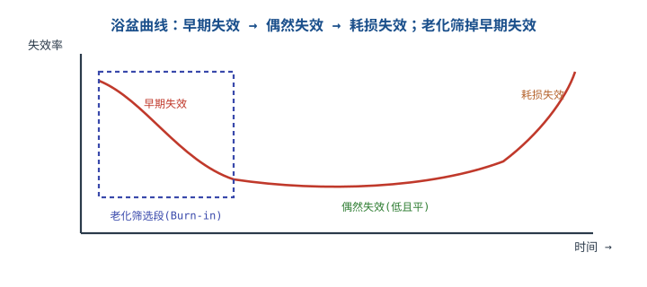
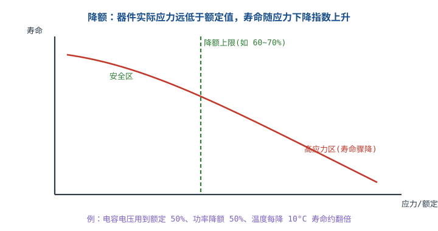

# 可靠性：降额、老化与环境试验

两块功能一样的板，一块电容用到额定的 90%、温度贴着上限，另一块只用 50%、留足裕量，几年后故障率天差地别。可靠性的核心不是"测出来的合格"，而是**设计时把应力压在器件能长期承受的范围内，再用试验证明假设成立**。这一章把降额、加速模型、MTBF、环境试验串成一条链，最后用一个 −40~85°C 的工业产品算 10 年寿命需要什么试验条件、多少样品。

## 1. 设计动机

::: motivation 四个真实的可靠性现场
**场景一：电容用到额定 90%。** 16V 电解电容用在 15V 轨上，常温测试全过；夏天机箱内 75°C，两年后批量鼓包。电压降额不足 + 温度加速，寿命被两头挤压。

**场景二：85°C 环境用 105°C 电容。** 规格书说 105°C/5000h，工程师以为"85°C 肯定够"。按 10°C 法则，95°C 热点下寿命只有 10,000h，约 1.14 年；10 年目标根本达不到。

**场景三：把 MTBF 当寿命。** 规格书写 MTBF 100,000h（约 11.4 年），销售说"能用 11 年"。MTBF 是平均无故障间隔，不是"到 11 年才坏"；10 年后的可靠度可能只有 50% 左右。

**场景四：所有产品都做 168h 老化。** 低风险产品被过度老化，增加成本与耗损；高风险产品又老化不足，早期失效流向客户。老化时间要按浴盆曲线的早期段长度定，不是越长越好。
:::

这一章要回答的问题：

| 问题 | 决定什么 | 错判的后果 |
|---|---|---|
| 电压、电流、功率、温度各降多少 | 器件寿命与成本 | 降额不足早期失效，过度降额成本失控 |
| 温度加速怎么算 | 试验时间与样品数 | 试验做少了证据不足，做多了浪费 |
| MTBF 与寿命是什么关系 | 规格书怎么写 | 把 MTBF 当寿命，承诺无法兑现 |
| 环境试验做哪些、条件怎么选 | 设计验证覆盖 | 漏做关键应力，现场批量失效 |
| 老化筛什么、筛多久 | 出厂质量 | 早期失效流出或过度老化 |

## 2. 定义与直观

### 2.1 可靠性、失效率、MTBF 与寿命

**可靠性（reliability）**是产品在规定条件下、规定时间内完成规定功能的概率。三个"规定"缺一不可：没有条件、没有时间、没有功能定义，"可靠"就是形容词。可靠度记作 $R(t)$，无量纲，$0\le R(t)\le1$。

**失效率（failure rate）**是单位时间内发生失效的概率密度与剩余产品数之比，记作 $\lambda(t)$，单位 1/h（工程上常用 FIT，$1\ \text{FIT}=10^{-9}\ \text{/h}$）。**浴盆曲线**把失效率随时间分成三段：早期失效（递减）、偶然失效（近似恒定）、耗损失效（递增）。

**MTBF（Mean Time Between Failures，平均无故障时间）**是可修复系统两次故障之间的平均时间；**MTTF（Mean Time To Failure，平均失效前时间）**是不可修复产品从开始使用到失效的平均时间。两者在恒定失效率下都等于 $1/\lambda$，但含义不同：MTBF 隐含"坏了可以修，修好继续用"，MTTF 隐含"坏了就换"。

对恒定失效率 $\lambda$：

$$R(t)=e^{-\lambda t},\qquad MTBF=\int_0^\infty R(t)\,dt=\frac{1}{\lambda}$$

$R(t)$ 是可靠度，无量纲；$\lambda$ 是失效率，1/h；$t$ 是时间，h；$MTBF$ 的单位是 h。这个式子的适用条件是**偶然失效期、失效率近似恒定**；早期失效与耗损失效不适用，浴盆曲线两端不能拿这个式子外推。

### 2.2 降额是什么、不是什么

**降额（derating）**是让器件实际承受的应力低于额定值，以降低失效率、延长寿命。**应力比（stress ratio）**定义为：

$$S=\frac{\text{实际应力}}{\text{额定应力}}$$

$S$ 无量纲。电压、电流、功率、温度都可以定义各自的 $S$。降额准则通常写成"$S\le S_{\max}$"，例如"MOS 的 $V_{DS}$ 不超过额定的 80%""电阻功率不超过额定的 50%~60%"。

降额不是"留点余量更保险"这么含糊，它对应具体的失效机理：

- **电压降额**：降低氧化层击穿、介质击穿、电迁移的驱动力；
- **电流降额**：降低焦耳热、接触温升、熔丝老化；
- **功率降额**：降低结温与热循环幅度；
- **温度降额**：按 Arrhenius 关系降低化学反应速率（电解液挥发、界面退化、金属间化合物生长）。

降额也不是万能的：它不能防 ESD、不能防机械损伤、不能防软件死机、不能防进水。**降额只对"应力驱动的退化/击穿"有效**，其它失效要靠设计、防护、试验与过程控制。

### 2.3 加速模型：温度、电压、温循、湿度

加速试验用高于正常条件的应力缩短试验时间，再用模型折算回使用条件。四种常用模型：

**Arrhenius（温度）**：

$$AF=\exp\left[\frac{E_a}{k}\left(\frac{1}{T_1}-\frac{1}{T_2}\right)\right]$$

$AF$ 是加速因子，无量纲；$E_a$ 是激活能，eV；$k=8.617\times10^{-5}$ eV/K 是玻尔兹曼常数；$T_1$ 是使用温度，K；$T_2$ 是加速温度，K，且 $T_2>T_1$。$AF$ 的物理含义是"加速条件下 1h 相当于使用条件下多少小时"。

**逆幂律（电压/电应力）**：

$$AF=\left(\frac{V_2}{V_1}\right)^n$$

$V_1$ 是使用电压，V；$V_2$ 是加速电压，V；$n$ 是电压加速指数，无量纲，随失效机理变化（典型 2~10，**具体以器件资料与试验拟合为准**）。

**Coffin-Manson（温度循环）**：

$$AF=\left(\frac{\Delta T_2}{\Delta T_1}\right)^m$$

$\Delta T_1$ 是使用温循幅度，K；$\Delta T_2$ 是试验温循幅度，K；$m$ 是疲劳指数，焊点常取 2~4，无量纲。这个式子只考虑温循幅度，忽略循环频率、驻留时间与升降温速率，精确评估要用修正模型。

**Peck（湿度）**：

$$AF=\left(\frac{RH_2}{RH_1}\right)^{-n}\exp\left[\frac{E_a}{k}\left(\frac{1}{T_1}-\frac{1}{T_2}\right)\right]$$

$RH_1$、$RH_2$ 是使用与试验相对湿度，%；$n$ 是湿度指数，典型 2~3；其余符号同上。湿度加速的失效机理是水汽扩散、腐蚀、离子迁移，温度与湿度耦合，不能只升温度不升湿度。

### 2.4 环境试验的选择逻辑

环境试验不是"把标准里的项目全做一遍"，而是**按产品会遇到的应力选**：

| 试验 | 主要考什么 | 典型标准 | 什么时候必须做 |
|---|---|---|---|
| 低温工作/贮存 | 材料变脆、液晶响应、电池容量、启动 | IEC 60068-2-1 / GB/T 2423.1 | 有户外、冷链、北方运输场景 |
| 高温工作/贮存 | 器件降额、电解液、塑料变形、热保护 | IEC 60068-2-2 / GB/T 2423.2 | 几乎所有电子产品 |
| 温度变化 | 焊点疲劳、CTE 失配、涂覆开裂 | IEC 60068-2-14 / GB/T 2423.22 | 有功率循环、昼夜温差、运输 |
| 恒定湿热 | 绝缘下降、金属腐蚀、霉变 | IEC 60068-2-78 / GB/T 2423.3 | 高湿、南方、仓储 |
| 交变湿热 | 凝露、呼吸效应、界面分层 | IEC 60068-2-30 / GB/T 2423.4 | 有凝露风险、户外、海运 |
| 正弦振动 | 共振、紧固件松动、引脚疲劳 | IEC 60068-2-6 / GB/T 2423.10 | 运输、车载、风机/泵周边 |
| 随机振动 | 宽带激励、包装运输 | IEC 60068-2-64 / GB/T 2423.56 | 运输、车载、航空 |
| 冲击 | 跌落、碰撞、安装冲击 | IEC 60068-2-27 / GB/T 2423.5 | 便携、手持、有跌落风险 |
| 盐雾 | 电化学腐蚀、连接器接触电阻 | IEC 60068-2-52 / GB/T 2423.18 | 沿海、船用、户外 |
| ESD | 静电放电、接口损坏 | IEC 61000-4-2 | 所有含外露接口的产品 |
| 防护等级 | 尘、水进入 | IEC 60529 | 户外、工业、清洗环境 |

表中的"什么时候必须做"是工程判断，不是标准强制清单；具体项目、严酷等级、持续时间要按产品规范、客户要求与适用标准确定。**试验条件抄同行没有意义**：同行可能用在室内，你的产品在海上平台，盐雾和湿热就不是一个量级。

::: analogy 体检与压力测试
降额像平时保持健康的生活方式，环境试验像体检和压力测试。体检正常不代表永远不会生病；压力测试能发现隐藏问题，但测试条件太狠也会把人送进医院。类比的边界：人可以恢复，产品的失效机理一旦被激发就是永久损伤；加速试验不能超过器件额定条件去"硬逼"，否则激发的是另一种机理，折算回使用条件没有意义。
:::

## 3. 定量关系

### 3.1 降额准则：电压、电流、功率、温度

下面这张表是**通用工业/消费类产品的工程上限**，不是标准强制值。不同标准、不同公司、不同客户要求可能更严；实际取"公司规范、客户要求、适用标准"三者中最严的一档。

| 应力 | 器件/参数 | 典型上限 $S_{\max}$ | 依据/机理 | 备注 |
|---|---|---|---|---|
| 电压 | 陶瓷电容 DC 电压 | 50% | 介质击穿、直流偏置降容、长期退化 | 高可靠场合取 50%，一般可取 80% |
| 电压 | 铝电解电容 DC 电压 | 80% | 氧化层击穿、漏电流 | 高温/高可靠取 60%~70% |
| 电压 | 钽电容 DC 电压 | 50% | 场致晶化、浪涌失效 | 钽电容对浪涌敏感，建议再加限流 |
| 电压 | MOS $V_{DS}$ | 80% | 雪崩击穿、振铃尖峰 | 必须含开关尖峰与余量 |
| 电压 | 二极管 $V_R$ | 80% | 反向击穿、热失控 | 含反向恢复尖峰 |
| 电流 | LED 正向电流 | 70%~80% | 结温、光衰 | 高温环境再降 |
| 电流 | 连接器/端子 | 70%~80% | 接触温升、氧化 | 按端子额定与温升曲线 |
| 电流 | 电感 $I_{rms}$ | 80% | 绕组温升、绝缘老化 | 同时校核 $I_{sat}$ |
| 电流 | 电感 $I_{sat}$ | 80% | 磁芯饱和、电流失控 | 高温下 $I_{sat}$ 会下降 |
| 功率 | 电阻 | 50%~60% | 长期漂移、热斑 | 高压/高阻再降 |
| 功率 | MOS 总损耗 | 由 $T_j$ 约束 | 热循环、电迁移 | 见下一行 |
| 温度 | MOS/二极管 $T_j$ | 80% 的 $T_{j,\max}$ | Arrhenius、热循环 | 150°C 额定对应 120°C |
| 温度 | 铝电解环境温度 | 额定上限 −10~20°C | 电解液挥发 | 105°C 额定用到 85~95°C |
| 温度 | PCB 材料 | 低于 $T_g$ 20°C | 分层、翘曲 | 无铅回流还要看 Td |
| 其它 | 晶振驱动功率 | 70% | 老化、ESR 上升 | 过驱会加速老化 |
| 其它 | 继电器触点电流 | 75% | 电弧、触点烧蚀 | 感性负载再降 |

**怎么用这张表**：先算实际应力（含最坏情况、尖峰、温度），再除以额定值得到 $S$，与 $S_{\max}$ 比较。**不要用典型值算降额**：典型值是 25°C、标称电压下的数字，最坏情况可能差 30%~50%。器件参数以数据手册的最坏条件为准；数据手册没给的，按"典型量级，以实测为准"处理。

降额的三个常见误区：

1. **只降电压不降温度**：电解电容的寿命主要由温度决定，电压降了但温度贴着上限，寿命仍然不够；
2. **只降稳态不降瞬态**：开关尖峰、浪涌、启动冲击是瞬时应力，按稳态算降额会漏掉最坏点；
3. **降额表直接套用**：不同标准（IPC-9592B、NASA EEE-INST-002、公司规范）对同一器件的限值不同，取最严者，并写清依据。

### 3.2 Arrhenius 加速因子

把 2.3 的 Arrhenius 式展开，工程上更常用"温度每升 10°C 寿命减半"的经验式：

$$L_2=L_1\,2^{-\Delta T/10},\qquad \Delta T=T_2-T_1$$

$L_1$ 是温度 $T_1$ 下的寿命，h；$L_2$ 是温度 $T_2$ 下的寿命，h；$\Delta T$ 是温差，K（数值上等于 °C 差）；指数中的 10 是"10°C 法则"的经验常数。这个式子是 Arrhenius 在特定 $E_a$ 下的近似，**只在额定温度附近、同一失效机理下有效**；跨 50°C 以上外推，误差可能很大，必须用厂家曲线或试验数据修正。

Arrhenius 与 10°C 法则的关系：若 $E_a\approx0.7$ eV、温度在 60~100°C，10°C 法则与 Arrhenius 的偏差通常在 10%~20% 以内；$E_a$ 越高，温度加速越强。**不要用 Arrhenius 外推到不同机理**：低温下可能是焊点疲劳，高温下变成电解液干涸，两者的 $E_a$ 完全不同。

### 3.3 失效率、MTBF 与串联系统

串联系统（所有单元都必须工作）的失效率相加：

$$\lambda_{\text{sys}}=\sum_{i=1}^{n}\lambda_i,\qquad MTBF_{\text{sys}}=\frac{1}{\lambda_{\text{sys}}}$$

$\lambda_i$ 是第 $i$ 个单元的失效率，1/h；$n$ 是单元数；$\lambda_{\text{sys}}$ 是系统失效率，1/h；$MTBF_{\text{sys}}$ 是系统 MTBF，h。这个式子的适用条件是**各单元失效独立、失效率恒定、串联结构**；共因失效、冗余、相关性会让实际值偏离。

并联冗余（至少一个工作）：

$$R_{\text{sys}}=1-\prod_{i=1}^{n}(1-R_i)$$

$R_i$ 是第 $i$ 个单元的可靠度，无量纲；$R_{\text{sys}}$ 是系统可靠度。两单元相同、$R=0.9$ 时，$R_{\text{sys}}=1-(1-0.9)^2=0.99$。**冗余能提高可靠度，但不能消除共因失效**：同一电源、同一连接器、同一软件缺陷会让两个单元同时失效，实际收益低于计算值。

**MTBF 不是寿命**。恒定失效率下，$R(t)=e^{-t/MTBF}$；$t=MTBF$ 时 $R=1/e=0.368$，即约 36.8% 的产品能活到 MTBF，**不是"平均能用 MTBF 这么久"**。这个区别在规格书、销售话术与客户承诺里必须写清。

### 3.4 加速寿命试验的样品数

用"零失效"试验证明可靠度 $R$、置信度 $C$ 时，样品数：

$$n=\frac{-\ln(1-C)}{-\ln R}\cdot\frac{t_m}{AF\,t_a}$$

$n$ 是样品数，只；$C$ 是置信度，小数；$R$ 是目标可靠度，小数；$t_m$ 是任务时间，h；$AF$ 是加速因子，无量纲；$t_a$ 是每个样品的加速试验时间，h。这个式子的适用条件是**恒定失效率、零失效、样品独立、失效机理与使用条件一致**；出现失效时要用二项分布/卡方分布，不能继续套这个式子。

若已知任务时间与目标可靠度，也可以先算总加速器件小时：

$$T_a=\frac{-\ln(1-C)}{-\ln R}\cdot\frac{t_m}{AF}$$

$T_a$ 是加速条件下需要的总器件小时，h·只；再用 $n=T_a/t_a$ 分配样品数与试验时间。**样品数与试验时间可以互换**：22 只做 2346h 与 26 只做 2000h，总器件小时相近；但样品数太少会降低对批次一致性的覆盖，工程上通常取 ≥10~20 只。

### 3.5 温度循环与湿度加速

温度循环用 Coffin-Manson：

$$AF_{\text{TC}}=\left(\frac{\Delta T_{\text{test}}}{\Delta T_{\text{use}}}\right)^m$$

若使用温循幅度 25K、试验 100K、$m=3$，则 $AF=(100/25)^3=64$。若 10 年每天 1 个循环，共 $3650$ 个循环，试验等效循环数为 $3650/64=57$ 个；实际试验通常取 100~1000 个循环，因为还要覆盖升降温速率、驻留时间、安装应力与批次差异。**这个例子说明模型只给量级，不能替代标准规定的试验剖面**。

湿度用 Peck 模型，温度与湿度同时加速；如果只升温度不升湿度，可能激发的是干热失效而不是湿热失效。盐雾试验则是电化学腐蚀，不能用 Arrhenius 折算，按标准规定的喷雾/干燥循环做。

### 3.6 环境试验矩阵

把 2.4 的选择逻辑落成矩阵：

| 产品场景 | 低温 | 高温 | 温变 | 恒定湿热 | 交变湿热 | 振动 | 冲击 | 盐雾 |
|---|---|---|---|---|---|---|---|---|
| 室内消费电子 | ○ | ● | ○ | ○ | — | ○ | ● | — |
| 工业控制柜内 | ● | ● | ● | ● | ○ | ● | ○ | — |
| 户外/沿海 | ● | ● | ● | ● | ● | ● | ● | ● |
| 车载/运输 | ● | ● | ● | ○ | ○ | ● | ● | ○ |
| 便携/手持 | ● | ● | ○ | ○ | ○ | ○ | ● | — |

● 必做；○ 按需；— 通常不做。这张表是**起点**，不是标准清单；具体严酷等级、持续时间、功能判据要按产品规范与适用标准确定。**安全/法规相关的试验（耐压、漏电流、接地）不在本表**，按安规标准单独做。

## 4. 典型计算

### 4.1 工业级 −40~85°C、10 年寿命：先算电容

**项目条件（假设）**：工业控制器，工作温度 −40~85°C，10 年寿命，24h/天，年运行 8760h，10 年任务时间 $t_m=87600$h。任务剖面（按时间占比）：25°C 占 30%，55°C 占 60%，85°C 占 10%。电容热点温度 = 环境 + 10K，所以三个热点为 35°C、65°C、95°C。

候选 A：105°C/5000h 铝电解；候选 B：125°C/5000h 铝电解。按 10°C 法则 $L=L_0\,2^{(T_0-T)/10}$ 估算：

| 热点 | 候选 A（105°C/5000h） | 候选 B（125°C/5000h） |
|---|---:|---:|
| 35°C | $5000\times2^{7}=640000$ h | $5000\times2^{9}=2560000$ h |
| 65°C | $5000\times2^{4}=80000$ h | $5000\times2^{6}=320000$ h |
| 95°C | $5000\times2^{1}=10000$ h | $5000\times2^{3}=40000$ h |

用 Miner 线性损伤累加，年损伤：

$$D_{\text{year}}=\sum_i \frac{f_i\times8760}{L_i}$$

$f_i$ 是第 $i$ 个温度点的时间占比，小数；$L_i$ 是该温度下的寿命，h；$D_{\text{year}}$ 是每年的损伤，1/年；寿命 $=1/D_{\text{year}}$，年。

候选 A：

$$D_A=\frac{0.3\times8760}{640000}+\frac{0.6\times8760}{80000}+\frac{0.1\times8760}{10000}$$

$$D_A=0.00411+0.06570+0.08760=0.15741\ \text{/年}$$

$$L_A=\frac{1}{0.15741}=6.35\ \text{年}$$

候选 B：

$$D_B=\frac{0.3\times8760}{2560000}+\frac{0.6\times8760}{320000}+\frac{0.1\times8760}{40000}$$

$$D_B=0.00103+0.01643+0.02190=0.03935\ \text{/年}$$

$$L_B=\frac{1}{0.03935}=25.41\ \text{年}$$

**结论**：105°C/5000h 电容在这个任务剖面下只有 6.35 年，达不到 10 年；125°C/5000h 电容约 25.4 年，有 2.54 倍裕量。这个算例也解释了为什么"85°C 环境用 105°C 电容"常常不够：**85°C 只占 10% 的时间，却贡献了 $0.0876/0.1574=55.7\%$ 的损伤**（候选 A）。高温段的权重不是按时间比例，而是按寿命比例放大的。

这里顺带更正一个常见算法：只按 65°C 算 105°C/2000h 电容，$2000\times2^{4}=32000$h≈3.65 年；如果产品目标是 10 年，这个结果不是"够用"，而是只有目标的三分之一左右。早先的资料把它当成"够用"，是把**某一个温度点的寿命**当成了**任务剖面的寿命**，也漏掉了 85°C 段的损伤。正确做法是按任务剖面加权（Miner 损伤），或者用厂家给出的温度—寿命曲线，而不是拿一个温度点外推全寿命。

注意：10°C 法则在 35°C 到 95°C 的 60K 跨度上外推，误差可能很大；这里的数字用于方案比较，最终选型要查厂家寿命曲线并做实测。**"典型量级，以数据手册为准"**。

### 4.2 10 年寿命的加速试验条件与样品数

**条件（假设）**：候选 B 的 125°C/5000h 电容，使用热点取任务剖面中占 60% 的 65°C；加速试验热点 125°C（试验箱 115°C + 10K 自热）；激活能 $E_a=0.7$ eV；任务时间 $t_m=87600$h；目标可靠度 $R=0.9$，置信度 $C=0.9$。

第一步，Arrhenius 加速因子：

$$T_1=65+273.15=338.15\ \text{K},\qquad T_2=125+273.15=398.15\ \text{K}$$

$$AF=\exp\left[\frac{0.7}{8.617\times10^{-5}}\left(\frac{1}{338.15}-\frac{1}{398.15}\right)\right]$$

$$\frac{1}{338.15}=2.9573\times10^{-3}\ \text{K}^{-1},\qquad \frac{1}{398.15}=2.5116\times10^{-3}\ \text{K}^{-1}$$

$$\frac{0.7}{8.617\times10^{-5}}=8123.2\ \text{K},\qquad 8123.2\times(2.9573-2.5116)\times10^{-3}=3.620$$

$$AF=e^{3.620}=37.34$$

第一步的结论：125°C 加速 1h，约相当于 65°C 使用 37.34h。

第二步，10 年任务时间折算到加速条件：

$$t_a=\frac{t_m}{AF}=\frac{87600}{37.34}=2345.9\ \text{h}\approx2346\ \text{h}$$

2346h 约 97.8 天。也就是说，**一个样品要在 125°C 热点下跑近 98 天，才等效 10 年**。

第三步，样品数（零失效，90% 可靠度，90% 置信度）：

$$n=\frac{-\ln(1-0.9)}{-\ln(0.9)}\cdot\frac{87600}{37.34\times2346}$$

$$-\ln(0.1)=2.3026,\qquad -\ln(0.9)=0.10536,\qquad \frac{2.3026}{0.10536}=21.85$$

$$\frac{87600}{37.34\times2346}=1.000$$

$$n=21.85\times1.000=21.85\rightarrow22\ \text{只}$$

即 22 只样品、每只 2346h，零失效，可在 90% 置信度下证明 90% 的产品能撑过 10 年。若把每只试验时间压到 2000h，则 $n=21.85\times87600/(37.34\times2000)=25.63\rightarrow26$ 只。**总器件小时相近，样品数与时间可以互换**。

第四步，最坏点校核。若按 95°C 热点（85°C 环境 + 10K）算：

$$AF_{95}=\exp\left[8123.2\times\left(\frac{1}{368.15}-\frac{1}{398.15}\right)\right]=e^{1.663}=5.27$$

$$t_{a,95}=\frac{87600}{5.27}=16622\ \text{h}\approx1.90\ \text{年}$$

22 只样品跑 1.9 年，工程上不可接受。**这说明最坏点不能靠温度加速硬扛**：要么选 125°C/长寿命电容、降低热点（散热/布局）、限制 85°C 下的工作时间，要么用厂家组件级寿命数据 + 少量验证。加速试验是证据，不是万能钥匙。

第五步，适用前提。以上计算成立的前提是：① 失效机理在 65°C 与 125°C 下相同（电解液干涸/氧化层退化，而不是焊点疲劳或封装开裂）；② 试验温度不超过器件额定 125°C；③ 样品独立、零失效；④ 任务剖面与真实使用一致。**任何一条不成立，$AF$ 与 $n$ 都要重算**。最终结论以器件数据手册、试验报告与认证机构/客户要求为准。

### 4.3 串联系统的 MTBF 与 10 年可靠度

**条件（假设）**：某控制器由 5 个单元串联，失效率分别为 MCU 2.0×10⁻⁶/h、电源 1.0×10⁻⁶/h、射频 0.5×10⁻⁶/h、传感器 3.0×10⁻⁶/h、连接器 0.5×10⁻⁶/h。

$$\lambda_{\text{sys}}=(2.0+1.0+0.5+3.0+0.5)\times10^{-6}=7.0\times10^{-6}\ \text{/h}$$

$$MTBF_{\text{sys}}=\frac{1}{7.0\times10^{-6}}=142857\ \text{h}\approx16.31\ \text{年}$$

1 年可靠度：

$$R(8760)=e^{-7.0\times10^{-6}\times8760}=e^{-0.06132}=0.9405$$

10 年可靠度：

$$R(87600)=e^{-7.0\times10^{-6}\times87600}=e^{-0.6132}=0.5416$$

**结论**：MTBF 约 16.3 年，但 10 年可靠度只有 54.2%。如果目标 10 年可靠度 ≥90%，要求的系统失效率为：

$$\lambda_{\text{req}}=\frac{-\ln(0.9)}{87600}=1.203\times10^{-6}\ \text{/h}$$

当前 $7.0\times10^{-6}$ 是要求的 $7.0/1.203=5.82$ 倍，必须降低失效率或加冗余。**MTBF 16 年不等于"10 年坏一半"这么简单，但确实不等于"10 年没问题"**；规格书要同时写 MTBF、任务时间与可靠度，不能只写一个数。

### 4.4 降额算例：MOSFET 的电压与结温

**条件（假设）**：24V 输入 Buck，开关节点最高 35V（24V 母线 + 约 11V 尖峰），候选 MOS 耐压 100V 与 60V；导通电流 2A，$R_{DS(on)}=50$ mΩ（100°C 典型），占空比 0.5，开关损耗 0.2W，$\theta_{JA}=60$°C/W，环境 85°C，$T_{j,\max}=150$°C。

电压降额：

$$S_{100}=\frac{35}{100}=35\%,\qquad S_{60}=\frac{35}{60}=58.3\%$$

按 80% 的通用上限，两者都合格；按 60% 的公司上限，60V 管 58.3% 已接近上限。**"58% 算不算贴近上限"取决于你采用的降额表**：用 60% 表就是接近，用 80% 表就还有 21.7 个百分点余量。关键不是数字本身，而是**同一项目从头到尾用同一张表**。

结温：

$$P_{\text{cond}}=I^2R_{DS(on)}D=2^2\times0.05\times0.5=0.1\ \text{W}$$

$$P_{\text{total}}=0.1+0.2=0.3\ \text{W}$$

$$T_j=T_a+P_{\text{total}}\theta_{JA}=85+0.3\times60=103\,^{\circ}\text{C}$$

$$S_{Tj}=\frac{103}{150}=68.7\%$$

按 $T_j\le80\%\times150=120$°C，103°C 合格，余量 17°C。若总损耗升到 0.6W：

$$T_j=85+0.6\times60=121\,^{\circ}\text{C}$$

$121/150=80.7\%$，超过 80% 上限。允许的最大总损耗：

$$P_{\max}=\frac{120-85}{60}=0.583\ \text{W}$$

即总损耗不能超过 0.583W。**降额算的是最坏情况**：最高环境、最大负载、最大 $R_{DS(on)}$、最坏尖峰，而不是 25°C 的典型值。

### 4.5 环境试验条件怎么选

以 4.1 的工业控制器为例，按"室内控制柜 + 偶尔户外安装"的场景，可选的试验矩阵如下（条件为示例，实际按产品规范与标准等级确定）：

| 试验 | 示例条件 | 判据 | 选它的理由 |
|---|---|---|---|
| 低温工作 | −40°C，16h，功能循环 | 功能 100% 通过，无启动失败 | 覆盖北方户外/冷库运输 |
| 高温工作 | +85°C，16h，满载 | 功能通过，$T_j$ 不超限 | 覆盖控制柜内高温 |
| 温度变化 | −40↔85°C，5K/min，50 循环 | 无焊点开裂、无涂覆开裂 | 覆盖昼夜温差与功率循环 |
| 恒定湿热 | 40°C/93%RH，96h | 绝缘电阻、功能通过 | 覆盖南方高湿仓储 |
| 交变湿热 | 25↔55°C，90%~96%RH，6 循环 | 无凝露导致的短路/腐蚀 | 覆盖凝露风险 |
| 正弦振动 | 10~500Hz，1g，每轴 2h | 无共振损坏、紧固件不松 | 覆盖运输与风机振动 |
| 冲击 | 15g/11ms，6 方向 | 无结构损坏、功能通过 | 覆盖搬运/安装冲击 |
| 盐雾 | 5% NaCl，35°C，循环 4 次 | 无腐蚀、接触电阻合格 | 仅户外/沿海版本 |
| ESD | 接触 ±4kV，空气 ±8kV | 功能不丢失、可恢复 | 外露接口 |
| 防护 | IP54 | 尘/水不进入 | 户外安装 |

**选择依据不是"标准里有"，而是"产品会遇到"**：室内产品做盐雾是浪费；户外产品不做盐雾是漏项。试验顺序也有讲究：通常先做温循/湿热，再做振动/冲击，最后做防护与 EMC；前一项造成的损伤可能在后一项暴露。具体顺序按产品规范与实验室建议。

## 5. 工程含义

### 5.1 降额清单

设计评审时逐条打勾：

- [ ] 每个器件的电压、电流、功率、温度应力都算过最坏值；
- [ ] 电解电容电压 ≤80%（高可靠 ≤60%~70%），温度 ≤额定上限 −10~20°C；
- [ ] 陶瓷电容按 DC bias 后的有效容量校核，电压 ≤50%~80%；
- [ ] 钽电容电压 ≤50%，并有浪涌/限流措施；
- [ ] MOS 的 $V_{DS}$ 含尖峰 ≤80%，$T_j$ ≤80% $T_{j,\max}$；
- [ ] 电阻功率 ≤50%~60%，高压/高阻再降；
- [ ] 电感 $I_{sat}$、$I_{rms}$ 都 ≤80%，高温下 $I_{sat}$ 下降要计入；
- [ ] 连接器/端子电流 ≤70%~80%，接触温升不超限；
- [ ] 保险丝不降额使用，按环境温度、浪涌与额定电流选型；
- [ ] 降额表版本与项目规范一致，异常项有偏差批准记录。

### 5.2 热设计与寿命

温度是大多数电子器件寿命的第一驱动。三个层次：

1. **降损耗**：选低 $R_{DS(on)}$、低 ESR、低铁损的器件，减少发热；
2. **降热阻**：铜箔、散热过孔、导热垫、散热片、风道；
3. **降环境**：远离热源、加隔板、控制机箱温升、限制高温段工作时间。

结温估算用 $T_j=T_a+P\,\theta_{JA}$，其中 $\theta_{JA}$ 依赖 PCB 铜面积、封装、气流与相邻器件；数据手册的 $\theta_{JA}$ 通常是 JEDEC 标准板，实际可能差 30%~50%。**热设计要用实测热成像/热电偶校核，不能只信手册**。

### 5.3 环境试验矩阵

环境试验的产出不是"通过/不通过"，而是**设计余量与失效模式**：

- 试验前：明确功能判据、性能判据、外观判据，避免"能开机就算过"；
- 试验中：监测关键参数（电压、电流、温度、时钟、通信），记录漂移；
- 试验后：功能复测、绝缘复测、外观检查、必要的开封分析；
- 失效时：先定位机理（焊点、器件、涂覆、连接器），再改设计，不要用"再烤久一点"掩盖。

### 5.4 老化与 ESS

**老化（burn-in）**是在出厂前用高温/满载运行，把早期失效筛掉；**环境应力筛选（ESS）**用温度循环 + 随机振动激发潜在缺陷。两者的区别：

| 维度 | 老化（Burn-in） | ESS |
|---|---|---|
| 应力 | 高温、满载、通电 | 温循、随机振动、电应力 |
| 目标 | 筛早期失效 | 激发工艺/装配缺陷 |
| 时间 | 数小时~数天 | 数小时~数十小时 |
| 风险 | 过老化增加耗损 | 过应力造成损伤 |
| 适用 | 高可靠/高价值产品 | 批次质量不稳定、新品导入 |

老化时间按浴盆曲线早期段长度定，不是越长越好。**全检老化成本高**，可以用抽样老化 + 过程控制替代；安全/医疗/汽车等高风险产品按适用标准与客户要求执行。

### 5.5 功能安全与认证

**功能安全（functional safety）**与可靠性不是一回事：功能安全关心安全相关系统在故障时能否把风险降到可接受水平，用 IEC 61508 的 SIL 与 PFH（每小时危险失效概率）度量；可靠性关心产品本身的失效概率与寿命。两者可以互相支持，但不能互相替代。

IEC 61508 的 SIL 与 PFH 区间（高需求/连续模式）大致为：SIL 1 $10^{-6}\le PFH<10^{-5}$，SIL 2 $10^{-7}\le PFH<10^{-6}$，SIL 3 $10^{-8}\le PFH<10^{-7}$，SIL 4 $10^{-9}\le PFH<10^{-8}$，单位 1/h。**这些区间是功能安全标准的口径，不是 MTBF 的倒数**；把 MTBF 直接换算成 SIL 是常见错误。

汽车级器件按 AEC-Q100 做应力试验与温度等级认证；电源转换设备可参考 IPC-9592B；Telcordia SR-332 是失效率预计方法，不是降额标准。**标准的选择取决于产品市场与客户要求，不能拿一份标准套所有产品**。

### 5.6 与其它章节的关系

- 流程与阶段门：DVT 的环境/EMC 试验、PVT 的良率，见 [硬件开发流程：需求到量产](development-flow.md)；
- BOM 与替代料：替代料的热、寿命、降额复核，见 [BOM、版本与成本控制](bom-version-cost.md)；
- 安规与认证：耐压、漏电流、温升与认证试验，见 [安规认证：3C / CE / FCC / UL](safety-certification.md)；
- 器件选型：功率器件、电容、电感的降额与损耗，见 [功率电感、电容、MOS 与二极管选型](../power/power-component-selection.md)；
- 热设计：结温、热阻、散热路径，见 [热设计与散热](../pcb/thermal-design.md)；
- 电容参数：DC bias、ESR、温度特性，见 [电容器参数全解](../components/capacitor-parameters.md)。

## 6. 常见坑

::: pitfall 可靠性里最常见的七个坑
- **把 MTBF 当寿命**：现象是规格书写"MTBF 100,000h，可用 11 年"；原因是混淆平均无故障间隔与可靠寿命；解决是同时写任务时间与可靠度，用 $R(t)=e^{-t/MTBF}$ 算给客户看。
- **85°C 环境用 105°C 电容**：现象是两年后批量鼓包；原因是只按额定温度选，没按 10°C 法则算寿命；解决是选 125°C/长寿命电容，或降低热点、限制高温工作时间。
- **只看标称电压不看 DC bias**：现象是 10µF 陶瓷加 12V 后只剩 3µF，纹波变大；原因是高介电常数陶瓷的直流偏置降容；解决是按偏置曲线选容量，留 2~3 倍裕量，或选更低介电材质。
- **只做常温测试**：现象是常温全过，高温现场批量重启；原因是高温下参数漂移、热保护、时序变化；解决是高温满载测试 + 最坏电压/负载组合。
- **老化时间越长越好**：现象是 burn-in 从 24h 拉到 168h，成本上升、耗损失效增加；原因是没按浴盆曲线早期段定时间；解决是按失效机理与早期段长度定老化时长，抽样验证。
- **加速试验温度超过器件额定**：现象是试验"通过"或"失效"都解释不了；原因是激发了另一种失效机理；解决是试验温度不超过额定，先做机理分析，再选加速模型。
- **降额表直接套用**：现象是同一器件在不同项目里限值不同，评审吵架；原因是标准/公司规范/客户要求混用；解决是项目开始时锁定降额表版本，取最严者，偏差走批准。
:::

## 7. 自测题

使用热点 65°C、加速热点 125°C、Ea=0.7 eV。Arrhenius 加速因子是多少？10 年（87,600h）等效加速时间是多少？

$T_1=338.15$ K，$T_2=398.15$ K；$1/T_1=2.9573\times10^{-3}$，$1/T_2=2.5116\times10^{-3}$，差 $4.457\times10^{-4}$。

$E_a/k=0.7/(8.617\times10^{-5})=8123.2$ K；指数 $=8123.2\times4.457\times10^{-4}=3.620$；$AF=e^{3.620}=37.34$。

等效时间 $t_a=87600/37.34=2345.9$ h≈2346h≈97.8 天。也就是说，125°C 下跑 1h 约等于 65°C 下 37.34h。

目标可靠度 90%、置信度 90%、零失效，10 年任务、AF=37.34。若每个样品做 2346h，需要多少只？做 2000h 呢？

$n=\frac{-\ln(0.1)}{-\ln(0.9)}\times\frac{87600}{37.34\times2346}=21.85\times1.000=21.85\rightarrow22$ 只。

若每只 2000h：$n=21.85\times87600/(37.34\times2000)=25.63\rightarrow26$ 只。

总器件小时相近，样品数与时间可以互换；但样品太少会降低批次覆盖，工程上通常取 ≥10~20 只。

5 个单元串联，失效率分别为 2.0、1.0、0.5、3.0、0.5（×10⁻⁶/h）。系统 MTBF 是多少？10 年可靠度是多少？

$\lambda_{\text{sys}}=(2.0+1.0+0.5+3.0+0.5)\times10^{-6}=7.0\times10^{-6}$/h。

$MTBF=1/(7.0\times10^{-6})=142857$h≈16.31 年。

$R(10\ \text{年})=e^{-7.0\times10^{-6}\times87600}=e^{-0.6132}=0.5416$，即 54.2%。MTBF 16 年不等于 10 年可靠度 90%；要 90% 需 $\lambda\le1.203\times10^{-6}$/h，当前是它的 5.82 倍。

105°C/5000h 电容，任务剖面 35°C 占 30%、65°C 占 60%、95°C 占 10%。按 10°C 法则和 Miner 损伤，寿命是多少年？

寿命：$L_{35}=5000\times2^7=640000$h，$L_{65}=5000\times2^4=80000$h，$L_{95}=5000\times2^1=10000$h。

年损伤 $D=0.3\times8760/640000+0.6\times8760/80000+0.1\times8760/10000=0.00411+0.06570+0.08760=0.15741$/年。

寿命 $=1/0.15741=6.35$ 年，达不到 10 年。95°C 只占 10% 时间，却贡献 55.7% 的损伤，高温段的权重被寿命比例放大了。

MOS 耐压 60V，开关节点峰值 35V，$T_j=103$°C、$T_{j,\max}=150$°C。按 80% 降额，电压和温度各合格吗？

电压 $S=35/60=58.3\%$，低于 80%，合格；若公司表取 60%，则 58.3% 已接近上限。温度 $S=103/150=68.7\%$，低于 80%（120°C），合格，余量 17°C。

降额结论取决于采用的表；同一项目要锁定同一张表，并算最坏尖峰与最高环境。

工业控制器在室内控制柜、偶尔户外安装。环境试验至少该选哪些？盐雾要不要做？

至少：低温工作、高温工作、温度变化、恒定湿热/交变湿热、正弦振动、冲击、ESD、防护等级。盐雾只在户外/沿海版本做；室内版本做盐雾通常是浪费，但如果客户明确要求或运输经过海上，则按合同做。

选择依据是产品会遇到的应力，不是标准目录；试验顺序通常先温循/湿热，再振动/冲击，最后防护/EMC。

为什么加速试验不能把温度加到超过器件额定？超过会怎样？

超过额定可能激发另一种失效机理：例如电解电容从电解液干涸变成密封材料开裂，焊点从疲劳变成金属间化合物脆化。此时 Arrhenius 的 $E_a$ 不再适用，折算回使用条件的寿命没有意义，试验可能"通过"或"失效"都无法解释。

正确做法是试验温度不超过额定，先做失效机理分析，确认加速条件与使用条件机理一致，再选模型与试验时间。

## 8. 参考资料

- IEC 60068-2-1:2007、IEC 60068-2-2:2007、IEC 60068-2-14:2009、IEC 60068-2-27:2008、IEC 60068-2-6:2007、IEC 60068-2-52:2017 — 低温、高温、温度变化、冲击、正弦振动、盐雾循环的试验方法与判据。
- GB/T 2423.1-2008、GB/T 2423.2-2008、GB/T 2423.3-2016、GB/T 2423.4-2008、GB/T 2423.10-2019、GB/T 2423.17-2008、GB/T 2423.18-2021、GB/T 2423.22-2012 — 与上述 IEC 60068 系列对应的我国环境试验方法标准。
- IEC 61508-1:2010《Functional safety of electrical/electronic/programmable electronic safety-related systems — Part 1 — General requirements》— SIL 与 PFH 的定义与区间；功能安全与 MTBF 的区别以此为准。
- AEC-Q100《Failure Mechanism Based Stress Test Qualification for Integrated Circuits》（当前修订版）— 汽车级 IC 的温度等级、应力试验项目与判据。
- Telcordia SR-332 Issue 4《Reliability Prediction Procedure for Electronic Equipment》— 失效率预计与 MTBF 的工程方法；注意它是预计方法，不是降额标准。
- IPC-9592B《Requirements for Power Conversion Devices for the Computer and Telecommunications Industries》— 电源转换设备的降额、寿命与可靠性要求。
- NASA EEE-INST-002《Instructions for EEE Parts Selection, Screening, Qualification, and Derating》— 降额等级、器件筛选与质量等级的参考体系。
- O'Connor & Kleyner《Practical Reliability Engineering》第 5 版 — 浴盆曲线、Arrhenius/逆幂律/Coffin-Manson 模型、可靠性演示试验与置信度；本章的加速与样品数口径以此为基础。
