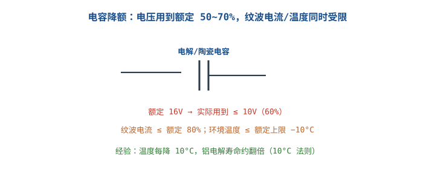

---

id: reliability-derating
title: "可靠性：降额、老化与环境试验 Reliability: Derating, Burn-in & Environmental Test"
part: 8
chapter: 可靠性与认证
order: 40
tags: [可靠性, 降额, 老化, 环境试验, 浴盆曲线, MTBF]
difficulty: 2
status: published
sources:
  - https://www.fides-reliability.org/
  - IPC-9592 / Telcordia 降额体系
---

# 可靠性：降额、老化与环境试验

## 1. 可靠性是设计出来的，不是测出来的

::: motivation 同样的板子，有的用十年有的三个月坏
两块功能一样的板，一块电容用到额定 90%、温度贴着上限，另一块只用 50%、留足裕量，几年后故障率天差地别。**可靠性的核心思想：让器件在远低于额定应力下工作**——这就是降额（Derating）。应力越低，寿命越长，且近似呈指数关系。
:::

## 2. 典型降额系数（定量判据）

降额 = 实际应力 ÷ 额定值。常用经验值（工业级，按 IPC-9592 / Telcordia 体系）：

| 器件 | 参数 | 额定 | 典型降额后实际使用 | 降额比例 |
|---|---|---|---|---|
| 铝电解电容 | 电压 | 16V | ≤ 10V | **≤ 60~70%** |
| 陶瓷电容 | 电压 | 25V | ≤ 12.5V（DC bias 还会再掉） | ≤ 50% |
| 电阻 | 功率 | 0.25W | ≤ 0.125W | ≤ 50% |
| BJT/MOSFET | 电压 Vds | 100V | ≤ 60V | ≤ 60% |
| LED | 电流 | 20mA | ≤ 10~15mA | ≤ 60~75% |
| 二极管 | 电流 | 额定 | ≤ 50~70% | ≤ 70% |
| 电解电容 | 环境温度 | 105°C | ≤ 85°C（降 20°C） | 温度降额 |

**温度法则**：铝电解电容温度每降 10°C，寿命约翻倍（10°C 法则）。所以热设计是可靠性的一部分。

## 3. 老化与环境试验

### 浴盆曲线与老化筛选
产品失效率随时间呈"浴盆形"：早期高（工艺缺陷）→ 偶然失效期（低且平）→ 耗损失效期（老化）。**老化（Burn-in）**就是在出厂前高温满载跑一段时间，把早期失效的苗子筛掉。

### 常见环境试验
- **高低温循环**：−40°C↔85°C，考热胀冷缩焊点/器件。
- **恒温恒湿**：考防潮、绝缘下降。
- **振动/冲击**：考机械连接。
- **ESD 测试**：接触 ±4kV、空气 ±8kV 等。

## 4. 示例（含计算）

::: example 选型时算降额
选一只 DC-DC 输入 24V，MOSFET 耐压选 100V。
- 实际关断时 SW 节点峰值约 35V（24V 母线 + ~11V 开关尖峰）。
- 占额定 35/100 = 35%，远低于 60% 上限，降额充分，可靠。
- 若只选 60V MOS：35/60 = 58%，贴近上限，尖峰扰动就可能击穿。
:::

::: example 电容寿命估算
某铝电解 105°C/2000h，实际工作在 65°C。
- 温差 105−65 = 40°C = 4 个 10°C 档。
- 寿命 ≈ 2000h × 2⁴ = 32000h ≈ 3.6 年。再留余量，实际够用。
:::

## 5. 上手操作清单

- [ ] 每个关键器件核对应力/额定 ≤ 降额表比例。
- [ ] 电容注意 DC bias 降额（陶瓷实际容量比标称低）。
- [ ] 发热器件先做热设计，温度是寿命第一杀手。
- [ ] 量产前做一轮高温老化筛选早期失效。

## 扩展与变种电路

### 扩展1：电容与功率器件降额 Derating in Detail

电容是可靠性短板，电压、纹波电流、温度三者要同时降额。

::: example 三个降额维度
- **电压**：≤ 额定 60~70%；陶瓷还要考虑 DC bias（加直流后容量缩水 30~70%）。
- **纹波电流**：实际纹波电流 ≤ 额定 80%，否则发热缩短寿命。
- **温度**：环境温度比额定上限低 10~20°C。
- 功率器件：结温 $T_j$ 不超过额定；功耗 $P=(T_j-T_a)/R_{\theta JA}$，留热阻裕量。
:::

对比"按标称电压选型"：只看标称不留裕量，尖峰和温度一叠加就超应力。

::: pitfall 陶瓷电容忘了 DC bias 降额
- **现象**：选了 10µF 陶瓷，加 12V 后实际容量只剩 3µF。
- **原因**：高介电常数陶瓷（X5R/X7R）加直流偏置后容量大幅缩水。
- **解决**：按 DC bias 曲线选容量，留 2~3 倍裕量，或选更低介电材质。
:::

### 扩展2：老化筛选与环境应力筛选 Burn-in / ESS

出厂前用高温/满载把早期失效产品筛掉，避免流向客户。

::: example 老化方案
- 高温（如 60~85°C）、满载通电跑 24~168h，中途监测参数漂移。
- 筛选标准：老化后参数超出规格的判为早期失效，剔除。
- 定量：早期失效率高的产品做 burn-in 后，现场 MTBF 显著上升；但 burn-in 本身也耗成本，按产品风险权衡。
- 环境应力筛选（ESS）更狠：温度循环 + 随机振动，激发潜在缺陷。
:::

对比"全检功能不做老化"：功能好不等于早期缺陷被激发；没老化的板子现场早期故障率高。

::: pitfall 老化时间越长越好的误区
- **现象**：一味拉长 burn-in 时间。
- **原因**：过长老化不筛更多缺陷，反而增加耗损失效、抬成本。
- **解决**：按浴盆曲线早期段长度定老化时间，足够即可。
:::

## 6. 常见坑与故障现象

::: pitfall 常见坑
- **器件用到额定值**：温度/电压贴上限，现场早期失效。留 30~50% 裕量。
- **忽略陶瓷电容 DC bias**：实际容量远低于标称，电源纹波变大。
- **只算常温不测高温**：高温下参数漂移、热保护触发，常温测试全过。
- **不做老化筛选**：工艺缺陷板流入客户，售后返修率高。
:::

## 7. 自测题

一只额定 16V 的铝电解，实际电路最高 12V，降额够不够？

12/16 = 75%，略高于建议的 60~70% 上限。建议换 25V 额定（12/25=48%）或留更多裕量，尤其温度高时。

为什么说温度是电容寿命的第一杀手？

铝电解遵循 10°C 法则：温度每降 10°C 寿命约翻倍。高温加速电解液挥发，直接决定寿命。热设计要让电容工作温度尽量低。

burn-in 老化筛选筛的是浴盆曲线哪一段的失效？

早期失效段（ infant mortality）。用高温满载在出厂前把工艺缺陷产品提前激发并剔除，让产品到客户手里时进入低而平的偶然失效期。

## 8. 参考资料

- FIDES – [电子可靠性预计方法论](https://www.fides-reliability.org/)（基于失效物理的降额/环境应力建模）
- IPC-9592、Telcordia（SR-332）降额与可靠性预计体系
