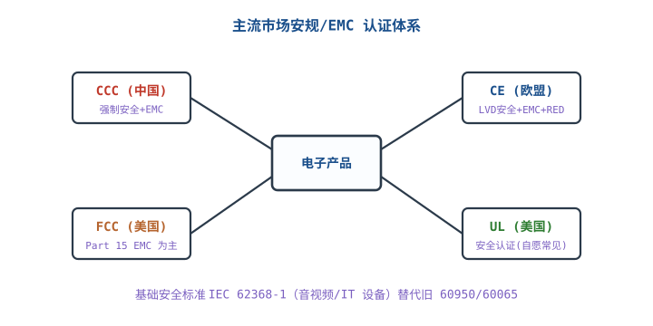
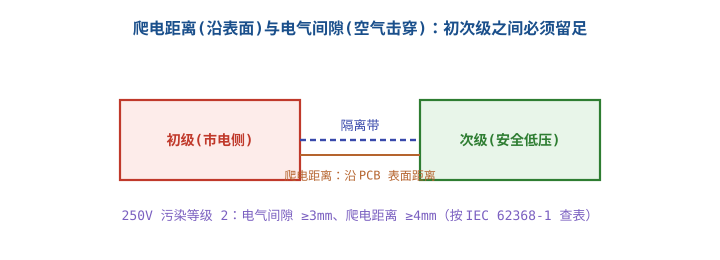

# 安规认证：3C / CE / FCC / UL

接市电的产品，安全不是"用起来没出事"，而是**在正常使用、单一故障、异常操作下，都不产生电击、起火、能量危险**。安规认证就是用标准化的试验与文件，证明这一点；EMC 认证证明产品不干扰别人、也不容易被别人干扰；能效认证证明它不浪费电。三者是三条独立的合规线，不能用一个"CE"概括。

::: warning 适用前提
本章的数值、距离、限值与周期是**工程量级和示例**，不是认证判据。具体产品是否属于 CCC 目录、适用哪个标准版本、试验条件与判定限值，必须以 **GB 4943.1-2022 / IEC 62368-1 的现行版本、目标市场法规、认证机构（实验室）的书面意见**为准。任何"按本章数值就能通过认证"的理解都是错误的；认证结论只能由具备资质的实验室与认证机构出具。
:::

## 1. 设计动机

::: motivation 四个真实的认证现场
**场景一：耐压测试打火。** 24W 适配器初次级之间爬电距离只有 4.5mm，按加强绝缘的要求不够。耐压打到 3kV 时变压器引脚处打火，整批样机返工。功能没问题，距离不够。

**场景二：辐射超标 6dB。** 12V/2A 适配器在 120MHz 附近辐射超标 6dB，原因是输出线缆共模电流。加一个共模电感能过，但客户要求不加成本；最后改 PCB 布局 + 屏蔽，周期多了 3 周。

**场景三：以为"CE"是一个认证。** 产品做了 EMC，没做 LVD 安规；带无线又没做 RED。海关抽检时技术文件不全，整批货卡住。CE 是**一组指令的符合性声明**，不是一张证书。

**场景四：能效没过。** 24W 适配器平均效率 85%，目标市场要求更高；换同步整流 + 低损耗变压器后过线，但成本涨了 1.8 元。能效不是"贴个标签"，它直接改电源拓扑与器件。
:::

这一章要回答的问题：

| 问题 | 决定什么 | 错判的后果 |
|---|---|---|
| 目标市场要哪些认证 | 上市资格与预算 | 漏证、卡关、召回 |
| 安规关键测试项是什么 | 设计预留 | 耐压/漏电流/温升不过，改板 |
| EMC 怎么测、怎么整改 | 滤波/屏蔽/布局 | 超标后加成本、延期 |
| 认证要多久、多少钱 | 项目排期 | 错过窗口、重复送测 |
| 常见不通过原因是什么 | 一次通过率 | 反复整改、费用翻倍 |

## 2. 定义与直观

### 2.1 安全、EMC、能效是三条独立的合规线

| 合规线 | 保护对象 | 核心问题 | 典型标准 | 失败后果 |
|---|---|---|---|---|
| **安全（Safety）** | 人、财产 | 电击、起火、能量、机械、化学 | IEC 62368-1 / GB 4943.1 | 触电、起火、召回、法律责任 |
| **EMC（电磁兼容）** | 无线电环境、其它设备 | 发射不超标、抗扰度够 | CISPR 32/35、FCC Part 15、EN 55032/55035 | 干扰通信、被干扰死机、不能上市 |
| **能效（Energy Efficiency）** | 能源 | 平均效率、空载功耗 | EU 2019/1782、DOE Level VI、GB 20943 | 不能销售、电费高、品牌受损 |
| **无线（Radio）** | 频谱 | 功率、频段、占空比、抗扰 | RED、FCC Part 15C、SRRC | 干扰频谱、不能上市 |

四条线的标准、测试方法、判定限值都不同。一个产品可以安规通过但 EMC 不过，也可以 EMC 通过但能效不过；**"CE 认证"只是把这些指令打包声明，不是一项测试**。

### 2.2 四大认证体系：CCC、CE、UL、FCC

| 认证 | 市场 | 性质 | 覆盖 | 主要标准 | 关键差异 |
|---|---|---|---|---|---|
| **CCC（3C）** | 中国 | 强制（目录内） | 安全 + EMC | GB 4943.1-2022、GB/T 9254.1 | 需工厂审查与获证后监督；是否属于目录以最新目录为准 |
| **CE** | 欧盟 | 强制 | LVD 安全 + EMC + RED（无线）+ ErP/RoHS | EN IEC 62368-1、EN 55032/55035、RED | 制造商自我声明 + 技术文件；无线无协调标准时需公告机构介入 |
| **UL** | 美国/加拿大 | 常见自愿（NRTL） | 安全 | UL 62368-1 | 非法律强制，但客户/保险/检查员常要求；需工厂跟踪检验 |
| **FCC** | 美国 | 强制 | 射频发射 | 47 CFR Part 15B/15C | 无意辐射体多走 SDoC；无线发射体需认证（TCB） |

四个体系最容易混淆的点：

1. **CCC 不是"所有电子产品都要"**。它按目录管理；是否属于目录、是否需要 CCC，要以最新目录与认证机构判定为准。目录内的产品没有 CCC 不得出厂/销售/进口。
2. **CE 不是"一张证书"**。LVD、EMC、RED、ErP、RoHS 各自有指令/法规；CE 标志是制造商的符合性声明，背后要有技术文件、风险评估、测试报告与 EU 符合性声明。**自我声明不等于不测试**。
3. **UL 不是美国法律对所有产品的强制要求**。UL 是 NRTL（国家认可实验室），UL 标志表示产品通过了 UL 标准并接受工厂跟踪检验；很多客户、保险公司、电气检查员会要求，但并非所有产品都有法定强制。
4. **FCC 不是"安全认证"**。FCC Part 15 管的是射频发射；无意辐射体（适配器、显示器等）通常走 SDoC，无线发射体（Wi-Fi/BLE）走认证。FCC 不管触电与起火，那是 UL/安规的范畴。

### 2.3 认证的三种模式

- **自我声明（SDoC，Supplier's Declaration of Conformity）**：制造商/进口商自己声明符合标准，保留测试报告与技术文件。FCC Part 15B、欧盟 LVD/EMC 常见这种模式。优点是快、省；缺点是**责任在制造商**，文件不全或测试不实，后果自负。
- **第三方认证（Certification）**：由认证机构测试、发证、跟踪检验。UL、CCC、FCC 无线认证（TCB）属于这一类。优点是公信力强；缺点是周期长、费用高、变更受控。
- **强制目录（CCC）**：目录内产品必须经指定机构认证并加施 CCC 标志，还要接受工厂审查与获证后监督。**证书不是终点，一致性才是**。

### 2.4 安规的关键概念

- **基本绝缘（basic insulation）**：防电击的第一层绝缘；
- **附加绝缘（supplementary insulation）**：基本绝缘失效后的第二层；
- **双重绝缘（double insulation）**：基本 + 附加；
- **加强绝缘（reinforced insulation）**：一层等效于双重绝缘的绝缘，常用于初次级之间；
- **电气间隙（clearance）**：两导体间穿过空气的最短距离，防空气击穿；
- **爬电距离（creepage）**：两导体间沿绝缘表面的最短距离，防表面漏电/起痕；
- **工作电压（working voltage）**：设备在正常条件下绝缘承受的最高电压（有效值/峰值/直流，按标准定义）；
- **污染等级（pollution degree）**：环境污秽程度，常见 2 级（办公室/实验室）；
- **过电压类别（overvoltage category）**：设备所在位置的瞬态过电压等级，常见 II 类（插座供电设备）；
- **材料组（material group）**：按 CTI（相比漏电起痕指数）分的绝缘材料等级，FR-4 常见 IIIa；
- **Class I/II/III**：按防电击方式分类，Class I 有保护接地，Class II 双重/加强绝缘无保护接地，Class III 由 SELV 供电；
- **ES1/ES2/ES3**：IEC 62368-1 的能量源分级，ES1 在正常/单一故障下不构成电击危险，ES2/ES3 需要防护；
- **接触电流（touch current）**：人触及时流过人体的电流；**保护导体电流**：流过 PE 的电流；
- **耐压（Hi-Pot）**：在绝缘上加高电压，验证不击穿。

::: analogy 绝缘像防水
基本绝缘像一层防水布，附加绝缘像第二层；加强绝缘像一层等效于两层的复合防水层。电气间隙是"空气这条缝有多宽"，爬电距离是"水沿着表面能爬多远"。类比的边界：水压是连续的，电压有瞬态尖峰；防水布破了还能补，绝缘一旦击穿/起痕，往往直接起火或电击，不能靠"再用胶带缠一下"解决。
:::

## 3. 定量关系

### 3.1 绝缘距离：查表，不是套一个固定数

绝缘距离由**工作电压、绝缘类型、污染等级、材料组、过电压类别、海拔**共同决定。以 250V 工作电压、污染等级 2、材料组 IIIa、过电压类别 II 为例，工程上常见的量级是：

| 绝缘类型 | 电气间隙（量级） | 爬电距离（量级） | 说明 |
|---|---|---|---|
| 基本绝缘 | 1.5~3 mm | 2.5~4 mm | 具体查标准表；3/4mm 是偏保守的取值 |
| 加强绝缘 | 3~6 mm | 5~8 mm | 约按基本绝缘两倍；不是简单"乘 2"就完事 |

**为什么不能背一个数**：同样 250V，污染等级从 2 升到 3、材料组从 I 降到 IIIb、海拔超过 2000m、瞬态过电压更高，表值都会变大；开槽、加筋、涂覆会改变爬电路径；变压器、光耦、继电器内部的绝缘结构也要单独算。**标准表是唯一依据，本章数值只用于早期布局预留**。

设计预留建议：在 PCB 面积允许时，按"基本绝缘 3mm/4mm、加强绝缘 6mm/8mm"预留，再按标准表复核；如果空间不够，优先加宽隔离带、开槽、改用加强绝缘器件，而不是"先画上去再说"。

### 3.2 耐压与漏电流

**耐压试验**是在绝缘上加规定的交流/直流电压，持续规定时间，观察是否击穿/闪络。试验电压由工作电压、绝缘类型、标准表格决定；对 250V 工作电压、加强绝缘的适配器，**典型试验电压在 3kV AC、60s 量级**。产线例行试验可能缩短时间、调整电压/跳闸电流，具体按标准与认证机构的方案执行。

**漏电流**分两种：

- **接触电流**：人触摸外壳/输出端时流过的电流，Class II 适配器通常按 **0.25mA 量级**控制；
- **保护导体电流**：Class I 设备流过 PE 的电流，通常按 **3.5mA 量级**控制。

这两个数是**典型量级**，具体限值、测量网络、测试条件按 IEC 62368-1 的表与图执行。Y 电容是接触电流的主要来源之一，估算式：

$$I_Y=2\pi f C U$$

$I_Y$ 是流过 Y 电容的电流（近似接触电流分量），A；$f$ 是电网频率，Hz；$C$ 是 Y 电容容量，F；$U$ 是施加电压，V。两个 Y 电容并联时容量相加：

$$I_{Y,\text{total}}=2\pi f (C_1+C_2)U$$

这个式子是正弦稳态估算，忽略了变压器绕组间电容、PCB 寄生电容、测量网络的加权；**实际接触电流以标准测量网络与实验室判定为准**。

### 3.3 EMC 限值：发射与抗扰度

以 CISPR 32/EN 55032 Class B（居住/商业环境）为例，电源端传导发射的典型限值：

| 频段 | 准峰值（QP） | 平均值（AV） |
|---|---|---|
| 0.15~0.5 MHz | 66→56 dBμV（随频率对数线性下降） | 56→46 dBμV |
| 0.5~5 MHz | 56 dBμV | 46 dBμV |
| 5~30 MHz | 60 dBμV | 50 dBμV |

10m 法辐射发射的典型限值：30~230MHz 为 **30 dBμV/m**，230~1000MHz 为 **37 dBμV/m**（Class B）；Class A 对应 40/47 dBμV/m。3m 法的限值通常比 10m 法高 10dB（40/47 dBμV/m），因为距离近、场强高。**具体限值、测量距离、天线高度、转台角度按标准与实验室方案执行**。

抗扰度以 EN 55035 为例，典型试验等级：ESD 接触 ±4kV、空气 ±8kV；EFT ±1kV（AC 端口）/±0.5kV（信号端口）；浪涌 ±1kV（线—线）/±2kV（线—地）；辐射抗扰 3V/m；传导抗扰 3V。**这些是常见等级，不是所有产品都一样**；医疗、汽车、工业环境另有更严的标准。

谐波电流按 EN 61000-3-2，电压波动/闪烁按 EN 61000-3-3；这两项对带 PFC/大电容整流的电源尤其重要。

### 3.4 能效：平均效率与空载功耗

能效认证看两个数：**平均效率**与**空载功耗**。平均效率是特定负载点（25%/50%/75%/100%）效率的平均值；空载功耗是输出空载时的输入功率。以 24W 输出为例：

$$P_{in}=\frac{P_{out}}{\eta},\qquad P_{loss}=P_{in}-P_{out}$$

$P_{in}$ 是输入功率，W；$P_{out}$ 是输出功率，W；$\eta$ 是效率，小数；$P_{loss}$ 是损耗，W。若 $\eta=0.88$：

$$P_{in}=\frac{24}{0.88}=27.273\ \text{W},\qquad P_{loss}=27.273-24=3.273\ \text{W}$$

若 $\eta=0.85$：

$$P_{in}=\frac{24}{0.85}=28.235\ \text{W},\qquad P_{loss}=28.235-24=4.235\ \text{W}$$

效率从 88% 降到 85%，损耗增加 $4.235-3.273=0.962$W。10 年 24h 运行多耗电：

$$E=0.962\times24\times365\times10/1000=84.3\ \text{kWh}$$

按 0.7 元/kWh，多花 $84.3\times0.7=59.0$ 元。**能效不只是合规，它直接进全生命周期成本**。

能效门槛按目标市场法规查表：欧盟外部电源看 2019/1782，美国看 DOE Level VI（10 CFR 430 Subpart B Appendix Z），中国看 GB 20943。**具体限值按功率分档与法规现行版本计算**，本章不抄具体数字，避免版本过期误导。

### 3.5 认证时间与成本

| 项目 | 典型周期 | 典型费用（示例） | 主要变量 |
|---|---|---|---|
| 安规预测试 | 1~2 周 | 0.5万~2 万元 | 是否一次通过、是否需整改 |
| 安规正式测试 | 4~6 周 | 2万~6 万元 | 产品类别、变压器/结构复杂度 |
| EMC 预测试/正式 | 2~4 周 | 1万~4 万元 | 辐射/传导整改轮次 |
| 无线（RED/FCC） | 4~8 周 | 3万~10 万元 | 模块是否预认证、频段/功率 |
| 能效 | 1~2 周 | 0.5万~1 万元 | 测试点、报告认可 |
| CCC（含工厂审查） | 6~10 周 | 1.5万~4 万元 | 目录、工厂质量体系 |
| UL（含跟踪检验） | 6~12 周 | 4万~12 万元 | 结构、材料、工厂审查 |

表中的周期与费用是**行业估算**，随产品复杂度、实验室排期、整改轮次、是否加急变化，不是报价。认证的关键路径通常不是"测试本身"，而是**排期 + 整改 + 报告审核**；一个 6 个月项目，认证至少要在 DVT 阶段启动，不能等 PVT 完再送。

## 4. 典型计算

### 4.1 220V 输入、12V/2A 输出的适配器认证清单

**产品条件（假设）**：外部电源适配器，输入 100~240V AC，输出 12V/2A（24W），Class II（无保护接地），塑料外壳，用于信息技术设备；目标市场中国、欧盟、美国。

| 类别 | 适用标准/法规 | 关键判据 | 预估周期 | 预估费用 |
|---|---|---|---|---|
| 安规（中国） | GB 4943.1-2022 | 爬电/间隙、耐压、接触电流、温升、机械、阻燃 | 5~7 周 | 2.5 万元 |
| 安规（欧盟） | EN IEC 62368-1（LVD 2014/35/EU） | 同上，按欧盟协调标准 | 4~6 周 | 2.5 万元 |
| 安规（美国） | UL 62368-1 | 同上，按 UL 要求 + 工厂跟踪检验 | 6~8 周 | 5 万元 |
| EMC 发射（欧盟） | EN 55032 Class B | 传导/辐射限值 | 2~4 周 | 1.5 万元 |
| EMC 抗扰（欧盟） | EN 55035 | ESD/EFT/浪涌/辐射/传导 | 2~3 周 | 1 万元 |
| 谐波/闪烁 | EN 61000-3-2 / -3-3 | 谐波电流、电压波动 | 1~2 周 | 0.5 万元 |
| EMC（美国） | FCC Part 15B Class B，SDoC | 传导/辐射限值 | 2~3 周 | 1 万元 |
| EMC（中国） | GB/T 9254.1 Class B | 传导/辐射限值 | 2~4 周 | 1 万元 |
| 能效（欧盟） | Regulation (EU) 2019/1782 | 平均效率、空载功耗 | 1~2 周 | 0.5 万元 |
| 能效（美国） | DOE 10 CFR 430 Subpart B Appendix Z（Level VI） | 平均效率、空载功耗 | 1~2 周 | 0.5 万元 |
| 能效（中国） | GB 20943-2013 | 平均效率、空载功耗 | 1~2 周 | 0.5 万元 |
| CCC（如目录内） | GB 4943.1 + GB/T 9254.1 | 安全 + EMC + 工厂审查 | 6~10 周 | 1.5 万元 |
| RoHS/REACH | EU 2011/65/EU 等 | 限用物质 | 1~2 周 | 0.3 万元 |

**清单的读法**：安规、EMC、能效是三条线；CCC 是"安全+EMC+工厂审查"的打包；UL 是北美安全的自愿/客户要求；FCC 只管射频发射。**如果适配器只是给自家整机配套、不单独销售，认证策略可能不同**（整机认证覆盖配套电源），要以产品定义与认证机构意见为准。表中的周期与费用是估算，**判据与试验条件以标准现行版本、目标市场法规与认证机构书面意见为准**。

关键判据展开：

1. **爬电/间隙**：按 250V、PD2、IIIa 查表；加强绝缘按上限预留 6mm/8mm，实际以标准表与结构为准；
2. **耐压与绝缘电阻**：初次级加强绝缘，典型 3kV AC/60s，无击穿/闪络；绝缘电阻按标准规定的测试电压与限值（典型 MΩ 量级）；产线例试按机构方案；
3. **接触电流**：Class II 按 0.25mA 量级控制，Y 电容选型要算；
4. **温升**：变压器绕组、MOS、电容、外壳触摸温度不超限；具体限值按标准表与材料等级；
5. **机械**：外壳冲击、跌落、端子拉力、电源线弯曲、螺钉扭矩；
6. **阻燃**：PCB、外壳、变压器骨架按 V-0 或等效要求；
7. **故障条件**：输出短路、过载、风扇堵转、元件短路，不得起火/触电；
8. **EMC**：Class B 限值 + 设计余量 ≥6dB；
9. **能效**：平均效率、空载功耗达标；
10. **标识/说明书**：额定值、极性、制造商、警告语、语言。

### 4.2 漏电流与 Y 电容

**条件（假设）**：250V/50Hz，Y 电容两只，每只 2.2nF；Class II 接触电流按 0.25mA 量级控制。

单只：

$$I_Y=2\pi\times50\times2.2\times10^{-9}\times250=1.728\times10^{-4}\ \text{A}=0.173\ \text{mA}$$

两只：

$$I_{Y,\text{total}}=0.173\times2=0.346\ \text{mA}$$

0.346mA 已经超过 0.25mA 的量级，**这个 Y 电容组合偏大**。允许的总容量：

$$C_{\max}=\frac{I_{\max}}{2\pi f U}=\frac{0.25\times10^{-3}}{2\pi\times50\times250}=3.18\times10^{-9}\ \text{F}=3.18\ \text{nF}$$

两只各 1.5nF，总 3nF：

$$I_{Y,\text{total}}=2\pi\times50\times3.0\times10^{-9}\times250=2.356\times10^{-4}\ \text{A}=0.236\ \text{mA}$$

0.236mA 低于 0.25mA 量级，留了一点余量。**但 Y 电容不是越小越好**：它同时承担共模滤波，容量太小会导致 EMC 超标；这是"漏电流 vs EMC"的经典取舍。实际选型要同时做接触电流测试与 EMC 预测试，并以标准测量网络为准。

### 4.3 耐压与绝缘距离

**条件（假设）**：250V 工作电压、PD2、IIIa、加强绝缘；按保守值预留电气间隙 6mm、爬电 8mm；耐压 3kV AC/60s。

耐压的电场强度估算（仅作量级理解，不作为判定）：

$$E=\frac{U}{d}=\frac{3000}{6}=500\ \text{V/mm}$$

6mm 空气的工频击穿场强约 3kV/mm 量级，500V/mm 看起来余量很大；但**耐压失效往往不是空气击穿，而是沿面爬电、变压器层间/绕组间绝缘、Y 电容引脚、光耦内部绝缘**。所以"间隙够"不等于"耐压过"：变压器结构、绝缘胶带层数、绕组顺序、光耦/隔离器件等级都要单独验证。

爬电距离 8mm 是保守预留；如果实测工作电压低于 250V、污染等级更低、材料组更好，标准表值可能更小。**但不能因为"功能正常"就缩小距离**；距离是安规判据，不是性能参数。

### 4.4 EMC 整改：超标 6dB 要加多少阻抗

**条件（假设）**：120MHz 辐射超标 6dB，怀疑输出线缆共模电流；LISN 等效 50Ω，准备加共模电感/磁环。

6dB 对应电压比：

$$A=20\log_{10}\frac{V_1}{V_2}=6\ \text{dB}\Rightarrow \frac{V_1}{V_2}=10^{6/20}=2.0$$

即需要把噪声电压减半。串联阻抗 $Z$ 与 50Ω 测量端形成分压，近似：

$$A=20\log_{10}\frac{50}{50+Z}$$

令 $A=-6$dB，则 $50/(50+Z)=0.5$，解得 $Z=50\ \Omega$。也就是说，**在 120MHz 需要一个约 50Ω 的共模阻抗**，才能拿到 6dB 的衰减。磁环/共模电感的阻抗随频率变化，要按器件阻抗—频率曲线选，不能只看 100MHz 标称值。

如果改用屏蔽，屏蔽效能：

$$SE=20\log_{10}\frac{E_1}{E_2}$$

6dB 同样对应场强减半。屏蔽要保证低阻抗搭接、缝隙/开孔不破坏完整性；否则"加了屏蔽罩还是超标"很常见。

**取舍**：加大 Y 电容能改善共模路径，但会增加接触电流（见 4.2）；加共模电感会增加成本/体积；改布局/减小环路通常最便宜但需要经验。正确顺序是：先定位噪声源与耦合路径（近场探头/电流探头），再选最便宜且不破坏安规的方案。

### 4.5 能效与电费

**条件（假设）**：24W 输出，效率 88% vs 85%，24h 运行，365 天/年，10 年，电价 0.7 元/kWh。

损耗差：

$$\Delta P_{loss}=\frac{24}{0.85}-\frac{24}{0.88}=28.235-27.273=0.962\ \text{W}$$

10 年多耗电：

$$E=0.962\times24\times365\times10/1000=84.3\ \text{kWh}$$

多花电费：

$$C=84.3\times0.7=59.0\ \text{元}$$

**结论**：效率差 3 个百分点，10 年多花约 59 元；如果产品售价 100 元，这已经超过售价的一半。对 24h 运行的产品，能效是硬成本，不是"绿色营销"。

### 4.6 认证排期与关键路径

**条件（假设）**：适配器认证含安规、EMC、能效、CCC（如目录内）、UL；预测试 2 周，安规 5 周，EMC 3 周，能效 1 周，CCC 8 周，UL 8 周；整改缓冲 2 周。

并行安排：

- 第 1~2 周：预测试（安规耐压/接触电流、EMC 预扫、能效摸底）；
- 第 3~7 周：安规正式 + EMC 正式 + 能效正式并行；
- 第 3~10 周：CCC/UL 并行（工厂审查排期）；
- 第 8~10 周：整改/复测缓冲；
- 第 10~12 周：报告审核、证书/声明归档。

关键路径是 **CCC/UL 的 8 周 + 整改缓冲 2 周 = 10 周**，不是安规测试的 5 周。**认证排期要按最长的那条线算**；如果 CCC 工厂审查排到 12 周，项目就要等 12 周。一个 6 个月项目，认证最晚要在第 10~12 周启动，才能在第 22~24 周拿到报告，与 PVT/MP 衔接。

## 5. 工程含义

### 5.1 设计阶段预留清单

- [ ] 目标市场与认证范围在需求阶段确认（CCC 目录、CE 指令、FCC SDoC/认证、UL 是否客户要求）；
- [ ] 初次级隔离带按加强绝缘预留，爬电/间隙按标准表复核；
- [ ] 变压器、光耦、隔离 DC-DC 选加强绝缘等级，不能只靠 PCB 距离；
- [ ] Y 电容容量按接触电流限值反算，同时做 EMC 预测试；
- [ ] 保险丝、X/Y 电容、变压器、光耦用认证件，BOM 标注认证编号；
- [ ] PCB 材料、外壳、变压器骨架满足阻燃要求；
- [ ] 外壳开孔、散热孔、端子、电源线入口满足机械与防护要求；
- [ ] EMC 滤波/屏蔽/接地在设计阶段预留位置与焊盘；
- [ ] 能效方案（同步整流、低损耗变压器、低待机功耗）在方案阶段确定；
- [ ] 认证样机与量产一致性（同一 BOM、同一工艺、同一关键件）。

### 5.2 认证路标与工厂审查

1. **预测试**：自己或第三方实验室摸底，重点看耐压、接触电流、辐射/传导、能效；
2. **正式送测**：按标准做全项，保留原始数据与照片；
3. **整改/复测**：先定位机理，再改设计；不要用"加磁环/贴铜箔"掩盖问题；
4. **报告/证书**：核对型号、输入/输出范围、关键件清单、照片与铭牌；
5. **工厂审查**：CCC/UL 会查质量体系、来料检验、生产线测试、关键件一致性；
6. **获证后监督**：年度/定期监督，变更要报备；关键件、结构、电路变更可能触发重新认证。

**证书不是一劳永逸**：安规件换料、变压器改结构、PCB 改布局、外壳改材料，都可能影响一致性；变更前先问认证机构，不要先改了再补。

### 5.3 安规件与供应链

安规件（保险丝、X/Y 电容、变压器、光耦、隔离器件、电源线、连接器）必须用认证型号，BOM 里写清认证编号与额定值。替代料如果安规等级不同，**不能直接换**；即使参数相同，认证编号不同也可能需要报备。采购降本时，安规件是"不能只看价格"的典型：一颗普通电容便宜几毛钱，失效可能起火。

### 5.4 常见不通过原因与整改

| 不通过项 | 典型原因 | 整改方向 |
|---|---|---|
| 耐压击穿 | 爬电/间隙不足、变压器层间绝缘不够、Y 电容引脚太近 | 加宽隔离带/开槽、改变压器结构、换加强绝缘器件 |
| 接触电流超标 | Y 电容太大、变压器绕组间电容大、PCB 寄生电容 | 减小 Y 电容、改变压器屏蔽/绕法、优化布局 |
| 温升超标 | 外壳散热差、变压器损耗大、MOS 损耗大 | 改散热/铜箔、换低损耗器件、优化风道 |
| 辐射超标 | 线缆共模电流、开关节点环路大、屏蔽不完整 | 加共模电感/磁环、减小环路、改屏蔽/接地 |
| 传导超标 | 差模/共模滤波不足、PFC/整流纹波 | 加 X/Y 电容、共模电感、改拓扑/频率 |
| ESD/浪涌失效 | 接口无防护、TVS 选型不当、地回路差 | 加 TVS/ESD 管、改接地/布局 |
| 能效不达标 | 同步整流未用、变压器/二极管损耗大、待机功耗高 | 改拓扑、换低损耗器件、优化待机 |
| 机械/结构不合格 | 外壳强度不足、端子拉力不够、电源线弯曲 | 加筋/加厚、改端子/线扣 |
| 标识/说明书不合格 | 缺警告语、额定值不符、语言不对 | 按标准与市场要求改铭牌/说明书 |

### 5.5 与其它章节的关系

- 流程与阶段门：认证排期、DVT/PVT 与认证的并行，见 [硬件开发流程：需求到量产](development-flow.md)；
- BOM 与替代料：安规件变更、认证编号、ECN，见 [BOM、版本与成本控制](bom-version-cost.md)；
- 可靠性与环境试验：温升、降额、环境试验，见 [可靠性：降额、老化与环境试验](reliability-derating.md)；
- 电气安全：触电、接地、RCD、绝缘配合的现场边界，见 [安全用电与触电防护](../basics/electrical-safety.md)；
- EMC 设计：滤波、屏蔽、接地、辐射/传导整改，见 [EMI/EMC 设计与整改](../pcb/emi-emc.md)；
- 电源拓扑：反激、同步整流、PFC 的效率与安规结构，见 [反激变换器](../power/flyback.md)。

## 6. 常见坑

::: pitfall 认证里最常见的七个坑
- **把基本绝缘当加强绝缘**：现象是耐压打火、爬电不够；原因是用基本绝缘的距离做初次级隔离；解决是按加强绝缘查表预留，变压器/光耦/隔离器件也要选加强绝缘等级。
- **Y 电容太大导致接触电流超标**：现象是安规测试漏电流超限；原因是只考虑 EMC 滤波，没算 Y 电容电流；解决是按 $I=2\pi fCU$ 反算容量，同时做 EMC 与漏电流测试。
- **认证后私改安规件/变压器**：现象是证书失效、工厂审查不符合；原因是把安规件当普通料降本；解决是变更前报备认证机构，关键件变更重新评估/送测。
- **忽略工厂审查与一致性**：现象是拿证后量产被查、证书暂停；原因是样品与量产 BOM/工艺不一致；解决是冻结关键件清单，来料检验、生产线测试、变更记录齐全。
- **EMC 不做预测试**：现象是正式送测超标，整改加成本、延期；原因是直接送实验室"赌一把"；解决是设计阶段预扫，留 ≥6dB 余量，预留滤波/屏蔽位置。
- **把 FCC SDoC 当认证证书**：现象是客户要"FCC 证书"拿不出；原因是 SDoC 是自我声明，不是证书；解决是准备测试报告、符合性声明、技术文件，按责任方要求保存。
- **CCC 目录判断错误**：现象是产品要 CCC 却没做，或不在目录却白做；原因是凭经验判断；解决是查最新目录、问认证机构，保留书面结论。
:::

## 7. 自测题

CCC、CE、UL、FCC 各自的性质与覆盖范围是什么？为什么不能用一个"CE"概括所有合规？

CCC 是中国强制认证（目录内），覆盖安全+EMC，含工厂审查；CE 是欧盟的符合性声明，覆盖 LVD 安全、EMC、RED（无线）、ErP/RoHS 等指令，制造商自我声明+技术文件；UL 是北美 NRTL 的安全认证，常见自愿但客户/保险/检查员常要求，含工厂跟踪检验；FCC 是美国射频发射强制要求，Part 15B 多走 SDoC，无线发射体走认证。

CE 不是一张证书，而是一组指令的符合性声明；安全、EMC、无线、能效各有标准与程序，不能互相替代。

250V/50Hz，两只 2.2nF Y 电容。每只和总的位移电流是多少？按 0.25mA 接触电流量级，容量该取多少？

每只 $I=2\pi\times50\times2.2\times10^{-9}\times250=0.173$mA；两只 $0.346$mA，超过 0.25mA 量级。

允许总容量 $C_{\max}=0.25\times10^{-3}/(2\pi\times50\times250)=3.18$nF；两只各 1.5nF 时总电流 $2\pi\times50\times3\times10^{-9}\times250=0.236$mA，留有余量。实际以标准测量网络与实验室判定为准。

24W 输出，效率 88% 和 85% 时输入功率、损耗各是多少？10 年 24h 运行多花多少电费（0.7 元/kWh）？

88%：$P_{in}=24/0.88=27.27$W，损耗 $3.27$W；85%：$P_{in}=24/0.85=28.24$W，损耗 $4.24$W。

损耗差 $0.97$W；10 年多耗电 $0.97\times24\times365\times10/1000=84.97$kWh；电费 $84.97\times0.7=59.48$ 元。

辐射在 120MHz 超标 6dB，用串联共模阻抗整改。50Ω 测量端下需要多大阻抗？还有哪些整改方向？

6dB 对应电压减半；$20\log_{10}[50/(50+Z)]=-6$dB，解得 $Z=50\Omega$。即在 120MHz 需要约 50Ω 共模阻抗。

其它方向：减小开关节点/线缆共模环路、加共模电感/磁环、屏蔽与低阻抗搭接、改 Y 电容/滤波（但会增加接触电流）、扩频/改开关频率（可能影响效率/EMC 其它频段）。先用近场探头/电流探头定位噪声源与路径，再选方案。

适配器认证清单至少包含哪几条线？安规、EMC、能效各举两个关键判据。

至少：安规（GB 4943.1/EN IEC 62368-1/UL 62368-1）、EMC 发射（EN 55032/FCC Part 15B/GB/T 9254.1）、EMC 抗扰（EN 55035）、谐波/闪烁（EN 61000-3-2/-3-3）、能效（EU 2019/1782/DOE Level VI/GB 20943）、RoHS/REACH；如目录内还要 CCC，如客户要求还要 UL。

安规判据：爬电/间隙、耐压、接触电流、温升；EMC 判据：传导/辐射限值、ESD/EFT/浪涌抗扰；能效判据：平均效率、空载功耗。

为什么认证排期的关键路径常常不是"测试 5 周"，而是 10~12 周？

测试只是其中一段；关键路径还包括实验室排期、预测试、整改/复测、报告审核、CCC/UL 工厂审查排期。安规 5 周、EMC 3 周可以并行，但 CCC/UL 的 8 周 + 2 周整改缓冲就是 10 周；如果工厂审查排到更晚，关键路径更长。

所以认证要在 DVT 阶段启动，不能等 PVT 完再送；项目计划要按最长的那条线留缓冲。

认证后把变压器从 A 厂换到 B 厂，参数相同，可以直接换吗？

不能直接换。变压器是安规关键件，绕组结构、绝缘胶带、骨架材料、爬电距离、认证编号都可能不同；即使电气参数相同，安规一致性也可能被破坏。

正确做法：变更前评估是否属于认证机构的"关键件变更"，按 ECN 走影响面分析，必要时报备/送测；保留变更记录与来料检验证据。具体以标准现行版本与认证机构意见为准。

为什么"CE 自我声明"不等于"不用测试"？技术文件至少应包含什么？

CE 自我声明是制造商对符合性的法律责任，不是免测许可。没有测试/评估证据，声明站不住脚；海关/市场监管抽查时拿不出技术文件，产品会被下架/处罚。

技术文件通常包括：产品描述与照片、铭牌、电路图/结构图、关键件清单、适用标准清单、风险评估、测试报告、EU 符合性声明、说明书；无线产品还包括射频测试与 RED 相关文件。具体清单按指令与认证机构要求。

## 8. 参考资料

- GB 4943.1-2022《音视频、信息技术和通信技术设备 第1部分：安全要求》（IDT IEC 62368-1:2018）— 能量源分级、绝缘配合、电气间隙/爬电距离、耐压、接触电流与温升；具体数值与试验条件按标准现行版本与认证机构意见执行。
- IEC 62368-1:2018《Audio/video, information and communication technology equipment — Part 1 — Safety requirements》— 安规设计与试验的国际基础标准；版本更新时以现行版为准。
- GB/T 9254.1-2021《信息技术设备、多媒体设备和接收机 电磁兼容 第1部分：发射要求》（对应 CISPR 32）— 传导/辐射发射限值与测量方法。
- GB/T 17626.2-2018《电磁兼容 试验和测量技术 静电放电抗扰度试验》（IDT IEC 61000-4-2）— ESD 抗扰度试验等级与判定。
- GB/T 17626.5-2019《电磁兼容 试验和测量技术 浪涌（冲击）抗扰度试验》（IDT IEC 61000-4-5）— 浪涌抗扰度试验。
- FCC 47 CFR Part 15 Subpart B《Unintentional Radiators》— 美国无意辐射体的发射要求与 SDoC 程序；无线发射体另见 Part 15 Subpart C。
- EN 55032:2015+A11:2020《Electromagnetic compatibility of multimedia equipment — Emission requirements》（CISPR 32）与 EN 55035:2017+A11:2020（CISPR 35）— 欧盟多媒体设备的发射与抗扰度要求。
- Directive 2014/35/EU（LVD）、Directive 2014/30/EU（EMC）、Directive 2014/53/EU（RED）— 欧盟低电压、电磁兼容与无线电设备指令；CE 符合性声明与技术文件的技术法规基础。
- Commission Regulation (EU) 2019/1782 — 外部电源生态设计要求；美国 DOE 10 CFR 430 Subpart B Appendix Z（Level VI）；GB 20943-2013《单路输出式交流-直流和交流-交流外部电源能效限定值及节能评价值》— 能效限值与测试方法按法规现行版本。
- UL 62368-1《Audio/video, information and communication technology equipment — Part 1 — Safety requirements》— 北美安规认证标准与工厂跟踪检验要求。
- IEC 60529《Degrees of protection provided by enclosures (IP Code)》— 外壳防护等级；具体 IP 等级按产品使用环境与客户要求确定。
