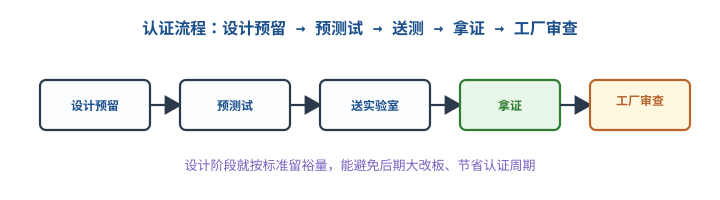

# 安规认证：3C / CE / FCC / UL

## 1. 为什么产品上市前要认证

::: motivation 不认证就卖 = 违法 + 担人命
接市电的产品若绝缘失效、漏电，会电到人；辐射超标的设备会干扰邻居无线电。因此各主要市场强制要求**安全（Safety）**与**电磁兼容（EMC）**认证。没认证的产品不能合法销售，出事故厂商全责。硬件工程师要在**设计阶段**就按标准留裕量，否则送测时大改板、周期拖几个月。
:::

## 2. 四大认证速查

| 认证 | 市场 | 性质 | 覆盖 | 对应标准 |
|---|---|---|---|---|
| **CCC（3C）** | 中国 | 强制 | 安全 + EMC | GB 4943.1-2022（IDT IEC 62368-1:2018） |
| **CE** | 欧盟 | 强制 | LVD 安全 + EMC + RED(无线) | EN/IEC 62368-1、EN 55032 |
| **FCC** | 美国 | EMC 强制 | Part 15 辐射/传导 | FCC Part 15 Subpart B |
| **UL** | 美国 | 安全(常见自愿) | 电击/起火 | UL 62368-1 |

基础安全标准已统一到 **IEC 62368-1**（音视频/信息技术设备安全），替代旧的 IEC 60950（IT）和 IEC 60065（音视频）。它按"能量源"分级管理，而不是按旧产品类别。

## 3. 关键设计判据：爬电距离与电气间隙

安规最核心的硬件指标是**初次级隔离**上的两个距离：

- **电气间隙（Clearance）**：两导体间穿过**空气**的最短距离，防空气击穿打火。
- **爬电距离（Creepage）**：两导体间沿**绝缘表面**的最短距离，防表面漏电/碳化。

定量判据（250V、污染等级 2、过电压类别 II 的**基本绝缘**典型值，具体查 IEC 62368-1 表格）：
- 电气间隙 ≥ **3mm**
- 爬电距离 ≥ **4mm**

初次级之间要求的是**加强绝缘（Reinforced）**，上述数值按 IEC 62368-1 约**翻倍**取（如电气间隙 ~6mm、爬电距离 ~8mm）；光耦/隔离变压器/隔离 DC-DC 本身也要选加强绝缘等级，不能只靠 PCB 走线间距凑。

## 4. 认证流程

- **设计预留**：原理图/PCB 阶段就满足爬电、熔丝、阻燃材料（V-0）要求。
- **预测试**：自己用 EMC 实验室/近场探头先摸底，少走弯路。
- **送测**：指定实验室（如 TUV/SGS/CTI）按标准测，出报告。
- **拿证 + 工厂审查**：CCC/UL 还要跟厂检，量产一致性受控。

## 5. 示例（含计算/判据）

::: example 开关电源初次级隔离
设计一款 220V 输入的电源，初次级之间用隔离反激变压器 + 光耦反馈。
- PCB 上初级地到次级地的开槽距离：实测爬电 5mm、间隙 3.5mm——**这只达到基本绝缘量级，不满足初级—次级的加强绝缘要求**。加强绝缘应按本章上文的 ~6mm 电气间隙 / ~8mm 爬电取值（具体查 IEC 62368-1 表），差距只能靠加大开槽（cutout）、加宽隔离带或改用带加强绝缘的隔离器件来补，不能按示例尺寸放行。
- 光耦选加强绝缘（Reinforced）型，隔离电压 ≥ 5kVrms。
- 初级保险丝选符合安规的认证型号，X/Y 电容选安规认证件。
:::

## 6. 上手操作清单

- [ ] 接市电产品必须先确认目标市场的强制认证。
- [ ] 初次级间距按 IEC 62368-1 查表留足。
- [ ] 关键安全件（保险丝、X/Y 电容、光耦、变压器）用认证件。
- [ ] 外壳材料选 UL94 V-0 阻燃。
- [ ] 设计阶段预 EMC，别等送测才改。

## 扩展与变种电路

### 扩展1：爬电距离与电气间隙设计 Creepage & Clearance Design

安规失败最常见的硬件原因就是初次级间距不够。

::: example 设计要点
- 间距随工作电压、污染等级、绝缘等级（基本/加强）查表增大。
- 开槽（slot）可在有限板宽内增加爬电距离；高压区禁止走信号线跨隔离带。
- 光耦/隔离器件的跨隔离距离要计入，不是只看 PCB。
- 定量：250V 污染 2 级，间隙 ~3mm、爬电 ~4mm；400V 母线要更大。
:::

对比"只看功能不看间距"：功能正常但间距不足，送测打高压（Hi-Pot）直接击穿，整板返工。

::: pitfall 跨隔离带进信号线
- **现象**：为省走线把信号跨过初次级隔离带。
- **原因**：破坏了加强绝缘间距，安规测不过。
- **解决**：跨隔离必须用隔离器件（光耦/数字隔离器），走线不跨带。
:::

### 扩展2：认证流程与预测试 Pre-scan & Certification Flow

认证周期长、费用高，设计阶段预测试能大幅减少送测返工。

::: example 预测试做法
- EMC 辐射：用近场探头先找辐射源，滤波/屏蔽到位后再送全电波暗室。
- 安全：自己先打耐压（Hi-Pot）测初次级绝缘是否击穿。
- 定量：预测试通过后送正式实验室，一次通过率高；没预测试常见返工 2~3 轮，每轮数周。
:::

对比"直接送测赌一把"：赌不过就改板重测，周期和费用翻倍。预测试是省钱省时。

::: pitfall 用非认证安规件
- **现象**：X 电容/保险丝用普通料，认证时被驳回。
- **原因**：安规件必须有认证编号（如 VDE/UL），普通电容失效会起火。
- **解决**：BOM 里安全件强制选认证型号，别为省钱替换。
:::

## 7. 常见坑与故障现象

::: pitfall 常见坑
- **设计不按标准留间距**：送测打高压击穿，整板改。
- **用普通件代替安规件**：X/Y 电容、保险丝、光耦必须认证件。
- **EMC 没预测试**：辐射超标送测才发现，加屏蔽/滤波要改板。
- **忘了工厂审查**：CCC/UL 拿证后量产变更要报备，否则证书失效。
:::

## 8. 自测题

爬电距离和电气间隙有什么区别？

电气间隙是两导体间穿空气的最短距离（防空气击穿）；爬电距离是沿绝缘表面的最短距离（防表面漏电碳化）。两者都要按工作电压查表留足，初次级隔离最关键。

产品要卖欧盟，需要满足哪些指令？

CE 标志涵盖：LVD 低电压安全指令（EN/IEC 62368-1）、EMC 指令（EN 55032/55035），带无线的还要 RED 指令。自我声明 + 技术文件 + CE 标志。

为什么设计阶段就要考虑认证，而不是做完再补？

安规间距、安规件选型、EMC 滤波都要落在 PCB 布局上。事后补要改板、重打样、重测，周期数月。设计阶段按 IEC 62368-1 留裕量，一次通过率高、省成本。

## 9. 参考资料

- IEC – [安规认证体系索引](https://www.iec.ch/)（IEC 62368-1、FCC Part 15、CCC、CE）
- IEC 62368-1（音视频/IT 设备安全）、FCC Part 15（电磁兼容）标准索引
