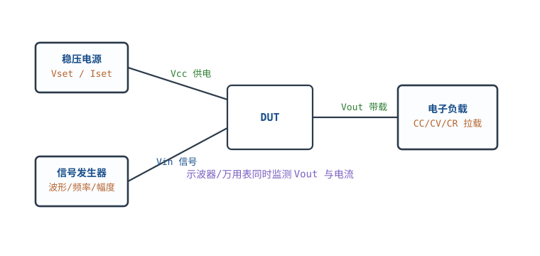
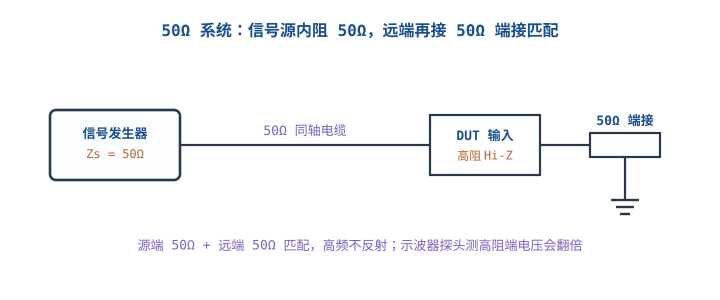
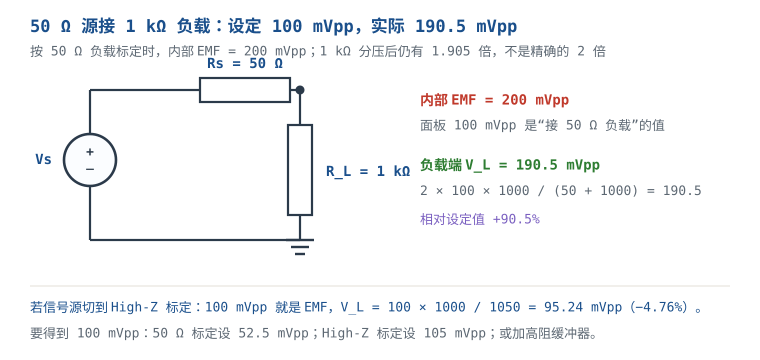

# 信号发生器、电子负载与稳压电源 Signal Generator, Electronic Load & Bench Supply

调试一个电路，万用表/示波器负责"看"，但还需要三样主动设备：**稳压电源**给电路供电并限流保护，**信号发生器**给输入端喂已知波形，**电子负载**在输出端模拟真实用电负载。三者配合，才能复现产品在真实负载下的行为；只测空载，很多问题根本不会出现。

这三样仪器都有一个"设定值不等于实际值"的陷阱：信号源显示 100 mVpp，接到 1 kΩ 放大器输入端可能是 190.5 mVpp，也可能是 95.24 mVpp，取决于它按 50 Ω 还是高阻标定；电子负载设 1 A 恒流，在 0.2 V 输出上可能根本拉不到 1 A；任意波形发生器标称 100 MS/s，不代表它能输出干净的 10 MHz 方波。本章按"源内阻 → 匹配 → 负载模式 → 动态测试 → 任意波形带宽"展开，每个设定值都给可复算的实际值。

本章符号：$V_s$ 是信号源开路电动势（EMF，V）；$R_s$ 是源内阻（$\Omega$）；$R_L$ 是负载电阻（$\Omega$）；$V_L$ 是负载端电压（V）；$\Gamma$ 是反射系数；$T_d$ 是电缆单向延迟（s）；$I$、$V$、$P$、$R$ 分别是电子负载的电流（A）、电压（V）、功率（W）、等效电阻（$\Omega$）；$f_s$ 是 AWG 采样率（Sa/s）。文中源内阻、电子负载最小电压、输出电容等为典型量级，具体以数据手册为准。

## 1 设计动机

::: motivation 三个现场
**现场一：信号源设 100 mVpp，放大器输入端却是 190.5 mVpp。** 信号源按"50 Ω 负载"标定，显示 100 mVpp 时内部 EMF 是 200 mVpp；接到 1 kΩ 输入，分压得 $200\times1000/1050=190.5\ \text{mVpp}$，比设定值高 90.5%。放大器提前进入非线性，工程师却去查增益电阻。

**现场二：5 V/1 A LDO 被电子负载拉出 0.9 V 跌落，判为"环路坏"。** 负载从 0.1 A 跳到 1 A，LDO 环路要 10 µs 才响应；这 10 µs 里输出电容独自供电。10 µF 时 $\Delta V=0.9\ \text{A}\times10\ \mu\text{s}/10\ \mu\text{F}=0.9\ \text{V}$；换成 100 µF 只剩 0.09 V。跌落主要是电容和环路带宽，不一定是 LDO "坏了"。

**现场三：100 MS/s AWG 生成 10 MHz 方波，看起来像正弦。** 10 MHz 在一个周期内只有 10 个采样点，5 次谐波（50 MHz）正好落在奈奎斯特频率；重建滤波器再把高次谐波滤掉，边沿变成几 ns 到十几 ns 的圆角。**"采样率 100 MS/s"与"能输出 10 MHz 方波"是两件事。**
:::

| 你想确认 | 先算 | 判据（工程经验值） |
|---|---|---|
| 源接负载后实际幅度 | $V_L=V_sR_L/(R_s+R_L)$ | 先确认幅度按 50 Ω 还是高阻标定 |
| 要不要端接 | 电缆延迟 $T_d$ 与上升时间 | $T_d>t_r/6$ 时按传输线处理 |
| 电子负载能不能拉到设定电流 | 最小工作电压与功率 | 低于最小电压会退出恒流 |
| 动态跌落多大 | $\Delta V=\Delta I\,t/C$ + ESR | 先看电容、ESR、环路响应 |
| 电源线会不会掉压 | $V_{drop}=I R_{lead}$ | 大电流用远端采样 |
| AWG 能不能生成这个边沿 | $BW$ 与 $f_s$、重建滤波器 | 边沿 $t_r\approx0.35/BW$ |
| 波形细节够不够 | 每周期点数、垂直位数 | 方波至少 10~20 点/周期，看谐波 |

**不算会摔在哪**，四个带数字的代价：

1. **幅度约定错，激励大 90.5%。** 50 Ω 标定的 100 mVpp 接到 1 kΩ，实际 190.5 mVpp；放大器可能削顶、发热、失真，测出来的 THD 全是激励过大造成的。
2. **电子负载模式错，测的不是电源。** CR 模式在电压跌落时自动减小电流，掩盖了电源的限流行为；CW 模式在低压时电流反升，可能触发过流保护。
3. **动态测试不看电容/环路。** 1 A 阶跃、10 µF、10 µs 响应，理论跌落 1 V；若只换 LDO 不换电容，问题照旧。
4. **AWG 带宽不够，边沿是假的。** 100 MS/s、重建滤波器 40 MHz，上升时间约 8.75 ns；用它测 1 ns 边沿的电路，看到的全是 AWG 的响应。

## 2 定义与直观

### 2.1 三类"源"仪器

| 仪器 | 角色 | 关键设定 | 关键限制 |
|---|---|---|---|
| 稳压电源 Bench Supply | 供电，CV/CC | 电压、电流限、远端采样 | 输出电容、环路、线损 |
| 信号发生器 Function/AWG | 喂已知波形 | 频率、幅度、偏置、输出阻抗/负载 | 带宽、采样率、重建滤波 |
| 电子负载 Electronic Load | 吸电流/模拟负载 | CC/CV/CR/CW、动态斜率 | 最小电压、功率、散热 |

### 2.2 信号源的戴维南模型：50 Ω 不是"可选附件"

大多数函数发生器/任意波形发生器的输出级是一个理想电压源串一只 **50 Ω** 电阻。面板上的"Output Impedance: 50 Ω / High-Z"通常不是真的切换内阻，而是告诉仪器"我假设负载是多少"，从而决定显示幅度按哪种负载标定：

- **50 Ω 模式**：显示值是"接 50 Ω 负载时的电压"，内部 EMF 是显示值的 2 倍。
- **High-Z 模式**：显示值是"开路/高阻负载时的电压"，内部 EMF 等于显示值。

实际内阻仍然是 50 Ω（少数仪器可切换 600 Ω 或其它，以手册为准）。**"High-Z"是幅度参考，不是把内阻变成无穷大。** 这一点是本章最重要的纠正：把"输出阻抗 50 Ω 或高阻"当成"内阻可切换"，会在分压计算上错一倍。

### 2.3 电子负载的四种模式

| 模式 | 行为 | 方程 | 典型用途 | 坑 |
|---|---|---|---|---|
| CC 恒流 | 无论电压多少，吸设定电流 | $I=I_{set}$ | 测电源负载调整率、电池放电 | 低于最小电压会退出恒流 |
| CV 恒压 | 调节电流，把端口电压维持在设定值 | $V=V_{set}$ | 测充电器/电池、模拟稳压源 | 不是电源，不能给 DUT 供电 |
| CR 恒阻 | 等效一只设定电阻 | $I=V/R_{set}$ | 模拟电阻负载、启动/短路 | 电压低时电流自动变小 |
| CW 恒功率 | 保持 $P=V I$ 恒定 | $I=P_{set}/V$ | 模拟 DC-DC 恒功率负载 | 低压时电流反升，可能过流 |

电子负载是**吸收功率**的设备，功率全部变成热：$P=V I$。它不能替代电源，CV 模式只是"把端口电压拉到自己设定的值"，方向是吸电流，不是灌电流。

### 2.4 稳压电源：CV、CC 与远端采样

台式电源通常有 CV（恒压）和 CC（恒流）两个环路：正常工作时 CV 稳压；负载电流超过设定限值后，电源进入 CC，电压被拉低以限制电流。**第一次上电把电流限设到预期值的 1.5~2 倍**，是为了让短路/接反时电源自动限流，而不是让 DUT 吃满电流。

电源的"设定 5 V"到"DUT 端 5 V"之间还有导线和接触电阻：

$$V_{DUT}=V_{set}-I(R_{lead+}+R_{lead-})$$

1 A 电流、0.05 Ω 总引线电阻，掉 50 mV；5 V 只剩 4.95 V。大电流/低电压场合要用**远端采样（remote sense）**：把 sense 线接到 DUT 端，电源自动补偿线损。

### 2.5 任意波形发生器：采样率、重建滤波、存储深度

AWG 的工作链是：**波形存储 → DAC（按 $f_s$ 更新）→ 重建滤波器 → 输出放大器**。三个限制：

- **奈奎斯特**：输出频率必须低于 $f_s/2$；实际可用上限通常是 $0.4f_s$ 左右，因为重建滤波器有过渡带。
- **重建滤波器**：把 DAC 的阶梯/镜像滤掉，但也会滤掉高次谐波，边沿变圆。
- **存储深度**：$T=M/f_s$，决定一次能播放多长的任意波形。

DAC 的零阶保持（zero-order hold）本身还有 $\operatorname{sinc}$ 滚降：

$$H(f)=\frac{\sin(\pi f/f_s)}{\pi f/f_s}$$

在 $f=0.4f_s$ 时 $H=0.7568$（$-2.42\ \text{dB}$），在 $f=0.5f_s$ 时 $H=0.6366$（$-3.92\ \text{dB}$）。即使没有重建滤波器，高频幅度也已经掉了。

::: analogy 信号源像"带内阻的水泵"，电子负载像"可编程阀门"
信号源是一个理想水泵串一根细管（50 Ω）：不管你怎么设定，水从细管出来时已经分掉一部分压力。负载越接近细管阻力（50 Ω），匹配越好；负载越轻（高阻），出口压力越接近水泵的全压。电子负载像一个可编程阀门：CC 是"无论水压多少，固定流量"；CV 是"无论流量多少，固定水压"；CR 是"固定开度"；CW 是"固定功率"。

类比的边界：水泵不会因为负载轻而"显示值翻倍"，信号源会，因为它的显示值是按 50 Ω 负载标定的。电子负载的阀门在低压下会关不死/开不够，CC 模式有最小工作电压，不是理想电流沉。
:::

## 3 定量关系

### 3.1 源内阻分压：设定值、EMF 与负载电压

信号源的戴维南模型：

$$V_L=V_s\frac{R_L}{R_s+R_L}$$

其中 $V_s$ 是内部 EMF，$R_s$ 是源内阻，$R_L$ 是负载。若面板按 50 Ω 负载标定，显示值 $V_{set}$ 满足：

$$V_{set}=V_s\frac{50}{R_s+50}$$

当 $R_s=50\ \Omega$ 时，$V_s=2V_{set}$。代入一般负载：

$$V_L=2V_{set}\frac{R_L}{50+R_L}$$

**几个关键值（$V_{set}=100\ \text{mVpp}$，50 Ω 标定）：**

| $R_L$ | $V_L$ | 相对设定值 | 说明 |
|---|---|---|---|
| 50 Ω | 100 mVpp | 1.000× | 匹配，显示值就是负载值 |
| 100 Ω | 133.3 mVpp | 1.333× | 已明显偏高 |
| 1 kΩ | 190.5 mVpp | 1.905× | 接近翻倍，但不是翻倍 |
| 1 MΩ | 199.99 mVpp | 2.000× | 近似开路，翻倍 |

**"50 Ω 源接高阻负载幅度翻倍"只在 $R_L\gg50\ \Omega$ 时成立。** 1 kΩ 时是 1.905 倍，100 Ω 时是 1.333 倍；把 1 kΩ 当"高阻"直接乘 2，会高估 5%。更关键的是：如果信号源设在 High-Z 模式，显示值本身就是 EMF，接 1 kΩ 时 $V_L=100\times1000/1050=95.24\ \text{mVpp}$，不是翻倍，而是低 4.76%。

### 3.2 匹配、反射与电缆

高频链路默认 50 Ω：源 50 Ω、电缆 50 Ω、负载 50 Ω。负载不等于 50 Ω 时，反射系数：

$$\Gamma=\frac{R_L-50}{R_L+50}$$

驻波比：

$$VSWR=\frac{1+|\Gamma|}{1-|\Gamma|}$$

回波损耗：

$$RL=-20\log_{10}|\Gamma|$$

**算例：1 kΩ 负载。** 

$$\Gamma=\frac{1000-50}{1000+50}=0.9048$$

$$VSWR=\frac{1+0.9048}{1-0.9048}=20.0$$

$$RL=-20\log_{10}(0.9048)=0.87\ \text{dB}$$

失配损耗：

$$-10\log_{10}(1-0.9048^2)=0.74\ \text{dB}$$

1 kΩ 对 50 Ω 系统是严重失配；低频（音频、传感器）可以按集总分压处理，高频（>10 MHz、长电缆）必须端接 50 Ω 或改用高阻探头/缓冲。

**什么时候要端接？** 电缆单向延迟：

$$T_d=\frac{L}{v}$$

同轴电缆 $v\approx2\times10^8\ \text{m/s}$，1 m 约 5 ns。按 $T_d>t_r/6$ 判据，$t_r<30\ \text{ns}$ 时就该考虑匹配；更严格地用往返延迟 $2T_d=10\ \text{ns}$，$t_r<10\ \text{ns}$ 时反射明显。端接后，源端 50 Ω + 电缆 50 Ω + 远端 50 Ω，负载得到 $V_{set}$（50 Ω 标定），不再翻倍。

### 3.3 电子负载四模式的方程与边界

- **CC**：$I=I_{set}$，只要 $V>V_{min}$。$V_{min}$ 典型 0.5~1 V（以数据手册为准）；低于它，MOSFET 进入线性区/无法维持电流，负载退出恒流。
- **CV**：$V=V_{set}$，负载吸收的电流由源决定：$I=(V_{source}-V_{set})/R_{source}$。它不能"把电压抬高"，只能"把电压拉低到设定值"。
- **CR**：$I=V/R_{set}$。5 Ω 在 5 V 时 1 A，在 1 V 时只有 0.2 A；它不是恒流，电源跌落后负载会自动"变轻"。
- **CW**：$I=P_{set}/V$。10 W 在 5 V 时 2 A，在 1 V 时要 10 A；低压时电流反升，容易触发过流/过功率保护。0 V 时无法维持功率。

功率与散热：

$$P=V I$$

24 V、2 A 就是 48 W，全部变成热。电子负载的功率额定通常有温度降额曲线；环境温度高、散热差时，允许功率低于铭牌值。

### 3.4 动态拉载：电容、ESR 与环路

电子负载的动态模式让电流在 $I_{low}$ 与 $I_{high}$ 之间周期切换，用来测电源的负载瞬态响应。电压跌落由三部分组成：

1. **电容电荷**：环路来不及响应的时间 $t_r$ 内，负载电流由输出电容提供：

$$\Delta V_C=\frac{\Delta I\,t_r}{C}$$

2. **ESR**：电流阶跃瞬间，电容 ESR 上的压降：

$$\Delta V_{ESR}=\Delta I\,R_{ESR}$$

3. **电缆/负载线电感**：电流斜率 $di/dt$ 在电感上产生尖峰：

$$\Delta V_L=L\frac{di}{dt}$$

**算例：5 V/1 A，$\Delta I=0.9\ \text{A}$（0.1→1 A），环路响应 $t_r=10\ \mu\text{s}$，$C=10\ \mu\text{F}$，$R_{ESR}=50\ \text{m}\Omega$，负载线 $L=1\ \mu\text{H}$，$di/dt=1\ \text{A}/\mu\text{s}$。**

$$\Delta V_C=\frac{0.9\times10\ \mu\text{s}}{10\ \mu\text{F}}=0.9\ \text{V}$$

$$\Delta V_{ESR}=0.9\times0.05=0.045\ \text{V}$$

$$\Delta V_L=1\ \mu\text{H}\times1\ \text{A}/\mu\text{s}=1\ \text{V}$$

三者不是简单相加（时间尺度不同），但量级说明：10 µF 时，电容跌落就有 0.9 V；电缆电感尖峰 1 V；ESR 只有 45 mV。换成 100 µF，$\Delta V_C=0.09\ \text{V}$，电容项降 10 倍，但电感尖峰仍在。**先看电容和布线电感，再看环路。**

### 3.5 稳压电源：线损、负载调整率与限流

**线损：**

$$V_{drop}=I(R_{lead+}+R_{lead-})$$

0.05 Ω、1 A 时 50 mV；5 V 输出到 DUT 只剩 4.95 V（−1%）。远端采样把 sense 线接到 DUT 端，电源把线损补回来；sense 线本身几乎不取电流，但要走 Kelvin 接法，避免 sense 点落在高电流路径上。

**负载调整率：**

$$\text{Load Regulation}=\frac{V_{no-load}-V_{load}}{\Delta I}$$

5.000 V 空载、4.980 V/1 A：

$$\frac{5.000-4.980}{1}=0.020\ \text{V/A}=20\ \text{mV/A}$$

相对值 $0.020/5.000=0.4\%$。这个指标要跟数据手册的测试条件（电流范围、温度、远端/本地采样）一起看。

**限流：** 第一次上电把 $I_{limit}$ 设到预期工作电流的 1.5~2 倍，短路时电源进入 CC，电压跌落而不是电流爆炸。但限流不是保险丝：半导体器件在毫秒级过流下仍可能损坏，限流值要按器件绝对最大额定值留裕量。

### 3.6 AWG 的带宽、上升时间与存储

**奈奎斯特与可用带宽：**

$$f_{out}<0.5f_s$$

实际受重建滤波器限制，常用上限 $0.4f_s$ 左右。要输出上升时间 $t_r$ 的边沿，需要：

$$BW\ge\frac{0.35}{t_r}$$

**算例：100 MS/s、重建滤波器 40 MHz。**

$$t_r\approx\frac{0.35}{40\ \text{MHz}}=8.75\ \text{ns}$$

想输出 1 ns 边沿，需要 $BW\ge350\ \text{MHz}$，采样率至少 1 GS/s（按 5 倍带宽则 1.75 GS/s 以上）。

**每周期点数：**

$$N_{pts}=\frac{f_s}{f_{out}}$$

10 MHz、100 MS/s 时每周期 10 点；一个方波至少要保留 5 次谐波，10 点/周期刚好到 5 次谐波（50 MHz），再高就被采样/滤波削掉。要看得过去的方波，每周期 20~30 点更稳妥，或直接用更高采样率。

**存储深度：**

$$T_{play}=\frac{M}{f_s}$$

1 M 点、100 MS/s 时 10 ms；1 kHz 波形可放 10 个周期，1 Hz 波形只有 0.01 个周期。低频任意波形要么加深存储，要么用序列/循环播放。

**垂直分辨率：** 理想 SNR：

$$SNR=6.02N+1.76\ \text{dB}$$

14 位约 86.0 dB，8 位约 49.9 dB。位数影响小信号细节和量化噪声，不决定带宽。

## 4 典型计算

### 4.1 完整算例：50 Ω 源给 1 kΩ 放大器输入 100 mVpp

**需求**：信号源输出阻抗 50 Ω，放大器输入阻抗 1 kΩ，希望输入端得到 100 mVpp。信号源面板显示 100 mVpp（按 50 Ω 负载标定）。

**第一步：内部 EMF。**

$$V_s=2\times100\ \text{mVpp}=200\ \text{mVpp}$$

**第二步：接到 1 kΩ 的实际电压。**

$$V_L=200\times\frac{1000}{50+1000}=190.5\ \text{mVpp}$$

**第三步：相对误差。**

$$\frac{190.5-100}{100}=+90.5\%$$

**第四步：如果要让 $V_L=100\ \text{mVpp}$，面板该设多少？**

$$V_{set}=\frac{V_L(R_s+R_L)}{2R_L}=\frac{100\times1050}{2\times1000}=52.5\ \text{mVpp}$$

**第五步：如果信号源设在 High-Z 模式呢？** 显示值就是 EMF：

$$V_L=100\times\frac{1000}{1050}=95.24\ \text{mVpp}$$

要得到 100 mVpp，High-Z 模式应设：

$$V_{set}=100\times\frac{1050}{1000}=105\ \text{mVpp}$$

**结论：** "100 mVpp"必须先问"按什么负载标定"。50 Ω 标定时实际 190.5 mVpp（高 90.5%）；High-Z 标定时实际 95.24 mVpp（低 4.76%）。前者是"翻倍"陷阱，后者是"1 kΩ 不是真正高阻"的残余分压。最稳妥的做法是：把信号源设 High-Z 模式，按 $V_L=V_{set}R_L/(50+R_L)$ 算实际值，或用高阻缓冲器/仪表放大器提高输入阻抗。

**功率检查。** 50 Ω 标定、1 kΩ 负载，$V_L=190.5\ \text{mVpp}$：

$$V_{rms}=\frac{0.1905}{2\sqrt{2}}=0.0673\ \text{V},\qquad P=\frac{V_{rms}^2}{1000}=4.53\ \mu\text{W}$$

信号源内部 50 Ω 上还有 $I^2R_s$ 的功率，但总量都是 µW 级，不会让放大器发热；问题在电压幅度，不在功率。

**输入电容的影响。** 放大器输入 10 pF 与 1 kΩ 源构成极点：

$$f_p=\frac{1}{2\pi\times1000\times10\times10^{-12}}=15.9\ \text{MHz}$$

100 kHz 时衰减 $1/\sqrt{1+(0.1/15.9)^2}=0.99998$，可忽略；10 MHz 时 $0.846$（−1.45 dB）；100 MHz 时 $0.157$（−16.1 dB）。音频/传感器应用不用担心，射频/高速应用必须把输入电容算进去。

### 4.2 算例：接 50 Ω 负载与接 1 MΩ 负载

**50 Ω 标定、100 mVpp：**

- $R_L=50\ \Omega$：$V_L=200\times50/100=100\ \text{mVpp}$，匹配。
- $R_L=1\ \text{M}\Omega$：$V_L=200\times10^6/(50+10^6)=199.99\ \text{mVpp}$，近似翻倍。

**High-Z 标定、100 mVpp：**

- $R_L=50\ \Omega$：$V_L=100\times50/100=50\ \text{mVpp}$，只有设定值的一半。
- $R_L=1\ \text{M}\Omega$：$V_L=100\times10^6/(50+10^6)=99.995\ \text{mVpp}$，基本等于设定值。

**同一块表、同一个 100 mVpp，接 50 Ω 和接 1 MΩ 能差 4 倍**（50 Ω 标定下 100 mV vs 200 mV；High-Z 标定下 50 mV vs 100 mV）。这就是为什么示波器/万用表读数与信号源设定值对不上时，第一步要查"负载设定"。

### 4.3 算例：电子负载动态拉载，5 V/1 A 电源跌多少

**场景**：5 V/1 A DC-DC，输出电容 10 µF，ESR 50 mΩ，环路响应 10 µs；电子负载 CC 动态 0.1 A↔1 A，斜率 1 A/µs，负载线 1 µH。

**电容项：**

$$\Delta V_C=\frac{0.9\times10\ \mu\text{s}}{10\ \mu\text{F}}=0.9\ \text{V}$$

**ESR 项：**

$$\Delta V_{ESR}=0.9\times0.05=0.045\ \text{V}$$

**电感尖峰：**

$$\Delta V_L=1\ \mu\text{H}\times1\ \text{A}/\mu\text{s}=1\ \text{V}$$

**判断**：0.9 V 跌落对 5 V 是 18%，远超"2~3%"的工程目标；把电容加到 100 µF，电容项降到 0.09 V（1.8%），但 1 µH 负载线的 1 V 尖峰仍在——这时要先缩短负载线/加本地去耦，而不是继续加电容。

**功率**：5 V×1 A=5 W，电子负载要能吸 5 W；若用 24 V/2 A 测试，则是 48 W，注意散热和降额。

### 4.4 算例：电源线损与远端采样

**场景**：电源设 5.000 V，负载 1 A，引线总电阻 0.05 Ω。

$$V_{drop}=1\times0.05=0.050\ \text{V}$$

$$V_{DUT}=5.000-0.050=4.950\ \text{V}$$

相对误差 1%。若 DUT 是 3.3 V LDO，1% 的输入跌落可能还能工作；若 DUT 是 5 V±1% 的电路，已经到边界。远端采样把 sense 线接到 DUT 端，电源把输出抬到 5.05 V，DUT 端回到 5.00 V；但 sense 线断开会造成过压，要用带开路保护的电源。

### 4.5 算例：AWG 生成 10 MHz 方波的边沿

**场景**：100 MS/s、重建滤波器 40 MHz，生成 10 MHz 方波。

**每周期点数：**

$$N_{pts}=\frac{100\ \text{MS/s}}{10\ \text{MHz}}=10$$

**可用谐波**：10 点/周期最多表示到 5 次谐波（50 MHz），而重建滤波器 40 MHz 把 4 次（40 MHz）以上削掉；实际边沿：

$$t_r\approx\frac{0.35}{40\ \text{MHz}}=8.75\ \text{ns}$$

**sinc 滚降**：在 40 MHz（$0.4f_s$）：

$$H=\frac{\sin(0.4\pi)}{0.4\pi}=0.7568\quad(-2.42\ \text{dB})$$

幅度已经掉 2.42 dB；到 50 MHz（$0.5f_s$）掉 3.92 dB。**"100 MS/s 能生成 50 MHz 信号"只在正弦、且允许 4 dB 衰减的意义上成立；方波的 5 次谐波已经被削得很厉害。**

**存储**：1 M 点、100 MS/s 可播放 10 ms；10 MHz 方波 10 ms 内有 100k 个周期，循环播放没问题；1 Hz 波形 10 ms 只有 0.01 个周期，必须加深存储或降低采样率。

### 4.6 算例：电子负载 CR/CW 在低压下的行为

**CR 模式，$R=5\ \Omega$：**

- 5 V：$I=5/5=1\ \text{A}$。
- 1 V：$I=1/5=0.2\ \text{A}$。

电源跌到 1 V 时，负载自动变轻；如果这是"短路测试"，CR 模式不会维持 1 A，测不到限流点。

**CW 模式，$P=10\ \text{W}$：**

- 5 V：$I=10/5=2\ \text{A}$。
- 1 V：$I=10/1=10\ \text{A}$。
- 0.5 V：$I=20\ \text{A}$，很可能超过负载/电源量程。

CW 模式在低压时电流反升，适合模拟"恒功率负载"（如 DC-DC 输入），但不适合做低压大电流的恒流测试。

### 4.7 算例：1 kΩ 负载在 100 MHz 的反射

**场景**：50 Ω 源、1 m 电缆、1 kΩ 负载，100 MHz。

$$\Gamma=\frac{1000-50}{1000+50}=0.9048$$

$$VSWR=20.0,\qquad RL=0.87\ \text{dB}$$

失配损耗 0.74 dB。电缆 $T_d=5\ \text{ns}$，往返 10 ns；100 MHz 周期 10 ns，反射波与入射波几乎反相/同相叠加，负载端电压会随电缆长度剧烈变化。**低频时 1 kΩ 只是分压，高频时必须端接 50 Ω 或用高阻缓冲。**

## 5 工程含义

### 5.1 按任务设置源与负载

| 任务 | 信号源设置 | 电子负载模式 | 关键检查 |
|---|---|---|---|
| 音频放大器测试 | High-Z 或按实际 $R_L$ 算 | 不用 | 输入电容、幅度约定 |
| 传感器激励 | High-Z，低幅度 | 不用 | 源内阻、负载分压 |
| DC-DC 负载调整率 | 不用 | CC，多点电流 | 线损、远端采样、纹波 |
| DC-DC 动态响应 | 不用 | CC 动态，设定斜率 | 电容、ESR、环路、负载线 |
| 电池放电 | 不用 | CC 或 CR | 截止电压、温度、线损 |
| 充电器测试 | 不用 | CV 或 CC | 不能反灌，注意极性 |
| RF/高速链路 | 50 Ω，远端端接 | 不用 | 反射、电缆延迟、端接功率 |
| 任意波形激励 | 按 $f_s$、BW、存储设置 | 不用 | 每周期点数、重建滤波 |

### 5.2 幅度约定检查清单

1. 信号源菜单的负载设定是 50 Ω 还是 High-Z？
2. 实际负载是多少？1 kΩ 不是"高阻"，1 MΩ 才接近开路。
3. 电缆/夹具的损耗和反射是否计入？
4. 示波器/万用表测的是负载端还是源端？探头负载是否改变了电路？
5. 需要精确幅度时，用 High-Z 模式 + 实际分压计算，或加高阻缓冲器。

### 5.3 电子负载选型与使用

- **电压/电流/功率**三个量程都要覆盖，且注意低压大电流、高压小电流的不同限制。
- **最小工作电压**：CC 模式在低压下可能拉不到设定电流；电池/CPU 低压测试要选低 $V_{min}$ 型号。
- **动态斜率**：要覆盖被测电源的环路带宽；斜率不够，测不出真实瞬态。
- **散热/降额**：功率全部变热，按环境温度和安装方式降额；不要堵住风扇/散热孔。
- **极性/反灌**：电子负载只能吸电流；接反/接电池可能损坏，确认是否有反接保护。

### 5.4 电源测试的顺序

1. 空载设压、设限流，确认输出正确。
2. 轻载（如 10%）看纹波、效率、静态功耗。
3. 额定负载看负载调整率、温升。
4. 动态拉载看跌落/过冲/恢复时间。
5. 短路/过流看限流点与恢复。
6. 关机/上电看浪涌、掉电时序。

### 5.5 AWG 的边界

- 输出频率低于 $0.4f_s$；方波/脉冲的边沿由重建滤波器和带宽决定，不由采样率单独决定。
- 每周期点数决定能保留到几次谐波；方波至少 10~20 点/周期，再看重建滤波器。
- 存储深度决定低频/长波形能播放多久；$T=M/f_s$。
- 垂直位数决定小信号细节，不决定带宽；14 位比 8 位多约 36 dB 理论 SNR。
- 输出幅度同样有 50 Ω/High-Z 约定，接负载后要重算。

### 5.6 安全与接地

- 台式电源/信号源的输出参考保护地（除非明确浮地/隔离）；把输出负端接到大地/其他电位前，先确认不会形成地环路。
- 电子负载的输入通常参考保护地；测浮地电源/电池时注意共模电压。
- 大功率负载的接线要按电流选线径，端子要拧紧；接触电阻发热可能烧端子。
- 测市电/高压时用隔离、差分探头和合适的 CAT 等级，见 [安规认证](safety-certification.md) 与 [电气安全与触电防护](../basics/electrical-safety.md)。

## 6 常见坑

::: pitfall 坑一：把"输出阻抗 50 Ω/高阻"当成可切换内阻
- **现象**：信号源设 High-Z 后，接 1 kΩ 负载幅度仍比设定值低 4.76%；接 50 Ω 又只有一半。
- **原因**：High-Z 只是幅度显示参考，实际内阻仍是 50 Ω；分压始终存在。
- **解决**：按 $V_L=V_sR_L/(R_s+R_L)$ 算；精确幅度用高阻缓冲器，或按实际负载反算设定值。
:::

::: pitfall 坑二：50 Ω 标定 100 mVpp 接 1 kΩ，实际 190.5 mVpp
- **现象**：放大器输出失真/发热，THD 测试很差；信号源显示只有 100 mVpp。
- **原因**：50 Ω 标定的显示值是端接值，EMF 是 200 mVpp；1 kΩ 分压得 190.5 mVpp，高 90.5%。
- **解决**：确认负载设定；50 Ω 模式下把设定值改成 52.5 mVpp，或切 High-Z 模式用 105 mVpp，或加缓冲。
:::

::: pitfall 坑三：电子负载 CC 模式在低压下拉不到设定电流
- **现象**：设 1 A，实际只有 0.3 A，负载显示"低电压"或进入非调节区。
- **原因**：电子负载有最小工作电压（典型 0.5~1 V），低于它 MOSFET 无法维持恒流。
- **解决**：查手册的 $V_{min}$ 曲线；低压大电流测试选低 $V_{min}$ 型号，或改用 CR/电阻负载。
:::

::: pitfall 坑四：用 CR 模式测电源限流点
- **现象**：电源跌落后负载电流自动变小，看不到限流平台，误判"电源没有限流"。
- **原因**：CR 是 $I=V/R$，电压跌一半，电流也跌一半；不是恒流。
- **解决**：测限流/短路用 CC 模式；模拟电阻启动特性才用 CR。
:::

::: pitfall 坑五：动态拉载只看 LDO，不看电容和负载线
- **现象**：5 V/1 A 电源动态跌落 1 V，换 LDO 无效。
- **原因**：10 µF 电容在 10 µs 响应内提供 0.9 A，跌落 0.9 V；1 µH 负载线再产生 1 V 尖峰。
- **解决**：先加输出电容/降 ESR/缩短负载线，再评估环路；用示波器同时看 Vout 和负载电流。
:::

::: pitfall 坑六：把 AWG 的 100 MS/s 当成 50 MHz 方波能力
- **现象**：10 MHz 方波看起来像正弦，边沿 8~10 ns；DUT 的 1 ns 边沿测不出来。
- **原因**：每周期 10 点，5 次谐波在奈奎斯特边缘；40 MHz 重建滤波器把边沿限制在 8.75 ns。
- **解决**：按 $BW\ge0.35/t_r$ 选 AWG；方波至少 10~20 点/周期，边沿要求高时用更高采样率/带宽。
:::

## 7 自测题

50 Ω 信号源按 50 Ω 负载标定，设 100 mVpp，接 1 kΩ 负载，实际电压是多少？

EMF $=200\ \text{mVpp}$；$V_L=200\times1000/1050=190.5\ \text{mVpp}$，比设定值高 90.5%。1 kΩ 不是真正的高阻，"翻倍"只是近似；要得到 100 mVpp，50 Ω 模式设 52.5 mVpp。

同一信号源切到 High-Z 模式，设 100 mVpp，接 1 kΩ，实际多少？

High-Z 模式下显示值就是 EMF，$V_L=100\times1000/1050=95.24\ \text{mVpp}$，低 4.76%。要得到 100 mVpp，设 105 mVpp。High-Z 不改变 50 Ω 内阻，只改变幅度参考。

5 V/1 A 电源、10 µF 输出电容、环路响应 10 µs，0.1→1 A 阶跃的电容跌落是多少？

$\Delta V=\Delta I\,t/C=0.9\times10\ \mu\text{s}/10\ \mu\text{F}=0.9\ \text{V}$。换成 100 µF 是 0.09 V；还要加 ESR 和负载线电感的影响。

电子负载 CR 模式设 5 Ω，电源从 5 V 跌到 1 V，电流变多少？这说明什么？

$I=5/5=1\ \text{A}$ 在 5 V；1 V 时 $I=1/5=0.2\ \text{A}$。CR 不是恒流，电压跌落时负载自动变轻；测限流点要用 CC 模式。

100 MS/s、40 MHz 重建滤波器的 AWG，输出 10 MHz 方波的上升时间约多少？

$t_r\approx0.35/40\ \text{MHz}=8.75\ \text{ns}$；每周期 10 点，5 次谐波在 50 MHz（奈奎斯特边缘），40 MHz 以上被滤波器削掉。要 1 ns 边沿，需要 ≥350 MHz 带宽、≥1 GS/s 采样率。

1 kΩ 负载接 50 Ω 系统，在 100 MHz 的反射系数、VSWR 和回波损耗是多少？

$\Gamma=(1000-50)/(1000+50)=0.9048$；$VSWR=(1+0.9048)/(1-0.9048)=20.0$；$RL=-20\log_{10}(0.9048)=0.87\ \text{dB}$。严重失配，高频必须端接 50 Ω 或加缓冲。

## 8 参考资料

- Keysight, *Step Up Your Function Generator Experience and Knowledge*：输出阻抗、幅度约定、任意波形与重建滤波。
- Tektronix, *XYZs of Signal Generators Primer*：采样率、重建滤波器、上升时间与波形保真度。
- Keysight, *Electronic Load Fundamentals*：CC/CV/CR/CW 模式、动态拉载与功率降额。
- Tektronix, *Power Supply Measurement and Analysis*：负载瞬态、纹波与接地测量方法。
- IEC 61010-1:2010+AMD1:2016：台式电源/电子负载的保护接地、安全类别与瞬态过电压要求。

相关章节：[示波器：探头、触发、带宽与接地](oscilloscope.md)、[万用表使用与测量技巧](multimeter.md)、[逻辑分析仪、频谱仪与网络分析仪](logic-analyzer-spectrum.md)、[LDO 线性稳压器](../power/ldo.md)、[电源指标与测试](../power/power-specs.md)、[模拟信号与信号链概述](../opamp/analog-signal-chain.md)、[硬件调试方法论与上电检查](debug-methodology.md)。
