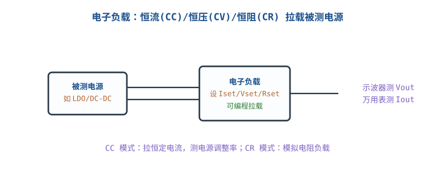

# 信号发生器、电子负载与稳压电源

## 1. 三类"源"仪器各自干什么

::: motivation 调试需要"能供、能拉、能喂信号"
调试一个电路，万用表/示波器负责"看"，但你还需要三样主动设备：**稳压电源**给电路供电（且限流保护）、**信号发生器**给输入端喂已知波形、**电子负载**在输出端模拟真实用电负载。三者配合才能复现产品在真实负载下的行为，而不是空载时"看着正常"。
:::

主图就是这套台架：电源给 DUT 供电，信号发生器喂输入，电子负载拉输出，示波器/万用表监测。

## 2. 工作原理与关键指标

### 稳压电源 Bench Supply
- **恒压 CV / 恒流 CC**：设好电压和电流上限，正常工作在 CV；短路或过载自动切到 CC 限流——这是**第一次上电的保险丝**。
- 关键指标：输出电压/电流范围、**负载调整率/源调整率**（典型 0.01%）、纹波（mV 级）、分辨率。

### 信号发生器 Function/Arbitrary Generator
- 输出正弦/方波/三角/噪声/任意波形，设**频率、幅度、直流偏置 Offset、输出阻抗**。
- 关键指标：带宽、采样率、垂直分辨率（位深）、输出阻抗（50Ω 或高阻）。

### 电子负载 Electronic Load
- 主动吸收功率、可编程模拟负载，模式有 **CC 恒流 / CV 恒压 / CR 恒阻 / CW 恒功率**，以及 CC-CV 等组合模式。
- 关键指标：电压/电流/功率范围、电流上升沿速度（测电源动态响应）、分辨率。

## 3. 接线与操作

- **电源**：先把电压调到目标值、电流限到预期工作电流的 1.5~2 倍，再接 DUT；第一次上电**限流**是安全底线。
- **信号源**：确认输出阻抗设置（50Ω 还是高阻），幅度指的是"开路幅度"还是"端接后幅度"，别重复衰减。
- **电子负载**：先设好电压/电流上限再接 DUT，从 0 电流缓慢加载，观察 Vout 跌落与电源限流点。

## 4. 测量示例（含计算）

::: example 用电子负载测 LDO 的负载调整率
LDO 标称 3.3V，空载测 Vout = 3.312V；电子负载 CC 模式拉到 500mA，测得 Vout = 3.298V。
$$\text{负载调整率}=\frac{V_{no-load}-V_{full-load}}{\Delta I}=\frac{3.312-3.298}{0.5\text{ A}}=0.028\text{ V/A}=28\text{ mV/A}$$
或相对值 $(3.312-3.298)/3.312=0.42\%$。手册若规定 <1%，则合格。
:::

::: example 50Ω 系统下的幅度核算
信号源设"1Vpp、50Ω 端接"，但负载实际是高阻（示波器 Hi-Z）。
- 源内阻 50Ω 与开路输出关系：机内显示 1Vpp（端接后值），则**开路**送到高阻端的电压是它的 **2 倍 = 2Vpp**。
- 教训：在高阻负载上用 50Ω 信号源，实际幅度翻倍，必须把信号源幅度减半，或在远端真的并 50Ω 端接。
:::

## 5. 上手操作清单

- [ ] 电源先设压、限流，再接电；第一次上电手不离开开关。
- [ ] 信号源先关输出（Output Off）再接线，设好参数再开。
- [ ] 电子负载先设上限电压/电流，再从 0 缓慢加载。
- [ ] 用示波器同时看 Vout 和加载瞬态，抓跌落/过冲。

## 扩展与变种电路

### 扩展1：50Ω 源端与远端端接 50Ω Termination

高频信号链路默认 50Ω 系统：信号源内阻 50Ω，同轴电缆 50Ω，远端再并 50Ω 端接，匹配不反射。

::: example 什么时候要端接
- 信号上升沿很快、电缆较长（电长度接近上升沿的 1/6 以上）时，不匹配会产生反射/振铃。
- 远端高阻 + 末端并 50Ω：把电缆终接成 50Ω，消除反射；高阻探头测端接点，读到的是源端幅度的 1 倍（不是 2 倍）。
- 计算：电缆 $v\approx 2/3 c$，1m 电缆延迟约 5ns；上升沿 <30ns 时就该考虑匹配。
:::

对比"直接高阻接"：慢信号直接接没事；快信号不端接会振铃、幅度来回反射。

::: pitfall 高阻负载上幅度翻倍却没意识到
- **现象**：信号源设 1Vpp，示波器却看到 2Vpp。
- **原因**：50Ω 信号源配高阻负载，开路电压 = 端接电压 ×2。
- **解决**：要么信号源按"开路"设置，要么远端并真 50Ω 端接，并在心里把幅度除以 2。
:::

### 扩展2：电子负载 CC/CV 模式测电源 Electronic Load Modes

电子负载不只是"吃电流"，可编程模拟不同负载特性，是测电源动态响应的主力。

::: example 用动态拉载测电源瞬态响应
- 把电子负载设为**瞬态模式**：电流在 0.1A↔1A 之间以 kHz 级快速切换。
- 示波器 AC 耦合测 Vout，看加载瞬间的跌落（undershoot）和恢复时间。
- 判据：好的 DC-DC 在负载阶跃时 Vout 跌 < 2~3% 并在几十 µs 内恢复；跌落过大说明环路补偿/输出电容不够。
:::

对比"固定电阻负载"：电阻只能一个工作点；电子负载能扫全范围、做动态阶跃，是自动化电源测试的标准做法。

::: pitfall 电子负载功率/散热超量程
- **现象**：拉载一会儿负载报警、降额或跳保护。
- **原因**：$P=V\times I$ 在负载上全部变成热，高压大电流时远超瞬时额定。
- **解决**：选足够功率的负载、注意占空比与散热，高压小电流/低压大电流分别看对应量程曲线。
:::

## 6. 常见坑与故障现象

::: pitfall 常见坑
- **电源不设限流直接上电**：DUT 有短路时大电流直灌，烧片子。第一次上电必须把电流限到预期值。
- **信号源输出阻抗与负载不匹配**：高频反射或幅度翻倍，波形与预期不符。
- **电子负载空载/轻载测电源**：很多 DC-DC 轻载不稳定（burst mode），只测空载会漏掉动态问题。
- **忘了信号源直流偏置**：放大电路需要的是叠加了共模的交流信号，只给纯交流可能偏置不对。
:::

## 7. 自测题

第一次给一块新板子上电，稳压电源要先做哪两个设置？

先把输出电压调到目标值，再把电流限流设到预期工作电流的 1.5~2 倍，最后才接板子。这样万一短路，电源自动进 CC 限流而不是大电流烧板。

50Ω 信号源设 1Vpp（端接值），直接接到高阻示波器输入，示波器看到多少？

约 2Vpp。50Ω 源内阻在端接时分压一半；高阻负载下端接电阻不存在，开路电压翻倍。要得到 1Vpp 需把信号源幅度减半，或末端并真 50Ω。

用电子负载 CC 模式把 LDO 负载从 0 拉到 500mA，Vout 从 3.312 掉到 3.298V，负载调整率是多少？

$(3.312-3.298)/0.5 = 28\text{ mV/A}$，相对变化 0.42%。在典型 LDO 指标（<1%）内为正常。

## 8. 参考资料

- Keysight – [Step Up Your Function Generator](https://www.keysight.com/us/en/lib/resources/user-manuals/step-up-your-function-generator-experience-and-knowledge-446859.html)
- kitspace/awesome-electronics（电源、电子负载资源索引）
