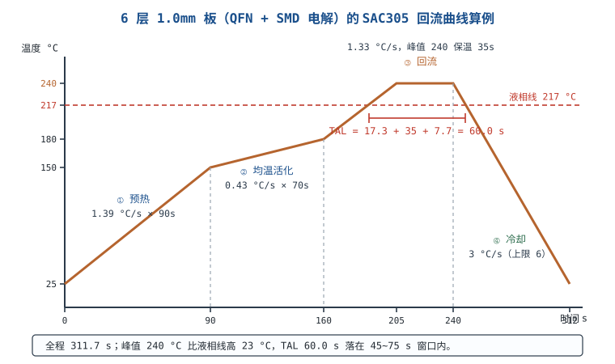

# 焊接：直插、贴片、拆焊与飞线

焊点是整块板子上**唯一由工艺决定、设计图纸上看不见**的连接。设计再好的电路，一个冷焊点就能让它时好时坏；一个立碑的 0402 就能让整批良率掉下去。这一章从冶金讲起：焊料为什么能"粘"在铜上（金属间化合物）、温度和助焊剂各起什么作用、无铅工艺的窗口为什么比有铅窄；然后给出一条可复算的四阶段回流曲线（6 层、1.0mm 厚、含 QFN 与 SMD 电解电容），最后落到手工焊、返修与 ESD 的具体参数。

## 1 设计动机：焊点是可靠性的短板

::: motivation 三个"焊出来"的故障
**一、虚焊让低温启动失效。** 一批产品 −20 °C 冷启动 3% 失败，常温全过；四线法测出某个连接器焊点的接触电阻从 5mΩ 涨到 5Ω，压降 $0.15\ \text{A}\times5\ \Omega=0.75\ \text{V}$，把 3.3V 轨拉到 2.55V，MCU 读 Flash 失败。根因是冷焊裂纹在低温下张开。

**二、立碑吃掉良率。** 0402 电容一端先润湿，表面张力把它竖起来；一条板上有 200 个 0402，立碑率 0.05% 就意味着每 10 块板有一块要返修。

**三、ESD 打坏却不自知。** 手工焊时烙铁头没有可靠接地，漏电压通过烙铁尖注入栅极，器件当场没坏，几天后漏电超标——这类"软失效"最难查。
:::

焊接的工艺窗口很窄，而且窗口的边界都有物理原因：

| 参数 | 典型窗口 | 越界后果 |
|---|---|---|
| 峰值温度 | 235~245 °C（SAC305） | 低了不润湿/冷焊，高了损伤器件、IMC 过厚 |
| TAL（液相线以上时间） | 45~90 s（细间距 45~75 s） | 短了润湿不足，长了 IMC 粗化变脆 |
| 升温斜率 | 1~3 °C/s | 快了热冲击、立碑、飞溅 |
| 冷却斜率 | 1~4 °C/s（上限 6） | 快了应力裂纹，慢了晶粒粗大 |
| 烙铁温度 | 320~350 °C（无铅） | 低了冷焊，高了焊盘起翘、器件过热 |

这些数字不是"经验值"，每一条都能从热传导、扩散或表面张力算出来——下面逐个给式子。

## 2 定义与直观：焊接是冶金连接

**焊接（soldering）**是用低于母材熔点的填充金属（焊料），在助焊剂辅助下润湿母材、发生冶金反应生成金属间化合物（Intermetallic Compound，IMC），冷却后形成电气与机械连接的工艺。四个要素缺一不可：

| 要素 | 作用 | 缺失的后果 |
|---|---|---|
| **清洁** | 去除氧化层，让焊料能接触金属 | 不润湿、焊料成球、虚焊 |
| **温度** | 焊料熔化、扩散反应进行 | 冷焊、润湿角大、IMC 不足 |
| **助焊剂** | 还原氧化层、降低表面张力、防二次氧化 | 润湿差、连锡、焊点发暗 |
| **时间** | 润湿铺展、IMC 生长到合适厚度 | 时间短=虚焊，时间长=IMC 过厚变脆 |

**润湿（wetting）**是判断焊点好坏的第一直观：熔融焊料在母材上铺开，接触角小、边缘薄而光滑。这里有一个常见误解需要纠正：

::: pitfall 把"润湿角小于 30°"当成验收判据
- **现象**：用"润湿角 <30°"去判定焊点合格，把一批润湿角 60° 的焊点判成不良，返修后反而出现焊盘损伤。
- **原因**：IPC-A-610 的**验收判据**是润湿角不大于 90°（焊料与焊盘/引脚之间形成明显润湿、边缘呈凹面）；"小于 30°"是**工艺追求**的漂亮焊点，不是合格线。
- **解决**：验收按 IPC-A-610 的 Class 2/3 条款判"是否润湿、焊料量是否合适、有无裂纹/空洞"；30° 只作为工艺优化的目标值。
:::

**金属间化合物**是焊接与"粘接"的本质区别。锡基焊料与铜在界面生成 Cu₆Sn₅（ε 相）和 Cu₃Sn（η 相），厚度典型 1~3µm。太薄说明润湿/反应不足（虚焊风险），太厚（超过 4~5µm）则脆性上升，热循环下容易在 IMC 与焊料界面开裂。**IMC 不是越厚越好，是"刚好"最好。**

## 3 定量关系：热、扩散、表面张力与温度曲线

### 3.1 加热需要多少能量

把一块板从室温加热到回流峰值，需要的能量是：

$$Q=mc\Delta T,\qquad C_{th}=mc$$

- $Q$：热量（J）；
- $m$：质量（g）；
- $c$：比热容（$\mathrm{J/(g\cdot K)}$）；
- $C_{th}$：热容（J/K）；
- $\Delta T$：温升（K）。

以 100mm×80mm×1.0mm 的 6 层板为例。FR-4 体积 $10\times8\times0.1=8\ \text{cm}^3$，密度约 $1.85\ \text{g/cm}^3$，质量约 $14.8\ \text{g}$，比热约 $1.2\ \mathrm{J/(g\cdot K)}$：

$$C_{FR4}=14.8\times1.2=17.8\ \text{J/K}$$

6 层铜（每层 35µm）合计 210µm，体积 $6\times0.0035\times80=1.68\ \text{cm}^3$，质量约 $15.1\ \text{g}$，铜比热 $0.385\ \mathrm{J/(g\cdot K)}$：

$$C_{Cu}=15.1\times0.385=5.8\ \text{J/K}$$

总热容 $C_{th}=17.8+5.8=23.6\ \text{J/K}$。从 25 °C 加热到 240 °C，温升 215 K：

$$Q=23.6\times215=5.07\times10^{3}\ \text{J}\approx5.1\ \text{kJ}$$

若这 215 K 在 240 s 内完成（预热+均温+回流+保温），板子平均吸热功率是

$$P=\frac{5.07\times10^{3}}{240}=21.1\ \text{W}$$

**这个数决定了"为什么 1.0mm 六层板要更长的均温时间"**：铜多、热容大，同样的炉温曲线下，板子吸热更多、升温更慢，均温不足就会出现"板边到了峰值、板中心还没到液相线"的假象。

### 3.2 IMC 厚度随时间的平方根增长

扩散控制的界面反应遵循：

$$x=\sqrt{Dt}\ \Rightarrow\ \frac{x_2}{x_1}=\sqrt{\frac{t_2}{t_1}}$$

- $x$：IMC 厚度（µm）；
- $D$：扩散系数（与温度呈指数关系，$\text{m}^2/\text{s}$）；
- $t$：液相线以上的时间（s）。

代入"液相线以上时间从 60 s 增到 120 s"：$x_2/x_1=\sqrt{2}=1.41$。若 60 s 时 IMC 是 2.0µm，120 s 时就是 $2.0\times1.41=2.83\ \mu\text{m}$——仍在 1~3µm 的合理范围，但已经接近上限。若再叠加更高的峰值温度（$D$ 指数上升），厚度会更快超标。**这就是"TAL 不是越长越好"的定量理由。**

### 3.3 表面张力：立碑的力有多大

熔融焊料对元件端头的竖直拉力近似为：

$$F\approx\gamma\cdot L$$

- $\gamma$：焊料表面张力，SAC305 约 $0.5\ \text{N/m}$（典型量级，以材料手册为准）；
- $L$：润湿周长或焊盘宽度（m）；
- $F$：竖直力（N）。

0402 元件焊盘宽约 0.6mm，一端先润湿时：

$$F=0.5\times0.6\times10^{-3}=0.30\ \text{mN}$$

而 0402 电容质量约 1mg（典型量级），重力只有

$$G=mg=1\times10^{-6}\times9.81=9.8\times10^{-6}\ \text{N}=9.8\ \mu\text{N}$$

两者相差 $0.30\ \text{mN}/9.8\ \mu\text{N}=30.6$ 倍。**表面张力是重力的 30 倍，所以只要两端润湿不同步，元件就会被"拉"起来——立碑不是偶然，是力学必然。** 对策是让两端同时到达同一温度：对称焊盘、对称铺铜、均匀加热、合适的升温斜率。

### 3.4 四阶段温度曲线

无铅焊膏 SAC305（Sn96.5/Ag3.0/Cu0.5）的固相线约 217 °C、液相线约 220 °C（典型量级，以焊膏手册为准）。四阶段的参数与目的：

| 阶段 | 温度区间 | 斜率 | 时间 | 目的 |
|---|---|---|---|---|
| ① 预热 | 25→150 °C | 1~3 °C/s | 60~120 s | 挥发溶剂、减小热冲击、避免飞溅 |
| ② 均温/活化 | 150→180 °C | 0.3~1 °C/s | 60~120 s | 助焊剂活化、板面与器件均温 |
| ③ 回流 | 180→峰值 235~245 °C | 1~3 °C/s | TAL 45~90 s | 润湿、铺展、IMC 生长 |
| ④ 冷却 | 峰值→25 °C | 1~4 °C/s（上限 6） | — | 晶粒细化、减小热应力 |

时间由温升除以斜率得到：

$$t=\frac{\Delta T}{v}$$

TAL（Time Above Liquidus）是曲线在 217 °C 以上的总时间，由"上升段越过 217 到峰值"+"峰值保温"+"下降段从峰值回到 217"三段相加：

$$TAL=\frac{T_{peak}-217}{v_{up}}+t_{dwell}+\frac{T_{peak}-217}{v_{down}}$$

### 3.5 热滞后：为什么炉温曲线不等于焊点温度

大热容器件（电解电容、变压器、大连接器）的升温滞后于板面。一阶近似下，滞后温差约等于升温斜率乘以器件热时间常数：

$$\Delta T_{lag}\approx v\cdot\tau_{th}$$

- $v$：升温斜率（°C/s）；
- $\tau_{th}$：器件热时间常数（s），与质量和散热面积有关；
- $\Delta T_{lag}$：器件与环境的温差（°C）。

以 SMD 电解电容 $\tau_{th}\approx20\ \text{s}$（典型量级）、升温斜率 $1.33\ ^\circ\text{C/s}$ 为例：$\Delta T_{lag}\approx1.33\times20=26.6\ ^\circ\text{C}$。也就是说，当炉温到 240 °C 时，电容本体可能只有 213 °C 左右。**这解释了为什么大器件附近的焊点容易"欠热"**：焊点小、热容低，但它的热量要从周围的板和大器件那里来。工程上的对策是延长均温段、把大热容器件放在板边/远离风道死角，或者干脆改成后焊。

## 4 典型计算：6 层 1.0mm 板的回流曲线

### 4.1 输入与约束

| 项目 | 取值 | 来源/说明 |
|---|---|---|
| 板 | 100mm×80mm×1.0mm，6 层，外层 1oz | 热容按 §3.1 算得 23.6 J/K |
| 焊膏 | SAC305，液相线 217 °C | 焊膏手册 |
| 峰值温度 | 235~245 °C | J-STD-020 + 焊膏手册的交集 |
| TAL | 45~75 s（细间距/含 QFN 取窄窗口） | 同上 |
| 升温斜率 | ≤3 °C/s | 防立碑与热冲击 |
| 冷却斜率 | ≤6 °C/s，工程取 1~4 | 防应力裂纹 |
| 关键器件 | QFN 5×5（热焊盘 3.5×3.5）、SMD 电解 10×10 | IPC-7093A（QFN 空洞） |

### 4.2 四阶段时间计算

**① 预热：25→150 °C，取 1.39 °C/s。**

$$t_1=\frac{150-25}{1.39}=89.9\ \text{s}\approx90\ \text{s}$$

**② 均温：150→180 °C，取 0.43 °C/s。**

$$t_2=\frac{180-150}{0.43}=69.8\ \text{s}\approx70\ \text{s}$$

**③ 回流：180→240 °C，取 1.33 °C/s。**

$$t_3=\frac{240-180}{1.33}=45.1\ \text{s}\approx45\ \text{s}$$

越过液相线的时刻在回流段内：

$$t_{217}=90+70+\frac{217-180}{1.33}=160+27.8=187.8\ \text{s}$$

**峰值保温 35 s**（在 240 °C 附近，补偿大热容器件的滞后）。

**④ 冷却：240→25 °C，取 3 °C/s。**

$$t_4=\frac{240-25}{3}=71.7\ \text{s}$$

冷却段从 240 °C 回到 217 °C 需要 $23/3=7.7\ \text{s}$。于是：

$$TAL=\frac{240-217}{1.33}+35+\frac{240-217}{3}=17.3+35+7.7=60.0\ \text{s}$$

全程时间：

$$t_{total}=90+70+45+35+71.7=311.7\ \text{s}\approx5.2\ \text{min}$$

### 4.3 五项校核

| 校核项 | 计算 | 判据 | 结论 |
|---|---|---|---|
| 峰值温度 | 240 °C | 235~245 °C | 通过，比液相线高 23 °C |
| TAL | 60.0 s | 45~75 s | 通过，余量 15 s |
| 升温斜率 | 1.39 / 0.43 / 1.33 °C/s | ≤3 °C/s | 通过 |
| 冷却斜率 | 3 °C/s | ≤6 °C/s（工程 1~4） | 通过 |
| 板吸热功率 | $5.07\ \text{kJ}/240\ \text{s}=21.1\ \text{W}$ | 炉子能力 | 需按炉子功率与风速复核 |

再加两项与器件相关的校核：

**QFN 热焊盘。** 3.5mm×3.5mm 的热焊盘按 55% 覆盖率开孔（约 6.7mm² 锡膏面积，分 4×4 小块），峰值 240 °C 保证润湿，预热充分让助焊剂挥发物排出；空洞面积按 IPC-7093A 控制在 25% 以内。**空洞不只是"焊得不好看"，它直接抬高结到板的热阻**，功率器件的温升会明显变差，这一点在[热设计与散热](../pcb/thermal-design.md)里有定量分析。

**SMD 电解电容。** 按 $\tau_{th}\approx20\ \text{s}$ 估算，1.33 °C/s 的升温斜率下本体滞后约 26.6 °C，峰值时本体约 213 °C，低于 217 °C 的液相线，也远低于其耐温上限（常见标称 260 °C 峰值，以数据手册为准）。**注意：这是 SMD 电解；插件电解电容不能过回流焊，必须后焊或用选择性焊接。**

### 4.4 手工焊的参数从哪来

手工焊没有"曲线"，只有三个可调量：烙铁温度、接触时间、传热效率。

**温度差是传热驱动力。** SAC305 液相线 217 °C，烙铁设 330 °C，温差

$$\Delta T=330-217=113\ ^\circ\text{C}$$

这个温差决定了热量能以多快的速度从烙铁传到焊点。温差太小（烙铁 240 °C）传热慢，焊料还没润湿就把助焊剂烧光了；温差太大（烙铁 400 °C）则助焊剂瞬间碳化、焊盘铜箔受热过度。

**接触时间。** 焊点热容很小，2~3 s 足够让焊料熔化并润湿；超过 5 s，FR-4 的玻璃化转变温度（Tg 典型 130~180 °C）以上区域扩大，焊盘铜箔容易起翘、层间分离。**判据不是"看着化了就行"，而是"2~3 s 内形成润湿、5 s 内必须撤"。**

**传热效率。** 烙铁头接触面积越大传热越快。刀头（刀型）比尖头接触面积大 3~5 倍，适合大焊盘和散热焊盘；尖头适合密脚器件。烙铁功率 30~60 W，功率不足时会出现"焊料化了但焊盘没到温"的假润湿。

### 4.5 返修与 ESD

**返修（rework）**与正常焊接的区别是"已经受过一次热历程"。IPC-7711/7721 对返修的加热次数、焊盘保护、清洗都有要求，工程上一般控制在 2~3 次以内；每多一次回流，IMC 加厚一次（§3.2 的 $\sqrt{t}$ 关系），焊盘与基材的结合也弱一次。

返修参数（QFN/QFP 类）：

| 参数 | 取值 | 说明 |
|---|---|---|
| 预热台 | 100~150 °C | 减小器件与板面的温差，降低翘曲 |
| 热风温度 | 350~380 °C | 喷嘴罩住目标，风速中低档 |
| 加热时间 | 30~60 s（到焊料完全熔化） | 以"镊子能轻推元件"为判据 |
| 吸锡带 | 编织铜带 + 助焊剂 | 清理多余锡，别用烙铁硬刮 |
| 返修次数 | ≤2~3 次 | 按 IPC-7711/7721 与产品规范 |

**ESD 防护**在这里不是可选项：无铅工艺的烙铁温度更高、助焊剂更活跃，器件暴露的热与电应力都更大。人体模型（HBM）2kV、100pF 的放电能量是

$$E=\frac{1}{2}CU^{2}=\frac{1}{2}\times100\times10^{-12}\times(2000)^{2}=0.2\ \text{mJ}$$

0.2mJ 不足以让人有感觉，却足以击穿 MOS 栅氧化层。防护的三件套：

- **腕带**：串 1MΩ 限流电阻，既泄放静电又不让人体成为低阻通路（见[地的学问与地弹](../power/grounding.md)）；
- **台垫**：表面电阻典型 $10^{6}\sim10^{9}\ \Omega$，通过 1MΩ 电阻接保护地；
- **烙铁/焊台接地**：烙铁头对地电阻典型要求小于 2Ω、漏电压小于 2mV（以焊台手册为准），**这是最容易被忽略的一条**——烙铁尖直接接触引脚，漏电会顺着引脚进器件。

## 5 工程含义：手工焊与回流焊、缺陷与检验

### 5.1 手工焊与回流焊的差异

| 项目 | 手工焊 | 回流焊 |
|---|---|---|
| 热源 | 烙铁接触传导 | 对流/红外辐射 |
| 加热速率 | 局部数秒内到温 | 全板 1~3 °C/s |
| 焊料形态 | 锡丝（含助焊剂芯） | 锡膏（焊粉+助焊剂+溶剂） |
| 氧化控制 | 靠焊丝内助焊剂，局部 | 靠焊膏助焊剂，可加氮气 |
| 典型缺陷 | 冷焊、虚焊、连锡、焊盘起翘 | 立碑、空洞、偏移、锡珠 |
| 热应力 | 局部集中，引脚附近梯度大 | 全板均匀，梯度小 |
| 适用 | 插件、返修、小批、实验 | SMD 批量生产 |

**手工焊的 IMC 通常比回流焊薄**（受热时间只有几秒，而回流是几十秒），但热应力更集中；**回流焊的 IMC 更均匀**，但峰值和 TAL 控制不好就会过厚。两者的缺陷谱系不同，检查方法也不同。

### 5.2 虚焊、冷焊、立碑的成因

| 缺陷 | 现象 | 机理 | 关键工艺参数 | 对策 |
|---|---|---|---|---|
| **虚焊** | 焊点表面看着可以，一掰就动，接触电阻时大时小 | 焊料未与母材形成连续 IMC（氧化、污染、温度不足） | 预热不足、焊盘氧化、助焊剂失效 | 清洁焊盘、加助焊剂、提高预热 |
| **冷焊** | 表面灰暗、颗粒状、像米粒 | 焊料熔化但未充分润湿就冷却（热量不足或冷却前扰动） | 烙铁温度低、接触时间短、焊接时抖动 | 提高温度/延长到 2~3s、焊后静止冷却 |
| **立碑** | 一端翘起，元件竖立 | 两端润湿不同步，表面张力（§3.3，约 30 倍重力）拉起 | 焊盘/铺铜不对称、升温过快、锡膏量不均 | 对称设计、控制升温斜率 ≤3 °C/s、钢网开孔对称 |
| **连锡** | 相邻焊盘被锡连通 | 锡量过多、助焊剂不足、间距过小 | 锡膏量、钢网厚度、贴装压力 | 减薄钢网、加阻焊桥、吸锡带清理 |
| **空洞** | X-ray 下焊点内有气泡 | 助焊剂挥发物未排出、润湿不良 | 预热斜率、焊膏回温、钢网开孔 | 充分预热、分段开孔、按 IPC-7093A 控制 |
| **焊盘起翘** | 铜箔与基材分离 | 局部过热超过 Tg、机械应力 | 烙铁温度、接触时间、返修次数 | 控温 ≤350 °C、单点 ≤5 s、减少返修 |

### 5.3 检验：从目视到四线法

| 方法 | 能发现 | 发现不了 | 判据 |
|---|---|---|---|
| 目视/放大镜 | 连锡、立碑、偏移、润湿不良 | BGA/QFN 底部、内部裂纹 | IPC-A-610 Class 2/3 |
| X-ray | BGA/QFN 空洞、锡量、偏移 | 虚焊（接触但未冶金连接） | 空洞 ≤25%（热焊盘，按 IPC-7093A） |
| 四线法（开尔文） | 接触电阻、虚焊 | 外观缺陷 | 正常 mΩ 级，异常 Ω 级 |
| 拉力/剪切 | 焊点机械强度 | 电气性能 | 按产品规范 |
| 切片 | IMC 厚度、裂纹 | 批量效率 | IMC 1~3µm |

**虚焊是最难检的**：X-ray 看得到空洞，看不到"接触但没形成 IMC"；目视看得到外观，看不到内部裂纹。所以工程上把"四线法测接触电阻 + 温度循环后复测"作为虚焊的专项判据——这也是[故障排查案例库](troubleshooting-cases.md)里焊点虚接案例的核心手段。

## 6 常见坑

::: pitfall 用烙铁头"沾"锡往焊盘上蹭
- **现象**：锡堆在焊盘上不成形，表面灰暗、颗粒状，一掰就动。
- **原因**：焊件没有被加热到焊料熔点以上，锡只在烙铁头上熔化，靠"蹭"贴上去，没有润湿也没有 IMC。
- **解决**：先让烙铁同时接触引脚与焊盘 1~2 s，再把锡丝送到焊盘（不是烙铁头），锡熔化后先撤锡丝再撤烙铁。
:::

::: pitfall 回流峰值越高越保险
- **现象**：把峰值从 240 °C 提到 255 °C，润湿看起来更好，但几个月后焊点开裂、器件早期失效。
- **原因**：IMC 厚度随温度指数增长、随时间按 $\sqrt{t}$ 增长；255 °C 已接近很多器件的耐温上限，TAL 也被动拉长。
- **解决**：峰值取 235~245 °C（SAC305），TAL 45~75 s；以焊膏手册与器件耐温的交集为准，不是越高越可靠。
:::

::: pitfall 立碑只怪锡膏质量
- **现象**：换了三批锡膏，立碑率还是 0.05%，集中在板子同一侧。
- **原因**：那一侧的焊盘铺铜不对称、散热快，两端润湿不同步；表面张力是重力的 30 倍（§3.3），只要不同步就会立。
- **解决**：改对称铺铜/加隔热焊盘（thermal relief 的取舍见[布线](../pcb/routing.md)）、控制升温斜率、钢网开孔对称。
:::

::: pitfall 大热容器件按炉温曲线判断焊接质量
- **现象**：炉温曲线完美，QFN 旁边的电解电容焊点却欠热、空洞多。
- **原因**：大热容器件热时间常数大，滞后 $v\cdot\tau_{th}$（本例 26.6 °C），器件本体与附近焊点根本没到曲线温度。
- **解决**：用热电偶实测关键点（QFN 焊盘、电容本体、板中心），延长均温段或调整器件布局；必要时后焊。
:::

::: pitfall 返修次数不设限
- **现象**：同一块板返修 5 次后"怎么焊都不亮"，换器件也没用。
- **原因**：每次返修都加厚一次 IMC、削弱一次焊盘与基材的结合；焊盘起翘/层间分离是不可逆的。
- **解决**：按 IPC-7711/7721 控制返修次数（一般 ≤2~3 次）；返修前评估是否值得，超过次数直接报废。
:::

::: pitfall 忽视烙铁漏电压与 ESD
- **现象**：手工焊过的板子，MOS 栅极漏电偏大、良率莫名下降；换一批器件又好一阵。
- **原因**：烙铁头未可靠接地，漏电压经引脚注入栅极；HBM 0.2mJ 的能量足以击穿栅氧化层却不留外观痕迹。
- **解决**：焊台接地（烙铁头对地 <2Ω、漏电压 <2mV）、腕带 1MΩ、台垫 10⁶~10⁹Ω，按 IEC 61340-5-1 建立 ESD 工作区。
:::

## 7 自测题

SAC305 的液相线、常用峰值温度和 TAL 窗口各是多少？为什么不能"越高越保险"？

液相线约 217 °C，峰值 235~245 °C（比液相线高 20~30 °C），TAL 45~90 s（细间距 45~75 s）。

不能越高越保险，因为 IMC 厚度随温度指数增长、随时间按 $\sqrt{t}$ 增长：TAL 从 60 s 增到 120 s，IMC 增厚 $\sqrt{2}=1.41$ 倍（2.0µm → 2.83µm）；峰值再往上还会逼近器件耐温上限。

100×80×1.0mm 的 6 层板从 25 °C 加热到 240 °C，需要多少能量？平均吸热功率多大？

FR-4：体积 8cm³、质量 14.8g、比热 1.2 → $C=17.8\ \text{J/K}$；6 层铜：体积 1.68cm³、质量 15.1g、比热 0.385 → $C=5.8\ \text{J/K}$。

总热容 23.6 J/K，$\Delta T=215\ \text{K}$：

$$Q=23.6\times215=5.07\times10^{3}\ \text{J}\approx5.1\ \text{kJ}$$

240 s 内完成，平均功率 $5.07\ \text{kJ}/240\ \text{s}=21.1\ \text{W}$。

预热 25→150 °C、均温 150→180 °C、回流 180→240 °C、保温 35 s、冷却 3 °C/s。四段各多少秒？TAL 多少？

预热取 1.39 °C/s：$125/1.39=89.9\ \text{s}$；均温取 0.43 °C/s：$30/0.43=69.8\ \text{s}$；回流取 1.33 °C/s：$60/1.33=45.1\ \text{s}$；冷却：$215/3=71.7\ \text{s}$。

$$TAL=\frac{23}{1.33}+35+\frac{23}{3}=17.3+35+7.7=60.0\ \text{s}$$

全程 $90+70+45+35+71.7=311.7\ \text{s}$。

为什么 0402 元件一端的润湿不同步就会立碑？用数字说明。

表面张力的竖直拉力 $F\approx\gamma L=0.5\times0.6\times10^{-3}=0.30\ \text{mN}$；0402 质量约 1mg，重力 $mg=9.8\ \mu\text{N}$。

两者相差 $0.30\ \text{mN}/9.8\ \mu\text{N}=30.6$ 倍。表面张力远大于重力，所以只要两端润湿不同步，元件就会被拉起。对策是对称焊盘/铺铜、控制升温斜率、均匀锡量。

"润湿角小于 30°"是 IPC-A-610 的验收判据吗？

不是。IPC-A-610 的验收判据是润湿角不大于 90°、边缘呈凹面、焊料量合适；"小于 30°"是工艺追求的漂亮焊点目标，不是合格线。

把 30° 当验收线会误判大量合格焊点，导致不必要的返修和焊盘损伤。

大热容的 SMD 电解电容在 1.33 °C/s 的升温下，本体比炉温滞后多少？会有什么后果？

$$\Delta T_{lag}\approx v\cdot\tau_{th}=1.33\times20=26.6\ ^\circ\text{C}$$

炉温到 240 °C 时电容本体约 213 °C，低于 217 °C 液相线。后果是：器件本体的热历程与曲线不符，附近焊点可能欠热、空洞增多；对策是延长均温段、用热电偶实测关键点、必要时后焊。注意插件电解电容不能过回流焊。

## 8 参考资料

- **IPC-A-610H, *Acceptability of Electronic Assemblies***：焊点润湿、焊料量、立碑、空洞、环宽的验收判据（Class 2/3）；本章 §2 的润湿角纠正与 §5.3 的检验判据按该标准。
- **IPC/JEDEC J-STD-020E, *Moisture/Reflow Sensitivity Classification for Nonhermetic Surface Mount Devices***：回流峰值、TAL、MSL 分级与 floor life；本章 §3.4、§4.1 的温度窗口与[DFM 与可制造性设计](../pcb/dfm-process.md)的口径一致。
- **IPC/JEDEC J-STD-033D, *Handling, Packing, Shipping and Use of Moisture/Reflow Sensitive Surface Mount Devices***：湿敏器件的烘烤条件与车间寿命；本章 §4.3 的电解电容与 QFN 烘烤要求按该标准与器件手册确定。
- **IPC-7093A, *Design and Assembly Process Implementation for Bottom Termination Components***：QFN 热焊盘钢网开孔、空洞控制与散热路径；本章 §4.3 的 55% 覆盖率与 25% 空洞判据按该标准，热阻影响见[热设计与散热](../pcb/thermal-design.md)。
- **IPC-7711/7721, *Rework, Modification and Repair of Electronic Assemblies***：返修流程、加热次数、焊盘保护与清洗要求；本章 §4.5 的返修参数按该标准组织。
- **IEC 61340-5-1:2016, *Protection of electronic devices from electrostatic phenomena***：ESD 腕带、台垫、接地与工作区要求；本章 §4.5 的 ESD 三件套与[地的学问与地弹](../power/grounding.md)的 ESD 接地口径一致。返修后的验证方法见[硬件调试方法论与上电检查](debug-methodology.md)，焊点虚接的失效分析见[故障排查案例库](troubleshooting-cases.md)，焊膏/回流参数的仿真预验证见[LTspice 仿真入门](ltspice.md)（热过程本身需要专门的热仿真工具）。
