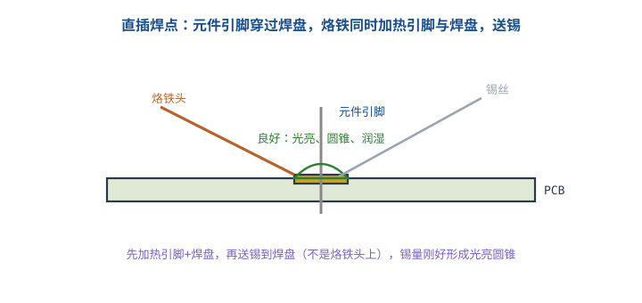
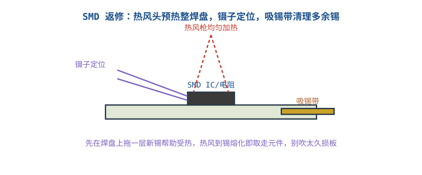
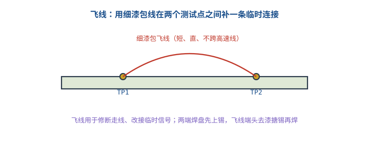

# 焊接：直插、贴片、拆焊与飞线

## 1. 焊点是硬件的"接口"

::: motivation 一个虚焊能毁掉整块板
再好的设计，焊点虚焊、冷焊、连锡，板子就是不通、时好时坏、温度一变化就出问题。焊接不是"把锡糊上去"，而是让**焊料同时润湿引脚和焊盘**，形成金属间化合物。判断标准只有一句话：好焊点光亮、圆锥状、像小山峰；坏焊点灰暗、颗粒状、像米粒。
:::

## 2. 工具与工艺要点

- **烙铁温度**：无铅焊锡约 320~350°C，有铅约 300~320°C；功率 30~60W，刀头/尖头按场合选。
- **焊锡**：常用含助焊剂芯锡丝（Sn63/Pb37 或无铅 SAC305）；助焊膏帮助润湿、减少冷焊。
- **顺序**：先加热**引脚+焊盘**两者，再把锡丝送到焊盘上（不是烙铁头上），锡熔化后同时撤锡丝、撤烙铁。

主图是直插焊接的标准动作：

## 3. 操作流程与检查清单

### 直插 Through-Hole
1. 元件引脚穿过焊盘，弯折固定。
2. 烙铁头同时贴引脚和焊盘加热 1~2s。
3. 送锡到焊盘（不是烙铁），锡润湿形成圆锥。
4. 先撤锡丝，再撤烙铁，保持不动 2~3s 冷却。
5. 剪去过长引脚。

### 焊点质量判据
| 好焊点 | 坏焊点 |
|---|---|
| 光亮、圆锥、润湿角小 | 灰暗、颗粒、像米粒（冷焊） |
| 引脚轮廓可见、锡均匀包裹 | 锡球/尖刺、连锡（桥连） |
| 机械牢固 | 一掰就动（虚焊） |

## 4. 焊接示例（含定量判据）

::: example 时间与温度
- 烙铁接触焊盘一般 **2~3 秒**完成；超过 5s 容易铜箔起翘、元件过热。
- 判据：好焊点润湿角 < 30°；冷焊表现为表面颗粒灰暗。
- 连锡（桥连）判据：两个相邻焊盘间有锡连通，通断档蜂鸣即确认。
:::

## 5. 上手操作清单

- [ ] 烙铁头先上锡"搪锡"，保证导热。
- [ ] 先加热焊件再送锡，别用烙铁"沾"锡往板上蹭。
- [ ] 焊完用放大镜/显微镜查连锡与虚焊。
- [ ] 洗手/通风，无铅烟有害。

## 扩展与变种电路

### 扩展1：SMD 贴片与热风返修 SMD & Hot-Air Rework

贴片元件引脚细、间距密，单点烙铁或热风整焊，靠镊子定位。

::: example 返修流程
1. 焊盘上先拖一层新锡帮助均匀受热。
2. 镊子放正元件，热风枪（喷嘴罩住）均匀加热。
3. 锡一熔化、元件自对位（surface tension self-alignment）即停风。
4. 多余锡用吸锡带（编织铜带）+ 烙铁吸走。
- 定量：QFN/密脚 IC 表面贴装，热风温度 350~380°C、风速中低档，避免吹飞小元件。
:::

对比直插：SMD 密度高但不可手插定位，靠焊盘锡膏自对位；拆焊必须热风，单点烙铁容易扯掉焊盘。

::: pitfall 热风温度过高吹掉焊盘/相邻元件
- **现象**：一吹整排小电阻飞了，或焊盘铜箔起翘。
- **原因**：温度过高、风过大、吹太久。
- **解决**：控温 350~380°C、中风速、只对准目标焊盘，周边小元件可贴高温胶带保护。
:::

### 扩展2：飞线 Repair Jumper Wire

走线断了、要临时改接，用细漆包线在两测试点间补一条连接。

::: example 飞线要点
- 选 30~36AWG 漆包线，两端刮漆/搪锡后再焊，否则漆包层不导通。
- 飞线要**短、直、贴板**，避开高速/时钟线减少寄生天线效应。
- 两端焊盘先上锡，飞线焊上后机械固定（点胶/打弯）防拉扯断。
- 定量：修断走线时飞线是临时方案，量产应改板；飞线长度 >2cm 就要考虑串扰。
:::

对比"改 PCB"：飞线快、适合调试修复；量产/可靠产品应回到画板改走线。

::: pitfall 飞线没去漆导致假连通
- **现象**：飞线焊上了，两点还是不通。
- **原因**：漆包线表面绝缘漆没刮干净，锡只焊在漆上。
- **解决**：端头用小刀刮漆或用打火机烧后搪锡，确认露出铜再焊。
:::

## 6. 常见坑与故障现象

::: pitfall 常见坑
- **冷焊/虚焊**：灰暗颗粒状焊点，时好时坏、一掰就动。原因是温度不够或焊件没预热。重新加热加助焊剂重焊。
- **连锡桥连**：相邻引脚被锡连通，造成短路。用吸锡带吸走多余锡。
- **焊盘铜箔翘起**：烙铁停留过久。温度别太高、接触别超 5s。
- **用烙铁头沾锡往板上蹭**：焊件没加热，锡不润湿，必成冷焊。先加热焊件再送锡。
:::

## 7. 自测题

好焊点和冷焊在外观上怎么区分？

好焊点光亮、圆锥状、锡均匀包裹引脚；冷焊灰暗、颗粒状、像米粒，机械上一掰就动。冷焊要加助焊剂重新加热重焊。

拆一个 QFP 密脚贴片 IC，为什么用单点烙铁很难？

引脚太多、焊盘同时冷却，单点加热拆不动还容易扯掉焊盘。要用热风枪整体均匀加热，锡全部熔化后再用镊子取走元件。

飞线用漆包线焊上后两点仍不通，最可能原因？

漆包线端头绝缘漆没刮净，锡焊在漆层上形成假连通。应刮漆/搪锡露出铜后再焊。

## 8. 参考资料

- SparkFun Learn – [How to Solder (Through-Hole / SMD)](https://learn.sparkfun.com/tutorials/how-to-solder-through-hole-soldering/all)
- kitspace/awesome-electronics（焊接与制造资源）
