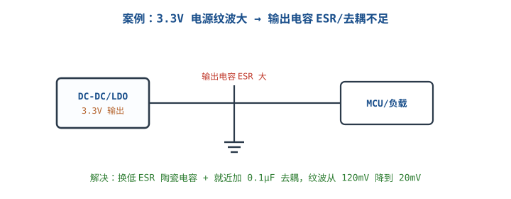

# 故障排查案例库

## 1. 用四步法学案例

::: motivation 会排障比会画图更值钱
教科书告诉你"正常电路该什么样"，但实际板子出问题时，你面对的是一个**异常现象**。把每个案例都按"现象→定位→根因→解决"四步写清楚，尤其要挖到**根因（为什么会这样）**，而不是停在"换个元件就好了"。这样下次遇到类似症状，你能自己推出来。
:::

下面先给一个简短示范，再在扩展里展开三个高频真实案例。

::: example 示范：MCU 不启动
- **现象**：上电后串口无输出，LED 不闪。
- **定位**：量 3.3V ✓、量内核 1.8V = 0V。
- **根因**：内部 LDO 使能脚悬空，未被拉高，输出关断。
- **解决**：使能脚上拉到 3.3V，1.8V 出来，启动正常。
:::

## 2. 排查通用检查表

- [ ] 现象用客观语言写清（多少 V、什么频率、偶发还是必现）。
- [ ] 先复现：偶发问题先找稳定条件。
- [ ] 用测量缩小范围（电流追踪 / 信号追踪）。
- [ ] 根因要到物理本质（寄生电感、ESR、时序窗口）。
- [ ] 解决后验证：再测一遍指标，确认回落到正常。

## 扩展与变种电路

### 扩展1：电源纹波过大 Ripple Too High

::: example 现象→定位→根因→解决
- **现象**：3.3V 电源示波器 AC 耦合看到 120mVpp 纹波，ADC 采样值跳动。
- **定位**：换示波器/探头确认不是测量假象；纹波峰尖频率与 DC-DC 开关频率吻合。量输出电容上纹波最大。
- **根因**：输出电容 ESR 偏大（普通电解 ESR 数百 mΩ），开关电流在 ESR 上产生 $\Delta V=I_{ripple}\times ESR$；且 IC 引脚就近缺 0.1µF 高频去耦。
- **解决**：换低 ESR 陶瓷电容，IC 电源脚就近加 0.1µF；纹波降到 ~20mVpp。
- 定量：$I_{ripple}=0.5\text{A}$、ESR=200mΩ → 纹波 100mV；ESR 降到 20mΩ → 10mV。
:::

对比"加大电容容量"：容量大不解决 ESR 尖峰，要选低 ESR 材质 + 就近高频去耦。

::: pitfall 纹波大只堆电容容量
- **现象**：并了大电解纹波还是尖。
- **原因**：尖峰来自 ESR/ESL，不是容量不足。
- **解决**：换低 ESR 陶瓷电容、靠近负载放 0.1µF。
:::

### 扩展2：地弹与共地噪声 Ground Bounce

::: example 现象→定位→根因→解决
- **现象**：数字输出切换时，相邻输入偶发误触发；静态测量电压却正常。
- **定位**：示波器同时看驱动输出与接收端地，发现驱动翻转瞬间接收端"地"被抬了 0.8V 尖峰。
- **根因**：大电流同时开关，地平面走线/封装引脚存在电感 $L$，$V=L\,di/dt$ 产生地弹；接收端参考地被抬升，输入相对地越过阈值。
- **解决**：减小地回路电感（完整地平面）、IC 就近去耦（给 di/dt 提供本地回路）、慢化边沿、分区单点接地。
- 定量：$L=5\text{nH}$、$di/dt=1\text{A}/5\text{ns}$ → $V=5\text{nH}\times0.2\text{A/ns}=1\text{V}$ 地弹。
:::

对比"加施密特触发抗噪"：提高阈值只是治标，根因是地弹，要减小回路电感。

::: pitfall 把地弹误判成信号干扰
- **现象**：一直往信号线加 RC 滤波，误触发依旧。
- **原因**：噪声在地上不在信号上。
- **解决**：量接收端对地的实际波形，先确认参考地本身有没有被抬。
:::

### 扩展3：建立保持时间与亚稳态 Setup/Hold & Metastability

::: example 现象→定位→根因→解决
- **现象**：UART 偶发丢字节、SPI 读值偶发错，复现不规律。
- **定位**：逻辑分析仪抓异常帧，发现数据跳变与采样时钟沿几乎对齐。
- **根因**：异步数据在触发器建立/保持窗口内变化，进入亚稳态（metastability），输出不确定，偶发采样错。
- **解决**：异步输入加两级同步器、让数据提前稳定、降速或调时钟相位、必要时加握手。
- 定量：触发器建立时间 $t_{su}\approx$ 几 ns，数据必须在采样沿前 $t_{su}$ 稳定、之后 $t_h$ 保持。
:::

对比"软件重传重试"：重试是补救，根因是时序违例，硬件上加同步器才治本。

::: pitfall 异步输入不加同步器
- **现象**：低概率偶发采样错误，难复现。
- **原因**：异步信号直接进时钟域，亚稳态随机传播。
- **解决**：跨时钟域信号必经同步器/握手，别直接连。
:::

## 3. 常见坑与故障现象

::: pitfall 常见坑
- **只看表面不挖根因**：换个电容好两天又犯，因为没解决 ESR/地弹根因。
- **偶发问题不先复现**：偶发 bug 先找稳定复现条件，否则改了也不知道好没好。
- **测量引入假象**：长接地弹簧/探头负载把测量噪声当成电路问题（见示波器章）。
- **一次改多处**：不知道哪个改动起效。一次一个变量。
:::

## 4. 自测题

电源纹波尖峰很大，加大电容容量却没改善，根因可能是什么？

尖峰来自电容 ESR/ESL，不是容量。$I_{ripple}\times ESR$ 产生尖峰。应换低 ESR 陶瓷电容、IC 就近加 0.1µF 高频去耦。

数字电路静态电压正常，一切换输出相邻门就误触发，先量什么？

先量接收端"地"相对系统地的波形。很可能是地弹：大 di/dt 在共地阻抗 $L$ 上产生 $V=L\,di/dt$ 尖峰，抬升了接收端参考地。

UART 偶发丢字节且难复现，逻辑分析仪发现数据跳变对齐采样沿，根因是什么？

建立/保持时间违例导致触发器亚稳态。异步数据在采样窗口内变化，输出不确定。解决：加两级同步器、让数据提前稳定、降速或调相位。

## 5. 参考资料

- SparkFun Learn – [How to Use a Multimeter](https://learn.sparkfun.com/tutorials/how-to-use-a-multimeter/all)
- David J. Agans, *Debugging: The 9 Indispensable Rules*（现象→定位→根因的方法论源头）
- 亚稳态参考：SparkFun External IO and Metastability 教程
