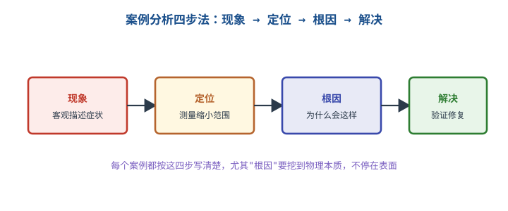
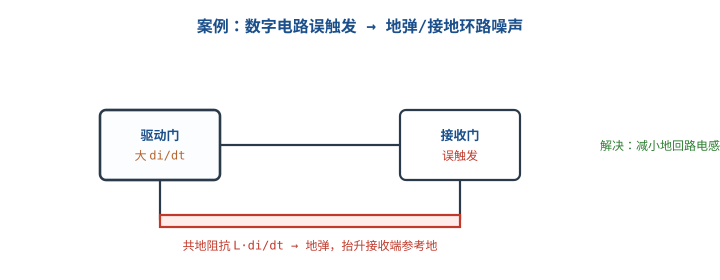
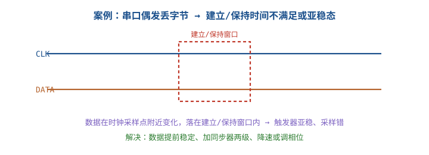

# 故障排查案例库

教科书告诉你"正常电路该是什么样"，而现场给你的永远是一个异常现象。把现象修好并不难，难的是说清**为什么**：为什么这一批在 −20 °C 才坏、为什么换个大电容纹波反而更差、为什么只有电机启动那 300 ms 丢包。这一章收录六个可复算的真实类型案例——电源自激、地环路噪声、ADC 精度不足、通信误码、复位异常、焊点虚接——加上一个批量低温失效的完整排查，全部按"现象 → 测量 → 假设 → 验证 → 根因 → 修复 → 防再发"七步写。**每一步都带数字，每一步都能被下一个人复算。**

## 1 设计动机：为什么"换好元件"不算修好

::: motivation 三类最贵的"假修复"
**一、治标不治本。** 纹波大就并电容，并完从 180mVpp 降到 60mVpp，验收通过；三个月后同型号在高温下批量返修，因为根因是 ESR 与环路零点，不是容量。

**二、不解释全部现象。** 低温失效的板子换了电源芯片就好了三台，于是判定"芯片批次问题"；但同一批芯片在另 88 台上工作正常——真正的根因（输入电容低温 ESR 升高触发 UVLO）被这条"证据"掩盖了。

**三、无法证明修好了。** 改完测了 20 次没复现就出货。若单次复现概率是 1%，测 20 次全过的概率是 $0.99^{20}=81.8\%$，这是"什么都没发生"，不是"修好了"。
:::

案例库的价值不在记住六个故事，而在建立**可迁移的判据**：见到纹波先算 $I_{ripple}\times ESR$，见到低温失效先算参数的温度乘数，见到偶发误码先算眼高与共模。一个案例被复算过一遍，同类故障的定位时间就从"几天"降到"几小时"。

三个数字说明复盘的收益：

- 一次返修的物流加人工按 200 元算，100 台批量返修是 2 万元；而设计阶段多算一遍 ESR 温度余量，成本是 1 小时。
- 根因定位每推迟一天，库存与在途品的风险敞口扩大一批；批次隔离的成本随天数线性增长。
- 有复盘记录的团队，同类故障的二次发生率显著低于无记录团队——因为**判据被写下来了**，而判据是可以继承的。

## 2 定义与直观：复盘的结构

**故障复盘（post-mortem）**是把一次异常拆成七个可验证环节的过程。四步骨架（现象→定位→根因→解决）人人会写，但真正能防再发的是后面三步：验证（改动是否真的消除了判据）、修复（最小必要改动）、防再发（把判据写进规范/测试）。



七步的输入输出与常见错误：

| 步骤 | 必须产出 | 常见错误 |
|---|---|---|
| 现象 | 带数字与单位的客观描述，含发生条件与频率 | "不稳定""有点烫" |
| 测量 | 每个测量点的期望值、实测值、判据 | 只测一个点就下结论 |
| 假设 | 可证伪的因果句："若 A 成立，则 B 点应为 C" | "可能是干扰" |
| 验证 | 单变量实验 + 复测同一判据 | 一次改三处 |
| 根因 | 能解释**全部**观测（包括正常的那部分） | 停在"换件就好了" |
| 修复 | 最小必要改动 + 回归测试数据 | 顺手改了无关设计 |
| 防再发 | 写进规范/测试项/来料检验的判据 | "下次注意" |

**根因的三个检验**，缺一不可：

1. **能解释全部观测**：包括为什么另外 88 台没坏、为什么常温不坏、为什么只在启动瞬间坏。只解释一部分的叫"相关因素"，不叫根因。
2. **能被定量复算**：把参数代进公式能算出与实测同量级的数。算不出来，说明对机理的理解还没到位。
3. **改回去能复现**：把根因重新引入（换回旧电容、恢复两端接地），故障应重现。这一步在实验室做，别在客户现场做。

::: analogy 复盘像医生写病历，不像修车换件
修车师傅换掉坏件，车能跑就行；医生要写清"症状—检查—诊断—治疗—随访"，因为下一个病人可能症状相同、病因不同。案例库就是病历库：它的价值在于**把"症状→检查项"的映射固定下来**，让下一个人不用从零开始猜。

类比的边界：医学有对照组和统计，硬件案例常常只有一台样机。所以硬件的"病历"必须额外记录**样本量与复现条件**——1 台坏、99 台好的分布，本身就是最重要的证据之一。
:::

## 3 定量关系：四类可复算的物理量

案例再花哨，背后的定量关系只有四类。把案例归到某一类，就知道该测什么、该算什么。

### 3.1 电压类：阻抗上的压降

直流看电阻，交流看电感：

$$V=IR,\qquad V=L\frac{di}{dt}\approx 2\pi fLI$$

以电源纹波为例，输出电容上的纹波近似等于电感电流纹波在 ESR 上的压降：

$$\Delta V_{ripple}\approx \Delta I_L\times ESR$$

其中 $\Delta I_L$ 是电感电流峰峰值（A），$ESR$ 是输出电容等效串联电阻（$\Omega$），$\Delta V_{ripple}$ 是纹波峰峰值（V）。代入 $\Delta I_L=0.66\ \text{A}$、$ESR=50\ \text{m}\Omega$：$\Delta V=0.66\times0.05=33\ \text{mV}$。这个式子解释了两件事：**为什么加大容量不降尖峰**（容量不在式子里），以及**为什么低温会更差**（ESR 随温度上升）。

### 3.2 时间类：RC 建立与脉冲宽度

一阶建立过程：

$$V(t)=V_\infty\left(1-e^{-t/\tau}\right),\qquad \tau=RC$$

要建立到 $n$ 位精度（误差小于 1 LSB），需要的 $\tau$ 数是：

$$k=\ln\left(2^{n+1}\right)$$

12 位时 $k=\ln(2^{13})=9.01$，即采样窗口至少 9 个 $\tau$。反向也常用：已知窗口 $t$ 与时间常数 $\tau$，残差比例就是 $e^{-t/\tau}$。

短脉冲被 RC 滤掉的幅度同样用这个式子：宽度 $t_p$ 的脉冲经过 $\tau$ 的 RC，幅度只剩 $V_{DD}(1-e^{-t_p/\tau})$。

### 3.3 热类：温升与热阻

$$\Delta T=P\times R_{th},\qquad T_j=T_a+\Delta T$$

$P$ 是功耗（W），$R_{th}$ 是热阻（°C/W），$T_j$ 是结温（°C），$T_a$ 是环境温度（°C）。焊点空洞、散热焊盘虚接、风道堵塞，最终都表现为 $R_{th}$ 变大，用这个式子换算成结温。

### 3.4 统计类：批次失效的比例

一批 $N$ 台中有 $k$ 台失效，失效率 $\hat p=k/N$。要判断"这批是否异常"，用二项分布的标准差：

$$\sigma_{\hat p}=\sqrt{\frac{\hat p(1-\hat p)}{N}}$$

以及把某个参数门槛与分布对比的 $z$ 分数：

$$z=\frac{x-\mu}{\sigma},\qquad P(X>x)=1-\Phi(z)$$

$N=100$、$\hat p=0.12$ 时 $\sigma=0.0325$，即 12% 的失效率本身有 ±3.25 个百分点的统计涨落；判断"是否与 5% 的基线不同"要看 $z=(0.12-0.05)/0.0325=2.15$，对应单侧概率约 1.6%——这才叫"显著"。

### 3.5 温度乘数：把"低温失效"变成一条不等式

铝电解电容的 ESR 随温度下降而上升，工程上用乘数 $k(T)$ 表示，典型量级如下（**以具体型号数据手册为准**）：

| 温度 | 25 °C | 0 °C | −10 °C | −20 °C | −40 °C |
|---|---|---|---|---|---|
| $k(T)=ESR(T)/ESR(25)$ | 1.0 | 1.5 | 2.5 | 4.0 | 8.0 |

把 $k(T)$ 代进"输入电压减去浪涌压降"的不等式，就能算出失效边界温度：

$$V_{in}-I_{start}\cdot ESR_{25}\cdot k(T)<V_{UVLO}$$

$$\Rightarrow\quad k_{crit}=\frac{V_{in}-V_{UVLO}}{I_{start}\cdot ESR_{25}}$$

$V_{in}$ 是输入电压（V），$I_{start}$ 是启动浪涌电流（A），$ESR_{25}$ 是 25 °C 时的 ESR（$\Omega$），$V_{UVLO}$ 是欠压锁定阈值（V），$k_{crit}$ 是临界乘数（无量纲）。**这个式子是整章最有用的一个**：它把"低温失效"从定性描述变成了"余量还差几度"。

## 4 典型计算：六个结构化复盘

### 4.1 案例一：电源自激（峰值电流模式的次谐波振荡）

**现象。** 12V 转 9V/2A、500kHz 的 Buck，输出纹波从设计值 33mVpp 涨到 180mVpp，频谱在 250kHz 有明显峰，电感有可听啸叫；负载从 0.5A 加到 2A 时更严重。

**测量。** 用电流探头看电感电流：相邻周期的峰值一高一低交替，周期是开关周期的两倍；示波器看 SW 节点，占空比在 75% 附近抖动。测输入 12.0V、输出 9.02V，效率 91%，没有过温。

**假设与判据。** 假设"峰值电流模式在占空比大于 50% 时缺少足够斜率补偿，产生次谐波振荡"。判据：① $D>0.5$；② 振荡频率为 $f_{sw}/2$；③ 电感电流逐周期扰动放大。

先算占空比：

$$D=\frac{V_{out}}{V_{in}}=\frac{9}{12}=0.75$$

无斜率补偿时，电感电流扰动每周期被放大的倍数是：

$$\alpha=\frac{D}{1-D}=\frac{0.75}{0.25}=3.0$$

10 个开关周期后放大 $3^{10}=59049$ 倍——任何微小扰动都会立即长成大幅振荡。这正是 250kHz 交替波形的来源。再算电感电流纹波，确认不是电感饱和：

$$\Delta I_L=\frac{(V_{in}-V_{out})D}{Lf_{sw}}=\frac{(12-9)\times0.75}{6.8\times10^{-6}\times500\times10^{3}}=\frac{2.25}{3.4}=0.662\ \text{A}$$

按设计 ESR=50mΩ 算，正常纹波应为 $0.662\times0.05=33\ \text{mV}$，实测 180mV 是它的 5.5 倍——多出来的部分是振荡，不是纹波。

**验证。** 只改一处：按芯片手册把斜率补偿电阻调大一档（补偿量提高约 1.6 倍）。振荡消失，纹波回到 34mVpp；再把补偿改回去，振荡重现——根因确认。

**根因。** 峰值电流模式的内环在 $D>0.5$ 时对电感电流扰动呈正反馈，需要外部斜率补偿把环路"压平"。本设计沿用了 $D<0.5$ 场合的补偿取值，补偿斜坡不足以抵消 $D/(1-D)=3$ 的放大。

**修复与防再发。** 修复：补偿量按最坏 $D$ 重算并留 1.5 倍裕量；同时在原理图注释里写明"该拓扑 $D_{max}=0.75$，必须核算斜率补偿"。防再发：设计校核表增加一条"$D_{max}>0.5$ 时核算斜率补偿"，并在样机阶段用电流探头看电感电流是否交替——这个检查只要 5 分钟，却能在打样前发现问题。环路补偿的完整推导见[开关电源的控制环路与补偿](../power/smps-control-loop.md)。

### 4.2 案例二：地环路噪声（变频器旁的传感器长线）

**现象。** 一台 0~10V 输出的压力变送器经 30m 屏蔽双绞线进 PLC 的 12 位模拟输入，变频器启停时读数跳动 2~3% 满量程，稳态时正常。

**测量。** 短接输入端，读数仍跳 ±2.5%——说明噪声不在信号源，而在测量参考。用差分探头测变送器地（远端）与 PLC 地（近端）之间：8kHz、峰峰值 0.24V 的共模电压，与变频器载波同频。用电流探头夹住屏蔽层：0.2A、8kHz 的共模电流。

**假设与判据。** 假设"屏蔽层两端接地形成地环路，变频器共模电流在屏蔽层阻抗上产生压降，叠加到单端输入的参考上"。判据：① 屏蔽层有与载波同频的共模电流；② 该电流在屏蔽层阻抗上的压降与实测跳动量吻合；③ 断开一端接地后电流显著下降。

屏蔽层电感按 0.8µH/m（典型量级）估：

$$L_{shield}=0.8\ \mu\text{H/m}\times30\ \text{m}=24\ \mu\text{H}$$

共模电流 $I_{cm}=0.2\ \text{A}$、频率 $f=8\ \text{kHz}$，感应压降：

$$V_{cm}=2\pi fLI=2\pi\times8\times10^{3}\times24\times10^{-6}\times0.2=0.241\ \text{V}$$

0.241V 相对 10V 满量程是 2.41%，与实测 2~3% 吻合。**单端输入没有共模抑制能力**，这 0.241V 会被完整地当成信号的一部分。

**验证。** 改一个变量：把屏蔽层远端（变送器侧）断开，只保留 PLC 侧单端接地。共模电流降到 4mA 以下（电流探头读数），跳动降到 0.4%。再把远端接回去，跳动回到 2.4%——根因确认。

**根因。** 屏蔽层两端接地，与两地之间的地电位差构成环路；变频器共模电流沿屏蔽层流动，在屏蔽层电感上产生压降，串进单端输入。**问题不在信号线，在"地"这条看不见的线上。**

**修复与防再发。** 修复：屏蔽层单端接地；模拟输入改差分（或加隔离放大器），把共模抑制从 0dB 提到 80dB 量级——0.241V 共模在 80dB CMRR 下只折合 24µV；信号侧加共模扼流圈。验证：读数跳动 0.05% 满量程，连续 72 小时无异常。防再发：接口规范写明"屏蔽层单端接地，另一端悬空并做绝缘处理"，并在柜内布线规范中要求信号线与电机线分槽。地环路的通用分析见[地的学问与地弹](../power/grounding.md)。



### 4.3 案例三：ADC 精度不足（源阻抗与基准噪声）

**现象。** 12 位 SAR ADC、3.3V 基准，输入经 100kΩ/100kΩ 分压测 0~5V 信号。读数抖动 ±12 LSB，切换通道后第一次读数偏差最大，稳定后仍有 ±8 LSB。

**测量。** 短接输入：抖动 ±2 LSB——这是基准与数字噪声的贡献。接分压源：抖动 ±12 LSB。查数据手册：采样电容典型 4pF，采样窗口 1.2µs。

**假设与判据。** 假设"源阻抗过高，采样窗口内建立不足"。判据：① 源阻抗与采样电容的 $\tau$ 算出的残差应能解释多出来的 LSB；② 降低源阻抗后抖动应下降。

源阻抗是两只 100kΩ 并联：

$$R_s=100\ \text{k}\Omega\parallel100\ \text{k}\Omega=50\ \text{k}\Omega$$

$$\tau=R_sC_s=50\times10^{3}\times4\times10^{-12}=200\ \text{ns}$$

采样窗口 1.2µs 相当于：

$$\frac{t}{\tau}=\frac{1.2\times10^{-6}}{200\times10^{-9}}=6.0$$

残差比例 $e^{-6}=2.48\times10^{-3}$，折合电压：

$$3.3\times2.48\times10^{-3}=8.18\ \text{mV}$$

而 12 位的 1 LSB 是：

$$V_{LSB}=\frac{3.3}{2^{12}}=\frac{3.3}{4096}=806\ \mu\text{V}$$

残差折合 $8.18/0.806=10.1$ LSB，加上基准噪声的 2 LSB，正好是实测的 ±12 LSB。**根因成立。**

顺带算一下基准的贡献：3.3V 由普通 LDO 供给，实测基准上 3mV 纹波，折合 $3/0.806=3.7$ LSB——这部分即使建立问题解决了也还在。

**验证。** 改一个变量：分压电阻从 100kΩ/100kΩ 换成 10kΩ/10kΩ。新源阻抗 5kΩ，$\tau=5\times10^3\times4\times10^{-12}=20\ \text{ns}$，窗口 1.2µs 相当于 60 个 $\tau$，残差 $e^{-60}\approx0$。抖动从 ±12 LSB 降到 ±4 LSB（还剩基准噪声与电源噪声）。再换 2.5V 精密基准（初始精度 0.05%、噪声 µV 级）：抖动 ±1 LSB。

**根因与修复。** 根因是"采样建立不足 + 基准噪声"两个独立误差叠加，不是 ADC 本身精度不够。修复：分压改 10kΩ、输入端加 100nF 电荷桶（远大于 4pF 采样电容，提供瞬时电荷）、基准改精密基准并就近去耦。防再发：把数据手册的"源阻抗—采样时间"曲线做成设计校核表；产测增加"短接输入测码分布"和"满量程点误差"两项，用 ENOB 而不是"能读数"作为判据。

### 4.4 案例四：通信误码（I2C 上升时间超限）

**现象。** 400kHz 快速模式 I2C，总线上挂 6 个器件，偶发 NACK 与数据错；示波器看波形"方波有点圆"，但逻辑分析仪解码大部分正常。

**测量。** 示波器测 SDA 上升时间（10%~90%）：796ns。总线电容用 LCR 表估 200pF（6 个器件引脚加走线）。上拉电阻 4.7kΩ。

**假设与判据。** 假设"上拉过大，总线 RC 使上升沿超过快速模式的 300ns 上限，采样点落在未建立区"。判据：① 实测上升时间大于规范上限；② 按 $0.8473RC$ 复算与实测吻合；③ 降低上拉后上升时间达标且误码消失。

I2C 规范给出的上升时间估算式（TTL 电平阈值下的 10%~90%）：

$$t_r=0.8473RC=0.8473\times4.7\times10^{3}\times200\times10^{-12}=796\ \text{ns}$$

与实测 796ns 完全一致。规范上限 300ns，超了 $796/300=2.65$ 倍。上升时间超限的直接后果是：高电平在采样时刻还没到 $V_{IH}$，接收端可能读到 0，表现为随机 NACK——**看起来像"通信协议问题"，实际是模拟问题。**

**验证。** 改一个变量：上拉从 4.7kΩ 降到 1.5kΩ，复算 $t_r=0.8473\times1.5\times10^{3}\times200\times10^{-12}=254\ \text{ns}$，实测 258ns，达标。连续 $10^7$ 次读写 0 错误。

但上拉不能随便降，要同时满足灌电流限制。快速模式 $V_{OL,max}=0.4\ \text{V}$、器件 $I_{OL}=3\ \text{mA}$：

$$R_{min}=\frac{V_{DD}-V_{OL,max}}{I_{OL}}=\frac{3.3-0.4}{3\times10^{-3}}=967\ \Omega$$

1.5kΩ 在 967Ω 之上，合法且有余量。若总线上有器件 $I_{OL}$ 只有 2mA，则 $R_{min}=(3.3-0.4)/0.002=1450\ \Omega$，1.5kΩ 就贴着下限了——**这就是"上拉取值要查所有器件手册"的原因**，详见[I2C 与 SPI 总线](../mcu/i2c-spi.md)。

**根因与防再发。** 根因是上拉取值只按"经验 4.7k"选，没有按总线电容核算上升时间。防再发：把 $t_r=0.8473RC\le300\ \text{ns}$ 写进接口设计规则；布局时把总线电容预算（每器件 10pF、每 10mm 走线 1pF 量级）写进原理图注释；样机阶段用示波器量上升时间而不是只用逻辑分析仪看解码。



### 4.5 案例五：复位异常（RC 把看门狗脉冲滤掉了）

**现象。** 外部看门狗芯片每 1.6s 发一个 10µs 低脉冲复位 MCU。小批量试用时"程序跑飞后不复位"，断电重启才好；把 NRST 上的 100nF 电容拆掉后恢复正常。

**测量。** 双通道示波器同时看看门狗输出与 MCU 的 NRST：看门狗输出确实有 10µs 低脉冲，但 NRST 只被拉低 8mV，远未到 $V_{IL}$。

**假设与判据。** 假设"NRST 外部电容与内部上拉构成 RC 低通，把 10µs 脉冲滤掉了"。判据：① 按 $RC$ 算出 10µs 脉冲造成的跌幅；② 算出能触发复位所需的最小脉宽；③ 去掉电容后复位恢复。

MCU 复位脚内部上拉典型 30~50kΩ（以数据手册为准），取 40kΩ；外部 100nF：

$$\tau=RC=40\times10^{3}\times100\times10^{-9}=4\ \text{ms}$$

10µs 脉冲造成的跌幅：

$$\Delta V=V_{DD}\left(1-e^{-t_p/\tau}\right)=3.3\times\left(1-e^{-10\times10^{-6}/4\times10^{-3}}\right)=3.3\times(1-e^{-0.0025})=3.3\times0.0025=8.24\ \text{mV}$$

与实测 8mV 吻合。要拉到 $V_{IL}=0.3V_{DD}=0.99\ \text{V}$，需要：

$$t_p=-\tau\ln\left(1-\frac{V_{IL}}{V_{DD}}\right)=-4\times10^{-3}\times\ln(0.7)=1.43\ \text{ms}$$

也就是说，10µs 的脉冲差了 143 倍。**这个电容本意是抗噪，结果把复位功能整个吃掉了。**

**验证。** 去掉 100nF，10µs 脉冲把 NRST 拉到 0.1V 以下，连续 100 次强制看门狗超时全部正常复位；把电容装回去，故障重现。

**根因与防再发。** 根因是复位网络的 RC 时间常数与复位脉冲宽度不匹配，且设计时没有核算。修复：去掉该电容（内部已有滤波），必要时用 1nF 并把看门狗脉宽提高到 20µs 以上（$\tau=40\ \mu\text{s}$，20µs 对应 $1-e^{-0.5}=39\%$，仍偏浅，所以更稳的做法是完全不用电容或改用带延时的复位 IC）。防再发：复位网络设计规则写明"NRST 电容需按最小复位脉宽核算，默认不放"；样机阶段用示波器确认复位脉冲到达引脚时的实际电平。

### 4.6 案例六：焊点虚接（低温下裂纹张开）

**现象。** 一批 100 台产品，−20 °C 冷启动时 3 台失败（3%），常温全部正常；用手轻压板子能复现失败，松开恢复。

**测量。** 四线法（开尔文）测 J1 连接器 pin4 到 U1 电源脚的电阻：25 °C 时 5mΩ，−20 °C 时 5.0Ω。冷冻喷雾局部降温，逐点定位到 J1 pin4 焊点；显微镜下看到焊点与引脚之间有环状裂纹；X-ray 显示该焊点润湿不良、有空洞。

**假设与判据。** 假设"焊点存在冷焊/裂纹，温度循环后裂纹张开，接触电阻随温度急剧上升"。判据：① 接触电阻在低温下升高 3 个数量级；② 该电阻上的压降足以让 MCU 掉到最低工作电压以下；③ 重新焊接后低温恢复正常。

压降核算：该支路负载电流 0.15A，

$$V_{drop}=IR=0.15\times5.0=0.75\ \text{V}$$

3.3V 轨只剩 $3.3-0.75=2.55\ \text{V}$，低于 Flash 可靠读取所需的最低电压（典型 2.7V，以数据手册为准），MCU 启动时读 Flash 失败——**表现为"低温不启动"，本质是焊点**。

**验证。** 重新焊接该点（加助焊剂、提高烙铁温度、延长加热 0.5s），−20 °C 冷启动 10 次全部通过；接触电阻回到 6mΩ。对同批另外 20 台做 X-ray 抽检，又发现 2 台有类似空洞，说明是工艺问题而非偶发。

**根因与防再发。** 根因是回流/手工焊时焊盘与引脚未同时达到润湿温度，形成冷焊；温度循环中焊料与引脚的热膨胀差（SAC305 约 21ppm/K，铜约 17ppm/K，**典型量级，以材料手册为准**）在裂纹尖端产生交变应力，裂纹逐渐张开。修复：返修该批焊点；钢网开孔与回流曲线按 [IPC-7093A](soldering.md) 复核。防再发：增加"温度循环 −40~+85 °C、100 次后测接触电阻"的型式试验；产测用四线法抽测关键连接器；手工焊工位加"焊点外观 + 拉力"双检。

### 4.7 完整案例：批量产品低温失效

这是本章唯一一个从头走到尾、每一步都有数字的完整案例。

**现象。** 100 台同型产品（12V 输入、5V/3A 中间轨、3.3V 数字轨），−20 °C 冷启动 12 台失败，−10 °C 冷启动 0 台失败，常温 0 台失败。失败表现为：上电后电源"打嗝"（听到"嗒嗒"声），输出起不来，断电再上电偶尔能起来。

**测量（在温度箱内做，每台都测）。**

| 测量点 | 常温（25 °C） | −20 °C（失败机） | −20 °C（通过机） |
|---|---|---|---|
| 12V 输入（启动瞬间最低点） | 11.2V | 8.40V | 8.76V |
| 输入电解电容 ESR（100kHz） | 0.45Ω（批均值） | 2.00Ω | 1.80Ω |
| 启动浪涌电流峰值 | 1.8A | 1.8A | 1.8A |
| DCDC 的 UVLO 阈值 | 8.6V | 8.6V | 8.6V |

注意失败机与通过机的差别：**它们的 25 °C ESR 只差 0.05Ω（0.50Ω 对 0.45Ω），到 −20 °C 就放大成 0.20Ω 的差别，恰好跨过 UVLO 门槛。** 这就是低温失效的典型特征——分布尾巴在高温端看不出来，在低温端被乘数放大。

**假设与判据。** 假设"输入电解电容低温 ESR 升高，启动浪涌电流在其上产生压降，把输入拉到 UVLO 以下，DCDC 打嗝重启"。判据：① 压降 $I_{start}\times ESR$ 与实测最低点吻合；② 用 §3.5 的不等式算出的临界温度落在 −10 °C 与 −20 °C 之间；③ 换低 ESR 电容后全部通过。

先算压降（失败机，$ESR(-20)=2.00\ \Omega$）：

$$V_{drop}=I_{start}\times ESR(-20)=1.8\times2.00=3.60\ \text{V}$$

$$V_{in,min}=12-3.60=8.40\ \text{V}$$

与实测 8.40V 完全一致。通过机 $1.8\times1.80=3.24\ \text{V}$，$V_{in,min}=8.76\ \text{V}$，高于 UVLO 8.6V 仅 0.16V——**这一批整机其实都贴着门槛在跑**，失败与通过的差别只有 0.36V。

再算临界乘数与临界温度。失败机的 $ESR_{25}=0.50\ \Omega$：

$$k_{crit}=\frac{V_{in}-V_{UVLO}}{I_{start}\cdot ESR_{25}}=\frac{12-8.6}{1.8\times0.50}=\frac{3.4}{0.90}=3.78$$

查 §3.5 的乘数表，$k=2.5$ 对应 −10 °C、$k=4.0$ 对应 −20 °C，线性插值：

$$T_{crit}=-20-\frac{3.78-4.0}{4.0-2.5}\times10=-20+1.47=-18.5\ ^\circ\text{C}$$

按标称 $ESR_{25}=0.45\ \Omega$ 算则是 $k_{crit}=4.20$、$T_{crit}\approx-21\ ^\circ\text{C}$。**也就是说：标称机的失效边界只比规范（−20 °C）低 1 °C，ESR 偏大 11% 的机器边界就抬到 −18.5 °C，在 −20 °C 必然失效。** 这就是整批产品"卡在规范线上"的定量证据：任何让 ESR 偏大 5% 的因素（来料容差、老化、焊点接触）都会把边界推过 −20 °C。

为什么恰好 12% 失效？把 100 只电容的 $ESR_{25}$ 实测值做分布：均值 0.45Ω、标准差 0.02Ω。失效门槛是：

$$ESR_{25,crit}=\frac{V_{in}-V_{UVLO}}{I_{start}\cdot k(-20)}=\frac{3.4}{1.8\times4.0}=0.472\ \Omega$$

$$z=\frac{0.472-0.45}{0.02}=1.10,\qquad P(ESR>0.472)=1-\Phi(1.10)=13.6\%$$

理论 13.6 台，实测 12 台，在二项分布涨落范围内（$\sigma=\sqrt{100\times0.136\times0.864}=3.4$）。**"12 台"不是随机故障，而是 ESR 分布尾巴上那一段。**

各温度下的 ESR 乘数与输入最低点（标称 $ESR_{25}=0.45\ \Omega$、$I_{start}=1.8\ \text{A}$、$V_{UVLO}=8.6\ \text{V}$）：

| 温度 | $k(T)$ | $ESR(T)$ | 压降 | 输入最低点 | 判定 |
|---|---|---|---|---|---|
| 25 °C | 1.0 | 0.45Ω | 0.81V | 11.19V | 通过 |
| 0 °C | 1.5 | 0.68Ω | 1.22V | 10.78V | 通过 |
| −10 °C | 2.5 | 1.13Ω | 2.03V | 9.98V | 通过 |
| −20 °C | 4.0 | 1.80Ω | 3.24V | 8.76V | 临界（余量 0.16V） |
| −40 °C | 8.0 | 3.60Ω | 6.48V | 5.52V | 失败 |

```echarts
{
  "tooltip": {"trigger": "axis"},
  "legend": {"data": ["ESR 低温乘数 k(T)"], "bottom": 0, "textStyle": {"fontSize": 12}},
  "grid": {"left": 64, "right": 32, "top": 32, "bottom": 62},
  "xAxis": {"type": "category", "name": "温度 °C", "data": ["25", "0", "-10", "-20", "-40"], "axisLabel": {"fontSize": 11}},
  "yAxis": {"type": "value", "name": "ESR 乘数 k", "min": 0, "max": 9, "axisLabel": {"fontSize": 11}},
  "series": [
    {"name": "ESR 低温乘数 k(T)", "type": "line", "smooth": true, "symbolSize": 8,
     "lineStyle": {"width": 2.6, "color": "#b5642e"}, "itemStyle": {"color": "#b5642e"},
     "data": [1.0, 1.5, 2.5, 4.0, 8.0],
     "markLine": {"silent": true, "symbol": "none",
       "label": {"formatter": "失效门槛 k=4.2", "fontSize": 11, "color": "#c0392b"},
       "lineStyle": {"color": "#c0392b", "type": "dashed", "width": 1.6},
       "data": [{"yAxis": 4.2}]}}
  ]
}
```

**验证（单变量）。** 只把电容换成低 ESR 规格（$ESR_{25}\le0.30\ \Omega$）：

$$k_{crit}=\frac{3.4}{1.8\times0.30}=6.30\ \Rightarrow\ T_{crit}=-20-\frac{6.30-4.0}{8.0-4.0}\times20\approx-31.5\ ^\circ\text{C}$$

失效边界从 −21 °C 推到约 −31.5 °C，−20 °C 下 30 台全部通过。再把软启动从 1.8A 限到 1.2A：

$$V_{drop}=1.2\times(0.30\times4.0)=1.44\ \text{V},\qquad V_{in,min}=12-1.44=10.56\ \text{V}$$

余量 $10.56-8.6=1.96\ \text{V}$，占 12V 的 16.3%；按"输入跌落余量不低于 10% 输入电压"的经验线判定达标，但离 20% 的高可靠目标还有一点距离。

**修复。** ① 输入电容改低 ESR 规格并并联 10µF 陶瓷（陶瓷 ESR 在 mΩ 级，低温几乎不变）；② 软启动限流从 1.8A 降到 1.2A；③ 线束与连接器的接触电阻纳入压降预算（0.1Ω 量级时是 0.18V，占 12V 的 1.5%，不能想当然忽略）。

**防再发。** ① 降额规范增加"低温参数乘数"一栏，要求按 −40 °C 的 $k$ 值核算所有电解电容的压降；② 来料检验增加 ESR 抽检（100kHz、−20 °C 抽测 5 只）；③ 例行试验增加 −30 °C 冷启动 100 次；④ 把 §3.5 的不等式做成 Excel 校核表，设计评审时逐项填数。低温试验的严酷等级与判定按 IEC 60068-2-1 执行，具体等级以产品规范为准。

## 5 工程含义：把案例变成规范

### 5.1 判据的数量级速查

| 故障类型 | 第一判据 | 典型量级 | 备注 |
|---|---|---|---|
| 电源自激 | 电感电流是否交替、振荡频率 | $f_{sw}/2$，幅度大于纹波 3 倍 | $D>0.5$ 必查斜率补偿 |
| 纹波超标 | $I_{ripple}\times ESR$ 与实测比 | mΩ~百 mΩ | 先算再换件 |
| 地环路噪声 | 屏蔽层共模电流与压降 | mA~A，mV~V | 单端接地先试 |
| ADC 精度 | 建立残差 + 基准噪声折合 LSB | 1 LSB = FS/2^n | 短接输入分离噪声源 |
| 通信误码 | 上升时间/眼高/共模 | I2C 300ns、RS-485 ±200mV | 先算规范再改硬件 |
| 复位异常 | 脉冲到达引脚的实际电平 | $V_{IL}=0.3V_{DD}$ | 算 RC 时间常数 |
| 焊点虚接 | 四线法接触电阻随温度变化 | mΩ → Ω | 冷冻喷雾定位 |
| 低温失效 | ESR 乘数与 UVLO 余量 | k=1.5~8 | 算临界温度 |

### 5.2 余量：从"能工作"到"能批量工作"

低温失效案例揭示的规律适用于所有批量问题：**失效不发生在标称点，发生在分布的尾巴上。** 所以设计余量的对象不是"典型样机"，而是"最坏样本"：

- 参数余量：按数据手册的最大/最小值算，不按典型值；
- 温度余量：按工作范围两端各留 10~20% 的判据余量；
- 批次余量：来料容差（ESR ±20%、电容 ±20%、晶振 ±30ppm）要进最坏情况分析；
- 统计余量：$3\sigma$ 之外的样本要么筛选掉，要么改设计。

低温失效案例的临界温度只比规范低 1 °C，这不是"运气不好"，是**设计余量用完了**。规范要求 −20 °C，设计目标就该是 −30 °C 以下。

### 5.3 成本：预防与返修的账

| 阶段 | 动作 | 单次成本（量级） | 覆盖范围 |
|---|---|---|---|
| 设计 | 算一遍 ESR/环路/时序 | 1 小时 | 整批 |
| 样机 | 温度箱 −30 °C 冷启动 | 半天 | 3~10 台 |
| 小批 | 100 台高低温循环筛选 | 2~3 天 | 100 台 |
| 售后 | 单台返修 + 物流 | 200 元/台 | 1 台 |
| 批量返修 | 100 台召回 | 2 万元 + 品牌损失 | 100 台 |

这张表说明的不是"测试很便宜"，而是**越早的判据越便宜**：一个 1 小时的核算，能替代 100 台召回。

### 5.4 复盘的产出物

每个案例至少留下四样东西，否则等于没复盘：

1. **判据**：可写进设计规则的一句话（如"$D_{max}>0.5$ 必须核算斜率补偿"）。
2. **测试项**：可自动化/可重复的验证步骤（如"短接输入测码分布"）。
3. **测量方法**：用什么仪器、什么探头、什么触发条件（否则下次测不出来）。
4. **样本量**：多少台、多少次、什么条件下复现（否则无法判断是否修好）。

方法论的通用流程（二分、故障树、单变量、复现样本数）见[硬件调试方法论与上电检查](debug-methodology.md)；仿真阶段能提前发现的那部分（环路、建立、时序）见[LTspice 仿真入门](ltspice.md)。

## 6 常见坑

::: pitfall 只换件不挖根因
- **现象**：换个电容好两天，同型号在另一批又坏；返修记录里原因一栏永远写"元件不良"。
- **原因**：停在"相关"没有走到"因果"，没有用公式复算，也没有做"改回去能复现"的验证。
- **解决**：每个案例必须给出可复算的定量解释；根因要能解释全部观测（包括没坏的那 88 台）。
:::

::: pitfall 纹波大就堆容量
- **现象**：并了大电解，纹波尖峰几乎没变；换成低 ESR 电容后立刻下降。
- **原因**：尖峰来自 $\Delta I_L\times ESR$ 与 ESL，不是容量不足；容量只影响低频纹波与保持时间。
- **解决**：先按 $I_{ripple}\times ESR$ 算，再选低 ESR 陶瓷 + 就近去耦；容量只在算完 ESR 后作为补充。
:::

::: pitfall 把地环路噪声当信号干扰
- **现象**：在信号线上反复加 RC 滤波，跳动依旧；把屏蔽层改单端接地后立刻好转。
- **原因**：噪声不在信号线，在参考地/屏蔽层的共模电流上，单端输入把它当成信号。
- **解决**：先量"地"和"屏蔽层"的波形与电流，再决定动信号还是动地；差分/隔离是治本手段。
:::

::: pitfall 用逻辑分析仪代替示波器看模拟问题
- **现象**：逻辑分析仪解码"大部分正常"，偶发 NACK；换成示波器一看上升沿 796ns。
- **原因**：逻辑分析仪按阈值二值化，把"慢上升沿"显示成干净的方波，掩盖了模拟缺陷。
- **解决**：通信异常先用示波器量上升时间/眼图/共模，再用逻辑分析仪看协议层。
:::

::: pitfall 复位电容"顺手加一个"
- **现象**：NRST 加 100nF 抗噪，结果看门狗复位失效、调试器连不上。
- **原因**：$RC$ 低通把短脉冲滤掉；$R=40\ \text{k}\Omega$、$C=100\ \text{nF}$ 时 $\tau=4\ \text{ms}$，10µs 脉冲只拉低 8mV。
- **解决**：复位网络按最小脉宽核算，默认不放电容；需要抗噪时用复位 IC 或小电容 + 足够宽的脉冲。
:::

::: pitfall 偶发失效用小样本"验证"
- **现象**：修完测 5 台都过，出货后 12% 复发。
- **原因**：12% 失效率下，5 台全过的概率 $0.88^5=52.8\%$，这个样本量有一半概率漏掉问题。
- **解决**：按目标失效率定样本量；批量问题用温度箱/循环试验加速，验证要覆盖原失效条件（−20 °C 冷启动）。
:::

## 7 自测题

<details><summary>12V 转 9V、500kHz 的峰值电流模式 Buck 出现 250kHz 振荡，先算什么？</summary>

先算占空比 $D=V_{out}/V_{in}=9/12=0.75>0.5$，再算无补偿时的扰动放大倍数 $\alpha=D/(1-D)=0.75/0.25=3$。10 个周期放大 $3^{10}=59049$ 倍，说明必须核查斜率补偿。

判据补充：振荡频率为 $f_{sw}/2=250$kHz、电感电流逐周期交替。修复方向是加大斜率补偿或改变工作点。

</details>

<details><summary>一条 30m 屏蔽线两端接地，变频器载波 8kHz、屏蔽层共模电流 0.2A，屏蔽层电感 24µH。共模压降多少？</summary>

$$V=2\pi fLI=2\pi\times8000\times24\times10^{-6}\times0.2=0.241\ \text{V}$$

相对 10V 满量程是 2.41%，与"读数跳 2~3%"吻合。单端输入没有共模抑制，这 0.241V 会被当成信号。修复：屏蔽层单端接地 + 差分/隔离输入。

</details>

<details><summary>12 位 ADC、3.3V 基准，源阻抗 50kΩ、采样电容 4pF、采样窗口 1.2µs。建立误差折合多少 LSB？</summary>

$\tau=RC=50\times10^3\times4\times10^{-12}=200\ \text{ns}$；窗口 1.2µs 相当于 $6\tau$；残差 $e^{-6}=2.48\times10^{-3}$，折合 $3.3\times2.48\times10^{-3}=8.18\ \text{mV}$。

1 LSB $=3.3/4096=806\ \mu\text{V}$，所以误差 $8.18/0.806=10.1$ LSB。12 位精度需要 $k=\ln(2^{13})=9.01$ 个 $\tau$，即 1.8µs 以上，或把源阻抗降到 5kΩ。

</details>

<details><summary>I2C 快速模式、总线电容 200pF、上拉 4.7kΩ，上升时间是多少？为什么会出现随机 NACK？</summary>

$$t_r=0.8473RC=0.8473\times4700\times200\times10^{-12}=796\ \text{ns}$$

规范上限 300ns，超 2.65 倍。上升沿太慢，采样时刻高电平还没到 $V_{IH}$，接收端可能读成 0，表现为随机 NACK。

上拉降到 1.5kΩ 后 $t_r=254\ \text{ns}$ 达标；但还要满足 $R_{min}=(V_{DD}-V_{OL})/I_{OL}=(3.3-0.4)/3\ \text{mA}=967\ \Omega$。

</details>

<details><summary>NRST 外部 100nF、内部上拉 40kΩ，看门狗只发 10µs 低脉冲，能把复位拉到 $V_{IL}=0.3V_{DD}$ 吗？</summary>

不能。$\tau=40\ \text{k}\Omega\times100\ \text{nF}=4\ \text{ms}$，10µs 造成的跌幅 $3.3(1-e^{-0.0025})=8.24\ \text{mV}$，远高于 $0.99\ \text{V}$ 的 $V_{IL}$ 门槛。

要拉到 $V_{IL}$ 需要 $t_p=-\tau\ln(0.7)=1.43\ \text{ms}$，比 10µs 大 143 倍。所以这个电容会把复位功能整个滤掉。

</details>

<details><summary>某批 100 台产品 −20 °C 冷启动 12 台失败，输入电容 ESR(25 °C)=0.45Ω、$k(-20)=4$、启动电流 1.8A、UVLO 8.6V、输入 12V。临界温度和失效比例怎么算？</summary>

临界乘数：

$$k_{crit}=\frac{12-8.6}{1.8\times0.45}=4.20\ \Rightarrow\ T_{crit}\approx-21\ ^\circ\text{C}$$

即标称机只比规范低 1 °C，几乎没有余量。

失效门槛 $ESR_{25,crit}=3.4/(1.8\times4.0)=0.472\ \Omega$；ESR 分布均值 0.45Ω、$\sigma=0.02\Omega$ 时 $z=(0.472-0.45)/0.02=1.10$，理论 13.6%，实测 12 台，在 $\sigma=3.4$ 的统计涨落内。

</details>

## 8 参考资料

- **David J. Agans, *Debugging — The 9 Indispensable Rules***：规则 2「复现」、规则 3「别猜，去看」、规则 5「一次只改一个变量」；本章 §2 的七步复盘与 §5.4 的产出物按这套规则组织。方法论细节见[硬件调试方法论与上电检查](debug-methodology.md)。
- **Henry W. Ott, *Electromagnetic Compatibility Engineering*, Chapter 3 *Grounding***：地环路、共模电流与屏蔽层接地；本章 §4.2 的压降模型与该章一致，通用推导见[地的学问与地弹](../power/grounding.md)。
- **Analog Devices, MT-031 *Grounding Data Converters and Solving the Mystery of "AGND" and "DGND"***：数据转换器的地、基准与噪声耦合；本章 §4.3 的误差分解沿用其"基准—地—源阻抗"三项口径。
- **TI SLVA630A *Loop Response Considerations in Peak Current Mode Buck Converter Design***：峰值电流模式的次谐波振荡、斜率补偿与穿越频率；本章 §4.1 的 $\alpha=D/(1-D)$ 与补偿判据按该文整理。补偿设计见[开关电源的控制环路与补偿](../power/smps-control-loop.md)。
- **TI SLVA689 *I2C Bus Pullup Resistor Calculation***：上拉上下限与 $0.8473RC$ 上升时间公式；本章 §4.4 的两个数值与该文一致，总线细节见[I2C 与 SPI 总线](../mcu/i2c-spi.md)。
- **IPC-7093A *Design and Assembly Process Implementation for Bottom Termination Components***：QFN 热焊盘空洞、钢网开孔与散热路径；本章 §4.6 的虚接判据与[焊接：直插、贴片、拆焊与飞线](soldering.md)、[热设计与散热](../pcb/thermal-design.md)的口径一致。
- **IEC 60068-2-1:2007 *Environmental testing — Part 2-1: Tests — Test A: Cold***：低温试验的严酷等级、持续时间与判定；本章 §4.7 的 −20 °C/−30 °C 冷启动按该标准的试验框架设计，具体等级以产品规范为准。
