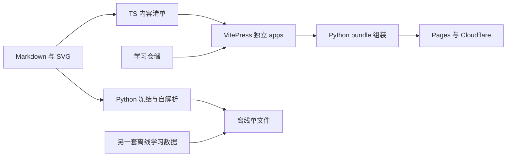

# 路书 Lubook 项目进度、架构与质量审查报告

审查日期：2026-10-21（Asia/Shanghai）  
项目位置：`E:\001_work\010-Doubao\lubook`  
审查基线：本地 `main`，提交 `c6f0002`（修复 Cloudflare 部署命令）  
审查方式：代码与文档交叉核查、三个方向的独立审阅、本地完整构建、内容质量门禁、存储故障注入、真实浏览器验证、公开站点访问。  
审查范围：现有门户、硬件分册、共享包、Python 工具链、CI/部署定义、嵌入式规划；硬件知识做重点抽样，不宣称全书逐章专业认证。

## 1. 结论与当前决策建议

**这是已经做出内容和交付物的知识产品，技术选型适合继续使用；但它目前更准确的阶段是“首本手册与门户可构建、可访问，正在补产品可靠性”，还不是“多分册框架和双形态体验已经完整验收”。**

建议保留 **Markdown/SVG + VitePress + pnpm workspace + Python 离线工具**。现阶段最有价值的工作是修复入口导航、知识准确性、用户数据可靠性和失效的验证契约，然后用第二本分册的小样验证复用能力。没有证据支持此时全面重写、引入后端或继续增加一批共享包。

本次最重要的证据：

- **本地 `pnpm verify:all` 通过，退出码 0**；门户和硬件分册均构建成功，硬件内容门禁通过，学习模块为 **43 个断言通过、0 失败**。
- **真实线上入口存在问题**：在 GitHub Pages 门户点击“硬件工程师手册”，地址变成 `/lubook/hardware/`，页面却显示 **`404 | 路书` / `PAGE NOT FOUND`**；直接访问或刷新分册地址可以加载分册。本地组装站同样重现。不能用 HTTP 200 代替点击验收。
- **本次重新生成的离线页存在 102 处 KaTeX 错误、43 个仍指向 `.md` 的跨章链接**。这些问题没有被当前全量验证发现。
- **模拟存储写入失败时，导入仍返回成功，重建仓储后数据消失**；新分册不声明旧键也会迁入硬件历史数据，实验得到 `total=1, done=2, pct=200`。
- **安全用电、示波器接地和 LTspice 命令有具体可定位的问题**，需要先做内容勘误，不能将“格式检查通过”解释为专业内容正确。

建议下一步批准的工作范围是“可靠性修复与第二分册试点”，而非一次铺开两本大部头新教材。

## 2. 实际项目进度

### 2.1 按交付能力盘点

| 领域 | 本次可证实的状态 | 依据与边界 |
|---|---|---|
| Lubook 品牌和门户 | 代码已实现，公开首页可访问 | `apps/portal`、门户配置和浏览器截图；但进入分册的点击路径有 F01 问题 |
| 硬件手册 | 140 章正文、411 SVG，内容资产已形成 | SUMMARY、磁盘统计、manifest 与快照一致 |
| 在线分册 | 构建成功，代表页的公式、图片、图表正常 | 实测首章、RC 章；不是 140 章逐页视觉验收 |
| 离线单文件 | 能构建，140 章、418 处图片引用对账通过 | `dist/hardware.html`；存在 F06/F07/F08 的体验与数据缺口 |
| 学习进度/收藏/笔记 | 已有仓储接口、UI、导入导出和迁移测试 | 正常路径可用，持久化失败反馈与新分册隔离不完整 |
| 共享框架 | 配置、主题、内容内核、学习仓储已拆分 | `packages/*` 实际有代码；复用到第二本真实分册尚未全链路验收 |
| CI/部署 | 有质量 workflow、Pages workflow、Cloudflare workflow | Pages 自动、Cloudflare 当前手动触发；部署未依赖质量门禁成功 |
| 嵌入式 MCU 分册 | 规划/大纲阶段 | 尚无 `apps/embedded`；门户卡片 `available:false` |
| 嵌入式 Linux 分册 | 规划/大纲阶段 | 尚无 `apps/embedded-linux`；门户卡片 `available:false` |
| 可复现实验资产 | 正文有算例与实验指引，受跟踪的工程附件不足 | 未发现受 Git 管理的 `.asc/.cir/.net/.c/.elf/.ioc/.kicad_sch/.kicad_pcb` 文件 |
| components / svg-kit | 明确的后续占位包 | 不应计为已经交付仿真、计算器或完整图形组件库 |

**不建议给整个项目打一个“完成 80%”之类的数字。** 尚无统一的最终需求分母；“硬件内容产量”“框架复用能力”“功能可靠性”“下一本书进度”是不同维度，应分别验收。

### 2.2 内容规模核验

| 篇目 | 章节数 |
|---|---:|
| 电路基础 | 14 |
| 元器件 | 13 |
| 模拟电路与运放 | 33 |
| 数字电路 | 12 |
| 单片机硬件 | 13 |
| 电源设计 | 12 |
| PCB/EMC | 13 |
| 测量调试与工程实践 | 12 |
| 题库 | 9 |
| 附录 | 9 |
| **总计** | **140** |

另核实到：411 个 SVG、418 处图片引用、93 个 ECharts 围栏、996 个教学容器、542 个 `<details>`。内容指纹为 `sha256-361225735a3a67f4`，路由快照 141 条，接地符号统计 247 个。

这些数字证明资产存在、结构一致，不证明每张图的电气连接与每个技术结论正确。

## 3. 本次实际执行的验证

### 3.1 环境与结果

本次使用 Windows、Node `24.19.0`、pnpm `12.11.2`、Python `3.12.14`、Edge `155.0.4283.62`。项目文档要求 Node 22；因此这里证明的是上述本机环境通过，不代替 Node 22/Linux CI 的运行结果。系统直接调用的 pnpm 是 11.25.0，审查使用了 `corepack pnpm` 提供的项目指定版本，没有换用 npm/yarn。

| 验证 | 本次结果 | 解释 |
|---|---|---|
| `pnpm verify:all` | **退出 0** | portal、hardware 在线构建 + 硬件质检 + 离线构建 + learning 测试通过 |
| `python run_quality.py --app hardware` | **退出 0，0 项失败** | 140 章，0 硬错误；1 条首页未进 SUMMARY 的已知提醒 |
| 路由/内容快照 | **一致** | 路由 141=141，revision 一致 |
| learning 测试 | **43 passed, 0 failed** | 当前脚本的断言数，不能当作 43 个完整用户流程 |
| 模板 `validate.py --src templates/site-template/docs` | **退出 1，4 个硬错误** | 缺 id/order/status/sources；其中部分字段与当前规范矛盾 |
| 不存在源目录的 `run_quality` | **退出 0** | 错误地被当作门户跳过检查，见 F12 |
| 存储故障注入 | **复现“成功但未持久化”** | 返回导入成功，重建实例后 `done` 从 1 变为 0 |
| 新分册迁移实验 | **复现硬件数据串入** | 未声明 legacyKeys，新书 1 章却 `done=2,pct=200` |
| 离线浏览器 | **3586 个公式占位中，102 个 `.katex-error`** | 90 个与 `<`/`>` 等实体相关，另 12 个与单引号实体 `&#x27;` 相关 |
| 离线内部链接扫描 | **43 个 `.md` 链接** | 没有转换为单文件内的章节锚点 |
| 在线首章，1440/390 宽 | 代表页正常 | 首章 0 数学错误、0 破图；390px 下文档宽度 390，无整页横向溢出 |
| 在线 RC 章 | 代表图表正常 | 1 个 ECharts canvas，图表容器 686×358，0 数学错误、0 破图 |
| 门户→硬件卡片点击 | **本地与 GitHub Pages 线上均出现 404** | 刷新同一地址恢复分册，见 F01 |

公开 HTTP 访问实测：门户 `https://gold99lt.github.io/lubook/`、首章 `.html` 深链接、`https://lubook.pages.dev/` 均返回 200，标题符合对应页面。Cloudflare 仅检查首页可达，未完成其全部交互测试。

GitHub Actions 运行记录 API 本次返回 **403 rate limit exceeded**，所以没有把“线上最新部署 SHA”“最近一次 CI 全绿”“仓库保护规则已经启用”写成已核实事实。也没有新执行安装依赖、干净 clone 或部署操作。

### 3.2 证据文件

本地辅助证据保存在 `.generated/review-2026-10-21/`（生成目录已被忽略，不纳入源码）：

- `verify-all.log`：完整验证输出和退出码。
- `learning-probes.mjs`、`learning-probes.json`：只使用内存存储的缺陷复现脚本及结果。
- `offline-browser-findings.json`：102 条数学错误及 43 个链接的逐项记录。
- `browser-smoke.json`：代表页、视口、数学/图表/图片检查数据。
- `live-cross-app-navigation.json`、`cross-app-navigation.json`：跨 app 点击与直接加载的对照。
- `portal-click-404.png`、`live-portal-click.png`、`offline-math-error.png`：问题截图。
- `portal-desktop.png`、`online-first-chapter-desktop.png`、`online-first-chapter-mobile.png`：代表页截图。

这些是可清理的本地证据。需要长期保存或交给别人复核时，应将该目录与本报告一起归档；不能仅分享报告后期待生成目录在其他机器存在。

## 4. 已确认的主要问题与改进建议

优先级定义：**P1** 为优先处理的用户入口、知识安全、数据可靠性或发布控制问题；**P2** 为应在扩展新分册前补齐的功能与框架问题；**P3** 为后续维护改进。不将所有建议都当作同等紧急。

### F01 · P1：门户卡片跨分册导航显示 404

**证据：** [PortalHome.vue:12](/E:/001_work/010-Doubao/lubook/packages/theme/src/components/brand/PortalHome.vue:12) 生成 `hardware/` 链接，卡片使用普通站内 `<a>`；门户与分册实际上是两次独立 VitePress 构建。门户的单页路由接管了点击，使用门户自己的页面清单解释分册路径。

本地组装站与线上 `https://gold99lt.github.io/lubook/` 均重现：

```text
点击前：路书门户
点击卡片：URL -> /lubook/hardware/
点击后：title = 404 | 路书；h1 = PAGE NOT FOUND
直接打开/刷新分册地址：可以加载硬件分册
```

**影响：** 用户从主入口进入现有唯一分册就可能失败；只测深链接 200 会漏掉这一故障。

**建议：** 独立 app 之间明确采用完整页面导航，例如在跨 app 卡片的点击处理里使用 `location.assign`；app 内部章节继续用 VitePress 路由。不要依赖门户的 SPA 路由跨入另一套构建。回门户、跨分册引用也按同一边界处理。

**验收：** `/` 和 `/lubook/` 两种部署 base 下，实际点击“门户→硬件→章节→回门户”，均显示正确主题和内容，无客户端 404；直接加载和刷新同样通过。

### F02 · P1：安全用电章节存在不准确且会误导实践的表述

**证据：** [electrical-safety.md:57](/E:/001_work/010-Doubao/lubook/apps/hardware/docs/basics/electrical-safety.md:57)、第 65、66、73、81 行。

- “工频交流与心脏搏动频率接近”：50/60 Hz 与约 1 Hz 的正常心跳不接近，不能用这个说法解释致颤危险。
- 以固定 `100kΩ` 估计人体电阻，得出接触 220V “只是麻”：人体与接触阻抗受电压、接触面积、环境、时间等影响，这种演算不能转化为市电接触安全保证。
- RCD “能在到达致命电流前切断”：RCD 不限制触电电流瞬时达到多少，主要是在适用故障条件下缩短持续时间；也不保护所有触电路径。
- “电笔验电确认 L/N 都断”不足以构成面向初学者的完整失电确认流程。

**依据：** [HSE 电气安全 FAQ](https://www.hse.gov.uk/electricity/faq.htm) 明确 RCD 只能减少某些电击的能量，不能保护所有电击；[OSHA 1910.333](https://www.osha.gov/laws-regs/regulations/standardnumber/1910/1910.333) 要求由合格人员用适当测试设备核实失电，并考虑反送电和储能。引用 OSHA 是说明工程原则，不是将其当作中国读者直接适用的法规。

**建议：** 单独发起内容勘误，去掉绝对安全承诺，准确区分电流、路径、持续时间、阻抗和保护措施；高压/市电相关内容由有实际电气安全经验的人独立核对。现有“内容冻结”应作为重构阶段约束，不能成为永久拒绝必要纠错的理由；本次未修改正文。

### F03 · P1：示波器接地建议缺少适用前提

**证据：** [oscilloscope.md:27](/E:/001_work/010-Doubao/lubook/apps/hardware/docs/practice/oscilloscope.md:27)、第 31、154 行，将探头地夹/接地弹簧直接连接 DUT GND，并泛化到开关节点测量，但没有交代普通台式示波器的地夹与保护接地的关系。

**影响：** 对隔离低压板正确的操作，可能被初学者照搬到非隔离电源初级热地。缩短地线只能改善测量环路，不能解决接地电位和额定类别问题。

**依据：** 本章自己的来源 [Tektronix ABCs of Probes](https://www.tek.com/vn/documents/whitepaper/abcs-probes-primer) 说明普通探头地夹应接 earth ground，不能破坏仪器保护接地；其他电位的测量须选适用且额定合适的方案。

**建议与验收：** 明确低压隔离电路的教学前提，区分普通无源探头、差分探头、隔离测量的边界；审查同类电源与测量章节，而不是仅给这一段补一句笼统提醒。

### F04 · P1：存储失败后仍提示保存/导入成功

**证据：** [learning/index.ts:224](/E:/001_work/010-Doubao/lubook/packages/learning/src/index.ts:224) 的 `persist()` 捕获写入异常后只输出警告；第 487 行调用后继续返回成功。[ChapterLearning.vue:36](/E:/001_work/010-Doubao/lubook/packages/theme/src/components/learning/ChapterLearning.vue:36) 无条件显示“已保存”。

本次向注入存储的 `setItem` 添加模拟 `QuotaExceededError`，得到：

```text
importData -> ok:true, message:导入成功（merge）
当前内存 -> done=1
新建仓储实例 -> done=0
底层持久化值 -> null
```

**影响：** 浏览器禁止写入、额度耗尽等条件下，用户相信笔记已经保存，刷新后却消失。

**建议：** 让持久化结果进入仓储接口和 UI；失败时清楚显示“尚未保存”，允许立即导出。导入操作在持久化成功前不应报告最终成功。补充写入失败、恢复重试、刷新重载测试。

### F05 · P1：质量门禁失败不一定阻止生产发布

**证据：** [deploy-docs.yml:3](/E:/001_work/010-Doubao/lubook/.github/workflows/deploy-docs.yml:3) 对 main 独立触发，第 52 行仅构建 bundle，随后上传部署；[quality.yml:80](/E:/001_work/010-Doubao/lubook/.github/workflows/quality.yml:80) 的快照/离线/learning 检查在另一个独立 workflow。Cloudflare 的手动发布同样未依赖完整质量检查。

**影响：** 一个“能构建，但快照或学习测试失败”的提交仍可能被发布。不能把“仓库有 Quality Gate”理解为部署受它控制。本次没有核实远端分支保护设置。

**建议：** 在同一 workflow 或可复用 workflow 中，让部署 `needs` 验证成功，且二者锁定同一 SHA。先把当前验证接到发布前，再增加 F01/F06 对应的少量实际浏览器检查。没有必要先建设复杂发布平台。

### F06 · P2：离线数学公式二次转义，102 处渲染失败

**证据：** [build_single_html.py:151](/E:/001_work/010-Doubao/lubook/packages/tooling/src/build_single_html.py:151) 先对整行 `H.escape`，第 155–156 行又对公式属性转义。

```text
原公式：A>B
HTML 属性：data-t="A&amp;gt;B"
浏览器拿到：A&gt;B
KaTeX：Expected EOF, got &
```

本次 Edge 实际读取重新构建的 `dist/hardware.html`，3586 个公式占位中有 **102 个 `.katex-error`**；90 个包含比较符等命名实体，12 个包含单引号实体。错误分布和原文已逐项写入 `offline-browser-findings.json`。不是仅凭正则猜测公式可能出错。

**建议：** 先保护/分词提取原始公式，再分别对正文和属性各编码一次。用真实章节片段覆盖 `<`、`>`、`&`、单/双引号和块公式；在浏览器断言 KaTeX 错误数，而非只检查源文件字符。

**验收：** 现有 102 处错误归零；相同原稿在线、离线的代表公式含义和显示一致。

### F07 · P2：离线跨章链接没有转换

**证据：** [build_single_html.py:162](/E:/001_work/010-Doubao/lubook/packages/tooling/src/build_single_html.py:162) 原样输出目标；[impedance.md:59](/E:/001_work/010-Doubao/lubook/apps/hardware/docs/basics/impedance.md:59) 指向 `math-basics.md`。离线成品共 **43 处**此类链接。

**影响：** 点击后尝试打开 `dist/math-basics.md` 等本不存在的文件，无法跳到已内嵌的章节。

**建议：** 建立规范化的章节相对路径→离线锚点映射；内部链接转为单文件内跳转，外链才使用新窗口。还应覆盖 `../`、章节内锚点、跨分册目标不存在时的明确行为。

**验收：** 43 个现有内部链接全部命中目标；输出中无悬空章节路径。

### F08 · P2：离线备份缺少恢复闭环，与在线备份格式分裂

**证据：** [build_single_html.py:813](/E:/001_work/010-Doubao/lubook/packages/tooling/src/build_single_html.py:813) 导出 `{exportedAt,learned,starred,notes}`，离线没有对应导入流程；在线 [learning/index.ts:432](/E:/001_work/010-Doubao/lubook/packages/learning/src/index.ts:432) 要求 `appId/schemaVersion`，使用路径 id 和另一套笔记结构。本次在线仓储拒收离线形态的备份，原因是 `appId=undefined`。

**影响：** “导出备份”不等于用户可以用现有产品恢复；在线与离线之间也没有学习记录搬运闭环。

**建议：** 先明确双形态的数据承诺。若要互通，统一版本化导出协议，提供旧离线 id→章节路径的兼容映射和离线导入；做“导出→清空→导入→刷新”的往返验收。只统一数据协议，不必把 Python 构建重写为 Node。按当前规则，修改格式前应补 ADR。

### F09 · P2：新分册隐式迁入硬件旧数据

**证据：** [learning/index.ts:198](/E:/001_work/010-Doubao/lubook/packages/learning/src/index.ts:198) 将 `hh.v1.learning` 无条件加入所有 app 的迁移源，与 ADR-0006 的“新 app 默认无旧键”不一致。

内存实验：给旧键放入两个硬件已学章，创建总章数为 1、未传 legacyKeys 的新 app，得到 `done=2,pct=200`，硬件笔记也写进新 app 的键。当前门户没有学习仓储，不受本项影响；主要阻碍后续分册。

**建议：** 迁移来源完全由 app 显式声明；已知章节集合应从 catalog 注入，不能只从历史存储播种。增加两个 app 共用 Storage、空迁移源、未知历史 id 的测试。不要只将百分比截到 100%，那会掩盖串数据。

### F10 · P2：第二分册“复制模板即可用”的契约尚不成立

| 缺口 | 代码依据 | 本次结果/触发条件 |
|---|---|---|
| 模板显式 `base:'/'` 覆盖按 app 派生的 base | [模板 config:20](/E:/001_work/010-Doubao/lubook/templates/site-template/docs/.vitepress/config.mts:20)、`shared-config/src/index.ts:397` | 部署到 `/lubook/embedded/` 时仍引用根路径资源；独立根路径构建测不出来 |
| validator 与规范矛盾，模板自身也不完整 | [validate.py:43](/E:/001_work/010-Doubao/lubook/packages/tooling/src/validate.py:43)、`packages/tooling/AGENTS.md:17`、模板 `hello.md:1` | 模板实际校验 4 个硬错误：id/order/status/sources；id/status/sources 与当前规范不一致，order 应补齐 |
| 动态发现 apps 后，仍调用手写根脚本 | `verify_all.py:56`、`build_pages_bundle.py:49`、根 `package.json:12` | 新 app 没有 `build:<app>` 就失败；CI 矩阵和内容门禁仍固定 portal/hardware |
| 离线运行 id 仍按 basename/旧 frontmatter | `build_single_html.py:185`、`:894` | 未来出现 `foo/intro.md` 和 `bar/intro.md` 时离线 id 冲突；现有 140 章未发现该冲突 |

**建议：** 用一个明确的 app registry 或 workspace 契约登记 `slug/kind/package/contentRoot`，由其驱动构建、门禁、门户可用性；统一一份可执行内容 schema。模板必须过 **嵌套 base + quality + offline + 学习隔离**，不能只跑一次在线 build。

不建议为迁就旧校验器给 140 章强行回填字段；应修正执行规则和规范的冲突。新分册离线 id 的统一属于数据兼容变更，先写 ADR 和迁移样例。

### F11 · P2：内容一致性门禁的保证弱于文档描述

**证据：**

1. [content-core/package.json:15](/E:/001_work/010-Doubao/lubook/packages/content-core/package.json:15) 的 manifest/parity 命令仍指向根 `docs`，那里已经没有 SUMMARY；调用实际报 `ENOENT docs/SUMMARY.md`。
2. [parity.ts:19](/E:/001_work/010-Doubao/lubook/packages/content-core/src/parity.ts:19) 固定旧 revision `sha256-4c8521761e575941`，当前为 `sha256-361225735a3a67f4`。
3. TS 构建生成 manifest 后，`verify_all.py:67` 又运行 Python freeze 覆盖同名 manifest；后续离线对账没有构成独立 TS/Python 解析器一致性证明。
4. [build_single_html.py:880](/E:/001_work/010-Doubao/lubook/packages/tooling/src/build_single_html.py:880) 仅比较数量、路径序列、标题和图片引用数；不重算正文 checksum，最后直接打印传入的 revision。显式给错 manifest 路径还会告警后跳过，而非失败。
5. [content-core/index.ts:283](/E:/001_work/010-Doubao/lubook/packages/content-core/src/index.ts:283) 的 overall 只包含章节文件 checksum，SVG 字节未纳入；同文件路径下改图中电阻值，文件/接地数量不变时，不一定改变 revision。

**建议：** TS 与 Python 分别输出临时清单，比较 appId、revision、逐章字段与资源路径/哈希；明确“内容版本一致”与“渲染结果正确”是两层验收。指纹格式变化单独版本化，不要求改正文。作为门禁调用时，清单缺失必须失败，开发时才允许显式选择宽松模式。

### F12 · P2：源目录错误时质检可以零检查通过

**证据：** [run_quality.py:94](/E:/001_work/010-Doubao/lubook/run_quality.py:94) 仅用 SUMMARY 是否存在判别内容 app；第 132 行把缺失视为门户并跳过全部内容检查。

本次执行一个不存在的 `--src`，输出 `内容 app=False`、`0 项失败`，退出码 **0**。

**建议与验收：** 从显式 app 类型判定 portal/content；内容 app 的源目录或 SUMMARY 缺失必须非零退出，门户的合法跳过应有单独日志和测试。测试必须同时覆盖“不存在目录”和“存在目录但遗漏 SUMMARY”。

### F13 · P2：LTspice 自动读时间常数的例子无法支撑教学结论

**证据：** [ltspice.md:30](/E:/001_work/010-Doubao/lubook/apps/hardware/docs/practice/ltspice.md:30) 输入为 0→5V；第 47 行 R=1kΩ、C=1µF、τ=1ms；第 58 行却写 `.measure t_when WHEN Vout=0.63`，称其读出 63% 时刻。

```text
5V 的 63.212% ≈ 3.1606V
0.63V 对应的理想 RC 时间 = -1ms × ln(1 - 0.63/5)
                           ≈ 0.134675ms，不是 1ms
```

此外命令缺少合适的分析类型和节点电压表达式。可给出类似 `.meas TRAN t63 WHEN V(Vout)=3.1606 RISE=1` 的完整实例，配套固定输入与初始条件；本次只进行了数学复核，未实际启动 LTspice 仿真，不能把该建议写成已运行结果。

**审核方法问题：** [REVIEW-round2-part8.md:28](/E:/001_work/010-Doubao/lubook/reviews/REVIEW-round2-part8.md:28) 已指出原命令非实际语法，却以“教学性写法可接受”放行；第 39 行又宣布整篇通过。对面向初学者的可复制命令，这个验收标准不合适。

**建议：** 至少给 RC 仿真、一个运放/滤波电路、一个安全低压测量各配一份可运行工程、输入条件和预期数值。命令应执行过再称“可运行”，图示与计算不应替代执行证据。

### F14 · P2：进度文档相互矛盾，容易让下一位 AI 重做已完成工作

**证据：** `REQUIREMENTS.md:59` 仍把 Monorepo 标为待执行，第 64 行把门户当后续工作；`ARCHITECTURE.md:285`、`CHANGELOG.md:5` 仍说品牌分支未 push、待核实，而实际本地已在包含品牌合并提交的 main，公开 Lubook 入口也存在。`EMBEDDED_PLAN` 仍保留旧路径和已经落地的前置任务。

**建议：** 新设一张简短的当前状态表：每项标记“仅规划/代码存在/本地验证/线上验证”，附提交和证据。历史方案保留原文但标记为历史，不再同时充当当前操作手册；CHANGELOG 区分实施历史与当前发布状态。未跟踪的 `EMBEDDED_OUTLINE.md` 若要成为团队依据，应在评审后进入版本管理。

### F15 · P2：bundle 输出目录缺少边界检查

**证据：** [build_pages_bundle.py:69](/E:/001_work/010-Doubao/lubook/packages/tooling/src/build_pages_bundle.py:69) 接收任意绝对化输出路径；第 92 行直接 `shutil.rmtree(out)`。若误传仓库根或 `apps`，会递归删除源码目录。默认 `.bundle` 正常；本次没有执行破坏性复现。

**建议：** 在删除前拒绝仓库根、源码、祖先目录和无生成标记的目录；先完成临时 staging，再替换允许的输出目录。用临时测试目录验证路径拒绝规则，不对真实源码做破坏性试验。

## 5. 整体框架重新评估

### 5.1 值得保留的设计

1. **内容与展示分开。** Markdown/SVG 便于版本管理、审阅、长期保存，也能同时服务在线和离线交付。
2. **VitePress 适合当前产品。** 阅读、搜索、目录、公式和静态部署已有成熟基础，不需要自建整个前端应用框架。
3. **Monorepo 的包边界基本合理。** 主题通过 CatalogProvider/LearningRepository 接口接收数据，没有直接 import 硬件 app 的 sidebar；共享配置和内容内核有明确用途。
4. **Python 离线工具值得保留。** 纯标准库构建、内联资源适合无需服务端的离线分发；问题在契约与验证，不在语言本身。
5. **快照、换行归一化、ADR 有实际价值。** 它们已经帮助保护内容搬迁，应保留并修正保证范围。

### 5.2 当前真正的框架缺口



当前不是缺少更多层，而是已有层之间有四条未闭合的契约：

| 契约 | 当前缺口 | 建议的最小收口 |
|---|---|---|
| app 契约 | 目录发现、根脚本、CI、门户卡片各自维护；跨 app 路由边界不清 | 单一 app registry；独立 app 间完整导航；各 app 统一构建接口 |
| 内容契约 | TS/Python/validator/模板对字段、id、revision 的理解不一致 | 一份可执行 schema + 一组跨两种解析器的真实 fixture |
| 学习数据契约 | 在线/离线不同 schema，隐式迁移，写失败不反馈 | 版本化导入导出协议、显式旧键、明确持久化结果 |
| 发布契约 | “质量通过”与“允许发布”脱节，当前 smoke 只查 200 | 同 SHA 先验后发；加入少量跨 app 点击与代表页渲染检查 |

不需要把所有应用合并成一套复杂 SPA，也不需要把所有包重新拆一次。先证明这四条契约成立。

### 5.3 暂不作为本期缺陷扣分的事项

- `release.json`、单 artifact 双发在 ADR-0005 里明确属于 Proposed/后续方案；可建议，但不能说这是已经承诺完成却遗漏的功能。
- 没有后端、云同步、IndexedDB、全站仿真，不是当前阅读产品天然的架构缺陷。是否需要它们，应由具体用户任务决定。
- “共享包越多”不是质量目标；`components/svg-kit` 占位可以保持不动。
- 内容零修改是此次重构的验收约束，不等于未来不允许勘误、新增章节或提升教材质量。

## 6. 如果由我实施，会怎样推进

### 阶段 A：先把现有用户路径修到可信

**目标：** 用户从门户进入手册、阅读公式、跳转章节、保存和恢复笔记都能完成。

范围：F01、F04、F06、F07、F08，以及 F02/F03 的内容勘误。代码修复和知识勘误分成小批次，便于审核和回退。涉及导出格式/id 先写 ADR；本报告不替代变更授权。

验收至少包括：

- 门户与分册双向点击正常；`/` 和 `/lubook/` 都通过。
- 现有离线 102 个公式错误清零、43 个跨章链接全部有效。
- 在线与离线各完成一次“写笔记→刷新→导出→清空→导入→刷新”。
- 注入存储失败时，不显示“已保存/导入成功”。
- 安全与测量章节有具体来源、修改前后对照和独立专业复核。

### 阶段 B：把多分册地基收口，不继续扩框架层数

范围：F05、F09、F10、F11、F12、F15。使用 app registry 驱动统一验证；模板 schema、离线 id、资源指纹和迁移规则形成明确契约。

建议只先维护一组小但真实的 fixture：两目录同名章节、相对图片、公式比较符、块公式、表格、图表、details、跨章/跨分册链接、旧版学习数据。两种渲染器都必须处理这些样例。

验收：一份干净 checkout 按 PLAYBOOK 完整通过；删除 SUMMARY、输入错误清单路径、破坏学习测试时确实失败；失败提交不能进入部署步骤。默认 Node 22/Linux 与本机环境分别记录结果。

### 阶段 C：用一个真实第二分册做纵向试点

先交付 MCU 的 3–5 章及对应最小工程，证明从写作到交付整个流程，而不是先写完 100 章。

建议试点顺序：

1. 固定一块可获得的 Cortex-M 开发板与工具链版本，完成环境和最小工程。
2. 解释并复现“复位到 main”：启动文件、链接脚本、map、串口或调试输出。
3. GPIO/定时器/中断中的一个可观察实验，给寄存器或 HAL/LL 的明确边界。
4. 一个 DMA/通信场景，包含错误条件与排查。
5. 一个简单 RTOS 场景，展示任务、同步、栈与超时。

通用概念与 STM32 主例结合，ESP32 等平台先做差异专栏。不要要求每个概念都同时维护多个平台的完整工程。

**出门条件：** 另一台机器、另一位读者能照文档复现；第二分册在两套 base、两种交付形态、同一浏览器多分册学习隔离下全部通过；然后才将门户卡片设为可用。

### 阶段 D：Linux 小样可以独立调研，但按环境分别验收

保留 MCU 与 Linux 分册分开的决定。Linux 先用 QEMU 完成“交叉编译→启动→用户程序→一个系统机制”的软件闭环，再选择真实板卡做 GPIO/I²C、设备树和外设实验。

QEMU virt 不能自动等价为真实开发板；每个实验写清楚适用平台，不能把接 LED、传感器的步骤默认放进 QEMU 教程。

原规划中的 5 章 MCU、4 章 Linux 试点方向合理；不建议现在同时大批量生成 90–115 章 MCU 与 40–60 章 Linux。可以并行做调研、技术核实和代码验证，正文扩产应服从试点反馈。

### 阶段 E：按读者的真实问题决定新增能力

先收集“找不到知识点”“实验复现失败”“笔记迁移困难”等具体问题，再决定是否增加跨册搜索、更多交互、后端或其他功能。

Mermaid 若进入新分册，必须同时设计在线和离线显示与导出；它是一个明确的新渲染需求，不是无限延长框架重构的理由。

## 7. 对项目持续推进的指导意见

### 7.1 把“内容生产”和“工程建设”分成两条可验收的线

工程线关注构建、数据、路径、发布；内容线关注正确性、适用条件、来源和复现。工程线全绿不能自动签署内容线，内容写完也不能代替产品操作验收。

每个 AI 任务开始时写清楚：要解决的读者问题、允许修改范围、不可改变的约束、交付物、验证方法。结束时必须提供实际命令/结果、文件路径、未验证范围；不要只写“已完成/已自审”。

### 7.2 以小批次可复现成果替代章节数量竞赛

建议先用 RC 仿真、运放/滤波、安全低压测量三个实验建立模板：器材和版本、完整输入、步骤、预期数值范围、实际结果、误差原因、故障注入、参考来源。

对 MCU/Linux，重要代码放入受版本管理的示例工程，记录编译命令与预期日志；文章只引用关键片段，避免复制后悄悄漂移。代码 CI 能编译也不代表实板已验证，二者状态分别记录。

### 7.3 来源应支持具体结论，不只支持章节主题

对于电气安全、器件极限、时序、内核特性等结论，给出具体官方文档章节或适用条件。不要把引用一本书或一个厂商首页当作整段结论的证明。

例如 `EMBEDDED_PLAN.md:84` 对 M23/M33 与 PAC/BTI/MVE 的绑定需要按内核代际重核；[Arm Cortex-M33](https://www.arm.com/products/silicon-ip-cpu/cortex-m/cortex-m33) 与 [Cortex-M85](https://www.arm.com/products/silicon-ip-cpu/cortex-m/cortex-m85) 的官方能力边界不同。新大纲补了 M85，不等于旧规划中的表述自动正确。

### 7.4 用一张状态表管理进度

建议在现有 README/PLAYBOOK 中保留唯一的当前状态入口，不必再写一份庞大架构文档。表格字段保持简单：

```text
任务 | 状态 | 负责范围 | 验收证据 | 对应提交 | 下一步
```

状态至少区分“规划”“实现”“本地验证”“线上验证”。截图要对应 SHA 与 base，测试记录要写环境。`EMBEDDED_OUTLINE.md` 当前未跟踪，若被采纳应正式归档，避免多机漏传。

### 7.5 让失败案例成为验证的一部分

先补少量高价值场景，而不是大量与实现逐行相同的测试：

- 点门户卡片，而不仅是 curl 首页。
- 导入失败后刷新，而不仅是检查返回值。
- 新 app 无 legacyKeys，而不仅是验证 hardware 正常迁移。
- 模板跑全门禁，而不仅是 build。
- 指定不存在的源目录/清单，确保失败。
- 验证公式的实际 DOM，而不仅是计数和文本哈希。

### 7.6 控制下一阶段范围

现有架构已经足以支持下一个试点。暂缓后端、云同步、仿真平台、全站题库系统、大规模组件抽象和多平台全面对照。每次新增能力都应回答“它解决了哪一个已经观察到的读者问题，以及如何验收”。

## 8. 建议交给下一轮实施的任务清单

| 批次 | 任务 | 完成凭据 |
|---|---|---|
| 1 | F01 门户跨 app 导航 | 两种 base 下实际点击录屏/截图与浏览器断言 |
| 2 | F02/F03 安全与测量勘误，F13 可运行命令修订 | 来源、修改前后、独立复算/专业审核；仿真另附执行证据 |
| 3 | F04/F08/F09 学习数据可靠性 | ADR、失败注入、跨 app 隔离、导出导入往返与刷新结果 |
| 4 | F06/F07 离线渲染和链接 | 102 个数学错误归零、43 个跨章链接有效、代表页回归 |
| 5 | F05/F10/F11/F12/F15 框架与发布门禁 | 模板全量通过、错误输入确实失败、同 SHA 验证后发布 |
| 6 | F14 状态文档收口 | 一份当前状态入口，历史方案标记清楚，无重复前置任务 |
| 7 | MCU 小样，随后 Linux 小样 | 完整工程与另一位读者/另一台机器的复现记录 |

这些批次可在互不冲突的文件范围并行，但涉及共享数据 schema、内容 id 和发布 topology 的决策应先统一，避免多个 AI 各自实现不兼容协议。

## 9. 可复核命令与本次操作边界

以下命令从项目根运行；需先使用项目规定的 pnpm，并确保 `python` 指向可用解释器：

```powershell
corepack pnpm --version
corepack pnpm verify:all
python run_quality.py --app hardware

# 本次已确认失败：模板与当前校验规范冲突
python packages/tooling/src/validate.py --src templates/site-template/docs

# 本次已确认错误通过：不存在目录仍返回 0
python run_quality.py --app hardware --src .generated/review-2026-10-21/nonexistent

# 本地辅助复现，不访问用户浏览器数据，只使用内存存储
node .generated/review-2026-10-21/learning-probes.mjs
```

浏览器复核：访问 `https://gold99lt.github.io/lubook/`，点击硬件卡片；再直接刷新目标地址对照。离线打开 `dist/hardware.html`，查看控制台运行 `document.querySelectorAll('.katex-error').length`，本基线结果为 102。

完整验证使用了一份位于忽略目录内的临时 pnpm 启动脚本，使子进程也使用已可用的 12.11.2；没有改项目 package.json、锁文件或系统工具配置。重建了在线/离线生成物和本地审查证据，未修改生产源码、140 章正文、411 SVG、快照基准，也未提交、push、部署或修改远程项目设置。原有未跟踪 `EMBEDDED_OUTLINE.md` 保留。

本报告的判断限于所列基线和验证范围。它支持立即修复已复现的问题、继续复用当前架构，并用真实第二分册的小样决定后续扩展；不构成对全书技术结论、所有浏览器、所有部署环境的全面认证。
